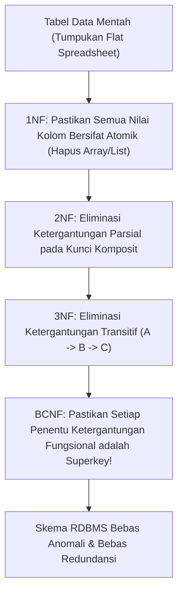

# Modul 158: Teori Normalisasi & Perancangan Skema Data (1NF s/d BCNF, Analisis Denormalisasi Terkontrol)

**Navigasi**: [⬅️ Master Index](../../INDEX.md) | [Tingkat 10: Tingkat 10: Basis Data, Data Engineering & Sistem Informasi Enterprise](./README.md)
*Sebelumnya*: [157. fondasi-teoretis-basis-data-model-relasional](./157-fondasi-teoretis-basis-data-model-relasional.md) | *Berikutnya*: [159. penguasaan-sql-tingkat-lanjut](./159-penguasaan-sql-tingkat-lanjut.md)

---

## 1. Intuisi Dasar Tanpa Jargon ("Seperti Bayi Baru Lahir")
### 1.1 Anomali Data: Mimpi Buruk Redundansi ([Normal Forms in DBMS](https://www.geeksforgeeks.org/normal-forms-in-dbms/))
Bayangkan Anda menyimpan data kampus dalam satu spreadsheet tabel tunggal: setiap kali ada mahasiswa baru yang mengambil mata kuliah, Anda harus mengetik ulang Nama Mahasiswa, Alamat, Nama Dosen, dan Gelar Dosen.
Tiba-tiba terjadi 3 malapetaka anomali:
1. **Anomali Pembaruan (Update Anomaly)**: Jika seorang dosen pindah ruangan kantor, Anda harus memperbarui 10.000 baris data mahasiswa. Jika ada 1 baris yang terlewat, database berada dalam keadaan inkonsistensi korup!
2. **Anomali Penyisipan (Insert Anomaly)**: Anda tidak bisa menambahkan data mata kuliah baru yang belum memiliki mahasiswa yang mendaftar.
3. **Anomali Penghapusan (Delete Anomaly)**: Jika mahasiswa terakhir yang mengambil mata kuliah tertentu lulus dan datanya dihapus, data mata kuliah dan dosen tersebut otomatis ikut terhapus dari muka bumi!

### 1.2 Sains Normalisasi: Membedah Tabel Menjadi Bebas Redundansi ([Fundamentals of Database Systems - Elmasri & Navathe](https://www.pearson.com/en-us/subject-catalog/p/fundamentals-of-database-systems/P200000003299))
Teori Normalisasi adalah metodologi matematis sistematis untuk memecah (*decompose*) tabel raksasa yang buruk menjadi beberapa tabel kecil yang elegan, berakar pada **Ketergantungan Fungsional (Functional Dependencies)**. Normalisasi menjamin bahwa setiap fakta disimpan tepat di satu tempat (*Single Source of Truth*), mengeliminasi seluruh anomali data dari 1NF, 2NF, 3NF, hingga Boyce-Codd Normal Form (BCNF).

## 2. Fondasi Teoretis & Aksiomatik / Matematis
### 2.1 Aksioma Armstrong & Penutupan Atribut (Attribute Closure) ([William W. Armstrong, 1974](https://dl.acm.org/doi/10.1145/321850.321852))
Sebuah Ketergantungan Fungsional $X \to Y$ menyatakan bahwa nilai atribut $X$ secara unik menentukan nilai atribut $Y$.
Aksioma Armstrong (Sound & Complete):
1. **Refleksivitas**: Jika $Y \subseteq X$, maka $X \to Y$.
2. **Augmentasi**: Jika $X \to Y$, maka $XZ \to YZ$.
3. **Transitivitas**: Jika $X \to Y$ dan $Y \to Z$, maka $X \to Z$.

Algoritma Penutupan Atribut (*Attribute Closure* $X^+$):
Himpunan seluruh atribut yang ditentukan secara fungsional oleh $X$ di bawah himpunan ketergantungan $F$:
$$X^+ = \{ A \mid F \models X \to A \}$$
Kunci Kandidat (*Candidate Key* $K$):
$K$ adalah superkey minimal: $K^+ = \text{All Attributes}$ dan $\forall A \subset K, \, A^+ \ne \text{All Attributes}$.

### 2.2 Hirarki Bentuk Normal Formal (1NF s/d BCNF) ([Elmasri & Navathe](https://www.pearson.com/en-us/subject-catalog/p/fundamentals-of-database-systems/P200000003299))
1. **Bentuk Normal Pertama (1NF)**:
   Setiap atribut harus bernilai atomik (tidak boleh ada array, set, atau grup berulang di dalam satu sel).
2. **Bentuk Normal Kedua (2NF)**:
   Relasi berada di 1NF dan **tidak memiliki ketergantungan parsial**: setiap atribut non-kunci harus bergantung sepenuhnya pada seluruh kunci utama, bukan pada sebagian kunci komposit:
   $$\forall (X \to A) \in F, \quad A \notin \text{Prime} \implies X \not\subset K$$
3. **Bentuk Normal Ketiga (3NF)**:
   Relasi berada di 2NF dan **tidak memiliki ketergantungan transitif**:
   $$\forall (X \to A) \in F, \quad (A \subseteq X) \lor (X \text{ adalah superkey}) \lor (A \text{ adalah atribut prime})$$
4. **Boyce-Codd Normal Form (BCNF)**:
   Bentuk normal ketat tanpa kompromi atribut prime:
   $$\forall (X \to A) \in F \text{ non-trivial}, \quad X \text{ WAJIB merupakan superkey murni}$$

## 3. Anatomi Teknis & Cara Kerja Internal


#### Tabel Walkthrough Eliminasi Anomali melalui Dekomposisi BCNF
| Skema Asal | Ketergantungan Fungsional | Pelanggaran Normal Form | Dekomposisi Solusi BCNF |
|---|---|---|---|
| `Courses(Student, Course, Teacher)` | `Student, Course -> Teacher` dan `Teacher -> Course` | BCNF Dilanggar (`Teacher` bukan superkey) | Pisahkan menjadi: 1. `TeacherCourse(Teacher, Course)` dan 2. `StudentTeacher(Student, Teacher)` |
| `Orders(OrderID, CustomerID, CustomerCity)` | `OrderID -> CustomerID` dan `CustomerID -> CustomerCity` | 3NF Dilanggar (Transitif via `CustomerID`) | Pisahkan menjadi: 1. `Orders(OrderID, CustomerID)` dan 2. `Customers(CustomerID, CustomerCity)` |

#### Tabel Penelusuran Korupsi Data Pesanan Ganda Akibat Ketiadaan Kunci Alami Unik (Unique Key)
| Transaksi Pembelian Pengguna | ID Pesanan (Surrogate Key) | Nomor Faktur Pembayaran | ID Pengguna | Total Pembayaran ($Rp$) | Status Pengecekan Duplikasi | Dampak Integritas Bisnis |
|---|---|---|---|---|---|
| Klik Tombol Beli Pertama | `order_id = 1001` (Auto-inc)| `INV-2024-001` | 42 | Rp 1.500.000 | Disimpan normal | Pesanan pertama tercipta |
| Jaringan Lambat (User Klik 2x)| `order_id = 1002` (Auto-inc)| `INV-2024-001` (SAMA!) | 42 | Rp 1.500.000 | **LOLOS KARENA ORDER_ID BEDA!**| **DUPLIKASI PESANAN TERCIPTA!** |
| Webhook Pembayaran Tiba | `order_id = 1003` (Auto-inc)| `INV-2024-001` (SAMA!) | 42 | Rp 1.500.000 | **Ketiadaan Constraint `UNIQUE(invoice_no)`!** | Kartu kredit nasabah ditagih ganda! |
| Gudang Memproses | Gudang kirim 2 barang fisik | Penjual merugi ganda | - | - | Rekonsiliasi keuangan selisih | Komplain nasabah dan sengketa chargeback |
| Mitigasi Skema | Pasang Natural Key Unik | `CONSTRAINT uq_inv UNIQUE(invoice_no)` | Basis data menolak order kedua | Database melempar error constraint | Transaksi duplikat tertolak instan |

## 4. Implementasi Praktis & Kode / Simulasi Riil
```python
def compute_attribute_closure(attributes: set[str], fds: list[tuple[set[str], set[str]]], initial_x: set[str]) -> set[str]:
    """
    Menghitung Penutupan Atribut (Attribute Closure X+) berdasarkan Aksioma Armstrong.
    fds: Daftar pasangan ketergantungan fungsional (X, Y) di mana X -> Y.
    """
    closure = set(initial_x)
    changed = True

    while changed:
        changed = False
        for lhs, rhs in fds:
            # Jika sisi kiri (LHS) adalah subset dari closure saat ini
            if lhs.issubset(closure):
                # Tambahkan sisi kanan (RHS) ke dalam closure
                new_attrs = rhs - closure
                if new_attrs:
                    closure.update(new_attrs)
                    changed = True

    return closure

# Contoh Uji: Skema R(A, B, C, D, E) dengan FDs: A -> B, BC -> D, D -> E
fds = [
    ({"A"}, {"B"}),
    ({"B", "C"}, {"D"}),
    ({"D"}, {"E"})
]

# Hitung penutupan dari {A, C}
closure_ac = compute_attribute_closure({"A", "B", "C", "D", "E"}, fds, {"A", "C"})
print("Penutupan Atribut {A, C}+ :", closure_ac)
# Output: {'A', 'B', 'C', 'D', 'E'} -> Karena mencakup seluruh atribut, {A, C} adalah Superkey!
```

## 5. Miskonsepsi & Jebakan Industri
### Studi Kasus Kegagalan Nyata: Over-Normalization pada Sistem E-Commerce yang Menghancurkan Latensi Checkout
- **Kronologi & Latar Belakang**: Sebuah platform marketplace global menormalisasi skema database transaksionalnya secara ekstrem hingga 6NF (memisahkan setiap atribut alamat, nomor telepon, dan status pesanan ke tabel mandiri). Saat pengguna membuka halaman riwayat pesanan, server harus mengeksekusi kueri dengan **32 tabel JOIN simultan**.
- **Akar Masalah**: Normalisasi murni dirancang untuk menghilangkan anomali tulis, namun mengorbankan performa baca (*read latency penalty*). Algoritma Cost-Based Optimizer (CBO) harus mengevaluasi ruang kombinasi pohon join faktorial \$32!$, memicu latensi perencanaan kueri 2 detik per permintaan.
- **Rekomendasi Industri**: Terapkan **Denormalisasi Terkontrol (Controlled Denormalization)** pada sistem berbeban baca tinggi (OLAP / High-Throughput Read). Salin atribut yang sering dibaca bersama (misal: menyertakan `customer_name` langsung di tabel `orders`) dengan jaminan sinkronisasi via transaksi atomik atau mekanisme Change Data Capture (CDC).

### Studi Kasus Kegagalan Nyata: Bencana Kerugian Finansial E-Commerce Akibat Ketiadaan Batasan Kunci Alami Unik pada Skema Basis Data
- **Kronologi & Konteks Kasus**: Pada platform e-commerce ritel besar, terjadi insiden penagihan ganda massal dan pengiriman barang dobel kepada lebih dari 15.000 pelanggan selama masa promosi flash sale, mengakibatkan kerugian modal ratusan juta rupiah dan gelombang sengketa pengembalian dana (*chargeback*).
- **Akar Masalah Perancangan Skema Basis Data & Ketergantungan Buta pada Surrogate Keys**: Pengembang merancang tabel `orders` hanya mengandalkan kolom integer auto-increment buatan (*Surrogate Key*) `order_id` sebagai satu-satunya primary key, tanpa memasang batasan unik (*UNIQUE constraint*) pada atribut kunci alami bisnis (*Natural Key*), seperti nomor referensi pembayaran gerbang perbankan (`payment_reference_id`) atau token idempotensi transaksi (`idempotency_key`). Ketika koneksi internet pengguna melambat, pengguna mengklik tombol 'Bayar' berulang kali. Karena setiap permintaan menghasilkan `order_id` auto-increment baru yang berbeda, basis data meloloskan seluruh transaksi duplikat tersebut. Basis data mengizinkan pembuatan beberapa baris pesanan berbeda untuk satu transaksi pembayaran yang sama persis, menelanjangi bahaya membuang integritas kunci alami bisnis demi kenyamanan kunci pengganti.

- **Potongan Kode / Arsitektur Cacat (Vulnerable Implementation)**:
```sql
-- Rekonstruksi Skema Cacat vs Skema Defensif Tabel Pesanan
-- CACAT: Hanya menggunakan surrogate key tanpa batasan integritas kunci alami:
CREATE TABLE orders_flawed (
    order_id BIGSERIAL PRIMARY KEY, -- Auto-increment baru dibuat pada setiap klik!
    user_id BIGINT NOT NULL,
    payment_reference VARCHAR(64) NOT NULL, -- CACAT: Nilai sama dapat dimasukkan berulang!
    total_amount NUMERIC(15, 2) NOT NULL,
    created_at TIMESTAMP WITH TIME ZONE DEFAULT NOW()
);

-- MITIGASI DEFENSIF: Penegakan Batasan Kunci Alami Bisnis (Unique Constraint Idempotent):
CREATE TABLE orders_safe (
    order_id BIGSERIAL PRIMARY KEY,
    user_id BIGINT NOT NULL,
    idempotency_key VARCHAR(64) NOT NULL,
    payment_reference VARCHAR(64) NOT NULL,
    total_amount NUMERIC(15, 2) NOT NULL,
    created_at TIMESTAMP WITH TIME ZONE DEFAULT NOW(),
    -- PENJAGA INTEGRITAS: Melarang duplikasi transaksi pembayaran yang sama secara mutlak!
    CONSTRAINT uq_order_idempotency UNIQUE (idempotency_key),
    CONSTRAINT uq_payment_reference UNIQUE (payment_reference)
);
```

- **Analisis Forensik & Rekayasa Modern**: Insiden pesanan ganda membuktikan bahwa kunci pengganti (*Surrogate Keys*) tidak boleh menggantikan pemodelan kunci alami (*Natural Business Keys*). Arsitektur basis data relasional enterprise modern mewajibkan: (1) Pemasangan indeks unik komposit pada kombinasi atribut yang secara inheren mengidentifikasi transaksi bisnis; (2) Penggunaan kunci idempotensi yang dikirimkan oleh klien sejak lapisan antarmuka; (3) Pengecekan integritas skema otomatis dalam pipeline migrasi basis data (seperti Flyway atau Liquibase).

## 6. Proyek Latihan & Rubrik Penilaian Mandiri
### Level 1 (Pemula)
- **Tugas**: Diberikan relasi $R(A, B, C, D)$ dengan ketergantungan fungsional $F = \{ A \to B, \, B \to C, \, C \to D \}$. Tentukan seluruh kunci kandidat dari $R$.
- **Petunjuk Arsitektur**: Hitung penutupan atribut $A^+$, $B^+$, $C^+$, dan $D^+$.
- **Vektor Uji**:
  - $A^+ = \{A, B, C, D\}$, sedangkan $B^+ = \{B, C, D\} \ne R$.
  - Kunci kandidat satu-satunya adalah $\{A\}$.
- **Rubrik Penilaian**: Perhitungan closure benar (50%), identifikasi minimalitas superkey (30%), kebersihan format (20%).

### Level 2 (Menengah)
- **Tugas**: Analisis apakah relasi $R(A, B, C)$ dengan $F = \{ AB \to C, \, C \to A \}$ memenuhi syarat BCNF atau hanya 3NF.
- **Petunjuk Arsitektur**: Kunci kandidat adalah $AB$ dan $BC$. Periksa ketergantungan $C \to A$. Apakah $C$ superkey? Apakah $A$ atribut prime?
- **Vektor Uji**:
  - $C$ bukan superkey ($C^+ = \{A, C\} \ne R$), namun $A$ adalah atribut prime (bagian dari kunci $AB$).
  - Relasi memenuhi 3NF tetapi **melanggar BCNF**.
- **Rubrik Penilaian**: Ketepatan evaluasi kondisi BCNF (40%), pembuktian atribut prime (30%), kesimpulan akurat (30%).

### Level 3 (Mahir)
- **Tugas**: Bangun algoritma dekomposisi BCNF otomatis di Python yang menerima skema relasi dan himpunan FD, lalu menghasilkan himpunan sub-relasi dekomposisi yang menjamin sifat *Lossless Join*.
- **Petunjuk Arsitektur**: Temukan ketergantungan $X \to Y$ yang melanggar BCNF, pecah relasi $R$ menjadi $R_1 = X \cup Y$ dan $R_2 = R \setminus (Y \setminus X)$, ulangi secara rekursif hingga seluruh sub-relasi memenuhi BCNF.
- **Vektor Uji**:
  - Input: $R(A, B, C, D)$ dengan $F = \{ A \to B, \, B \to C \}$.
  - Dekomposisi Lossless: $R_1(A, B)$, $R_2(B, C)$, $R_3(A, D)$.
- **Rubrik Penilaian**: Penjaminan invarian Lossless Join (40%), algoritma pemecahan rekursif benar (30%), struktur data modular (30%).

### Tingkat 1: Dasar
- **Tugas**: Rancang skrip DDL SQL untuk sistem perbankan yang memodelkan entitas Rekening (`Accounts`) dan Mutasi (`Transactions`) yang menerapkan kunci idempotensi alami unik pada setiap transaksi (`idempotency_token UNIQUE`), jenis mutasi (`CHECK (type IN ('DEBIT', 'CREDIT'))`), dan larangan saldo negatif (`CHECK (balance >= 0.00)`).
- **Petunjuk Perancangan Arsitektur**:
  - Gunakan tipe data `NUMERIC(18, 4)` untuk mata uang guna mencegah galat pembulatan floating-point.
- **Test Vector & Kasus Uji Ekstrem**:
  - *Uji Saldo Negatif*: Coba masukkan pembaruan saldo yang membuat `balance = -100.00`; basis data harus menolak seketika dengan error check constraint violation.
- **Rubrik Penilaian Mandiri**: 40% Penegakan Batasan CHECK dan UNIQUE yang Kuat, 30% Penggunaan Tipe Data Moneter Presisi Tetap, 30% Kerapian Skema DDL.

### Tingkat 2: Menengah
- **Tugas**: Kembangkan model data skema historis perubahan lambat (*Slowly Changing Dimensions / SCD Tipe 2*) dalam PostgreSQL/MySQL untuk melacak riwayat perubahan alamat dan profil pelanggan sepanjang masa menggunakan kolom rentang waktu validitas (`valid_from`, `valid_to`) dan bendera status aktif (`is_current BOOLEAN`).
- **Petunjuk Perancangan Arsitektur**:
  - Saat alamat pelanggan diperbarui, tutup rekor lama dengan mengisi `valid_to = NOW()` dan `is_current = FALSE`.
  - Sisipkan rekor baru dengan `valid_from = NOW()`, `valid_to = NULL`, dan `is_current = TRUE`.
- **Test Vector & Kasus Uji Ekstrem**:
  - *Kueri Riwayat Waktu*: Buat 3 kali pembaruan alamat pelanggan sepanjang 3 tahun; jalankan kueri "Alamat pelanggan pada 1 Juni 2022"; buktikan kueri mengembalikan rekor historis yang tepat pada tanggal tersebut.
- **Rubrik Penilaian Mandiri**: 40% Implementasi Skema SCD Tipe 2 yang Benar, 30% Kueri Perjalanan Waktu (Point-in-Time Query) Akurat, 30% Integritas Indeks Unik Parsial.

### Tingkat 3: Mahir
- **Tugas**: Rancang arsitektur skema basis data multi-tenant dengan isolasi tingkat baris (*Row-Level Security / RLS*) dalam PostgreSQL di mana beberapa perusahaan berbagi tabel yang sama (`tenant_id`), dan kebijakan keamanan kernel basis data (`CREATE POLICY`) secara otomatis menyaring kueri sehingga tenant A tidak dapat melihat data tenant B sedikitpun, bahkan jika pengembang lupa menambahkan klausa `WHERE tenant_id = ...`.
- **Petunjuk Perancangan Arsitektur**:
  - Aktifkan RLS: `ALTER TABLE documents ENABLE ROW LEVEL SECURITY;`.
  - Pasang parameter sesi koneksi: `current_setting('app.current_tenant_id')`.
- **Test Vector & Kasus Uji Ekstrem**:
  - *Audit Kebocoran Tenant*: Set sesi ke Tenant 1; eksekusi `SELECT * FROM documents`; buktikan hanya dokumen milik Tenant 1 yang dikembalikan dan data Tenant 2 tersembunyi 100% tanpa modifikasi kode aplikasi.
- **Rubrik Penilaian Mandiri**: 40% Konfigurasi Row-Level Security (RLS) PostgreSQL yang Tepat, 30% Isolasi Data Multi-Tenant Mutlak di Lapisan Database, 30% Analisis Performa Eksekusi Kueri.

## 7. Rekomendasi Sumber Belajar Standar Emas
| Kategori | Judul Sumber & Tautan | Penulis / Institusi | Fokus Pembahasan |
|---|---|---|---|
| Paper Aksioma | [Dependency Structures of Data Base Relationships](https://dl.acm.org/doi/10.1145/321850.321852) | William W. Armstrong (1974) | Publikasi asli perumusan Aksioma Armstrong untuk ketergantungan fungsional |
| Paper BCNF | [Recent Investigations in Relational Data Base Systems](https://dl.acm.org/doi/10.1145/800297.808503) | R. F. Boyce & E. F. Codd (1974) | Formulasi formal bentuk normal Boyce-Codd Normal Form (BCNF) |
| Buku Teks Standar | [Fundamentals of Database Systems (7th Edition)](https://www.pearson.com/en-us/subject-catalog/p/fundamentals-of-database-systems/P200000003299) | Ramez Elmasri & Shamkant B. Navathe | Pembahasan mendalam algoritma normalisasi, dekomposisi lossless, dan pemeliharaan ketergantungan |

---
*Navigasi Cepat*: [Ke Tingkat 10](./README.md) | [Ke Master Index](../../INDEX.md) | *Sebelumnya*: [157. fondasi-teoretis-basis-data-model-relasional](./157-fondasi-teoretis-basis-data-model-relasional.md) | *Berikutnya*: [159. penguasaan-sql-tingkat-lanjut](./159-penguasaan-sql-tingkat-lanjut.md)
