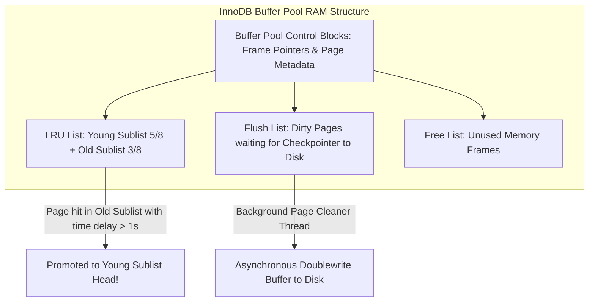

# Modul 158: Teori Normalisasi & Perancangan Skema Data (1NF s/d BCNF, Analisis Denormalisasi Terkontrol)

**Navigasi**: [⬅️ Master Index](../../INDEX.md) | [Tingkat 10: Tingkat 10: Basis Data, Data Engineering & Sistem Informasi Enterprise](./README.md)
*Sebelumnya*: [157. fondasi-teoretis-basis-data-model-relasional](./157-fondasi-teoretis-basis-data-model-relasional.md) | *Berikutnya*: [159. penguasaan-sql-tingkat-lanjut](./159-penguasaan-sql-tingkat-lanjut.md)

---

## 1. Intuisi Dasar Tanpa Jargon ("Seperti Bayi Baru Lahir")
Di mana sebenarnya data tabel MySQL atau SQLite Anda disimpan saat lampu LED hard disk berkedip-kedip? Data tersebut tidak disimpan dalam file teks biasa. Mesin Penyimpanan Berbasis B+ Tree ([B+ Tree Storage Engines](https://cstack.github.io/db_tutorial/)) membagi file database menjadi ribuan kotak halaman berukuran tetap yang identik (biasanya 4 KB pada SQLite atau 16 KB pada MySQL InnoDB). Pohon B+ Tree adalah indeks bertingkat raksasa yang sangat anggun: seluruh data baris aktual disimpan secara padat dan terurut rapi hanya pada simpul-simpul daun (**Leaf Nodes**) di dasar pohon, dan setiap daun dihubungkan oleh rantai linked-list dua arah. Ketika Anda mencari satu baris data atau memindai rentang tanggal (`WHERE date BETWEEN x AND y`), B+ Tree cukup menuruni 3 atau 4 tingkat cabang indeks dari puncak akar, lalu melompat mulus di sepanjang jalan tol simpul daun tanpa pernah membaca halaman disk yang tidak perlu!

## 2. Fondasi Teoretis & Aksiomatik / Matematis
Struktur Matematis Halaman Disk B+ Tree (Slotted-Page Architecture) dan Buffer Pool LRU-K:

1. **Arsitektur Halaman Berlubang (Slotted-Page Architecture)**:
   Sebuah halaman fisik database berukuran tetap $P = 16\text{ KB}$ dibagi menjadi dua arah yang saling mendekat:
   $$\text{Page Header} \longrightarrow \underbrace{[\text{Slot 0, Slot 1, } \dots, \text{Slot } k]}_{\text{Slot Array Tumbuh ke Kanan}} \quad \dots \text{Free Space} \dots \quad \underbrace{[\text{Tuple } k, \dots, \text{Tuple 0}]}_{\text{Data Baris Tumbuh ke Kiri}} \longleftarrow$$
   Slot Array menyimpan offset pointer integer 2-byte ke posisi data baris. Memungkinkan baris data berukuran variabel (*Variable-Length Records*) dipindahkan di dalam halaman tanpa mengubah ID record pointer luar `RID = (Page_ID, Slot_Number)`.

2. **Pohon B+ Tree Invariant**:
   - Setiap simpul dalam memiliki antara $\lceil M/2 \rceil$ hingga $M$ anak.
   - Semua simpul daun berada pada kedalaman kedalaman tingkat yang persis sama ($100\%$ Seimbang).
   - Simpul daun saling terhubung membentuk doubly linked-list untuk pemindaian rentang (*Range Scan*) cepat $O(\log N + K)$.

3. **Algoritma Pergantian Buffer Pool: LRU-K (O'Neil et al., 1993)**:
   Menggantikan LRU biasa untuk mencegah *Buffer Pool Pollution* (pemindaian tabel besar sekuensial yang menghapus halaman penting). LRU-K mencatat waktu akses ke-$K$ terakhir; halaman dengan jarak akses $t - t_{-K}$ terbesar yang pertama kali diusir.

## 3. Anatomi Teknis & Cara Kerja Internal
Arsitektur Buffer Pool Subsystem MySQL InnoDB: Peta Halaman RAM dan Free List:



1. **Doublewrite Buffer (InnoDB)**:
   Mencegah masalah kerusakan halaman parsial (*Torn Pages*) akibat listrik padam saat hardware menulis halaman 16 KB ke sektor disk 4 KB. InnoDB menulis halaman ke buffer kontinu berurutan terlebih dahulu sebelum menimpanya ke file tabel `.ibd` asli ([MySQL Doublewrite Buffer](https://dev.mysql.com/doc/refman/8.0/en/innodb-doublewrite-buffer.html)).

## 4. Implementasi Praktis & Kode / Simulasi Riil
```python
# Slotted-Page Binary Serialization Architecture in Python
import struct

PAGE_SIZE = 4096
HEADER_FORMAT = "!HH" # num_slots, free_space_offset
HEADER_SIZE = struct.calcsize(HEADER_FORMAT)

class SlottedPage:
    def __init__(self):
        self.data = bytearray(PAGE_SIZE)
        self.num_slots = 0
        self.free_offset = PAGE_SIZE # Pointer data baris tumbuh mundur dari akhir halaman
        self._save_header()

    def _save_header(self):
        struct.pack_into(HEADER_FORMAT, self.data, 0, self.num_slots, self.free_offset)

    def insert_tuple(self, record_bytes: bytes) -> int:
        rec_len = len(record_bytes)
        needed_space = 2 + rec_len # 2 byte slot offset + panjang data baris
        slot_array_end = HEADER_SIZE + (self.num_slots * 2)
        
        if self.free_offset - slot_array_end < needed_space:
            return -1 # Page is full!

        # Tulis data baris di ujung belakang memori
        self.free_offset -= rec_len
        self.data[self.free_offset:self.free_offset + rec_len] = record_bytes
        
        # Tulis offset pointer pada slot array di depan
        struct.pack_into("!H", self.data, slot_array_end, self.free_offset)
        slot_id = self.num_slots
        self.num_slots += 1
        self._save_header()
        return slot_id

page = SlottedPage()
slot = page.insert_tuple(b"User: Alice, Role: Admin")
print(f"Inserted tuple at slot ID: {slot}, Free offset at: {page.free_offset}")
```

## 5. Miskonsepsi & Jebakan Industri
1. **B+ Tree Fragmentation Due to Random UUID Primary Keys**: Menggunakan string UUID v4 acak sebagai Primary Key pada tabel clustered index InnoDB. Kunci acak disisipkan ke halaman B+ Tree yang acak di seluruh disk, memicu pembelahan halaman (*Page Splits*) massal yang membuang 50% kapasitas disk dan menghancurkan kecepatan tulis.
2. **Torn Page Corruption on Storage Power Outage**: Hardware drive gagal menulis satu halaman 16 KB penuh sebelum listrik padam (hanya 8 KB yang tersimpan). Tanpa perlindungan Doublewrite Buffer atau CoW, halaman B+ Tree korup secara permanen dan tabel database tidak dapat dibuka.
3. **Buffer Pool Thrashing from Sequential Table Scans**: Menjalankan kueri pelaporan besar yang membaca seluruh tabel tanpa indeks pada database produksi. Halaman buffer pool memori RAM terisi penuh oleh data pemindaian satu kali, mengusir data transaksi aktif penting pengguna.

## 6. Proyek Latihan & Rubrik Penilaian Mandiri
1. **Tingkat Pemula**: Hitung kapasitas maksimum baris yang dapat ditampung oleh satu halaman B+ Tree 16 KB jika rata-rata ukuran baris adalah 128 byte dan overhead header halaman adalah 120 byte.
2. **Tingkat Menengah**: Bangun pembaca file biner database SQLite sederhana di Python: buka file `.db` biner, baca header 100-byte pertama, ekstrak ukuran halaman (Page Size) dan nomor halaman akar pertama, lalu cetak teks skema tabel master SQLite.
3. **Tingkat Mahir**: Implementasikan Buffer Pool Manager mandiri lengkap dengan algoritma pergantian LRU-2 di C++: kelola pool 64 frame memori, implementasikan fungsi `fetch_page(page_id)` dan `unpin_page(page_id, is_dirty)`, serta tuliskan mekanisme background flusher yang membuang dirty pages ke file disk tiruan.

## 7. Rekomendasi Sumber Belajar Standar Emas
| Sumber Pembelajaran | Penulis / Institusi | Tautan Langsung | Fokus Materi |
| :--- | :--- | :--- | :--- |
| SQLite Database System: Design and Implementation | Sibsankar Haldar | [SQLite Internals Guide](https://cstack.github.io/db_tutorial/) | B-Tree File Format, Pager Module, Bytecode Engine & Write-Ahead Logging |
| MySQL 8.0 Reference Manual: The InnoDB Storage Engine | Oracle MySQL Team | [MySQL InnoDB Architecture](https://dev.mysql.com/doc/refman/8.0/en/innodb-storage-engine.html) | Clustered Indexes, Buffer Pool LRU, Doublewrite Buffer & Adaptive Hash |
| The LRU-K Page Replacement Algorithm for Database Disk Buffering | Elizabeth O'Neil, Patrick O'Neil, Gerhard Weikum | [ACM SIGMOD 1993 Paper](https://dl.acm.org/doi/10.1145/170036.170081) | Makalah Orisinal Penemuan Algoritma Buffer Pool LRU-K Teruji Zaman |
| Database Management Systems, 3rd Edition | Raghu Ramakrishnan & Johannes Gehrke | [McGraw-Hill Ramakrishnan](https://pages.cs.wisc.edu/~dbbook/) | Bab 8-10: Storage & Indexing, File Organizations, B+ Trees & Buffer Management |

---
*Navigasi Cepat*: [Ke Tingkat 10](./README.md) | [Ke Master Index](../../INDEX.md) | *Sebelumnya*: [157. fondasi-teoretis-basis-data-model-relasional](./157-fondasi-teoretis-basis-data-model-relasional.md) | *Berikutnya*: [159. penguasaan-sql-tingkat-lanjut](./159-penguasaan-sql-tingkat-lanjut.md)
