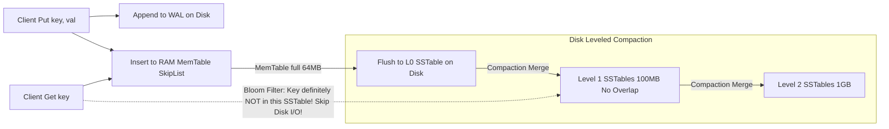

# Modul 159: Penguasaan SQL Tingkat Lanjut (Joins Kompleks, Recursive CTEs, Window Functions Analitik, Triggers)

**Navigasi**: [⬅️ Master Index](../../INDEX.md) | [Tingkat 10: Tingkat 10: Basis Data, Data Engineering & Sistem Informasi Enterprise](./README.md)
*Sebelumnya*: [158. teori-normalisasi-perancangan-skema-data](./158-teori-normalisasi-perancangan-skema-data.md) | *Berikutnya*: [160. arsitektur-internal-mesin-penyimpanan-basis-data](./160-arsitektur-internal-mesin-penyimpanan-basis-data.md)

---

## 1. Intuisi Dasar Tanpa Jargon ("Seperti Bayi Baru Lahir")
Hard disk mekanis dan bahkan drive SSD modern memiliki hukum fisika yang keras: mereka sangat membenci penulisan acak (**Random Writes**), namun sangat menyukai penulisan sekuensial lurus (**Sequential Writes**). Pada mesin B+ Tree, setiap kali Anda mengubah satu nilai baris data, database harus melompat ke halaman disk acak di antah berantah untuk menimpanya. Ketika aplikasi Anda harus mencatat 1 juta transaksi sensor atau penulisan log per detik, B+ Tree menyerah. Mesin Penyimpanan Berbasis Log-Structured Merge (LSM-Tree) ([LSM-Tree Storage Engines & RocksDB](https://rocksdb.org/)) adalah mesin pencatat berkecepatan monster yang menggerakkan RocksDB, Cassandra, dan Bigtable: ia tidak pernah menimpa data lama di disk! Semua penulisan baru diserap secepat kilat ke dalam memori RAM (**MemTable**) dan dicatat ke jurnal sekuensial; ketika RAM penuh, ia membekukannya dan mencetaknya ke disk sebagai file blok terurut rapi (**SSTables**); lalu proses latar belakang (**Compaction**) menggabungkan file-file tersebut secara bertahap seperti permainan kartu bridge!

## 2. Fondasi Teoretis & Aksiomatik / Matematis
Arsitektur Struktur Bertingkat LSM-Tree (Log-Structured Merge-Tree) Patrick O'Neil (1996):

Komponen Inti Alur Tulis dan Baca LSM-Tree:
1. **Write-Ahead Log (WAL)**: Menjamin durabilitas crash recovery melalui penulisan sekuensial instan ke disk sebelum mutasi memori.
2. **MemTable**: Struktur data pohon terurut di dalam RAM (biasanya Skiplist atau Red-Black Tree) yang menyerap seluruh operasi `Put()` dan `Delete()` dalam waktu $O(\log N)$.
3. **Immutable MemTable**: MemTable yang telah mencapai batas kapasitas (misal 64 MB), dibekukan menjadi read-only selagi proses flush latar belakang menulisnya ke disk.
4. **SSTables (Sorted String Tables)**: File biner di disk yang berisi data terurut berdasarkan kunci, dibagi menjadi blok-blok 4 KB dengan indeks footer dan filter **Bloom Filter** terintegrasi.

Amplifikasi Beban Sistem (Storage Amplification Metrics):

$$\begin{array}{|l|l|}
\hline
\textbf{Metrik Amplifikasi} & \textbf{Definisi Pengukuran} \\
\hline
\text{Write Amplification (WA)} & \frac{\text{Total Byte yang Ditulis ke Disk Fisik}}{\text{Total Byte Penulisan Permintaan Klien}} \\
\text{Read Amplification (RA)} & \frac{\text{Total Byte yang Dibaca dari Disk per Detik}}{\text{Total Byte yang Dikembalikan ke Pengguna}} \\
\text{Space Amplification (SA)} & \frac{\text{Ukuran Ruang Disk Fisik yang Terpakai}}{\text{Ukuran Data Unik Riil (Tanpa Data Usang/Tombstone)}} \\
\hline
\end{array}$$

Strategi Kompaksi (Compaction Strategies):
- **Size-Tiered Compaction**: Menggabungkan file SSTable yang berukuran setara (Write Amplification rendah, Space Amplification tinggi).
- **Leveled Compaction (RocksDB Default)**: Membagi disk menjadi tingkatan hierarkis ($L_0, L_1, L_2, \dots$). Ukuran level $L_{i+1} = 10 \times L_i$. Kunci di dalam satu level dijamin tidak bertindihan (*No Key Overlap*), menjamin batas pembacaan cepat!

## 3. Anatomi Teknis & Cara Kerja Internal
Alur Kerja Tulis dan Baca RocksDB LSM-Tree dengan Akselerasi Bloom Filter:



1. **Bloom Filter Speedup**: Filter probabilistik berukuran beberapa bit per kunci. Jika Bloom Filter mengembalikan 'TIDAK ADA', kunci tersebut dijamin 100% tidak ada di file SSTable, memangkas 99% operasi pembacaan disk I/O yang sia-sia!
2. **Tombstone Deletions**: Operasi `Delete(key)` pada LSM-Tree tidak menghapus data fisik secara instan. Ia menulis kunci baru bernilai penanda kuburan (**Tombstone**). Data lama baru benar-benar lenyap saat proses Compaction menggabungkan level SSTable terkait.

## 4. Implementasi Praktis & Kode / Simulasi Riil
```python
# Production-Grade Bloom Filter Implementation for LSM-Tree SSTables in Python
import math
import mmh3 # MurmurHash3 library

class BloomFilter:
    def __init__(self, expected_elements: int, false_positive_rate: float = 0.01):
        # Hitung ukuran bit array optimal m = -(n * ln(p)) / (ln(2)^2)
        self.m = int(-expected_elements * math.log(false_positive_rate) / (math.log(2) ** 2))
        # Hitung jumlah fungsi hash optimal k = (m / n) * ln(2)
        self.k = int((self.m / expected_elements) * math.log(2))
        self.bit_array = bytearray((self.m + 7) // 8)

    def add(self, key: str):
        for seed in range(self.k):
            digest = mmh3.hash(key, seed) % self.m
            self.bit_array[digest // 8] |= (1 << (digest % 8))

    def contains(self, key: str) -> bool:
        for seed in range(self.k):
            digest = mmh3.hash(key, seed) % self.m
            if not (self.bit_array[digest // 8] & (1 << (digest % 8))):
                return False # Jaminan 100%: Kunci PASTI TIDAK ADA!
        return True # Kunci MUNGKIN ADA (False Positive Rate ~1%)

bf = BloomFilter(expected_elements=10000, false_positive_rate=0.01)
bf.add("user_1001")
assert bf.contains("user_1001") == True
assert bf.contains("unknown_key") == False
print("Bloom Filter validation completed!")
```

## 5. Miskonsepsi & Jebakan Industri
1. **Compaction Debt Stalling Writes (Write Stalls)**: Laju penulisan klien melebihi kapasitas I/O disk untuk melakukan proses Compaction. File di $L_0$ menumpuk puluhan buah; RocksDB terpaksa memperlambat atau membekukan seluruh penulisan klien (*Write Stall*) hingga proses kompaksi selesai.
2. **Tombstone Accumulation Crippling Range Scans**: Menghapus jutaan kunci berurutan dalam rentang pendek. Kueri `Scan(start, end)` harus membaca jutaan penanda Tombstone satu per satu di disk, menghasilkan latensi pembacaan yang lambat hingga berdetik-detik.
3. **Extreme Disk Space Amplification in Size-Tiered Compaction**: Menggunakan Size-Tiered Compaction pada dataset besar. Sistem membutuhkan ruang disk kosong cadangan hingga 100% dari total ukuran database untuk menampung file sementara selama proses penggabungan kompaksi berlangsung.

## 6. Proyek Latihan & Rubrik Penilaian Mandiri
1. **Tingkat Pemula**: Hitung ukuran bit array minimum dan jumlah fungsi hash yang dibutuhkan oleh Bloom Filter untuk menampung 1.000.000 kunci dengan tingkat false positive maksimum 1%.
2. **Tingkat Menengah**: Tulis generator file SSTable biner sederhana di Python: terima kamus pasangan kunci-nilai terurut, tulis blok data 4 KB, tulis indeks offset footer di akhir file, dan sematkan Bloom Filter biner.
3. **Tingkat Mahir**: Bangun mesin penyimpanan LSM-Tree mini yang fungsional di C++/Rust (seperti LevelDB mini): implementasikan penulisan log WAL, MemTable SkipList, proses background flush ke disk SSTable, dan algoritma Leveled Compaction 2-tingkat dengan deteksi Tombstone.

## 7. Rekomendasi Sumber Belajar Standar Emas
| Sumber Pembelajaran | Penulis / Institusi | Tautan Langsung | Fokus Materi |
| :--- | :--- | :--- | :--- |
| The Log-Structured Merge-Tree (LSM-Tree) | Patrick O'Neil, Edward O'Neil, Gerhard Weikum | [Acta Informatica 1996 Paper](https://www.cs.umb.edu/~poneil/lsmtree.pdf) | Makalah Orisinal Penemuan Arsitektur Mesin Penyimpanan LSM-Tree |
| RocksDB Architecture and Internal Design Guide | Meta / RocksDB Engineering Team | [RocksDB Official Architecture](https://github.com/facebook/rocksdb/wiki/RocksDB-Overview) | MemTable, BlockBasedTable, Leveled Compaction, Write Stalls & Bloom Filters |
| Space and Time Tradeoffs in Hash Coding with Allowable Errors | Burton H. Bloom | [ACM Communications 1970](https://dl.acm.org/doi/10.1145/362686.362692) | Makalah Orisinal Penemuan Struktur Probabilistik Bloom Filter |
| Database Internals (Part I: Storage Engines) | Alex Petrov | [Databass.dev Storage Book](https://www.databass.dev/) | Perbandingan Komprehensif B+ Tree vs LSM-Tree Tradeoffs & Amplifications |

---
*Navigasi Cepat*: [Ke Tingkat 10](./README.md) | [Ke Master Index](../../INDEX.md) | *Sebelumnya*: [158. teori-normalisasi-perancangan-skema-data](./158-teori-normalisasi-perancangan-skema-data.md) | *Berikutnya*: [160. arsitektur-internal-mesin-penyimpanan-basis-data](./160-arsitektur-internal-mesin-penyimpanan-basis-data.md)
