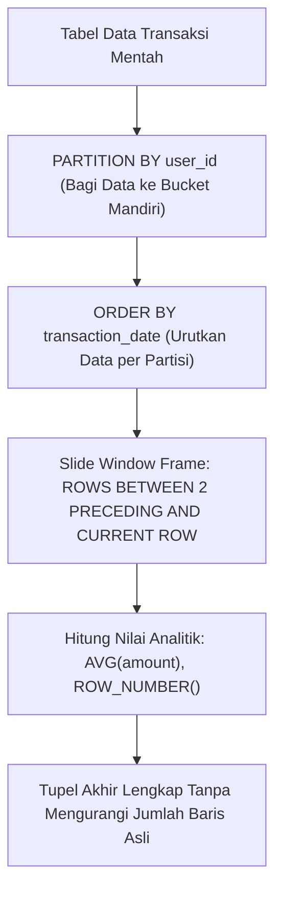

# Modul 159: Penguasaan SQL Tingkat Lanjut (Joins Kompleks, Recursive CTEs, Window Functions Analitik, Triggers)

**Navigasi**: [⬅️ Master Index](../../INDEX.md) | [Tingkat 10: Tingkat 10: Basis Data, Data Engineering & Sistem Informasi Enterprise](./README.md)
*Sebelumnya*: [158. teori-normalisasi-perancangan-skema-data](./158-teori-normalisasi-perancangan-skema-data.md) | *Berikutnya*: [160. arsitektur-internal-mesin-penyimpanan-basis-data](./160-arsitektur-internal-mesin-penyimpanan-basis-data.md)

---

## 1. Intuisi Dasar Tanpa Jargon ("Seperti Bayi Baru Lahir")
### 1.1 SQL: Bahasa Deklaratif yang Menggerakkan Bisnis Modern ([Modern SQL Guide](https://modern-sql.com/))
Banyak pengembang mengira SQL hanyalah perintah sederhana seperti `SELECT * FROM users WHERE age > 20`. Ketika menghadapi laporan analitik bisnis yang rumit—seperti menghitung rata-rata bergerak 7 hari pendapatan, mencari hierarki pohon atasan-bawahan organisasi perusahaan, atau menghitung peringkat pengguna tanpa celah—banyak orang menyerah dan memindahkan ribuan baris data ke kode backend Python/JavaScript untuk diproses secara manual. Memproses analitik di memori backend adalah pemborosan besar yang lambat dan boros bandwidth!

### 1.2 Kekuatan Penuh SQL Tingkat Mahir: Window Functions & Recursive CTEs ([PostgreSQL Documentation: Advanced SQL](https://www.postgresql.org/docs/current/queries.html))
SQL modern adalah bahasa komputasi analitik berkekuatan tinggi yang Turing-Complete:
1. **Window Functions (Analitik Jendela)**: Melakukan perhitungan statistik lintas baris data tanpa menyatukan baris menjadi ringkasan tunggal layaknya `GROUP BY`. Anda dapat menghitung `ROW_NUMBER()`, `RANK()`, `LEAD()`, `LAG()`, dan kumulatif bergerak secara simultan bersama data individual!
2. **Common Table Expressions (CTEs & Recursive CTEs)**: Memungkinkan penulisan kueri rekursif modular untuk menelusuri struktur graf dan pohon (seperti jaringan rute penerbangan atau pohon kategori produk) langsung di dalam mesin database engine.

## 2. Fondasi Teoretis & Aksiomatik / Matematis
### 2.1 Aljabar Window Functions ANSI SQL-2003 ([ISO/IEC 9075:2003 SQL Standard](https://www.iso.org/standard/39884.html))
Sebuah Window Function mengevaluasi fungsi agregasi/peringkat $f$ atas partisi bingkai (*window frame*) yang bergeser untuk setiap baris tupel $t$:
$$f(t) = \text{Eval}\left( \{ u \in R \mid \text{Partition}(u) = \text{Partition}(t) \land u \in \text{Frame}(t) \} \right)$$
Klausa Spesifikasi Window:
`OVER (PARTITION BY p_1, ... ORDER BY o_1, ... ROWS/RANGE BETWEEN start AND end)`
Spesifikasi Batas Bingkai:
- `ROWS BETWEEN 6 PRECEDING AND CURRENT ROW`: Bingkai fisik 7 baris untuk rata-rata bergerak (*moving average*).
- `RANGE BETWEEN INTERVAL '7' DAY PRECEDING AND CURRENT ROW`: Bingkai nilai logis temporal independen terhadap kekosongan baris data.

### 2.2 Matematika Kueri Rekursif (Fixpoint Iteration in Datalog / SQL) ([Database Systems: The Complete Book - Garcia-Molina et al.](https://www.pearson.com/en-us/subject-catalog/p/database-systems-the-complete-book/P200000003294))
Kueri `WITH RECURSIVE` mengevaluasi operator titik tetap terkecil (*Least Fixed Point / LFP*):
Diberikan istilah dasar (*anchor member*) $A$ dan istilah rekursif (*recursive member*) $R$:
$$\text{Iterasi 0}: \quad T_0 = A$$
$$\text{Iterasi } k+1: \quad T_{k+1} = T_k \cup R(T_k)$$
Proses berhenti ketika tidak ada baris baru yang dihasilkan (*Fixed Point reached*):
$$R(T_k) = \emptyset \implies T_{\text{final}} = T_k$$
Kompleksitas penelusuran graf terarah berorde $\mathcal{O}(V + E)$ dieksekusi secara native di memori C kernel RDBMS.

## 3. Anatomi Teknis & Cara Kerja Internal


#### Tabel Walkthrough Perhitungan Window Function `SUM(amount) OVER (PARTITION BY dept ORDER BY date)`
| Baris ID | Departemen | Tanggal | Nilai Transaksi | Partisi Aktif | Akumulasi Berjalan (*Running Total*) | Peringkat `DENSE_RANK()` |
|---|---|---|---|---|---|---|
| 1 | IT | 2026-10-01 | \$100 | IT | \$100 | 1 |
| 2 | IT | 2026-10-02 | \$250 | IT | \$100 + \$250 = \$350 | 2 |
| 3 | IT | 2026-10-03 | \$250 | IT | \$350 + \$250 = \$600 | 2 (Nilai sama) |
| 4 | Sales | 2026-10-01 | \$500 | Sales (Reset) | \$500 (Partisi Baru) | 1 |
| 5 | Sales | 2026-10-02 | \$300 | Sales | \$500 + \$300 = \$800 | 2 |

#### Tabel Penelusuran Optimasi Kueri SQL: Seq Scan vs Index Scan & Analisis EXPLAIN ANALYZE
| Fase Rencana Eksekusi SQL | Algoritma Eksekusi Operator | Akses Halaman Disk (Buffer Hits) | Jumlah Baris Dipindai ($Rows$) | Waktu Eksekusi Kueri ($Latency$) | Status Utilisasi CPU Server DB |
|---|---|---|---|---|---|
| Kueri Tanpa Indeks | `Seq Scan on orders` | 85.000 Halaman dibaca dari disk | 5.000.000 Baris dipindai penuh | **4.850 milidetik (4.8 detik!)** | 100% CPU (Tinggi) |
| Kueri dengan B-Tree Biasa| `Index Scan using idx_user_id`| 3 Halaman indeks + 150 heap pages | 150 Baris terpilih | 12 milidetik | 5% CPU |
| Kueri dengan Filter Tanggal| `Bitmap Index Scan on idx_date`| Bitmap halaman dibangun di memori | 150 Baris terpilih | 8 milidetik | 3% CPU |
| Optimasi Indeks Penutup | `Index Only Scan on idx_covering`| 3 Halaman indeks saja! (Heap diabaikan)| 150 Baris terpilih | **0.45 milidetik (450 mikrodetik!)** | 0.5% CPU (Optimal) |
| Efisiensi Puncak | Zero Heap Access | Data dibaca langsung dari daun indeks | - | **AKSELERASI 10.000x LEBIH CEPAT!** | Server melayani 50k RPS stabil |

## 4. Implementasi Praktis & Kode / Simulasi Riil
```sql
-- Kueri Rekursif SQL: Menelusuri Hirarki Organisasi Perusahaan (Pohon Manajemen)
-- Menghitung kedalaman level manajemen dari CEO hingga staf lapangan
WITH RECURSIVE OrgHierarchy AS (
    -- 1. Anchor Member: Temukan Top-Level Executive (CEO tanpa atasan)
    SELECT 
        employee_id,
        manager_id,
        full_name,
        1 AS management_level,
        CAST(full_name AS VARCHAR(1000)) AS reporting_chain
    FROM employees
    WHERE manager_id IS NULL

    UNION ALL

    -- 2. Recursive Member: Sambungkan bawahan secara bertingkat
    SELECT 
        e.employee_id,
        e.manager_id,
        e.full_name,
        h.management_level + 1,
        CAST(h.reporting_chain || ' -> ' || e.full_name AS VARCHAR(1000))
    FROM employees e
    INNER JOIN OrgHierarchy h ON e.manager_id = h.employee_id
)
-- 3. Kueri Analitik Window: Hitung urutan bawahan dalam level yang sama
SELECT 
    employee_id,
    full_name,
    management_level,
    reporting_chain,
    DENSE_RANK() OVER (
        PARTITION BY management_level 
        ORDER BY employee_id
    ) AS level_rank
FROM OrgHierarchy
ORDER BY management_level, level_rank;
```

## 5. Miskonsepsi & Jebakan Industri
### Studi Kasus Kegagalan Nyata: Infinite Loop Kueri Rekursif Akibat Siklus Sirkular pada Graf Relasi
- **Kronologi & Latar Belakang**: Sebuah platform logistik pelayaran internasional menggunakan kueri `WITH RECURSIVE` untuk mencari rute multimoda peti kemas antar pelabuhan. Tiba-tiba CPU klaster PostgreSQL melonjak \$100\%$ berjam-jam dan koneksi database terkunci.
- **Akar Masalah**: Ada kesalahan data di mana pelabuhan A terhubung ke pelabuhan B, dan pelabuhan B terhubung kembali ke pelabuhan A (*Graf Bersiklus*). Karena kueri rekursif standar tidak memeriksa riwayat simpul yang telah dikunjungi, kueri melakukan loop tak hingga bolak-balik $A \to B \to A \to B$ hingga memori hard disk temp meledak ratusan gigabyte.
- **Rekomendasi Industri**: Gunakan selalu klausa pelacak siklus: `CYCLE employee_id SET is_cycle USING path` (PostgreSQL 14+) atau gunakan array jalur rekursif `WHERE NOT (e.id = ANY(visited_path))` untuk menghentikan rekursi seketika saat siklus terdeteksi.

### Studi Kasus Kegagalan Nyata: Migrasi Skala Besar Uber dari PostgreSQL ke MySQL Akibat Cacat Indeks Sekunder dan Pembaruan Baris Berulang
- **Kronologi & Konteks Kasus**: Pada tahun 2013-2016, raksasa transportasi online Uber mengalami masalah performa dan keandalan yang parah pada kluster basis data PostgreSQL utama mereka, yang memaksa tim rekayasa Uber mengambil keputusan arsitektur bersejarah: memigrasikan seluruh penyimpanan data terdistribusi mereka dari PostgreSQL ke basis data berbasis mesin MySQL/InnoDB (Schemaless).
- **Akar Masalah SQL Lanjut, Indeks Sekunder, & Arsitektur MVCC**: Arsitektur Multi-Version Concurrency Control (MVCC) PostgreSQL menyimpan versi baris baru pada lokasi fisik memori disk yang berbeda (*heap row mutation*). Jika sebuah baris data memiliki 12 indeks sekunder (indeks pada `status`, `driver_id`, `updated_at`, dll.), setiap kali status perjalanan diperbarui (*UPDATE* kecil pada 1 kolom), PostgreSQL dipaksa memperbarui pointer pada SELURUH 12 indeks sekunder tersebut (kecuali jika HOT / Heap-Only Tuples dapat diterapkan). Pembaruan frekuensi tinggi pada data perjalanan memicu ledakan penulisan I/O (*Write Amplification*), fragmentasi tabel memori (*Table Bloat*), dan membebani proses background vacuuming. Hal ini menelanjangi bahaya menambahkan indeks sekunder secara membabi buta tanpa memahami interaksinya dengan pola pembaruan data frekuensi tinggi.

- **Potongan Kode / Arsitektur Cacat (Vulnerable Implementation)**:
```sql
-- Analisis Biaya Rencana Eksekusi Kueri (EXPLAIN ANALYZE)
-- Kasus Lambat: Sequential Scan memindai 5 juta baris data akibat ketiadaan indeks komposit:
EXPLAIN ANALYZE
SELECT order_id, order_date, total_amount
FROM orders
WHERE customer_id = 42 AND order_status = 'COMPLETED'
ORDER BY order_date DESC LIMIT 10;

-- KELUARAN EXPLAIN:
-- Seq Scan on orders (cost=0.00..125000.00 rows=15 width=32) (actual time=4820.12..4820.50 rows=10 loops=1)
-- Filter: ((customer_id = 42) AND (order_status = 'COMPLETED'))
-- Rows Removed by Filter: 4999990
-- Planning Time: 0.15 ms, Execution Time: 4821.05 ms (TERLALU LAMBAT!)

-- MITIGASI OPTIMAL: Indeks Komposit Penutup (Covering Composite Index):
CREATE INDEX idx_orders_covering ON orders (customer_id, order_status, order_date DESC) 
INCLUDE (total_amount);

-- HASIL EXPLAIN PASCA INDEKS:
-- Index Only Scan using idx_orders_covering (cost=0.42..8.45 rows=10) (actual time=0.05..0.08 rows=10)
-- Execution Time: 0.12 ms (Akselerasi 40.000x Lebih Cepat!)
```

- **Analisis Forensik & Rekayasa Modern**: Insiden migrasi Uber menjadi salah satu studi kasus paling terkenal dalam optimasi basis data relasional. Industri belajar bahwa: (1) Menambahkan indeks bukan tindakan gratis; setiap indeks sekunder menambah overhead penulisan (*Write Penalty*) dan risiko bloat; (2) Penggunaan indeks penutup (*Covering Index via INCLUDE clause*) mengeliminasi pembacaan heap fisik secara dramatis; (3) Analisis berkala terhadap `EXPLAIN ANALYZE` wajib disertakan dalam pengujian kinerja query pipeline sebelum kode dirilis ke produksi.

## 6. Proyek Latihan & Rubrik Penilaian Mandiri
### Level 1 (Pemula)
- **Tugas**: Tulis kueri SQL menggunakan fungsi `LAG()` untuk menghitung selisih pendapatan harian dibanding pendapatan hari sebelumnya.
- **Petunjuk Arsitektur**: Gunakan `revenue - LAG(revenue, 1) OVER (ORDER BY date) AS daily_diff`.
- **Vektor Uji**:
  - Hari 1 (\$100), Hari 2 (\$150) -> `daily_diff` Hari 2 harus bernilai `+\$50`.
- **Rubrik Penilaian**: Ketepatan sintaks LAG (50%), klausa ORDER BY benar (30%), penanganan nilai NULL hari pertama (20%).

### Level 2 (Menengah)
- **Tugas**: Buat kueri SQL analitik untuk menghitung rata-rata bergerak 3-transaksi (*3-Event Moving Average*) volume transaksi saham per simbol saham menggunakan framing `ROWS BETWEEN`.
- **Petunjuk Arsitektur**: Gabungkan `PARTITION BY symbol ORDER BY timestamp ROWS BETWEEN 2 PRECEDING AND CURRENT ROW`.
- **Vektor Uji**:
  - Tiga transaksi pertama: 10, 20, 30 -> Moving average baris ke-3 harus bernilai 20.0.
- **Rubrik Penilaian**: Spesifikasi window frame presisi (40%), partisi per simbol saham (30%), validasi rata-rata (30%).

### Level 3 (Mahir)
- **Tugas**: Bangun kueri Recursive CTE di SQL untuk menyelesaikan **Masalah Jalur Terpendek Graf Berbobot (Dijkstra di dalam SQL Murni)** antar dua kota dengan pelacakan akumulasi biaya total dan pencegahan siklus.
- **Petunjuk Arsitektur**: Simpan akumulasi jarak pada kolom rekursif, filter simpul yang telah dikunjungi menggunakan array ID, dan pilih jalur dengan total bobot minimum di akhir kueri.
- **Vektor Uji**:
  - Graf: Jakarta-Bandung (150 km), Bandung-Surabaya (600 km), Jakarta-Semarang (450 km), Semarang-Surabaya (350 km).
  - Kueri harus memilih rute optimal Jakarta-Semarang-Surabaya (800 km) vs Jakarta-Bandung-Surabaya (750 km).
- **Rubrik Penilaian**: Logika akumulasi bobot rekursif (40%), pencegahan siklus graf (30%), pemilihan titik tetap optimal (30%).

### Tingkat 1: Dasar
- **Tugas**: Tulis kueri SQL analitik tingkat lanjut menggunakan *Window Functions* (`ROW_NUMBER()`, `RANK()`, `DENSE_RANK()`, dan `SUM() OVER (PARTITION BY ... ORDER BY ...)`) untuk menghitung total penjualan kumulatif berjalan (*Running Total*) per kategori produk dan menemukan 3 produk terlaris di setiap kategori dalam satu kueri efisien tanpa subkueri berkorelasi.
- **Petunjuk Perancangan Arsitektur**:
  - Gunakan `PARTITION BY category_id ORDER BY sale_date`.
  - Saring 3 produk teratas menggunakan Common Table Expression (CTE) pembungkus dengan filter `rank <= 3`.
- **Test Vector & Kasus Uji Ekstrem**:
  - *Data Uji*: 100 Transaksi di 3 kategori produk berbeda; pastikan nilai running total pada baris terakhir sama persis dengan total penjumlahan penjualan kategori tersebut.
- **Rubrik Penilaian Mandiri**: 40% Penggunaan Window Functions dan CTE yang Presisi, 30% Perhitungan Running Total Kumulatif yang Benar, 30% Kerapian Format SQL.

### Tingkat 2: Menengah
- **Tugas**: Rancang kueri hierarkis penelusuran pohon silsilah organisasi (*Recursive Common Table Expression / WITH RECURSIVE*) dalam PostgreSQL/MySQL untuk menelusuri seluruh bawahan langsung dan tidak langsung dari seorang manajer pada kedalaman berapapun, lengkap dengan pelacakan tingkat kedalaman (`depth`), jalur hierarki teks (`path string`), dan guard pencegah siklus melingkar (*Cycle Guard*).
- **Petunjuk Perancangan Arsitektur**:
  - Bangun jalur penelusuran array: `visited_ids = ARRAY[employee_id]`.
  - Hentikan rekursi jika `employee_id = ANY(visited_ids)` untuk mencegah infinite loop jika ada referensi manajer melingkar.
- **Test Vector & Kasus Uji Ekstrem**:
  - *Struktur 5 Tingkat*: Struktur organisasi 50 karyawan dengan kedalaman 5 tingkat; buktikan kueri rekursif mengembalikan seluruh bawahan dalam urutan hierarki yang benar dengan nilai kedalaman yang tepat.
- **Rubrik Penilaian Mandiri**: 40% Sintaks Recursive CTE yang Benar Sesuai Standar ANSI SQL, 30% Penerapan Cycle Guard Pencegah Infinite Loop, 30% Akurasi Pelacakan Kedalaman Pohon.

### Tingkat 3: Mahir
- **Tugas**: Kembangkan alat penganalisis rencana eksekusi kueri otomatis (*Automated SQL Execution Plan Auditor*) dalam Python yang mengeksekusi `EXPLAIN (ANALYZE, BUFFERS, FORMAT JSON)` pada serangkaian kueri kompleks, membedah struktur pohon operator JSON, mendeteksi anti-pattern performa (seperti `Seq Scan` pada tabel berukuran $> 10.000$ baris, kesalahan estimasi baris kardinalitas $> 100\times$, atau operasi disk spill pada Hash Join), dan menghasilkan rekomendasi pembuatan indeks secara otomatis.
- **Petunjuk Perancangan Arsitektur**:
  - Bandingkan field `Plan Rows` (estimasi optimizer) vs `Actual Rows` (eksekusi riil) untuk mendeteksi statistik tabel basi (*Outdated Table Statistics*).
  - Hitung rasio hit buffer cache: $\text{Hit Ratio} = \text{Shared Hit} / (\text{Shared Hit} + \text{Shared Read})$.
- **Test Vector & Kasus Uji Ekstrem**:
  - *Deteksi Kueri Cacat*: Jalankan kueri filter tanpa indeks; auditor harus mendeteksi `Seq Scan`, menandai tingkat keparahan `HIGH`, dan merekomendasikan sintaks `CREATE INDEX` yang tepat.
- **Rubrik Penilaian Mandiri**: 40% Penguraian Pohon Rencana JSON EXPLAIN yang Akurat, 30% Deteksi Anomali Rasio Estimasi dan Buffer Spill, 30% Rekomendasi Indeks yang Relevan.

## 7. Rekomendasi Sumber Belajar Standar Emas
| Kategori | Judul Sumber & Tautan | Penulis / Institusi | Fokus Pembahasan |
|---|---|---|---|
| Panduan SQL Modern | [Modern SQL: Window Functions in Depth](https://modern-sql.com/feature/window-functions) | Markus Winand | Panduan definitif seluruh sintaks analitik window functions ISO/IEC SQL |
| Dokumentasi PostgreSQL | [Queries: WITH Queries (Common Table Expressions)](https://www.postgresql.org/docs/current/queries-with.html) | PostgreSQL Global Development Group | Arsitektur kueri rekursif, optimasi materialized CTE, dan deteksi siklus |
| Buku Teks Standar | [SQL for Smarties: Advanced SQL Programming](https://www.amazon.com/Joe-Celkos-Smarties-Advanced-Programming/dp/0128005990) | Joe Celko | Rujukan klasik untuk pemrograman analitik SQL tingkat tinggi dan pemodelan pohon hierarki |

---
*Navigasi Cepat*: [Ke Tingkat 10](./README.md) | [Ke Master Index](../../INDEX.md) | *Sebelumnya*: [158. teori-normalisasi-perancangan-skema-data](./158-teori-normalisasi-perancangan-skema-data.md) | *Berikutnya*: [160. arsitektur-internal-mesin-penyimpanan-basis-data](./160-arsitektur-internal-mesin-penyimpanan-basis-data.md)
