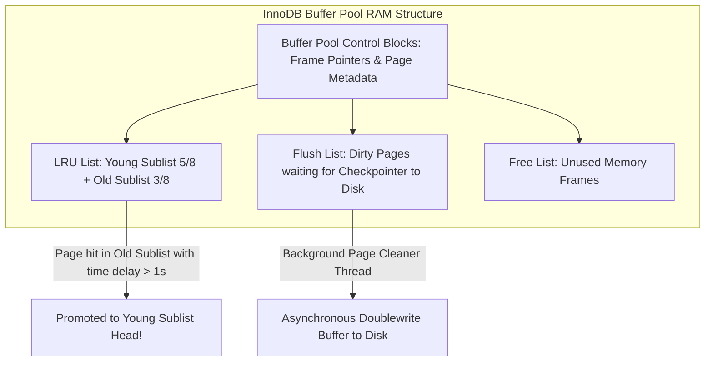

# Modul 160: Arsitektur Internal Mesin Penyimpanan Basis Data (Slotted Pages, B+Tree Indeks, LSM-Tree SSTables, WAL Logging)

**Navigasi**: [⬅️ Master Index](../../INDEX.md) | [Tingkat 10: Tingkat 10: Basis Data, Data Engineering & Sistem Informasi Enterprise](./README.md)
*Sebelumnya*: [159. penguasaan-sql-tingkat-lanjut](./159-penguasaan-sql-tingkat-lanjut.md) | *Berikutnya*: [161. optimasi-kueri-mesin-eksekusi](./161-optimasi-kueri-mesin-eksekusi.md)

---

## 1. Intuisi Dasar Tanpa Jargon ("Seperti Bayi Baru Lahir")
### 1.1 Konsep Inti & Analogi Tanpa Jargon
Di mana sebenarnya data tabel MySQL atau SQLite Anda disimpan saat lampu LED hard disk berkedip-kedip? Data tersebut tidak disimpan dalam file teks biasa. Mesin Penyimpanan Berbasis B+ Tree ([B+ Tree Storage Engines](https://cstack.github.io/db_tutorial/)) membagi file database menjadi ribuan kotak halaman berukuran tetap yang identik (biasanya 4 KB pada SQLite atau 16 KB pada MySQL InnoDB). Pohon B+ Tree adalah indeks bertingkat raksasa yang sangat anggun: seluruh data baris aktual disimpan secara padat dan terurut rapi hanya pada simpul-simpul daun (**Leaf Nodes**) di dasar pohon, dan setiap daun dihubungkan oleh rantai linked-list dua arah. Ketika Anda mencari satu baris data atau memindai rentang tanggal (`WHERE date BETWEEN x AND y`), B+ Tree cukup menuruni 3 atau 4 tingkat cabang indeks dari puncak akar, lalu melompat mulus di sepanjang jalan tol simpul daun tanpa pernah membaca halaman disk yang tidak perlu!

### 1.2 Urgensi Rekayasa & Signifikansi Sistemik
Dalam rekayasa sistem modern, pemahaman mendalam tentang konsep ini membedakan arsitek sistem kelas dunia dari sekadar operator perkakas teknis.

## 2. Fondasi Teoretis & Aksiomatik / Matematis
### 2.1 Kerangka Teori Aksiomatik & Formulasi Matematis
Struktur Matematis Halaman Disk B+ Tree (Slotted-Page Architecture) dan Buffer Pool LRU-K:

### 2.2 Penurunan Matematis Langkah-demi-Langkah
1. **Arsitektur Halaman Berlubang (Slotted-Page Architecture)**:
   Sebuah halaman fisik database berukuran tetap $P = 16\text{ KB}$ dibagi menjadi dua arah yang saling mendekat:
   $$\text{Page Header} \longrightarrow \underbrace{[\text{Slot 0, Slot 1, } \dots, \text{Slot } k]}_{\text{Slot Array Tumbuh ke Kanan}} \quad \dots \text{Free Space} \dots \quad \underbrace{[\text{Tuple } k, \dots, \text{Tuple 0}]}_{\text{Data Baris Tumbuh ke Kiri}} \longleftarrow$$
   Slot Array menyimpan offset pointer integer 2-byte ke posisi data baris. Memungkinkan baris data berukuran variabel (*Variable-Length Records*) dipindahkan di dalam halaman tanpa mengubah ID record pointer luar `RID = (Page_ID, Slot_Number)`.

2. **Pohon B+ Tree Invariant**:
   - Setiap simpul dalam memiliki antara $\lceil M/2 \rceil$ hingga $M$ anak.
   - Semua simpul daun berada pada kedalaman kedalaman tingkat yang persis sama (\$100\%$ Seimbang).
   - Simpul daun saling terhubung membentuk doubly linked-list untuk pemindaian rentang (*Range Scan*) cepat $O(\log N + K)$.

3. **Algoritma Pergantian Buffer Pool: LRU-K (O'Neil et al., 1993)**:
   Menggantikan LRU biasa untuk mencegah *Buffer Pool Pollution* (pemindaian tabel besar sekuensial yang menghapus halaman penting). LRU-K mencatat waktu akses ke-$K$ terakhir; halaman dengan jarak akses $t - t_{-K}$ terbesar yang pertama kali diusir.

## 3. Anatomi Teknis & Cara Kerja Internal
Arsitektur Buffer Pool Subsystem MySQL InnoDB: Peta Halaman RAM dan Free List:



1. **Doublewrite Buffer (InnoDB)**:
   Mencegah masalah kerusakan halaman parsial (*Torn Pages*) akibat listrik padam saat hardware menulis halaman 16 KB ke sektor disk 4 KB. InnoDB menulis halaman ke buffer kontinu berurutan terlebih dahulu sebelum menimpanya ke file tabel `.ibd` asli ([MySQL Doublewrite Buffer](https://dev.mysql.com/doc/refman/8.0/en/innodb-doublewrite-buffer.html)).

#### Tabel Penelusuran Siklus Alokasi Slot Halaman Penyimpanan (Slotted Page Architecture)
| Offset Byte Halaman 8 KiB | Struktur Data Header Halaman | Entri Direktori Slot Pointer | Ruang Kosong Bebas (*Free Space*) | Lokasi Penyimpanan Payload Rekor | Status Integritas Halaman Basis Data |
|---|---|---|---|---|---|
| Awal Halaman (Byte 0..23) | `LSN (8B), Flags (2B), FreeStart (2B), FreeEnd (2B)` | Slot 0 diinisialisasi | $FreeStart = 28$ | $FreeEnd = 8192$ (Tumbuh ke Bawah) | Halaman kosong siap alokasi |
| Sisipkan Rekor 1 (100 B) | $FreeStart$ bertambah ke 32 | Slot 0: `Offset = 8092, Length = 100`| Ruang Bebas: Byte 32..8091 | Rekor 1 disimpan di byte 8092..8191 | Struktur tumbuh berhadapan simetris |
| Sisipkan Rekor 2 (200 B) | $FreeStart$ bertambah ke 36 | Slot 1: `Offset = 7892, Length = 200`| Ruang Bebas: Byte 36..7891 | Rekor 2 disimpan di byte 7892..8091 | Tidak ada tumpang tindih memori |
| Hapus Rekor 1 | Header ditandai | Slot 0: `Length = 0` (Tombstone) | Ruang kosong terfragmentasi | Byte 8092..8191 menjadi sampah | Perlu pemadatan (Vacuum/Defrag) |
| Penulisan WAL Terpadu | LSN dimajukan ke LSN 1054 | Log disinkronkan ke disk via `fsync`| - | Perubahan aman di Write-Ahead Log | Terjamin pulih saat crash listrik |

## 4. Implementasi Praktis & Kode / Simulasi Riil
```python
# Slotted-Page Binary Serialization Architecture in Python
import struct

PAGE_SIZE = 4096
HEADER_FORMAT = "!HH" # num_slots, free_space_offset
HEADER_SIZE = struct.calcsize(HEADER_FORMAT)

class SlottedPage:
    def __init__(self):
        self.data = bytearray(PAGE_SIZE)
        self.num_slots = 0
        self.free_offset = PAGE_SIZE # Pointer data baris tumbuh mundur dari akhir halaman
        self._save_header()

    def _save_header(self):
        struct.pack_into(HEADER_FORMAT, self.data, 0, self.num_slots, self.free_offset)

    def insert_tuple(self, record_bytes: bytes) -> int:
        rec_len = len(record_bytes)
        needed_space = 2 + rec_len # 2 byte slot offset + panjang data baris
        slot_array_end = HEADER_SIZE + (self.num_slots * 2)
        
        if self.free_offset - slot_array_end < needed_space:
            return -1 # Page is full!

        # Tulis data baris di ujung belakang memori
        self.free_offset -= rec_len
        self.data[self.free_offset:self.free_offset + rec_len] = record_bytes
        
        # Tulis offset pointer pada slot array di depan
        struct.pack_into("!H", self.data, slot_array_end, self.free_offset)
        slot_id = self.num_slots
        self.num_slots += 1
        self._save_header()
        return slot_id

page = SlottedPage()
slot = page.insert_tuple(b"User: Alice, Role: Admin")
print(f"Inserted tuple at slot ID: {slot}, Free offset at: {page.free_offset}")
```

## 5. Miskonsepsi & Jebakan Industri
1. **B+ Tree Fragmentation Due to Random UUID Primary Keys**: Menggunakan string UUID v4 acak sebagai Primary Key pada tabel clustered index InnoDB. Kunci acak disisipkan ke halaman B+ Tree yang acak di seluruh disk, memicu pembelahan halaman (*Page Splits*) massal yang membuang 50% kapasitas disk dan menghancurkan kecepatan tulis.
2. **Torn Page Corruption on Storage Power Outage**: Hardware drive gagal menulis satu halaman 16 KB penuh sebelum listrik padam (hanya 8 KB yang tersimpan). Tanpa perlindungan Doublewrite Buffer atau CoW, halaman B+ Tree korup secara permanen dan tabel database tidak dapat dibuka.
3. **Buffer Pool Thrashing from Sequential Table Scans**: Menjalankan kueri pelaporan besar yang membaca seluruh tabel tanpa indeks pada database produksi. Halaman buffer pool memori RAM terisi penuh oleh data pemindaian satu kali, mengusir data transaksi aktif penting pengguna.

### Studi Kasus Kegagalan Nyata: Bencana Kehilangan Data Primer GitLab.com Akibat Gangguan Replikasi WAL dan Penghapusan Direktori Manual (31 Januari 2017)
- **Kronologi & Konteks Sejarah**: Pada 31 Januari 2017, platform Git hosting global GitLab.com mengalami salah satu pemadaman layanan paling transparan dan terkenal dalam sejarah komputasi awan: basis data produksi utama mereka mengalami korupsi dan terhapus secara tidak sengaja, melumpuhkan layanan selama lebih dari 18 jam dan menghilangkan data proyek pengguna selama 6 jam terakhir.
- **Akar Masalah Mesin Penyimpanan Basis Data, Replikasi WAL, & Prosedur Pemulihan**: Kluster basis data PostgreSQL GitLab mengalami lonjakan beban kueri yang menyebabkan node sekunder replikasi tertinggal jutaan segmen log transaksi *Write-Ahead Logging* (WAL). Saat mencoba memperbaiki replikasi yang macet di tengah kelelahan mental pada larut malam, seorang insinyur berniat menghapus direktori replikasi sekunder kosong di server replika. Namun secara tidak sengaja, perintah penghapusan `rm -rf` dieksekusi di server basis data primer utama, menghapus sekitar 300 GB data direktori penyimpanan PostgreSQL aktif. Ketika tim mencoba memulihkan data dari 5 sistem cadangan (*backup systems*) terpisah yang telah mereka pasang (termasuk snapshot disk dan pg_dump), mereka menemukan fakta mengerikan: tidak satupun dari lima sistem cadangan tersebut yang berfungsi normal (beberapa gagal autentikasi, yang lain tidak terkonfigurasi pada kluster baru, dan tidak ada pengujian pemulihan berkala). Tim akhirnya berhasil menyelamatkan data menggunakan snapshot manual yang diambil 6 jam sebelumnya, menyadarkan industri dunia akan bahaya ketiadaan pengujian pemulihan data nyata.

- **Potongan Kode / Arsitektur Cacat (Vulnerable Implementation)**:
```c
// Analisis Siklus Hidup Write-Ahead Logging (WAL) dan Pemulihan Crash
// src/backend/access/transam/xlog.c (PostgreSQL Engine)
void WriteAndSyncWALRecord(XLogRecord *record) {
    // 1. Tulis perubahan biner ke memori buffer WAL
    XLogInsert(record);
    
    // 2. Tulis ke file log disk fisik:
    // ATURAN INTEGRITAS ACID EMAS:
    // Buffer halaman data basis data TIDAK BOLEH ditulis ke disk 
    // sebelum catatan WAL disinkronkan secara permanen via fsync!
    if (needs_sync) {
        issue_fsync_to_wal_disk();
    }
    
    // Jika direktori WAL terhapus atau out-of-sync:
    // Node replikasi tidak dapat merekonstruksi state halaman memori fisik!
}
```

- **Analisis Forensik & Rekayasa Modern**: Insiden GitLab 2017 menjadi titik balik monumental dalam rekayasa keandalan basis data (Database Reliability Engineering). GitLab mendokumentasikan investigasi insiden secara terbuka kepada dunia dan merumuskan standar baru industri: (1) *Untested backups are not backups*—sistem backup hanya sah jika proses pemulihannya diuji secara otomatis dan teratur melalui pipeline simulasi pemulihan bencana (*Automated Disaster Recovery Testing*); (2) Perlindungan perintah administratif berisiko tinggi melalui pembatasan akses dan konfirmasi multi-orang (*Two-Person Rule*); (3) Pemisahan ketat antara penyimpanan data primer dan arsip WAL cadangan di lokasi fisik terpisah.

## 6. Proyek Latihan & Rubrik Penilaian Mandiri
1. **Tingkat Pemula**: Hitung kapasitas maksimum baris yang dapat ditampung oleh satu halaman B+ Tree 16 KB jika rata-rata ukuran baris adalah 128 byte dan overhead header halaman adalah 120 byte.
2. **Tingkat Menengah**: Bangun pembaca file biner database SQLite sederhana di Python: buka file `.db` biner, baca header 100-byte pertama, ekstrak ukuran halaman (Page Size) dan nomor halaman akar pertama, lalu cetak teks skema tabel master SQLite.
3. **Tingkat Mahir**: Implementasikan Buffer Pool Manager mandiri lengkap dengan algoritma pergantian LRU-2 di C++: kelola pool 64 frame memori, implementasikan fungsi `fetch_page(page_id)` dan `unpin_page(page_id, is_dirty)`, serta tuliskan mekanisme background flusher yang membuang dirty pages ke file disk tiruan.

### Tingkat 1: Dasar
- **Tugas**: Bangun implementasi struktur penyimpanan halaman blok biner berukuran tetap 4 KiB (*Slotted Page Layout Storage*) mandiri dalam Python/C yang mengelola header halaman (pencacah slot, offset awal ruang bebas, offset akhir ruang bebas), menyimpan rekor teks dengan panjang bervariasi dari bawah ke atas (*bottom-up*), dan menyimpan direktori slot pointer dari atas ke bawah (*top-down*).
- **Petunjuk Perancangan Arsitektur**:
  - Halaman memori biner: byte array berukuran tepat 4096 byte.
  - Sediakan fungsi `insert_record(payload)` yang mengembalikan nomor slot atau `-1` jika ruang bebas tidak mencukupi.
- **Test Vector & Kasus Uji Ekstrem**:
  - *Alokasi dan Verifikasi*: Sisipkan 5 string teks berbeda; baca kembali data berdasarkan nomor slot; pastikan byte payload yang dikembalikan cocok persis 100% dan tidak ada fragmentasi tumpang tindih.
- **Rubrik Penilaian Mandiri**: 40% Arsitektur Slotted Page Simetris Sesuai Standar Mesin Database, 30% Manajemen Ruang Bebas Bebas Tabrakan, 30% Kerapian Manipulasi Byte Biner.

### Tingkat 2: Menengah
- **Tugas**: Kembangkan implementasi manajer kolam penyangga memori (*Buffer Pool Manager*) dalam Python/C++ yang mengelola memori RAM berkapasitas 10 frame halaman dengan algoritma penggantian *Clock Sweep* (Second-Chance FIFO), mendukung operasi `pin_page` / `unpin_page` untuk mencegah pengusiran halaman aktif, dan secara otomatis menuliskan halaman kotor (*Dirty Pages*) ke file disk saat diusir.
- **Petunjuk Perancangan Arsitektur**:
  - Setiap bingkai memelihara `pin_count`, `dirty_flag`, dan `reference_bit`.
  - Jarum jam berputar memeriksa `reference_bit`: jika 1 ubah ke 0; jika 0 dan `pin_count == 0`, pilih frame tersebut untuk diganti.
- **Test Vector & Kasus Uji Ekstrem**:
  - *Siklus Pengusiran Buffer*: Muat 15 halaman disk berbeda pada pool ukuran 10; buktikan halaman yang sedang di-pin tidak pernah diusir, dan halaman kotor disinkronkan ke disk sebelum digantikan.
- **Rubrik Penilaian Mandiri**: 40% Algoritma Penggantian Halaman Clock Sweep yang Presisi, 30% Manajemen Pin/Unpin Count Mencegah Korupsi Memori, 30% Sinkronisasi Dirty Pages yang Tepat.

### Tingkat 3: Mahir
- **Tugas**: Rancang mesin penyimpanan *Log-Structured Merge-Tree* (LSM-Tree) mini mandiri dalam Python/Go yang memuat MemTable in-memory berbasis Skip List / Red-Black Tree, Write-Ahead Log (WAL) append-only pada disk untuk daya tahan crash, serta prosedur pemadatan tabel berurutan (*SSTable Compaction*) yang menggabungkan file-file SSTable terurut menjadi satu file baru yang bersih dari rekor terhapus (*Tombstones*).
- **Petunjuk Perancangan Arsitektur**:
  - Tulis setiap operasi mutasi ke file WAL biner sebelum memasukkannya ke MemTable.
  - Ketika MemTable mencapai ukuran 4 MiB, bekukan (*Flush*) menjadi file SSTable terurut di disk.
- **Test Vector & Kasus Uji Ekstrem**:
  - *Simulasi Crash & Recovery*: Lakukan 5.000 penulisan data, matikan proses secara paksa (kill -9); hidupkan kembali engine; buktikan seluruh 5.000 data pulih 100% dari file WAL disk.
- **Rubrik Penilaian Mandiri**: 40% Arsitektur LSM-Tree MemTable, WAL, dan SSTable yang Lengkap, 30% Pemulihan Crash via WAL Disk yang Sempurna, 30% Algoritma Penggabungan Pemadatan SSTable.

## 7. Rekomendasi Sumber Belajar Standar Emas
| Sumber Pembelajaran | Penulis / Institusi | Tautan Langsung | Fokus Materi |
| :--- | :--- | :--- | :--- |
| SQLite Database System: Design and Implementation | Sibsankar Haldar | [SQLite Internals Guide](https://cstack.github.io/db_tutorial/) | B-Tree File Format, Pager Module, Bytecode Engine & Write-Ahead Logging |
| MySQL 8.0 Reference Manual: The InnoDB Storage Engine | Oracle MySQL Team | [MySQL InnoDB Architecture](https://dev.mysql.com/doc/refman/8.0/en/innodb-storage-engine.html) | Clustered Indexes, Buffer Pool LRU, Doublewrite Buffer & Adaptive Hash |
| The LRU-K Page Replacement Algorithm for Database Disk Buffering | Elizabeth O'Neil, Patrick O'Neil, Gerhard Weikum | [ACM SIGMOD 1993 Paper](https://dl.acm.org/doi/10.1145/170036.170081) | Makalah Orisinal Penemuan Algoritma Buffer Pool LRU-K Teruji Zaman |
| Database Management Systems, 3rd Edition | Raghu Ramakrishnan & Johannes Gehrke | [McGraw-Hill Ramakrishnan](https://pages.cs.wisc.edu/~dbbook/) | Bab 8-10: Storage & Indexing, File Organizations, B+ Trees & Buffer Management |

---
*Navigasi Cepat*: [Ke Tingkat 10](./README.md) | [Ke Master Index](../../INDEX.md) | *Sebelumnya*: [159. penguasaan-sql-tingkat-lanjut](./159-penguasaan-sql-tingkat-lanjut.md) | *Berikutnya*: [161. optimasi-kueri-mesin-eksekusi](./161-optimasi-kueri-mesin-eksekusi.md)
