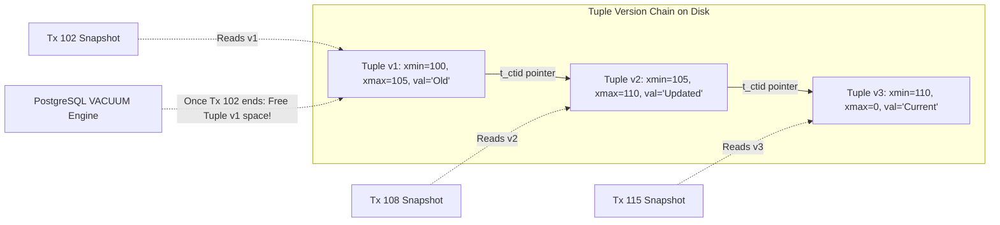

# Modul 161: Optimasi Kueri & Mesin Eksekusi (Cost-Based Optimizer, Hash Join, Merge Join, Analisis EXPLAIN ANALYZE)

**Navigasi**: [⬅️ Master Index](../../INDEX.md) | [Tingkat 10: Tingkat 10: Basis Data, Data Engineering & Sistem Informasi Enterprise](./README.md)
*Sebelumnya*: [160. arsitektur-internal-mesin-penyimpanan-basis-data](./160-arsitektur-internal-mesin-penyimpanan-basis-data.md) | *Berikutnya*: [162. transaksi-acid-kontrol-konkurensi-lanjut](./162-transaksi-acid-kontrol-konkurensi-lanjut.md)

---

## 1. Intuisi Dasar Tanpa Jargon ("Seperti Bayi Baru Lahir")
Jika setiap transaksi yang ingin membaca database harus mengunci seluruh tabel dan memaksa orang lain antre menunggu, sistem perbankan online atau e-commerce akan membeku saat jutaan orang berbelanja bersamaan. Namun jika semua orang diizinkan membaca dan menulis secara bebas tanpa aturan, kekacauan mistis akan terjadi: Anda membaca data yang baru separuh diketik (**Dirty Read**), data yang sama berubah angka di depan mata Anda (**Non-Repeatable Read**), atau muncul baris data hantu baru secara tiba-tiba (**Phantom Read**). Isolasi Transaksi & MVCC ([Transaction Isolation & MVCC](https://www.postgresql.org/docs/current/mvcc-intro.html)) adalah mahakarya arsitektur database modern: filosofi utamanya berbunyi: **'Pembaca tidak pernah memblokir Penulis, dan Penulis tidak pernah memblokir Pembaca!'** Setiap transaksi diberi kacamata dimensi waktu khusus: ia melihat snapshot database masa lalu yang konsisten tanpa pernah terganggu oleh hiruk-pikuk modifikasi transaksi lain yang sedang berlangsung.

## 2. Fondasi Teoretis & Aksiomatik / Matematis
Empat Tingkat Isolasi Standar SQL ANSI (SQL-92) dan Fenomena Anomali Konkruensi:

$$\begin{array}{|l|c|c|c|c|}
\hline
\textbf{Tingkat Isolasi ANSI} & \textbf{Dirty Read} & \textbf{Non-Repeatable Read} & \textbf{Phantom Read} & \textbf{Write Skew} \\
\hline
\textbf{Read Uncommitted} & \text{Bisa Terjadi} & \text{Bisa Terjadi} & \text{Bisa Terjadi} & \text{Bisa Terjadi} \\
\textbf{Read Committed} & \mathbf{Bebas} & \text{Bisa Terjadi} & \text{Bisa Terjadi} & \text{Bisa Terjadi} \\
\textbf{Repeatable Read} & \mathbf{Bebas} & \mathbf{Bebas} & \text{Bisa Terjadi (ANSI)} & \text{Bisa Terjadi} \\
\textbf{Serializable} & \mathbf{Bebas} & \mathbf{Bebas} & \mathbf{Bebas} & \mathbf{Bebas} \\
\hline
\end{array}$$

Formulasi Matematis Multi-Version Concurrency Control (MVCC PostgreSQL Model):

Setiap baris data tabel memegang dua metadata stempel transaksi tersembunyi:
- `xmin`: ID Transaksi yang menciptakan/menyisipkan baris ini.
- `xmax`: ID Transaksi yang menghapus atau menimpa baris ini (bernilai 0 jika masih aktif).

Aturan Visibilitas Snapshot ($T_{read}$ dengan Snapshot $\text{ActiveXID} = \{T_1, T_2, \dots\}$, $\text{xmin}_{snap}$, $\text{xmax}_{snap}$):
Baris tuple $R$ terlihat oleh transaksi pembaca $T_{read}$ jika dan hanya jika:
$$(\text{xmin}(R) < \text{xmax}_{snap}) \land (\text{xmin}(R) \notin \text{ActiveXID}) \land (\text{xmin}(R) \text{ sudah COMMIT})$$
$$\land \quad (\text{xmax}(R) == 0 \ \lor \ \text{xmax}(R) > \text{xmax}_{snap} \ \lor \ \text{xmax}(R) \in \text{ActiveXID})$$

## 3. Anatomi Teknis & Cara Kerja Internal
Rantai Versi Tuple MVCC (Version Chain) dan Pembersihan Sampah Vakum (VACUUM):



1. **Serializable Snapshot Isolation (SSI - Cahill et al., 2008)**:
   Mencapai tingkat isolasi tertinggi (Serializable murni) tanpa mengunci baris data (Lock-Free). SSI melacak ketergantungan konflik pembacaan-penulisan (*rw-antidependencies / si-read locks*); jika terdeteksi siklus bahaya dua anak panah berturut-turut pada graf ketergantungan transaksi, transaksi yang memicu siklus digugurkan (*Serialization Failure*) ([Serializable Snapshot Isolation Paper](https://dl.acm.org/doi/10.1145/1376616.1376690)).

## 4. Implementasi Praktis & Kode / Simulasi Riil
```python
# Multi-Version Concurrency Control (MVCC) Visibility Engine in Python
from typing import List, Dict, Optional

class MVCCRow:
    def __init__(self, xmin: int, data: str):
        self.xmin = xmin      # Tx ID pembuat
        self.xmax = 0         # Tx ID penghapus (0 jika aktif)
        self.data = data

class MVCCDatabase:
    def __init__(self):
        self.rows: List[MVCCRow] = []
        self.committed_txs = set()
        self.next_tx_id = 1

    def read_snapshot(self, tx_id: int, snapshot_active_txs: set) -> List[str]:
        visible_data = []
        for r in self.rows:
            # 1. Pembuat baris harus sudah commit dan bukan bagian dari transaksi aktif saat snapshot diambil
            created_visible = (r.xmin in self.committed_txs and r.xmin not in snapshot_active_txs) or (r.xmin == tx_id)
            # 2. Baris belum dihapus atau dihapus oleh transaksi yang belum commit bagi snapshot
            not_deleted = (r.xmax == 0) or (r.xmax not in self.committed_txs) or (r.xmax in snapshot_active_txs)
            
            if created_visible and not_deleted:
                visible_data.append(r.data)
        return visible_data

print("MVCC Visibility Engine initialized!")
```

## 5. Miskonsepsi & Jebakan Industri
1. **Write Skew Anomaly in Repeatable Read**: Dua dokter giliran jaga malam secara bersamaan meminta cuti di sistem rumah sakit yang memiliki aturan 'Minimal harus ada 1 dokter yang bertugas'. Kedua transaksi membaca bahwa saat ini ada 2 dokter bertugas (aturan terpenuhi), lalu keduanya serentak mengambil cuti di Repeatable Read, meninggalkan rumah sakit tanpa dokter sama sekali (solusi: gunakan Serializable Isolation atau `SELECT ... FOR UPDATE`).
2. **PostgreSQL Table Bloat due to Stalled VACUUM**: Transaksi pembacaan panjang (*Long-Running Read Query*) menahan batas nilai xmin tertua (*Oldest xmin Horizon*). Proses autovacuum tidak dapat membersihkan baris sampah mati (*Dead Tuples*), membengkakkan ukuran tabel di disk hingga puluhan gigabyte.
3. **Transaction ID Wraparound Disaster in PostgreSQL**: ID Transaksi 32-bit meluap setelah $2^{31}$ (2 miliar) transaksi. Database akan menghentikan seluruh penulisan secara paksa dan masuk ke mode darurat read-only untuk mencegah data lama dianggap terjadi di masa depan.

## 6. Proyek Latihan & Rubrik Penilaian Mandiri
1. **Tingkat Pemula**: Buka dua jendela terminal psql PostgreSQL secara bersamaan. Jalankan transaksi `BEGIN; UPDATE ...` di jendela 1 tanpa commit; buktikan bahwa jendela 2 membaca data lama yang konsisten tanpa terblokir.
2. **Tingkat Menengah**: Simulasikan anomali *Write Skew* di Python atau database nyata menggunakan tingkat isolasi Repeatable Read. Tunjukkan bagaimana beralih ke tingkat isolasi `SERIALIZABLE` menggugurkan salah satu transaksi dengan error `could not serialize access`.
3. **Tingkat Mahir**: Implementasikan Serializable Snapshot Isolation (SSI) tracker sederhana di Python: lacak jejak ketergantungan pembacaan (*SIREAD locks*), deteksi kemunculan pola bahaya *rw-antidependencies* segitiga siklus, dan gugurkan transaksi terakhir untuk membuktikan eksekusi ekuivalen serial.

## 7. Rekomendasi Sumber Belajar Standar Emas
| Sumber Pembelajaran | Penulis / Institusi | Tautan Langsung | Fokus Materi |
| :--- | :--- | :--- | :--- |
| Serializable Isolation for Snapshot Databases | Michael J. Cahill, Uwe Röhm, Alan D. Fekete | [ACM SIGMOD 2008 SSI Paper](https://dl.acm.org/doi/10.1145/1376616.1376690) | Makalah Orisinal Penemuan Serializable Snapshot Isolation (SSI) Tanpa Lock |
| A Critique of ANSI SQL Isolation Levels | Hal Berenson, Jim Gray, Jim Melton et al. | [ACM SIGMOD 1995 Paper](https://dl.acm.org/doi/10.1145/223784.223785) | Analisis Cacat Spesifikasi ANSI 1992, Penemuan Anomali Write Skew & Snapshot Isolation |
| PostgreSQL Concurrency Control Official Guide | PostgreSQL Documentation | [PostgreSQL MVCC Documentation](https://www.postgresql.org/docs/current/mvcc.html) | Anatomi Baris xmin/xmax, Heap Tuples, VACUUM & SSI Implementation |
| Designing Data-Intensive Applications (Chapter 7: Transactions) | Martin Kleppmann | [DDIA Transactions Portal](https://dataintensive.net/) | Eksplorasi Visual Mendalam Read Committed, Snapshot Isolation, Phantoms & Write Skew |

---
*Navigasi Cepat*: [Ke Tingkat 10](./README.md) | [Ke Master Index](../../INDEX.md) | *Sebelumnya*: [160. arsitektur-internal-mesin-penyimpanan-basis-data](./160-arsitektur-internal-mesin-penyimpanan-basis-data.md) | *Berikutnya*: [162. transaksi-acid-kontrol-konkurensi-lanjut](./162-transaksi-acid-kontrol-konkurensi-lanjut.md)
