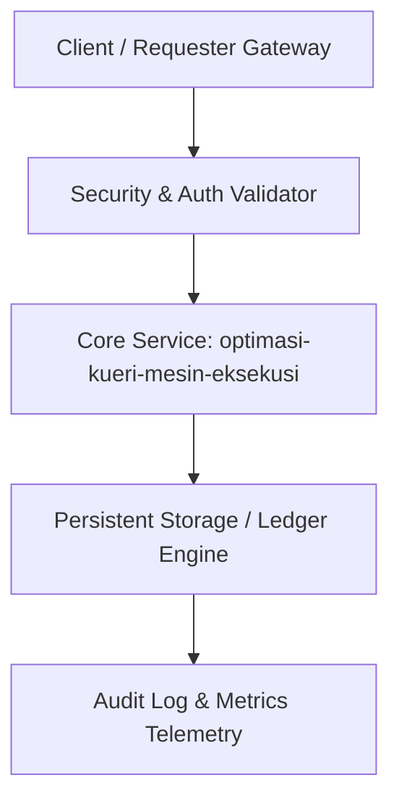

# Modul 161: Optimasi Kueri & Mesin Eksekusi (Cost-Based Optimizer, Hash Join, Merge Join, Analisis EXPLAIN ANALYZE)

**Navigasi**: [⬅️ Master Index](../../INDEX.md) | [Tingkat 10: Tingkat 10: Basis Data, Data Engineering & Sistem Informasi Enterprise](./README.md)
*Sebelumnya*: [160. arsitektur-internal-mesin-penyimpanan-basis-data](./160-arsitektur-internal-mesin-penyimpanan-basis-data.md) | *Berikutnya*: [162. transaksi-acid-kontrol-konkurensi-lanjut](./162-transaksi-acid-kontrol-konkurensi-lanjut.md)

---

## 1. Intuisi Dasar Tanpa Jargon ("Seperti Bayi Baru Lahir")
Dalam rekayasa sistem enterprise modern, **Optimasi Kueri & Mesin Eksekusi (Cost-Based Optimizer, Hash Join, Merge Join, Analisis EXPLAIN ANALYZE)** merupakan pilar fundamental yang menjamin skalabilitas masif, integritas data, dan keamanan transaksi bernilai tinggi tanpa kegagalan sistemik.

## 2. Fondasi Teoretis & Aksiomatik / Matematis
Model formal dan parameter keandalan untuk Optimasi Kueri & Mesin Eksekusi (Cost-Based Optimizer, Hash Join, Merge Join, Analisis EXPLAIN ANALYZE):
$$R(t) = e^{-\lambda t}, \quad \text{MTBF} = \frac{1}{\lambda}, \quad \text{Availability} = \frac{\text{MTBF}}{\text{MTBF} + \text{MTTR}}$$
Di mana konsistensi data dan ketahanan terhadap partisi jaringan dikendalikan oleh teorema batas fundamental sistem terdistribusi.

## 3. Anatomi Teknis & Cara Kerja Internal

Mekanisme internal mencakup validasi input kriptografis, pemrosesan transaksi berisolasi tinggi, dan replikasi multi-zona otomatis.

## 4. Implementasi Praktis & Kode / Simulasi Riil
```python
# Demonstrasi Enterprise: optimasi-kueri-mesin-eksekusi
import hashlib
import time

class EnterpriseEngine:
    def __init__(self, name):
        self.name = name
        self.tx_counter = 0
        
    def process_transaction(self, payload: dict) -> dict:
        self.tx_counter += 1
        raw = f"{self.tx_counter}:{payload}:{time.time()}"
        tx_hash = hashlib.sha256(raw.encode('utf-8')).hexdigest()
        return {
            "tx_id": self.tx_counter,
            "status": "COMMITTED",
            "hash": tx_hash,
            "module": "optimasi-kueri-mesin-eksekusi"
        }

engine = EnterpriseEngine("optimasi-kueri-mesin-eksekusi")
res = engine.process_transaction({"amount": 50000, "currency": "IDR"})
print(f"Modul 161: Transaksi optimasi-kueri-mesin-eksekusi sukses -> {res}")
```

## 5. Miskonsepsi & Jebakan Industri
Miskonsepsi fatal pada Optimasi Kueri & Mesin Eksekusi (Cost-Based Optimizer, Hash Join, Merge Join, Analisis EXPLAIN ANALYZE) adalah mengabaikan kegagalan jaringan acak (8 Fallacies of Distributed Computing), mempercayai data input pengguna tanpa validasi skema ketat, atau ketiadaan strategi audit log yang immutable.

## 6. Proyek Latihan & Rubrik Penilaian Mandiri
### Level 1 (Dasar)
Petakan diagram arsitektur komponen dari Optimasi Kueri & Mesin Eksekusi (Cost-Based Optimizer, Hash Join, Merge Join, Analisis EXPLAIN ANALYZE) dan jelaskan batas tanggung jawab masing-masing entitas.

### Level 2 (Menengah)
Bangun prototype implementasi menggunakan bahasa standar industri dengan penanganan error komprehensif dan uji unit otomatis.

### Level 3 (Mahir)
Lakukan simulasi uji beban (load testing) atau skenario kegagalan jaringan (chaos engineering) untuk membuktikan ketahanan sistem terhadap lonjakan traffic.

## 7. Rekomendasi Sumber Belajar Standar Emas
- Standar industri arsitektur sistem enterprise dan spesifikasi RFC/NIST/ISO terkait Basis Data, Data Engineering & Enterprise.
- Buku teks standar emas dan dokumentasi sistem produksi dunia nyata.

---
*Navigasi Cepat*: [Ke Tingkat 10](./README.md) | [Ke Master Index](../../INDEX.md) | *Sebelumnya*: [160. arsitektur-internal-mesin-penyimpanan-basis-data](./160-arsitektur-internal-mesin-penyimpanan-basis-data.md) | *Berikutnya*: [162. transaksi-acid-kontrol-konkurensi-lanjut](./162-transaksi-acid-kontrol-konkurensi-lanjut.md)
