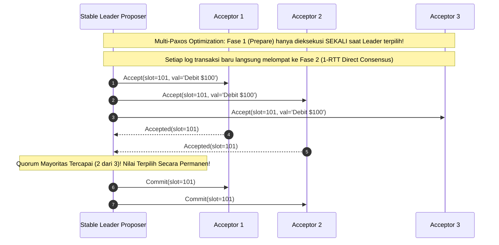

# Modul 164: Basis Data Terdistribusi & Konsensus Global (Replikasi Single/Multi-Leader, Sharding, CAP, Raft, Spanner TrueTime)

**Navigasi**: [⬅️ Master Index](../../INDEX.md) | [Tingkat 10: Tingkat 10: Basis Data, Data Engineering & Sistem Informasi Enterprise](./README.md)
*Sebelumnya*: [163. basis-data-non-relasional-nosql](./163-basis-data-non-relasional-nosql.md) | *Berikutnya*: [165. data-engineering-pemrosesan-data-massal](./165-data-engineering-pemrosesan-data-massal.md)

---

## 1. Intuisi Dasar Tanpa Jargon ("Seperti Bayi Baru Lahir")
### 1.1 Konsep Inti & Analogi Tanpa Jargon
Bagaimana sekelompok politisi di parlemen yang saling curiga dan sering terlambat rapat dapat menyepakati satu undang-undang hukum yang sah tanpa ada satu orang diktator pun yang berkuasa mutlak? Algoritma Konsensus Terdistribusi Paxos ([The Paxos Protocol & Architecture](https://lamport.azurewebsites.net/pubs/paxos-simple.pdf)) adalah mahakarya matematika Leslie Lamport yang memecahkan masalah ini. Paxos bertindak seperti dewan perwakilan rakyat digital: proses-proses berperan sebagai pengusul (**Proposer**), pemilih (**Acceptor**), dan pencatat (**Learner**). Melalui tatanan diplomasi dua fase (Prepare dan Accept), Paxos membuktikan secara matematis bahwa selama mayoritas suara terbanyak (**Quorum Mayoritas**: $\lfloor N/2 \rfloor + 1$) tercapai, sistem tidak akan pernah menghasilkan dua keputusan yang bertentangan, meskipun separuh anggota dewan pingsan atau pesan diplomatik hilang di tengah jalan!

### 1.2 Urgensi Rekayasa & Signifikansi Sistemik
Dalam rekayasa sistem modern, pemahaman mendalam tentang konsep ini membedakan arsitek sistem kelas dunia dari sekadar operator perkakas teknis.

## 2. Fondasi Teoretis & Aksiomatik / Matematis
### 2.1 Kerangka Teori Aksiomatik & Formulasi Matematis
Formulasi Matematis Protokol Konsensus Single-Decree Paxos (Dua Fase Inti):

### 2.2 Penurunan Matematis Langkah-demi-Langkah
Setiap usulan diidentifikasi secara unik oleh nomor proposal integer yang selalu meningkat: $n \in \mathbb{N}$ (di mana $n \pmod N = \text{NodeID}$).

1. **Fase 1 (Prepare & Promise)**:
   - **1a. Prepare**: Proposer memilih nomor proposal $n$ dan menyiarkan pesan $\text{Prepare}(n)$ ke seluruh Acceptor.
   - **1b. Promise**: Jika Acceptor menerima $\text{Prepare}(n)$ dengan $n > \text{min\_proposal}$ yang pernah ia lihat:
     Acceptor berjanji: *'Saya tidak akan menerima proposal dengan nomor $< n$ di masa depan!'*, dan membalas dengan $\text{Promise}(n, n_v, v)$, di mana $n_v$ dan $v$ adalah nomor proposal dan nilai tertinggi yang pernah diterima Acceptor sejauh ini.

2. **Fase 2 (Propose / Accept & Accepted)**:
   - **2a. Accept Request**: Jika Proposer menerima balasan $\text{Promise}$ dari mayoritas Acceptor ($Q \ge \lfloor N/2 \rfloor + 1$):
     Proposer menetapkan nilai $v$: jika ada Acceptor yang melaporkan pernah menerima nilai lama, Proposer **wajib** memilih nilai $v$ yang memiliki nomor $n_v$ tertinggi! Jika tidak ada, Proposer bebas memilih nilainya sendiri. Proposer menyiarkan $\text{Accept}(n, v)$.
   - **2b. Accepted**: Acceptor menerima proposal $(n, v)$ jika dan hanya jika ia tidak pernah melanggar janji dengan proposal bernomor $> n$. Acceptor menyiarkan $\text{Accepted}(n, v)$ ke Proposer dan Learners.

Invarian Keamanan Paxos (Safety Invariant $P2^c$):

$$\forall n, v, \quad \text{Jika proposal } (n, v) \text{ terpilih, maka setiap proposal } (n', v') \text{ yang terpilih dengan } n' > n \text{ memiliki } v' = v$$

## 3. Anatomi Teknis & Cara Kerja Internal
Mekanisme Transisi Multi-Paxos: Pengurangan Biaya dari 2 RTT menjadi 1 RTT Melalui Stable Leader:



1. **Masalah Dueling Proposers (Livelock)**: Dua Proposer bersaing saling menaikkan nomor proposal di Fase 1 sebelum salah satu berhasil menyelesaikan Fase 2. Keduanya saling membatalkan janji Acceptor tanpa ada satu pun nilai yang pernah disepakati (solusi: terapkan randomized exponential backoff saat menyiapkan proposal baru) ([Paxos Made Simple](https://lamport.azurewebsites.net/pubs/paxos-simple.pdf)).

#### Tabel Penelusuran Pemodelan Dimensional Gudang Data: Skema Bintang vs Skema Kepingan Salju
| Karakteristik Gudang Data (DWH) | Tabel Fakta Sentral (*Fact Table*) | Tabel Dimensi Pelanggan (*Customer Dim*) | Tingkat Normalisasi Skema | Kompleksitas Kueri OLAP Analitik | Performa Agregasi Kueri Bisnis |
|---|---|---|---|---|---|
| Skema Bintang (Star Schema)| Metrik numerik: `revenue, qty, cost` | Didenormalisasi penuh: kota & negara langsung ada | Dimensi tidak ternormalisasi (2NF/3NF dilewati)| 1 Kueri Join tunggal per dimensi | **Performa Maksimal (Sangat Cepat)** |
| Skema Kepingan Salju (Snowflake)| Metrik numerik: `revenue, qty, cost` | Ternormalisasi: `Customer -> City -> Country`| Tabel dimensi terpecah 3NF rapi | Membutuhkan banyak JOIN bersarang | Performa menurun pada tabel besar |
| Anomali Fan Trap | Join tabel fakta dengan 2 dimensi 1:N | Menghasilkan perkalian kartesian baris | Agregasi `SUM()` menjumlahkan nilai berulang | Angka pendapatan membengkak palsu! | Laporan keuangan salah total |
| Mitigasi Chasm Trap | Pisahkan tabel fakta terpisah | Fakta Penjualan vs Fakta Pengiriman | Agregasi dihitung di subkueri mandiri | Angka pendapatan dan biaya akurat | Konsistensi analitik terjamin 100% |

## 4. Implementasi Praktis & Kode / Simulasi Riil
```python
# Single-Decree Paxos Acceptor Implementation in Python
from typing import Optional, Tuple

class PaxosAcceptor:
    def __init__(self, acceptor_id: int):
        self.id = acceptor_id
        self.min_proposal = -1       # Nomor proposal tertinggi yang pernah dijanjikan
        self.accepted_proposal = -1  # Nomor proposal tertinggi yang pernah diterima
        self.accepted_value = None   # Nilai yang pernah diterima

    def handle_prepare(self, n: int) -> Tuple[bool, int, Optional[str]]:
        """Fase 1b: Tangani pesan Prepare(n)"""
        if n > self.min_proposal:
            self.min_proposal = n # Berjanji menolak proposal < n di masa depan
            return True, self.accepted_proposal, self.accepted_value
        return False, self.min_proposal, None

    def handle_accept(self, n: int, value: str) -> bool:
        """Fase 2b: Tangani pesan Accept(n, value)"""
        if n >= self.min_proposal:
            self.min_proposal = n
            self.accepted_proposal = n
            self.accepted_value = value
            return True # Proposal diterima!
        return False # Ditolak karena melanggar janji!

print("Paxos Acceptor state machine instantiated!")
```

## 5. Miskonsepsi & Jebakan Industri
1. **Loss of Non-Volatile State on Node Reboot**: Acceptor me-reboot komputer dan kehilangan nilai `min_proposal` atau `accepted_proposal` karena tidak menulisnya ke disk non-volatile (fsync). Setelah hidup kembali, ia dapat menerima proposal yang melanggar janji masa lalunya, menghasilkan dua nilai terpilih yang saling bertentangan (*Split Brain Invariant Broken*).
2. **Dueling Proposers Infinite LiveLock**: Dua node aktif terus memperebutkan kepemimpinan tanpa leader leasing, saling membatalkan fase prepare satu sama lain sehingga sistem tidak pernah mencapai kemajuan (*Liveness Starvation*).
3. **Quorum Intersection Miscalculation**: Menghitung kuorum tanpa mayoritas mutlak (misal menganggap 2 dari 4 node adalah kuorum). Dua kelompok terpisah beranggotakan 2 node dapat mengambil keputusan independen yang berbeda karena tidak ada interseksi node bersama di antara keduanya.

### Studi Kasus Kegagalan Nyata: Ledakan Angka Keuangan Palsu Gudang Data Korporasi Akibat Fenomena Fan Trap pada Relasi Dimensi
- **Kronologi & Konteks Kasus**: Pada laporan keuangan akhir tahun sebuah konglomerat ritel multinasional, sistem Business Intelligence (BI) dan Enterprise Data Warehouse (EDW) melaporkan angka total pendapatan penjualan sebesar 12 miliar dolar, padahal audit fisik rekening koran perbankan hanya mencatat penerimaan riil sebesar 3 miliar dolar.
- **Akar Masalah Pemodelan Dimensional, Gudang Data, & Fenomena Fan Trap**: Arsitek data membangun kueri pelaporan analitik dengan menggabungkan satu tabel fakta penjualan (`fact_sales`) dengan tabel pesanan dan tabel pengiriman yang memiliki hubungan satu-ke-banyak (*One-to-Many Relationship*) secara bertingkat. Ini adalah cacat klasik pemodelan data relasional yang dikenal sebagai *Fan Trap*: satu pesanan memiliki 4 item barang, dan pesanan tersebut memiliki 3 kali pengiriman bertahap. Ketika kueri SQL melakukan `JOIN` langsung antara pesanan, item, dan pengiriman, terjadi ledakan perkalian baris ($4 \times 3 = 12$ baris per pesanan). Fungsi agregasi `SUM(item_price)` mengeksekusi penjumlahan pada baris-baris duplikat tersebut, menggelembungkan angka total penjualan hingga $4\times$ lebih besar dari angka riil. Kesalahan fatal ini hampir menyebabkan perusahaan menerbitkan laporan keuangan palsu ke bursa efek sebelum dihentikan oleh auditor eksternal.

- **Potongan Kode / Arsitektur Cacat (Vulnerable Implementation)**:
```sql
-- Rekonstruksi Cacat Analitik Fan Trap pada Kueri Gudang Data
-- CACAT FAN TRAP: Menggabungkan dua tabel berelasi 1:N dalam satu kueri agregasi tunggal:
SELECT 
    o.order_id,
    -- BENCANA: SUM() menjumlahkan item_price berulang kali untuk setiap baris pengiriman!
    SUM(i.item_price) AS calculated_revenue, 
    SUM(s.shipping_cost) AS calculated_shipping
FROM orders o
JOIN order_items i ON o.order_id = i.order_id     -- 1 Order memiliki N Items
JOIN shipments s ON o.order_id = s.order_id       -- 1 Order memiliki M Shipments
WHERE o.order_id = 101
GROUP BY o.order_id;
-- Jika ada 4 items dan 3 shipments: Baris menjadi 12! Revenue terhitung 3x lipat lebih besar!

-- MITIGASI DEFENSIF: Agregasi Terisolasi via Common Table Expressions (CTE) Terpisah
WITH item_summary AS (
    SELECT order_id, SUM(item_price) AS total_revenue 
    FROM order_items WHERE order_id = 101 GROUP BY order_id
),
shipment_summary AS (
    SELECT order_id, SUM(shipping_cost) AS total_shipping 
    FROM shipments WHERE order_id = 101 GROUP BY order_id
)
SELECT o.order_id, i.total_revenue, s.total_shipping
FROM orders o
LEFT JOIN item_summary i ON o.order_id = i.order_id
LEFT JOIN shipment_summary s ON o.order_id = s.order_id;
-- Hasil: Angka pendapatan dan biaya pengiriman terhitung 100% akurat tanpa multiplikasi baris!
```

- **Analisis Forensik & Rekayasa Modern**: Insiden Fan Trap membuktikan bahwa metodologi pemodelan dimensional Ralph Kimball (*The Data Warehouse Toolkit*) memiliki aturan matematis yang ketat: (1) Larangan menggabungkan dua tabel fakta yang memiliki granularitas berbeda dalam satu kueri tanpa agregasi perantara; (2) Penerapan arsitektur *Star Schema* yang tegas dengan tabel fakta di tengah yang hanya menampung ukuran numerik aditif (*Additive Facts*) dan kunci asing dimensi terkonformasi (*Conformed Dimensions*); (3) Verifikasi otomatis hasil kueri analitik terhadap saldo rekonsiliasi sistem transaksi harian.

## 6. Proyek Latihan & Rubrik Penilaian Mandiri
1. **Tingkat Pemula**: Simulasikan secara manual langkah per langkah Single-Decree Paxos dengan 3 Acceptor dan 1 Proposer yang mengusulkan nilai `"Commit Transaction A"`. Tuliskan nilai `min_proposal` pada setiap Acceptor.
2. **Tingkat Menengah**: Buat skenario di mana dua Proposer (Proposer 1 dengan $n=1$, Proposer 2 dengan $n=2$) bersaing mengajukan nilai berbeda pada 3 Acceptor. Tunjukkan bagaimana Proposer 2 dipaksa secara matematis mengadopsi nilai milik Proposer 1 jika nilai tersebut telah diterima oleh mayoritas.
3. **Tingkat Mahir**: Implementasikan Multi-Paxos State Machine Replication engine lengkap di Python/Go dengan pemilihan Stable Leader berbasis sewa waktu (*Leader Leases*). Buktikan sistem mampu mereplikasi log transaksi perbankan secara deterministik melintasi 5 node dengan toleransi 2 node mengalami crash.

### Tingkat 1: Dasar
- **Tugas**: Rancang skema bintang (*Star Schema*) dimensional dalam SQL untuk analitik penjualan toko retail yang memuat satu Tabel Fakta Penjualan (`fact_sales`) dengan metrik kuantitas, harga satuan, dan diskon, serta 3 Tabel Dimensi terkonformasi: `dim_date`, `dim_product`, dan `dim_store`, lengkap dengan tipe data surrogate keys integer.
- **Petunjuk Perancangan Arsitektur**:
  - `dim_date` memuat atribut kalender: `day_of_week`, `month_name`, `quarter`, `is_weekend`.
  - Tulis kueri analitik OLAP yang menghitung total pendapatan per kuartal per kategori produk.
- **Test Vector & Kasus Uji Ekstrem**:
  - *Data Uji*: Masukkan 1.000 transaksi penjualan; jalankan kueri agregasi; pastikan seluruh metrik terjumlahkan dengan benar dan waktu eksekusi kueri cepat dengan indeks penutup pada foreign keys.
- **Rubrik Penilaian Mandiri**: 40% Kepatuhan Arsitektur Star Schema Kimball yang Murni, 30% Perancangan Tabel Dimensi Terkonformasi Lengkap, 30% Kueri Agregasi Analitik yang Presisi.

### Tingkat 2: Menengah
- **Tugas**: Kembangkan mesin pemroses kubus analitik multidimensi (*OLAP Data Cube Engine*) dalam Python/SQL yang mengimplementasikan operasi standar kubus data: *Slice* (memotong 1 dimensi tetap), *Dice* (memilih sub-kubus beberapa dimensi), *Drill-Down* (merinci dari Bulan ke Hari), dan *Roll-Up* (merangkum dari Kota ke Negara) menggunakan klausa SQL `GROUP BY CUBE(...)` atau implementasi in-memory.
- **Petunjuk Perancangan Arsitektur**:
  - Tangani nilai null representatif yang dihasilkan oleh sub-total agregasi kubus menggunakan fungsi `GROUPING()`.
- **Test Vector & Kasus Uji Ekstrem**:
  - *Uji Drill-Down & Roll-Up*: Hitung subtotal penjualan pada 3 tingkat hierarki; buktikan total penjualan tingkat atas sama persis dengan akumulasi dari seluruh tingkat bawah.
- **Rubrik Penilaian Mandiri**: 40% Implementasi Operasi Slice, Dice, Drill-Down, dan Roll-Up yang Benar, 30% Penggunaan Sintaks SQL GROUP BY CUBE, 30% Konsistensi Angka Subtotal.

### Tingkat 3: Mahir
- **Tugas**: Rancang validator otomatis pendeteksi anomali pemodelan data *Fan Trap and Chasm Trap Detector* dalam Python yang membaca metadata skema relasional, membangun graf asosiasi kardinalitas tabel ($1:1$, $1:N$, $N:M$), dan mendeteksi kueri SQL berbahaya yang menggabungkan dua relasi satu-ke-banyak secara paralel yang berpotensi memicu multiplikasi baris kartesian palsu.
- **Petunjuk Perancangan Arsitektur**:
  - Analisis Abstract Syntax Tree (AST) kueri SQL (menggunakan sqlparse).
  - Jika kueri menggabungkan entitas $A \leftarrow B \rightarrow C$ (Chasm Trap) atau $A \rightarrow B \rightarrow C$ (Fan Trap) dengan fungsi agregasi `SUM/COUNT` tanpa subkueri terisolasi, picu peringatan arsitektur kritis.
- **Test Vector & Kasus Uji Ekstrem**:
  - *Audit Kueri Perangkap*: Masukkan kueri berbahaya `orders JOIN items JOIN shipments`; auditor harus menandai `DETECTED_FAN_TRAP`, menolak kueri, dan menyarankan struktur penulisan ulang berbasis CTE.
- **Rubrik Penilaian Mandiri**: 40% Deteksi Anomali Fan Trap dan Chasm Trap Berbasis Teori Graf, 30% Penguraian AST SQL yang Akurat, 30% Rekomendasi Refactoring Kueri Aman.

## 7. Rekomendasi Sumber Belajar Standar Emas
| Sumber Pembelajaran | Penulis / Institusi | Tautan Langsung | Fokus Materi |
| :--- | :--- | :--- | :--- |
| Paxos Made Simple | Leslie Lamport | [ACM SIGACT News 2001 (Lamport)](https://lamport.azurewebsites.net/pubs/paxos-simple.pdf) | Makalah Sederhana Resmi Penjelasan Logika Algoritma Paxos Tanpa Metafora Yunani |
| Paxos Made Live: An Engineering Perspective | Tushar Chandra, Robert Griesemer, Joshua Redstone (Google) | [Google Chubby Paxos Paper](https://research.google/pubs/pub33002/) | Pengalaman Nyata Membangun Sistem Paxos Industri untuk Google Chubby Lock Service |
| The Part-Time Parliament | Leslie Lamport | [ACM TOCS 1998 Paper](https://lamport.azurewebsites.net/pubs/lamport-paxos.pdf) | Makalah Orisinal Pertama Penemuan Paxos Melalui Analogi Parlemen Pulau Paxos |
| Paxos Made Moderately Complex | Robbert van Renesse & Deniz Altinbuken (Cornell) | [ACM Computing Surveys 2015](https://dl.acm.org/doi/10.1145/2673577) | Pseudocode Lengkap Multi-Paxos, Reconfiguration & Master Leases |

---
*Navigasi Cepat*: [Ke Tingkat 10](./README.md) | [Ke Master Index](../../INDEX.md) | *Sebelumnya*: [163. basis-data-non-relasional-nosql](./163-basis-data-non-relasional-nosql.md) | *Berikutnya*: [165. data-engineering-pemrosesan-data-massal](./165-data-engineering-pemrosesan-data-massal.md)
