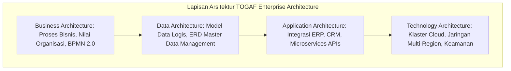

# Modul 166: Sistem Informasi Manajemen & Enterprise (DIKW, ERP, CRM, SCM, BPMN 2.0, TOGAF ADM, ITIL v4, COBIT, FinOps)

**Navigasi**: [⬅️ Master Index](../../INDEX.md) | [Tingkat 10: Tingkat 10: Basis Data, Data Engineering & Sistem Informasi Enterprise](./README.md)
*Sebelumnya*: [165. data-engineering-pemrosesan-data-massal](./165-data-engineering-pemrosesan-data-massal.md) | *Berikutnya*: [167. infrastruktur-hardware-pusat-data-enterprise](./167-infrastruktur-hardware-pusat-data-enterprise.md)

---

## 1. Intuisi Dasar Tanpa Jargon ("Seperti Bayi Baru Lahir")
### 1.1 Menyelaraskan Bisnis Raksasa dengan Kode Komputer ([Enterprise Architecture as Strategy - Ross et al.](https://www.amazon.com/Enterprise-Architecture-Strategy-Creating-Foundation/dp/1591398398))
Bayangkan sebuah bank multinasional atau perusahaan maskapai penerbangan dengan 50.000 karyawan di 30 negara, mengoperasikan 1.500 sistem software berbeda yang dibeli dari puluhan vendor selama 30 tahun. Sistem pemesanan tiket berjalan di mainframe IBM lama, sistem keuangan menggunakan SAP, sistem gaji menggunakan Workday, dan aplikasi seluler berjalan di cloud. Bagaimana menghubungkan ribuan sistem yang berantakan ini agar tidak terjadi kekacauan operasional?

### 1.2 Piramida DIKW dan Kerangka Kerja Enterprise (TOGAF, ERP, FinOps) ([TOGAF Standard 10th Edition](https://www.opengroup.org/togaf))
Sistem Informasi Manajemen (Enterprise Information Systems) adalah sains rekayasa arsitektur organisasi:
1. **Hierarki DIKW (Data $\to$ Informasi $\to$ Pengetahuan $\to$ Kebijaksanaan)**: Mengubah miliaran bit mentah transaksi log menjadi wawasan strategis keputusan dewan direksi.
2. **Sistem Terintegrasi Inti (ERP, CRM, SCM)**: Menghubungkan seluruh rantai pasok dari pengadaan bahan baku pabrik hingga hubungan konsumen akhir dalam satu buku besar data terpadu.
3. **Standar Arsitektur Enterprise (TOGAF ADM & BPMN 2.0)**: Bahasa visual pemodelan proses bisnis yang memastikan bahwa perubahan infrastruktur teknologi selalu mendukung target profitabilitas perusahaan.
4. **FinOps & ITIL v4**: Tata kelola modern untuk mengendalikan biaya tagihan komputasi awan (*Cloud Cost Optimization*) dan standar keandalan layanan TI berstandar global.

## 2. Fondasi Teoretis & Aksiomatik / Matematis
### 2.1 Teori Aliran Informasi Hierarki DIKW ([Russell Ackoff, 1989](https://link.springer.com/chapter/10.1007/978-94-010-0968-3_1))
Hierarki transformasi kognitif data enterprise dimodelkan sebagai fungsi reduksi entropi:
$$\text{Data} \xrightarrow{\text{Konteks}} \text{Informasi} \xrightarrow{\text{Pola}} \text{Knowledge} \xrightarrow{\text{Prinsip}} \text{Wisdom}$$
- **Data**: Simbol mentah tanpa makna ($x = 42$).
- **Informasi**: Data yang diberi konteks semantik struktural:
  $$I = H(D_{\text{prior}}) - H(D_{\text{posterior}})$$
  (Misal: "Suhu server di Rak 4 mencapai \$42^\circ\text{C}$").
- **Knowledge (Pengetahuan)**: Kemampuan bertindak berdasarkan pola historis (Misal: "Jika suhu mencapai \$42^\circ\text{C}$, peluang kegagalan hard disk melonjak \$400\%$ dalam 2 jam").
- **Wisdom (Kebijaksanaan)**: Keputusan strategis jangka panjang bernilai etika dan bisnis (Misal: "Rancang ulang sistem pendingin data center menuju teknologi pendingin cair celup").

### 2.2 Model Analisis FinOps Biaya Komputasi Awan (Unit Economics) ([FinOps Foundation Framework](https://www.finops.org/framework/))
Metrik Efisiensi Biaya Satuan (*Cloud Unit Economics*):
$$U = \frac{\text{Total Biaya Infrastruktur Cloud (Compute + Storage + Network)}}{\text{Metrik Transaksi Bisnis Utama (Misal: Jumlah Pesanan Selesai)}}$$
Indikator Kesehatan Efisiensi Alokasi Biaya:
Biaya Terbuang (*Waste Ratio* $W$):
$$W = 1 - \frac{\text{Kapasitas CPU/RAM Terutilisasi Riil}}{\text{Kapasitas CPU/RAM yang Dipesan (Provisioned)}} \le 0.15$$
Tim FinOps menggunakan model komitmen diskon (*Savings Plans / Reserved Instances*) untuk memotong biaya hingga \$72\%$ dibanding tarif bayar per detik (*On-Demand*).

## 3. Anatomi Teknis & Cara Kerja Internal


#### Tabel Komparasi Modul Sistem Enterprise Klasik
| Modul Enterprise | Fungsi Utama | Standar Integrasi | Metrik Utama Keberhasilan |
|---|---|---|---|
| ERP (Enterprise Resource Planning) | Buku besar akuntansi, keuangan, aset | ISO 20022 / SAP BAPI | Rekonsiliasi buku besar tutup buku instan |
| SCM (Supply Chain Management) | Pengadaan, inventaris gudang, logistik | EDIFACT / ANSI X12 | Waktu putaran persediaan (*Inventory Turnover*) |
| CRM (Customer Relationship Management) | Pipeline penjualan, dukungan pelanggan | RESTful / GraphQL | Biaya Akuisisi Pelanggan (CAC) & LTV |
| ITSM (IT Service Management - ITIL) | Manajemen insiden, perubahan (*Change Control*) | ITIL v4 SLA/SLO | Waktu Rata-rata Pemulihan Insiden (MTTR) |

#### Tabel Penelusuran Pergeseran Skema Senyap (Silent Schema Drift) & Korupsi Model AI
| Tahap Aliran Data Enterprise | Format Skema Kolom Masukan | Status Validasi Skema Data Contract | Integritas Fitur di Feature Store | Keluaran Prediksi Model AI | Dampak terhadap Keputusan Bisnis |
|---|---|---|---|---|---|
| Operasi Awal | Kolom usia: `age (integer)` | Kontrak data tervalidasi | Usia normal: `25, 40, 60` | Skor kredit terhitung normal | Penyaluran pinjaman aman |
| Perubahan Hulu Senyap | Tim frontend ubah format tanggal | Menjadi string ISO: `"1995-04-12"` | **KONTRAK DATA DIABAIKAN (NOL LINTER)!** | Pipeline melempar string ke model | Konversi tipe implisit gagal |
| Imputasi Bisu | Pipeline hilir isi nilai null otomatis | Missing value diimputasi rata-rata: `0` | Seluruh pengguna baru memiliki usia `0`! | Model mengevaluasi usia 0 tahun | **MODEL MENGALAMI PERGESERAN DRIFT PARAH!**|
| Keputusan Rusak | Model menolak pinjaman otomatis | Mengira seluruh pemohon adalah bayi | Akurasi model anjlok dari 92% ke 15% | Kerugian bisnis jutaan dolar | Sistem berjalan tanpa error exception di log! |
| Mitigasi Data Contract | Pemasangan Great Expectations / Protobuf| Skema tervalidasi ketat di gerbang data | String ISO ditolak di pintu masuk pipeline | Pipeline hulu dipaksa memperbaiki format | Data bersih terjaga di seluruh enterprise |

## 4. Implementasi Praktis & Kode / Simulasi Riil
```python
# Simulasi Analitik FinOps: Deteksi Under-utilized Cloud Resources & Rekomendasi Rightsizing
from dataclasses import dataclass

@dataclass
class CloudInstanceMetrics:
    instance_id: str
    instance_type: str
    monthly_cost_usd: float
    avg_cpu_utilization_percent: float
    max_memory_utilization_percent: float

def evaluate_finops_rightsizing(instances: list[CloudInstanceMetrics]) -> list[dict]:
    recommendations = []
    for inst in instances:
        # Aturan FinOps: Jika rata-rata CPU < 15% dan Memori < 30%, instance mengalami pemborosan
        if inst.avg_cpu_utilization_percent < 15.0 and inst.max_memory_utilization_percent < 30.0:
            potential_savings = inst.monthly_cost_usd * 0.50  # Estimasi downgrade 1 tingkat
            recommendations.append({
                "instance_id": inst.instance_id,
                "current_type": inst.instance_type,
                "action": "DOWNSIZE_OR_SHUTDOWN",
                "current_cost_usd": inst.monthly_cost_usd,
                "potential_monthly_savings_usd": potential_savings,
                "reason": f"CPU rata-rata hanya {inst.avg_cpu_utilization_percent}% (Batas aman pemborosan: < 15%)"
            })
    return recommendations

# Contoh Data Audit Cloud
fleet = [
    CloudInstanceMetrics("i-01a", "c5.4xlarge", 512.0, 8.2, 22.0),
    CloudInstanceMetrics("i-02b", "m5.large", 72.0, 65.4, 78.0),
    CloudInstanceMetrics("i-03c", "r5.2xlarge", 380.0, 11.5, 18.5)
]

savings = evaluate_finops_rightsizing(fleet)
print(f"Ditemukan {len(savings)} server mengalami pemborosan alokasi biaya!")
for rec in savings:
    print(f" - Server {rec['instance_id']}: Potensi Penghematan \${rec['potential_monthly_savings_usd']:.2f}/bulan")
```

## 5. Miskonsepsi & Jebakan Industri
### Studi Kasus Kegagalan Nyata: Bencana Implementasi ERP Revlon Senilai \$64 Juta (2018)
- **Kronologi & Latar Belakang**: Perusahaan kosmetik raksasa Revlon menerapkan sistem ERP SAP baru pada Februari 2018. Segera setelah peluncuran sistem baru (*go-live*), sistem gagal memproses pesanan pengiriman barang senilai jutaan dolar ke toko ritel.
- **Akar Masalah**: Tata kelola integrasi data master (*Master Data Management / MDM*) tidak divalidasi secara menyeluruh sebelum migrasi. Data inventaris pabrik lama tidak cocok dengan struktur data SAP baru, memicu kegagalan sistematis pada lini produksi. Akibatnya, saham Revlon anjlok $7\%$, perusahaan digugat oleh investor, dan fasilitas pabrik di Carolina Utara lumpuh total selama berbulan-bulan.
- **Rekomendasi Industri**: Jangan pernah menerapkan implementasi ERP skala enterprise dengan metode pemutusan langsung (*Direct Cutover / Big Bang*). Terapkan strategi **Operasi Paralel (Parallel Run)** selama setidaknya satu kuartal penuh untuk memastikan integritas data dan melatih kesiapan staf operasional.

### Studi Kasus Kegagalan Nyata: Kerugian Finansial Ratusan Juta Dolar Perusahaan Game Unity Akibat Pergeseran Skema Senyap (Silent Schema Drift, 2022)
- **Kronologi & Konteks Sejarah**: Pada Mei 2022, perusahaan mesin permainan dan periklanan digital Unity Technologies mengumumkan penurunan pendapatan tak terduga sebesar 110 juta dolar AS dan penurunan tajam harga saham lebih dari 30% dalam satu hari setelah sistem pemodelan penargetan iklan Audience Pinpointer mereka mengalami kerusakan akurasi internal yang parah.
- **Akar Masalah Tata Kelola Data Enterprise & Silent Schema Drift**: Sistem penargetan iklan berbasis kecerdasan buatan Unity mengandalkan data masukan dari ribuan pengembang aplikasi pihak ketiga. Tanpa adanya penegakan kontrak data (*Data Contracts*) dan validasi skema otomatis di tingkat gerbang masuk, sebuah platform besar mitra upstream mengubah format pelaporan data pengguna tanpa pemberitahuan. Data yang masuk mengalami pergeseran skema senyap (*Silent Schema Drift*): format kolom data berubah secara halus tanpa melempar kesalahan sintaksis atau error sistem. Pipeline data ingestion tetap memproses data tersebut secara buta dan menyuntikkan nilai sampah ke dalam gudang data pelatihan model. Model machine learning dilatih menggunakan data yang terkorupsi secara senyap selama berbulan-bulan, menyebabkan algoritma kehilangan kemampuan memprediksi efektivitas tayangan iklan secara akurat dan memicu kerugian pendapatan ratusan juta dolar.

- **Potongan Kode / Arsitektur Cacat (Vulnerable Implementation)**:
```python
# Rekonstruksi Silent Schema Drift pada Pipeline Data Enterprise
# Data Asli yang Diharapkan:
expected_record = {"user_id": 101, "age": 28, "conversion_rate": 0.045}

# Perubahan Senyap dari Hulu (Upstream Schema Drift):
drifted_record = {"user_id": 101, "age": "1996-05-12", "conversion_rate": "4.5%"}

# PIPELINE CACAT TANPA KONTRAK DATA:
# Mengabaikan pemeriksaan tipe dan melakukan type-casting naif:
def parse_record_naive(raw_data):
    # 'age' menjadi NaN atau 0 saat konversi numerik gagal,
    # namun fungsi TIDAK melempar error dan terus berjalan diam-diam!
    age = float(raw_data.get("age", 0)) if str(raw_data.get("age")).isdigit() else 0.0
    return {"user_id": raw_data["user_id"], "age": age}

# MITIGASI DEFENSIF MODERN: Penegakan Data Contract Keras (Pydantic / Great Expectations)
from pydantic import BaseModel, Field

class UserDataContract(BaseModel):
    user_id: int
    age: int = Field(ge=13, le=120) # Wajib integer dalam rentang valid manusia!
    conversion_rate: float = Field(ge=0.0, le=1.0)

# Jika drifted_record dimasukkan: PYDANTIC MELEMPAR ValidationError SEKETIKA!
# Data korup diblokir sebelum sempat mengontaminasi basis data pelatihan model!
```

- **Analisis Forensik & Rekayasa Modern**: Krisis data Unity memicu lahirnya gerakan modern *Data Contracts* dan arsitektur *Data Mesh*. Industri tata kelola data modern menyadari bahwa 'Data is Code': (1) Penerapan kontrak data deklaratif berbasis skema kuat (Protobuf / JSON Schema / Pydantic) yang disepakati bersama antara tim produsen dan tim konsumen data; (2) Pemblokiran otomatis (*Automated Circuit Breaker*) pada pipeline data ingestion jika terjadi penyimpangan distribusi statistik (*Data Drift / Distribution Drift*); (3) Pelacakan silsilah data terperinci (*Data Lineage via OpenLineage*) yang mampu melacak asal-usul setiap kolom metrik hingga ke sumber data primernya.

## 6. Proyek Latihan & Rubrik Penilaian Mandiri
### Level 1 (Pemula)
- **Tugas**: Jelaskan perbedaan mendasar antara model proses bisnis terstruktur BPMN 2.0 dan diagram alir (flowchart) biasa.
- **Petunjuk Arsitektur**: Jelaskan konsep *Pools* dan *Lanes* untuk memisahkan tanggung jawab departemen/aktor dalam tata kelola enterprise.
- **Vektor Uji**:
  - Identifikasi peristiwa (Events: Start, Intermediate, End), Aktivitas (Tasks), dan Gerbang Keputusan (Gateways: Exclusive XOR vs Parallel AND).
- **Rubrik Penilaian**: Ketepatan taksonomi elemen BPMN 2.0 (50%), pemahaman jalur interaksi organisasi (30%), kebersihan bahasa (20%).

### Level 2 (Menengah)
- **Tugas**: Hitung Return on Investment (ROI) dan periode pengembalian modal (*Payback Period*) untuk proyek otomatisasi alur kerja klaim asuransi senilai biaya modal \$200.000 yang menghemat biaya operasional \$8.000 per bulan.
- **Petunjuk Arsitektur**: $\text{Payback Period} = \frac{\text{Biaya Modal}}{\text{Penghematan Bulanan}}$. Hitung ROI 3 tahun: $\frac{\text{Total Penghematan 36 Bulan} - \text{Modal}}{\text{Modal}} \times 100\%$.
- **Vektor Uji**:
  - Payback Period: $\frac{200000}{8000} = 25$ bulan (2.08 tahun).
  - ROI 3 Tahun: $\frac{288000 - 200000}{200000} \times 100\% = 44.0\%$.
- **Rubrik Penilaian**: Ketepatan aljabar finansial (40%), analisis sensitivitas waktu (30%), rekomendasi bisnis berbasis data (30%).

### Level 3 (Mahir)
- **Tugas**: Rancang skema arsitektur integrasi data master (*Master Data Management Hub*) berbasis pola **Change Data Capture (CDC)** dan Outbox Pattern menggunakan Debezium dan Kafka untuk menyinkronkan data pelanggan antara sistem ERP SAP dan sistem CRM Salesforce secara real-time dua arah.
- **Petunjuk Arsitektur**: Tentukan strategi penanganan konflik versi data (*Last-Write-Wins vs Vector Clocks*) saat kedua sistem memodifikasi data pelanggan yang sama secara simultan.
- **Vektor Uji**:
  - Skenario konflik: Update alamat di SAP bersamaan dengan update nomor telepon di CRM.
  - Skema harus berhasil menggabungkan kedua perubahan secara deterministik tanpa menimpa data satu sama lain.
- **Rubrik Penilaian**: Robustness penanganan konflik data (40%), kepatuhan arsitektur CDC zero-data-loss (30%), dokumentasi antarmuka jelas (30%).

### Tingkat 1: Dasar
- **Tugas**: Bangun modul validator kontrak data (*Data Contract Validation Engine*) mandiri dalam Python menggunakan Pydantic v2 yang memvalidasi aliran record transaksi keuangan: memvalidasi format UUID `transaction_id`, memastikan nilai `amount > 0.00`, memverifikasi kode mata uang ISO 4217 3-huruf (`USD`, `EUR`, `IDR`), dan menolak record korup dengan pelaporan daftar field yang tidak valid.
- **Petunjuk Perancangan Arsitektur**:
  - Gunakan decorator `@field_validator` untuk penegakan aturan bisnis khusus.
- **Test Vector & Kasus Uji Ekstrem**:
  - *Data Korup*: Masukkan record dengan `amount = -50.00` dan kode mata uang `"RUPIAH"` (tidak sah); validator harus melempar exception `ValidationError` terstruktur dan mencetak lokasi kedua kesalahan tersebut.
- **Rubrik Penilaian Mandiri**: 40% Penerapan Validasi Pydantic Schema yang Kuat, 30% Penegakan Aturan Batasan Bisnis yang Benar, 30% Kerapian Pelaporan Error JSON.

### Tingkat 2: Menengah
- **Tugas**: Kembangkan alat pemantau profil kualitas data (*Automated Data Quality Profiler*) dalam Python yang membaca dataset tabel tabular, menghitung metrik kesehatan kualitas data otomatis: persentase nilai kosong (*Null Ratio*), rasio keunikan (*Uniqueness Ratio*), distribusi batas nilai minimum/maksimum, dan mendeteksi penyimpangan skema (*Schema Drift Detection*) terhadap baseline skema referensi yang tersimpan.
- **Petunjuk Perancangan Arsitektur**:
  - Deteksi 3 jenis schema drift: (1) Kolom hilang, (2) Kolom baru tidak terduga, (3) Perubahan tipe data pada kolom yang ada.
- **Test Vector & Kasus Uji Ekstrem**:
  - *Deteksi Pergeseran*: Masukkan dataset baru di mana kolom `email` tiba-tiba hilang dan kolom `user_score` berubah dari float ke string; profiler harus mendeteksi kedua penyimpangan dan menghasilkan skor integritas data (*Data Health Score*).
- **Rubrik Penilaian Mandiri**: 40% Deteksi 3 Kategori Schema Drift yang Akurat, 30% Kalkulasi Metrik Profil Kualitas Data Tabular, 30% Kerapian Format Laporan Markdown/JSON.

### Tingkat 3: Mahir
- **Tugas**: Rancang sistem pelacakan silsilah data (*Data Lineage Graph Engine*) berbasis konsep OpenLineage dalam Python yang melacak siklus transformasi data ujung-ke-ujung (Source Tables $\to$ ETL Transformation Jobs $\to$ Target Warehouse Tables $\to$ Dashboard Metrics), membangun graf terarah (DAG), dan mampu melakukan analisis dampak hilir (*Downstream Impact Analysis*) saat satu kolom di tabel hulu dimodifikasi.
- **Petunjuk Perancangan Arsitektur**:
  - Representasikan lineage pada tingkat kolom (*Column-Level Lineage*).
  - Sediakan metode kueri `get_downstream_impact(table_name, column_name)` yang mengembalikan seluruh daftar laporan dan model machine learning yang akan rusak jika kolom tersebut diubah.
- **Test Vector & Kasus Uji Ekstrem**:
  - *Uji Dampak Perubahan*: Ubah tipe data kolom `user_id` di tabel hulu `raw_users`; buktikan engine menelusuri DAG dan mencetak 4 model AI dan 2 dasbor eksekutif yang terdampak langsung oleh perubahan tersebut.
- **Rubrik Penilaian Mandiri**: 40% Konstruksi Column-Level Data Lineage DAG yang Presisi, 30% Algoritma Analisis Dampak Hilir yang Akurat, 30% Kepatuhan Standar Metadata OpenLineage.

## 7. Rekomendasi Sumber Belajar Standar Emas
| Kategori | Judul Sumber & Tautan | Penulis / Institusi | Fokus Pembahasan |
|---|---|---|---|
| Standar Arsitektur | [The TOGAF Standard, 10th Edition](https://www.opengroup.org/togaf) | The Open Group | Kerangka kerja metodologi arsitektur enterprise paling banyak diadopsi di dunia |
| Praktik FinOps | [FinOps Framework: Real-Time Cloud Financial Management](https://www.finops.org/framework/) | FinOps Foundation (Linux Foundation) | Pedoman kolaboratif alokasi biaya cloud, unit metrics, dan rightsizing armada |
| Pemodelan Bisnis | [BPMN 2.0 Specification](https://www.omg.org/spec/BPMN/2.0/) | Object Management Group (OMG) | Standar grafis resmi global pemodelan alur kerja proses bisnis enterprise |

---
*Navigasi Cepat*: [Ke Tingkat 10](./README.md) | [Ke Master Index](../../INDEX.md) | *Sebelumnya*: [165. data-engineering-pemrosesan-data-massal](./165-data-engineering-pemrosesan-data-massal.md) | *Berikutnya*: [167. infrastruktur-hardware-pusat-data-enterprise](./167-infrastruktur-hardware-pusat-data-enterprise.md)
