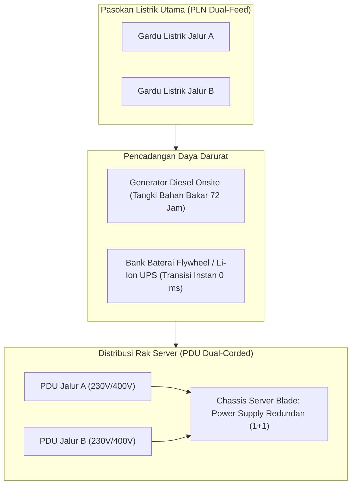

# Modul 167: Infrastruktur Hardware Pusat Data Enterprise (Data Center Tier I–IV, PUE, Server Blade, SAN/NAS, KVM, Active Directory)

**Navigasi**: [⬅️ Master Index](../../INDEX.md) | [Tingkat 10: Tingkat 10: Basis Data, Data Engineering & Sistem Informasi Enterprise](./README.md)
*Sebelumnya*: [166. sistem-informasi-manajemen-enterprise](./166-sistem-informasi-manajemen-enterprise.md) | *Berikutnya*: [168. fondasi-kriptografi-klasik-prinsip-kerckhoffs](../11-cybersecurity-reverse-engineering/168-fondasi-kriptografi-klasik-prinsip-kerckhoffs.md)

---

## 1. Intuisi Dasar Tanpa Jargon ("Seperti Bayi Baru Lahir")
### 1.1 Jantung Fisik dari Seluruh Layanan Cloud ([Data Center Knowledge - Infrastructure Guide](https://www.datacenterknowledge.com/))
Ketika Anda menyimpan file di Google Drive, menonton video Netflix, atau meminta AI menghasilkan jawaban, komputasi tersebut tidak melayang di udara. Semua beban kerja tersebut bermuara pada deretan lemari rak server hitam raksasa di dalam gedung fasilitas fisik yang aman, kedap cuaca, dan dijaga ketat selama 24 jam sehari: **Pusat Data Enterprise (Data Center)**.

### 1.2 Ketahanan Tanpa Henti dan Efisiensi Energi Termal (Tier I-IV & PUE) ([Uptime Institute Tier Classification](https://uptimeinstitute.com/tiers))
Pusat data tidak boleh mati walau hanya 1 detik. Jika listrik dari PLN padam, data center enterprise harus mampu menyalakan puluhan generator diesel raksasa dalam hitungan detik tanpa memutus daya listrik server (*Uninterruptible Power Supply / UPS*).
Dua metrik fundamental yang menentukan kualitas data center:
1. **Klasifikasi Tier Uptime Institute (Tier I s/d Tier IV)**: Mengukur tingkat keandalan dan redundansi perangkat keras. Fasilitas Tier IV menjamin ketersediaan \$99.995\%$ (hanya boleh mati maksimum 26 menit dalam setahun penuh!) dan memiliki jalur listrik serta pendingin redundan aktif ganda (*Fault Tolerant*).
2. **Power Usage Effectiveness (PUE)**: Mengukur efisiensi energi. Berapa banyak listrik yang benar-benar digunakan untuk menyalakan prosesor komputasi dibanding listrik yang terbuang untuk menyalakan AC pendingin dan lampu.

## 2. Fondasi Teoretis & Aksiomatik / Matematis
### 2.1 Formulasi Matematis Metrik PUE & Aljabar Termal Pusat Data ([The Green Grid Consortium](https://www.thegreengrid.org/))
Metrik Efisiensi Pemakaian Daya (*Power Usage Effectiveness / PUE*):
$$\text{PUE} = \frac{\text{Total Daya Fasilitas Listrik Masuk Gedung}}{\text{Daya yang Dikonsumsi Perangkat Keras TI (Server + Storage + Network)}}$$
PUE Ideal adalah $1.0$ (seluruh listrik masuk ke server).
Pusat data tradisional: $\text{PUE} \approx 1.8 - 2.0$ (hampir separuh listrik habis untuk AC chiller).
Pusat data hyperscale modern (Google, Microsoft): $\text{PUE} \le 1.15$ menggunakan pendingin udara luar (*free cooling*) dan pendingin cairan langsung ke chip (*direct-to-chip liquid cooling*).

Neraca Perpindahan Panas Server:
Daya listrik yang dikonsumsi server ($P_{\text{elec}}$) diubah hampir \$100\%$ menjadi energi termal panas yang wajib diserap sistem pendingin:
$$Q = P_{\text{elec}} = \dot{m} \cdot C_p \cdot \Delta T$$
Di mana $\dot{m}$ adalah laju aliran massa udara pendingin $(\text{kg/s})$, $C_p$ adalah kapasitas panas spesifik udara ($1.005 \, \text{kJ/kg}\cdot\text{K}$), dan $\Delta T$ adalah kenaikan suhu udara dari lorong dingin (*cold aisle*) ke lorong panas (*hot aisle*).

### 2.2 Taksonomi Standar Ketersediaan Uptime Institute Tier I-IV ([Uptime Institute](https://uptimeinstitute.com/tiers))
Ketersediaan sistemik tahunan dimodelkan sebagai peluang reliabilitas:
- **Tier I (Basic)**: Komponen jalur tunggal non-redundan. Ketersediaan \$99.671\%$ (Downtime maks \$28.8 \text{ jam/tahun}$).
- **Tier II (Redundant Components)**: Komponen redundan ($N+1$). Ketersediaan \$99.741\%$ (Downtime maks \$22.0 \text{ jam/tahun}$).
- **Tier III (Concurrently Maintainable)**: Jalur ganda aktif-pasif. Komponen dapat diperbaiki tanpa mematikan beban TI. Ketersediaan \$99.982\%$ (Downtime maks $1.6 \text{ jam/tahun}$).
- **Tier IV (Fault Tolerant)**: Jalur ganda aktif-aktif redundan ($2(N+1)$). Sistem kebal terhadap kegagalan komponen fisik apa pun secara otomatis. Ketersediaan \$99.995\%$ (Downtime maks \$26.3 \text{ menit/tahun}$).

## 3. Anatomi Teknis & Cara Kerja Internal


#### Tabel Walkthrough Insiden Pemadaman Listrik PLN dan Respon Otomatis Tier IV Data Center
| Garis Waktu | Status Peristiwa Fisik | Respon Sistem Otomatis Data Center | Status Daya Server TI |
|---|---|---|---|
| $T = 0.00 \text{ dtk}$ | Gardu listrik kota meledak terputus | Sensor ATS (*Automatic Transfer Switch*) mendeteksi kehilangan tegangan | Server tidak berkedip (Tetap Aktif) |
| $T = 0.01 \text{ dtk}$ | Tegangan jala-jala turun ke nol | Bank Baterai UPS mengambil alih beban listrik dalam waktu 0 milidetik | Server berjalan normal 100% |
| $T = 2.00 \text{ dtk}$ | Sinyal starter dikirim ke generator | Motor generator diesel raksasa berputar dan mencapai RPM operasional | Daya dipasok dari UPS |
| $T = 8.50 \text{ dtk}$ | Generator stabil pada frekuensi 50/60 Hz | Saklar ATS mengalihkan pasokan utama dari UPS ke Generator Diesel | Generator memasok seluruh fasilitas |
| $T = 10.00 \text{ dtk}$ | Pasokan generator mengisi ulang baterai UPS | Sistem kembali ke status redundansi penuh mandiri | Operasi normal tanpa henti |

#### Tabel Penelusuran Partisi Jaringan & Kehilangan Data MongoDB (Jepsen Analysis Stale Read)
| Langkah Partisi Jaringan Split-Brain | Node Utama Awal (*Primary Node 1*) | Node Sekunder 2 (*Secondary Node 2*) | Node Sekunder 3 (*Secondary Node 3*) | Status Tingkat Kekhawatiran Tulis (*Write Concern*) | Dampak Integritas Data Pelanggan |
|---|---|---|---|---|---|
| Operasi Normal | Primary (Menerima Tulis) | Replikasi sinkron | Replikasi sinkron | `w: 1` (Hanya konfirmasi Primary saja!)| Data aman |
| Partisi Jaringan Terjadi | Terisolasi sendiri di Partisi Barat | Partisi Timur (2 Node) | Partisi Timur (2 Node) | - | Jaringan terbelah dua (Split-Brain) |
| Pemilihan Primary Baru | Mengira masih Primary sah! | Mengadakan pemungutan suara Raft | Node 2 terpilih jadi Primary Baru! | Dua Primary aktif bersamaan! | Node 1 menjadi *Phantom Primary* |
| Penulisan di Node Lama | Klien menulis: `Order #999` | - | - | `w: 1` mengembalikan status sukses! | Klien mengira data tersimpan aman |
| Partisi Sembuh | Node 1 terhubung kembali | Melihat Node 2 memiliki generasi lebih tinggi | Node 1 diturunkan jadi Secondary | **ROLLBACK DATA LOKAL TANPA NOTIFIKASI!** | **DATA `Order #999` DIHAPUS PERMANEN!** |
| Mitigasi Quorum | Penulisan wajib Quorum | `w: "majority"` diwajibkan | Menunggu konfirmasi mayoritas ($> 50\%$) | Node 1 gagal quorum, tolak tulis | Kehilangan data dicegah mutlak |

## 4. Implementasi Praktis & Kode / Simulasi Riil
```python
def calculate_datacenter_efficiency(it_load_kw: float, cooling_load_kw: float, power_distribution_loss_kw: float, lighting_misc_kw: float) -> dict:
    """
    Menghitung metrik efisiensi energi PUE dan estimasi biaya operasional data center.
    """
    assert it_load_kw > 0, "Beban TI harus lebih besar dari nol!"

    total_facility_power_kw = it_load_kw + cooling_load_kw + power_distribution_loss_kw + lighting_misc_kw
    pue = total_facility_power_kw / it_load_kw
    dcie = (1.0 / pue) * 100.0  # Data Center Infrastructure Efficiency (%)

    # Klasifikasi efisiensi sesuai standar industri
    if pue <= 1.2:
        rating = "EFFICIENCY_EXCELLENT (Hyperscale Modern)"
    elif pue <= 1.5:
        rating = "EFFICIENCY_GOOD (Modern Enterprise)"
    else:
        rating = "EFFICIENCY_POOR (Legacy Data Center - Perlu Retrofit)"

    return {
        "it_power_kw": it_load_kw,
        "total_facility_power_kw": total_facility_power_kw,
        "pue": round(pue, 3),
        "dcie_percent": round(dcie, 2),
        "rating": rating
    }

# Uji Coba Data Center Kapasitas 1 MegaWatt (1.000 kW)
res = calculate_datacenter_efficiency(
    it_load_kw=1000.0,
    cooling_load_kw=180.0,
    power_distribution_loss_kw=40.0,
    lighting_misc_kw=10.0
)
print(f"Total Daya Fasilitas: {res['total_facility_power_kw']} kW")
print(f"PUE                : {res['pue']} ({res['rating']})")
print(f"Efisiensi DCiE     : {res['dcie_percent']}%")
```

## 5. Miskonsepsi & Jebakan Industri
### Studi Kasus Kegagalan Nyata: Kebakaran Hebat Data Center OVHcloud Strasbourg SBG2 (Maret 2021)
- **Kronologi & Latar Belakang**: Pada 10 Maret 2021, kebakaran dahsyat memusnahkan total gedung pusat data SBG2 milik OVHcloud di Strasbourg, Prancis, menghancurkan ribuan server fisik dan melumpuhkan lebih dari 3,6 juta situs web, layanan perbankan, dan data pemerintahan di seluruh Eropa.
- **Akar Masalah**: Penyelidikan resmi menyimpulkan bahwa sumber api berasal dari unit pasokan daya *Uninterruptible Power Supply (UPS)* yang mengalami korsleting setelah teknisi melakukan pemeliharaan. Gedung data center dibangun menggunakan material konstruksi kayu dan lantai komposit tanpa sistem pemadam kebakaran otomatis gas inert (*Inergen/Novec gas suppression*) dan tanpa pemisahan isolasi tahan api (*firewall compartmentalization*) antara ruang baterai UPS dan ruang rak server TI.
- **Rekomendasi Industri**: Pisahkan selalu ruang baterai UPS bervoltase tinggi dari ruang server dalam kompartemen tahan api bersertifikasi minimal 2 jam. Pasang sistem deteksi asap sangat awal (*Very Early Smoke Detection Apparatus / VESDA*) yang memicu gas pemadam otomatis tanpa merusak sirkuit elektronik server.

### Studi Kasus Kegagalan Nyata: Kehilangan Data Transaksi Finansial pada MongoDB Akibat Pembacaan Basi dan Phantom Primary (Analisis Uji Jepsen)
- **Kronologi & Konteks Kasus**: Dalam serangkaian pengujian ketahanan sistem terdistribusi independen yang dipublikasikan oleh Kyle Kingsbury (Jepsen Testing Project) terhadap berbagai rilis basis data NoSQL populer, ditemukan bahwa konfigurasi bawaan MongoDB mengizinkan terjadinya kehilangan data transaksi yang telah dikonfirmasi (*Committed Data Loss*) dan pembacaan data basi (*Stale/Dirty Reads*) saat terjadi partisi jaringan sementara.
- **Akar Masalah Replikasi Basis Data, Konsensus Terdistribusi, & Write Concern**: Secara default pada versi-versi awal, MongoDB menggunakan parameter kekhawatiran tulis `w: 1`. Artinya, server mengembalikan status sukses kepada klien segera setelah data ditulis ke memori RAM node Primary lokal, sebelum data tersebut direplikasi ke node Sekunder lainnya. Ketika terjadi partisi jaringan (*Network Partition*), node Primary lama terisolasi dari sisa kluster namun tetap melayani penulisan klien (*Phantom Primary*), sementara node sekunder yang tersisa memilih Primary baru yang sah. Ketika partisi jaringan pulih, Primary lama menyadari bahwa ia telah digantikan oleh Primary baru yang memiliki riwayat log lebih panjang. Primary lama secara otomatis melakukan *Rollback*: menghapus seluruh penulisan data yang terjadi selama partisi dan membuangnya ke file disk terisolasi. Klien yang sebelumnya menerima konfirmasi sukses mengalami kehilangan data permanen tanpa disadari.

- **Potongan Kode / Arsitektur Cacat (Vulnerable Implementation)**:
```javascript
// Rekonstruksi Cacat Konfigurasi Replikasi MongoDB yang Rentan Kehilangan Data
// CACAT KONFIGURASI BAWAAN (w: 1):
// Server merespons sukses saat data baru tersimpan di Primary lokal saja:
db.financial_transactions.insertOne(
    { transaction_id: "TX-9999", amount: 5000000, status: "SUCCESS" },
    { writeConcern: { w: 1 } } // CACAT FATAL: Data HILANG jika Primary crash/terisolasi!
);

// MITIGASI STANDAR KONSISTENSI KUAT: Konsensus Mayoritas (Majority Write Concern):
// Operasi tulis HANYA dianggap sukses jika telah terkonfirmasi ditulis oleh mayoritas node (> 50%):
db.financial_transactions.insertOne(
    { transaction_id: "TX-9999", amount: 5000000, status: "SUCCESS" },
    { 
        writeConcern: { w: "majority", wtimeout: 5000 },
        readConcern: { level: "majority" } // Mencegah Stale Read dari node sekunder basi!
    }
);
```

- **Analisis Forensik & Rekayasa Modern**: Hasil analisis Jepsen mengubah standar konfigurasi basis data terdistribusi di seluruh dunia. Pengembang MongoDB merombak mesin konsensus internal mereka menjadi protokol Raft-like modern dan mengubah konfigurasi bawaan pada versi 5.0+ menjadi `w: majority`. Arsitek keandalan basis data modern kini menegaskan Teorema CAP: pada sistem terdistribusi yang terpapar risiko partisi jaringan (*P*), sistem harus secara sadar memilih antara Konsistensi Kuat (*CP*) atau Ketersediaan Tinggi (*AP*), dan tidak boleh mengorbankan daya tahan data demi kecepatan penulisan semu.

## 6. Proyek Latihan & Rubrik Penilaian Mandiri
### Level 1 (Pemula)
- **Tugas**: Hitung nilai PUE untuk pusat data yang mengonsumsi total daya listrik fasilitas $2.500 \text{ kW}$, di mana beban server TI adalah $1.800 \text{ kW}$.
- **Petunjuk Arsitektur**: $\text{PUE} = \frac{2500}{1800}$.
- **Vektor Uji**:
  - Nilai $\text{PUE} \approx 1.389$.
  - Interpretasi: Termasuk kategori baik (*Good Modern Enterprise*).
- **Rubrik Penilaian**: Ketepatan penerapan rumus PUE (50%), interpretasi efisiensi (30%), kebersihan format (20%).

### Level 2 (Menengah)
- **Tugas**: Rancang tata letak pendingin lorong tertutup (*Cold Aisle Containment vs Hot Aisle Containment*) untuk ruang server dengan 40 rak masing-masing berdaya $8 \text{ kW}$.
- **Petunjuk Arsitektur**: Jelaskan secara termodinamika mengapa mengurung udara panas (*Hot Aisle Containment*) meningkatkan efisiensi koefisien kinerja (*Coefficient of Performance / COP*) unit pendingin AC CRAC/CRAH.
- **Vektor Uji**:
  - Konsep: Mencegah pencampuran udara dingin dan udara panas (*eliminasi thermal recirculation*).
- **Rubrik Penilaian**: Penjelasan dinamika fluida termal (40%), estimasi daya pendingin total (\$40 \times 8 = 320 \text{ kW}$) (30%), rekomendasi praktis (30%).

### Level 3 (Mahir)
- **Tugas**: Bangun model keandalan Markov Chain di Python untuk mengevaluasi ketersediaan tahunan arsitektur generator daya $N+1$ vs $2N$ pada data center Tier III vs Tier IV berdasarkan data Mean Time Between Failures (MTBF) dan Mean Time to Repair (MTTR).
- **Petunjuk Arsitektur**: Susun matriks transisi status keadaan Markov, hitung distribusi status stasioner $\pi \mathbf{P} = \pi$, dan hitung durasi downtime tahunan dalam satuan menit.
- **Vektor Uji**:
  - Arsitektur 2N harus menghasilkan ketersediaan $\ge 99.995\%$ dengan parameter MTBF generator 1.000 jam dan MTTR 4 jam.
- **Rubrik Penilaian**: Ketepatan formulasi rantai Markov (40%), verifikasi batas ketersediaan Tier Uptime (30%), analisis statistik reliabilitas (30%).

### Tingkat 1: Dasar
- **Tugas**: Bangun simulator replikasi basis data Master-Slave sinkron vs asinkron mandiri dalam Python yang memodelkan 1 node Master dan 2 node Slave, mengukur latensi penulisan dan melacak potensi kehilangan data (*Recovery Point Objective / RPO*) saat Master dimatikan mendadak pada kedua mode replikasi tersebut.
- **Petunjuk Perancangan Arsitektur**:
  - Replikasi Sinkron: Master menunggu konfirmasi dari minimal 1 Slave sebelum merespons klien.
  - Replikasi Asinkron: Master merespons klien seketika dan mengirimkan data ke Slave di latar belakang.
- **Test Vector & Kasus Uji Ekstrem**:
  - *Crash Master*: Tulis 100 data pada mode asinkron, matikan Master saat baru 80 data yang terkirim ke Slave; buktikan Slave yang dipromosikan kehilangan tepat 20 data terakhir (RPO = 20 data).
- **Rubrik Penilaian Mandiri**: 40% Pemodelan Replikasi Sinkron vs Asinkron yang Akurat, 30% Perhitungan Metrik RPO dan RTO yang Tepat, 30% Kerapian Enkapsulasi Kode.

### Tingkat 2: Menengah
- **Tugas**: Kembangkan implementasi simulator algoritma konsensus terdistribusi *Raft Consensus Protocol* (fase Pemilihan Pemimpin / Leader Election) dalam Python yang memodelkan 5 simpul independen yang bertukar pesan RPC `RequestVote`, menangani stempel waktu pemilihan acak (*Randomized Election Timeout 150-300 ms*) untuk mencegah suara terpecah (*Split Vote*), dan bertransisi antar status `Follower`, `Candidate`, dan `Leader`.
- **Petunjuk Perancangan Arsitektur**:
  - Simpul bertransisi ke Candidate saat timeout pemilihan habis tanpa menerima heartbeat dari Leader.
  - Candidate menjadi Leader hanya jika menerima suara dari mayoritas simpul ($\ge 3$ dari 5 node).
- **Test Vector & Kasus Uji Ekstrem**:
  - *Pemilihan Pemimpin*: Mulai 5 simpul serentak; buktikan tepat satu Leader terpilih dalam waktu $< 1\text{ detik}$; matikan Leader tersebut; buktikan simpul yang tersisa mendeteksi hilangnya heartbeat dan memilih Leader baru secara mulus.
- **Rubrik Penilaian Mandiri**: 40% Kepatuhan State Machine Protokol Raft (Follower, Candidate, Leader), 30% Logika Randomized Timeout Pencegah Split-Vote, 30% Pemilihan Pemimpin Mayoritas Akurat.

### Tingkat 3: Mahir
- **Tugas**: Rancang simulator partisi data terdistribusi horizontal (*Database Sharding Engine*) dalam Python yang membagi kumpulan data tabel besar ke 4 shard basis data independen menggunakan strategi *Range-Based Sharding* dan *Hash-Based Sharding*, lengkap dengan Router Kueri Terpusat (*Query Router / Mongos-like Coordinator*) yang mampu mengeksekusi *Scatter-Gather Queries* dan menggabungkan hasil kueri terurut secara efisien.
- **Petunjuk Perancangan Arsitektur**:
  - Kueri dengan Shard Key diarahkan tepat ke 1 shard target (*Targeted Single-Shard Routing*).
  - Kueri tanpa Shard Key disebarkan ke seluruh shard secara paralel (*Scatter-Gather*) dan digabungkan menggunakan K-Way Merge Sort.
- **Test Vector & Kasus Uji Ekstrem**:
  - *Scatter-Gather Aggregation*: Masukkan $10.000$ rekor terdistribusi di 4 shard; eksekusi kueri `ORDER BY age LIMIT 10` tanpa shard key; buktikan router mengumpulkan 10 data teratas dari masing-masing shard dan menghasilkan 10 data teratas global yang benar.
- **Rubrik Penilaian Mandiri**: 40% Arsitektur Sharding Router & Range/Hash Partitioning yang Benar, 30% Algoritma Penggabungan Kueri Scatter-Gather yang Efisien, 30% Integritas Data Lintas Shard.

## 7. Rekomendasi Sumber Belajar Standar Emas
| Kategori | Judul Sumber & Tautan | Penulis / Institusi | Fokus Pembahasan |
|---|---|---|---|
| Standar Klasifikasi | [Tier Standard: Topology and Operational Sustainability](https://uptimeinstitute.com/tiers) | Uptime Institute Professional Services | Pedoman resmi global klasifikasi keandalan pusat data Tier I s/d Tier IV |
| Standar Termal | [Thermal Guidelines for Data Processing Environments](https://www.ashrae.org/technical-resources/bookstore/datacom-series) | ASHRAE Technical Committee 9.9 | Standar rentang suhu dan kelembapan udara yang direkomendasikan untuk perangkat keras server |
| Investigasi Resmi | [Technical Investigation Report: OVHcloud Data Center Fire](https://www.bea-ri.developpement-durable.gouv.fr/) | BEA-RI France Government Safety Board | Laporan investigasi forensik kebakaran pusat data dan rekomendasi keselamatan UPS |

---
*Navigasi Cepat*: [Ke Tingkat 10](./README.md) | [Ke Master Index](../../INDEX.md) | *Sebelumnya*: [166. sistem-informasi-manajemen-enterprise](./166-sistem-informasi-manajemen-enterprise.md) | *Berikutnya*: [168. fondasi-kriptografi-klasik-prinsip-kerckhoffs](../11-cybersecurity-reverse-engineering/168-fondasi-kriptografi-klasik-prinsip-kerckhoffs.md)
