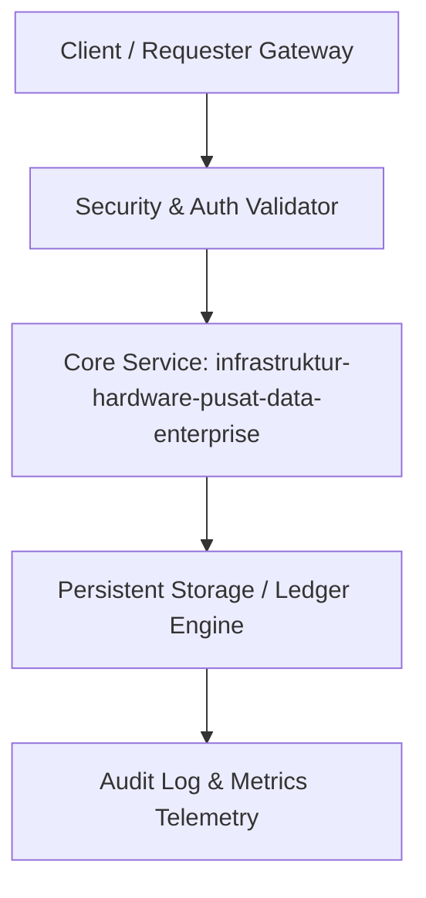

# Modul 167: Infrastruktur Hardware Pusat Data Enterprise (Data Center Tier I–IV, PUE, Server Blade, SAN/NAS, KVM, Active Directory)

**Navigasi**: [⬅️ Master Index](../../INDEX.md) | [Tingkat 10: Tingkat 10: Basis Data, Data Engineering & Sistem Informasi Enterprise](./README.md)
*Sebelumnya*: [166. sistem-informasi-manajemen-enterprise](./166-sistem-informasi-manajemen-enterprise.md) | *Berikutnya*: [168. fondasi-kriptografi-klasik-prinsip-kerckhoffs](../11-cybersecurity-reverse-engineering/168-fondasi-kriptografi-klasik-prinsip-kerckhoffs.md)

---

## 1. Intuisi Dasar Tanpa Jargon ("Seperti Bayi Baru Lahir")
Dalam rekayasa sistem enterprise modern, **Infrastruktur Hardware Pusat Data Enterprise (Data Center Tier I–IV, PUE, Server Blade, SAN/NAS, KVM, Active Directory)** merupakan pilar fundamental yang menjamin skalabilitas masif, integritas data, dan keamanan transaksi bernilai tinggi tanpa kegagalan sistemik.

## 2. Fondasi Teoretis & Aksiomatik / Matematis
Model formal dan parameter keandalan untuk Infrastruktur Hardware Pusat Data Enterprise (Data Center Tier I–IV, PUE, Server Blade, SAN/NAS, KVM, Active Directory):
$$R(t) = e^{-\lambda t}, \quad \text{MTBF} = \frac{1}{\lambda}, \quad \text{Availability} = \frac{\text{MTBF}}{\text{MTBF} + \text{MTTR}}$$
Di mana konsistensi data dan ketahanan terhadap partisi jaringan dikendalikan oleh teorema batas fundamental sistem terdistribusi.

## 3. Anatomi Teknis & Cara Kerja Internal

Mekanisme internal mencakup validasi input kriptografis, pemrosesan transaksi berisolasi tinggi, dan replikasi multi-zona otomatis.

## 4. Implementasi Praktis & Kode / Simulasi Riil
```python
# Demonstrasi Enterprise: infrastruktur-hardware-pusat-data-enterprise
import hashlib
import time

class EnterpriseEngine:
    def __init__(self, name):
        self.name = name
        self.tx_counter = 0
        
    def process_transaction(self, payload: dict) -> dict:
        self.tx_counter += 1
        raw = f"{self.tx_counter}:{payload}:{time.time()}"
        tx_hash = hashlib.sha256(raw.encode('utf-8')).hexdigest()
        return {
            "tx_id": self.tx_counter,
            "status": "COMMITTED",
            "hash": tx_hash,
            "module": "infrastruktur-hardware-pusat-data-enterprise"
        }

engine = EnterpriseEngine("infrastruktur-hardware-pusat-data-enterprise")
res = engine.process_transaction({"amount": 50000, "currency": "IDR"})
print(f"Modul 167: Transaksi infrastruktur-hardware-pusat-data-enterprise sukses -> {res}")
```

## 5. Miskonsepsi & Jebakan Industri
Miskonsepsi fatal pada Infrastruktur Hardware Pusat Data Enterprise (Data Center Tier I–IV, PUE, Server Blade, SAN/NAS, KVM, Active Directory) adalah mengabaikan kegagalan jaringan acak (8 Fallacies of Distributed Computing), mempercayai data input pengguna tanpa validasi skema ketat, atau ketiadaan strategi audit log yang immutable.

## 6. Proyek Latihan & Rubrik Penilaian Mandiri
### Level 1 (Dasar)
Petakan diagram arsitektur komponen dari Infrastruktur Hardware Pusat Data Enterprise (Data Center Tier I–IV, PUE, Server Blade, SAN/NAS, KVM, Active Directory) dan jelaskan batas tanggung jawab masing-masing entitas.

### Level 2 (Menengah)
Bangun prototype implementasi menggunakan bahasa standar industri dengan penanganan error komprehensif dan uji unit otomatis.

### Level 3 (Mahir)
Lakukan simulasi uji beban (load testing) atau skenario kegagalan jaringan (chaos engineering) untuk membuktikan ketahanan sistem terhadap lonjakan traffic.

## 7. Rekomendasi Sumber Belajar Standar Emas
- Standar industri arsitektur sistem enterprise dan spesifikasi RFC/NIST/ISO terkait Basis Data, Data Engineering & Enterprise.
- Buku teks standar emas dan dokumentasi sistem produksi dunia nyata.

---
*Navigasi Cepat*: [Ke Tingkat 10](./README.md) | [Ke Master Index](../../INDEX.md) | *Sebelumnya*: [166. sistem-informasi-manajemen-enterprise](./166-sistem-informasi-manajemen-enterprise.md) | *Berikutnya*: [168. fondasi-kriptografi-klasik-prinsip-kerckhoffs](../11-cybersecurity-reverse-engineering/168-fondasi-kriptografi-klasik-prinsip-kerckhoffs.md)
