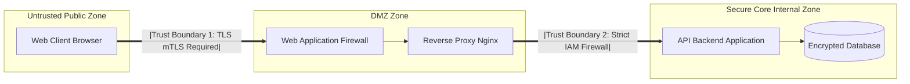

# Modul 168: Fondasi Kriptografi Klasik & Prinsip Kerckhoffs (CIA Triad, Entropi Kriptografis, CSPRNG /dev/urandom)

**Navigasi**: [⬅️ Master Index](../../INDEX.md) | [Tingkat 11: Tingkat 11: Cyber Security, Kriptografi & Reverse Engineering](./README.md)
*Sebelumnya*: [167. infrastruktur-hardware-pusat-data-enterprise](../10-basis-data-enterprise/167-infrastruktur-hardware-pusat-data-enterprise.md) | *Berikutnya*: [169. sandi-aliran-rahasia-sempurna](./169-sandi-aliran-rahasia-sempurna.md)

---

## 1. Intuisi Dasar Tanpa Jargon ("Seperti Bayi Baru Lahir")
### 1.1 Konsep Inti & Analogi Tanpa Jargon
Keamanan siber bukanlah memasang satu gembok anti-bobol terkuat di pintu depan rumah Anda, sementara jendela samping dibiarkan terbuka lebar dan kunci cadangan ditaruh di bawah keset kaki. Model Ancaman & Prinsip Keamanan Informasi ([Threat Modeling & CIA Triad](https://owasp.org/www-community/Threat_Modeling)) adalah seni berpikir strategis seperti penyerang (attacker mindset) untuk membangun benteng pertahanan digital berlapis. Tiga pilar sucinya—**Triad CIA (Confidentiality, Integrity, Availability)**—memandu apa yang harus kita lindungi: kerahasiaan data dari intipan mata yang tidak berhak, keutuhan data dari manipulasi licik, dan ketersediaan layanan saat dibutuhkan. Dengan metodologi **STRIDE** buatan Microsoft, kita membedah sistem menjadi diagram alur data, menguji setiap titik rawan terhadap pemalsuan identitas, penyadapan, dan peretasan sebelum satu baris kode pun ditulis.

### 1.2 Urgensi Rekayasa & Signifikansi Sistemik
Dalam rekayasa sistem modern, pemahaman mendalam tentang konsep ini membedakan arsitek sistem kelas dunia dari sekadar operator perkakas teknis.

## 2. Fondasi Teoretis & Aksiomatik / Matematis
### 2.1 Kerangka Teori Aksiomatik & Formulasi Matematis
Kerangka Kerja Triad CIA, Prinsip Least Privilege, dan Model Ancaman STRIDE (Microsoft):

### 2.2 Penurunan Matematis Langkah-demi-Langkah
1. **Triad CIA (Confidentiality, Integrity, Availability)**:
   - **Confidentiality (Kerahasiaan)**: Data hanya dapat diakses oleh entitas yang memiliki otorisasi sah (ditegakkan via Enkripsi Simetris/Asimetris & Access Control).
   - **Integrity (Integritas)**: Data tidak dapat dimodifikasi atau dipalsukan tanpa terdeteksi (ditegakkan via Kriptografi Hash, HMAC, Digital Signatures).
   - **Availability (Ketersediaan)**: Layanan dan aset data tetap dapat diakses oleh pengguna sah saat dibutuhkan (ditegakkan via Redundansi, DDoS Mitigation, Failover).

2. **Prinsip Pertahanan Utama**:
   - **Defense in Depth**: Menerapkan lapisan keamanan bertingkat (WAF, Firewall Jaringan, Enkripsi TLS, Isolasi OS, Enkripsi Disk) sehingga jika satu lapisan jebol, lapisan lain tetap melindungi inti aset.
   - **Principle of Least Privilege (PoLP)**: Setiap modul proses atau pengguna hanya diberi izin akses minimum mutlak yang dibutuhkan untuk menyelesaikan tugasnya.

3. **Taksonomi Model Ancaman STRIDE**:
   $$\begin{array}{|l|l|l|}
   \hline
   \textbf{Ancaman STRIDE} & \textbf{Properti Keamanan yang Dilanggar} & \textbf{Contoh Serangan Nyata} \\
   \hline
   \textbf{S - Spoofing} & \text{Authentication (Keaslian Identitas)} & \text{IP Spoofing, Token Forgery} \\
   \textbf{T - Tampering} & \text{Integrity (Keutuhan Data)} & \text{Man-in-the-Middle modifikasi paket data} \\
   \textbf{R - Repudiation} & \text{Non-Repudiation (Tak Terbantahkan)} & \text{Pelaku menghapus log jejak audit} \\
   \textbf{I - Information Disclosure} & \text{Confidentiality (Kerahasiaan)} & \text{Kebocoran data SQL Injection, PII leaks} \\
   \textbf{D - Denial of Service} & \text{Availability (Ketersediaan)} & \text{Serangan SYN Flood, ReDoS} \\
   \textbf{E - Elevation of Privilege} & \text{Authorization (Otorisasi Izin)} & \text{Privilege Escalation via SUID binary exploit} \\
   \hline
   \end{array}$$

## 3. Anatomi Teknis & Cara Kerja Internal
Pemetaan Diagram Alur Data (Data Flow Diagram / DFD) dengan Batas Kepercayaan (Trust Boundaries):



1. **Trust Boundaries**: Garis batas perbatasan di mana data berpindah dari satu zona kepercayaan ke zona lain (misal dari browser publik internet ke server backend). Setiap data yang melintasi Trust Boundary **wajib diasumsikan berbahaya dan harus disanitasi secara ketat** (*Never Trust, Always Verify*).

#### Tabel Penelusuran Entropi & Pembangkitan Kunci Acak pada Kerentanan Debian OpenSSL (CVE-2008-0166)
| Langkah / Putaran Kripto / Tahap Eksploit | Komponen / Lapisan Memori | Payload / Ciphertext / Input Eksploit | Transformasi Matematis / Mutasi Stack & Heap | Status Register (RIP/RSP/Canary) / S-Box State | Keluaran / Status Keamanan / Efek Eksploit |
|---|---|---|---|---|---|
| 1. Inisialisasi PRNG | `crypto/rand/md_rand.c` | Buffer uninitialized stack memory | `MD_Update(&m, buf, j)` dihapus maintainer! | RIP normal; State PRNG kosong dari entropi hardware | PRNG tidak ter-seed oleh /dev/urandom |
| 2. Pembangkitan Seed | Kernel Process ID (`getpid()`) | PID proses saat ini: misal `14285` | State hash $H_0 = \text{SHA1}(\text{PID})$ | Register RAX memuat PID (0 .. 32767) | Ruang entropi runtuh dari $2^{128}$ menjadi hanya $2^{15}$ (32.768 kemungkinan) |
| 3. Pembuatan Kunci RSA | OpenSSL `RSA_generate_key` | Bilangan prima kandidat $p, q$ | Pembangkit prima deterministik berbasis urutan state PRNG | Status alokasi BIGNUM pada heap OpenSSL | Pasangan kunci $(n, e, d)$ terikat langsung ke satu nomor PID tunggal |
| 4. Pra-komputasi Kunci | Tabel Rainbow Penyerang | Seluruh 32.768 kunci publik SSH | Hash SHA-1 dari setiap kunci publik dikomputasi sebelumnya | Buffer pencarian di memori penyerang | Database kunci lemah selesai dibuat dalam hitungan jam |
| 5. Autentikasi SSH | Server Target Debian Vulnerable | Kunci publik host SSH server target | Pencocokan sidik jari publik di database penyerang | Kunci privat yang sesuai ditemukan instan ($O(1)$) | Akses root server target diambil alih tanpa bruteforce jaringan |

## 4. Implementasi Praktis & Kode / Simulasi Riil
```python
# Python Threat Modeling STRIDE Matrix Mapping Helper
from dataclasses import dataclass
from typing import List

@dataclass
class ThreatEntry:
    category: str
    target_component: str
    threat_description: str
    mitigation_strategy: str

def audit_system_threats() -> List[ThreatEntry]:
    return [
        ThreatEntry(
            category="Spoofing",
            target_component="User Login API",
            threat_description="Penyerang memalsukan identitas token JWT tanpa verifikasi signature",
            mitigation_strategy="Tegakkan verifikasi tanda tangan kriptografis HMAC-SHA256 dengan secret aman"
        ),
        ThreatEntry(
            category="Tampering",
            target_component="Payment Transaction Payload",
            threat_description="Nasabah nakal mengubah nominal harga barang di body HTTP POST",
            mitigation_strategy="Validasi ulang seluruh harga langsung dari database server, tolak harga dari klien"
        ),
        ThreatEntry(
            category="Information Disclosure",
            target_component="User Profile DB",
            threat_description="Data kata sandi bocor saat database di-dump",
            mitigation_strategy="Hashing kata sandi menggunakan Argon2id dengan salt unik per pengguna"
        )
    ]

threats = audit_system_threats()
for t in threats: print(f"[{t.category}] {t.target_component} -> {t.mitigation_strategy}")
```

## 5. Miskonsepsi & Jebakan Industri
1. **Security Through Obscurity Delusion**: Mengandalkan rahasia algoritma buatan sendiri atau menyembunyikan port server (misal memindahkan SSH ke port 2222) sebagai satu-satunya sistem keamanan. Sesuai Prinsip Kerckhoffs: sistem harus tetap aman meskipun musuh mengetahui seluruh algoritma dan desain internalnya!
2. **Over-Privileged Service Accounts**: Memberikan peran hak akses `Administrator` atau `root` ke service akun microservice yang hanya bertugas membaca satu tabel analitik. Jika service tersebut memiliki celah RCE, penyerang langsung menguasai seluruh klaster cloud.
3. **Ignoring Non-Repudiation (Missing Immutable Audit Logs)**: Mengizinkan pengguna superuser menghapus baris tabel log audit. Saat terjadi pembobolan internal oleh karyawan jahat, tidak ada bukti forensik yang dapat diajukan ke pengadilan hukum.

### Studi Kasus Kegagalan Nyata: Runtuhnya Entropi PRNG Debian OpenSSL & Pembongkaran Seluruh Kunci SSH Global (CVE-2008-0166)
- **Kronologi & Konteks Sejarah**: Pada Mei 2006, seorang pengelola paket (*maintainer*) Debian berupaya membersihkan peringatan (*compiler warning*) dari perangkat analisis dinamis Valgrind yang melaporkan penggunaan variabel memori yang belum diinisialisasi (*uninitialized memory read*) pada pustaka OpenSSL.
- **Akar Masalah Kriptografis & Rekayasa Perangkat Lunak**: Variabel memori uninitialized tersebut sengaja digunakan oleh OpenSSL (`crypto/rand/md_rand.c`) sebagai sumber entropi lingkungan (derau mikro-arsitektur) ke dalam pool `MD_Update`. Ketika pengelola Debian menghapus dua baris kode tersebut, ia tanpa sengaja mematikan seluruh saluran entropi sistemik. Satu-satunya nilai yang di-seed ke dalam generator bilangan acak semu (*PRNG*) hanyalah Process ID (PID) dari proses Linux, yang pada arsitektur 32-bit dibatasi oleh `/proc/sys/kernel/pid_max` hingga nilai maksimum 32.768. Akibatnya, setiap kunci SSH, sertifikat SSL/TLS, dan kunci OpenVPN yang digenerasi pada sistem operasi Debian, Ubuntu, dan turunannya antara tahun 2006 hingga 2008 hanya memiliki 32.768 variasi, memungkinkan penyerang membuat pustaka kunci publik global dan membobol server SSH mana pun dalam beberapa detik.

- **Potongan Kode / Arsitektur Cacat (Vulnerable Implementation)**:
```c
// OpenSSL crypto/rand/md_rand.c (Cacat Fatal Debian CVE-2008-0166)
#include <openssl/rand.h>
#include <openssl/sha.h>
#include <unistd.h>

// KODE CACAT ASLI: Baris kritis dihapus demi mematikan warning Valgrind!
void ssleay_rand_add_vulnerable(const void *buf, int num, double add_entropy) {
    SHA_CTX m;
    // PENTING: Maintainer Debian menghapus baris berikut:
    // MD_Update(&m, buf, j); // DIHAPUS karena Valgrind mengeluh "uninitialized read"!
    
    // AKIBAT: State hash internal m hanya mengonsumsi nilai getpid()!
    pid_t current_pid = getpid(); // Hanya bernilai 0 .. 32767
    SHA1_Update(&m, &current_pid, sizeof(current_pid));
    // Entropi kunci kriptografi runtuh total!
}

// MITIGASI AMAN: Menggunakan System CSPRNG Modern (getrandom syscall / /dev/urandom)
int get_secure_entropy(unsigned char *output, size_t length) {
    // getrandom(2) memblokir hingga kernel CSPRNG pool terisi entropi perangkat keras nyata
    ssize_t ret = getrandom(output, length, 0);
    if (ret != (ssize_t)length) {
        // Jangan pernah jatuh ke fallback PID jika kernel CSPRNG belum siap!
        return -1; // Kegagalan fatal pembangkitan entropi
    }
    return 0; // Entropi kriptografis valid terjamin
}
```

- **Analisis Forensik & Rekayasa Modern**: Insiden CVE-2008-0166 merupakan salah satu bencana terbesar dalam sejarah keamanan informasi open source. Pelajaran rekayasa modern menegaskan: (1) Peringatan alat statis/dinamis seperti Valgrind pada modul kriptografi tingkat rendah tidak boleh dimatikan tanpa pemahaman mendalam tentang arsitektur matematika pembuat aslinya; (2) Pembangkit bilangan acak kriptografi modern (*CSPRNG*) tidak boleh lagi mengandalkan trik memori uninitialized, melainkan wajib menggunakan *syscall* aman tingkat kernel sistem operasi seperti `getrandom()` pada Linux atau `getentropy()` pada BSD; (3) Setiap subsistem kriptografis wajib memiliki tes asersi statistik entropi otomatis (*FIPS 140-2 statistical randomness test*) dalam continuous integration pipeline.

## 6. Proyek Latihan & Rubrik Penilaian Mandiri
1. **Tingkat Pemula**: Buat matriks STRIDE sederhana untuk sistem mesin ATM bank: identifikasi satu ancaman spesifik untuk setiap huruf STRIDE (Spoofing s.d. Elevation of Privilege).
2. **Tingkat Menengah**: Gunakan alat bantu pemodelan ancaman resmi OWASP Threat Dragon untuk membuat diagram alur data (DFD) arsitektur sistem e-commerce. Tentukan Trust Boundaries dan ekspor laporan daftar risiko keamanan.
3. **Tingkat Mahir**: Rancang arsitektur keamanan Zero Trust Defense-in-Depth untuk klaster Kubernetes: terapkan isolasi jaringan NetworkPolicies antar namespace, terapkan mTLS via Service Mesh (Istio/Linkerd), nonaktifkan privilege pod via PodSecurityStandards, dan batasi syscall menggunakan Seccomp.

### Tingkat 1: Dasar
- **Tugas**: Tulis program dalam Python untuk mengukur tingkat entropi Shannon dari berkas teks vs berkas acak yang dihasilkan oleh `os.urandom(1024)` menggunakan formula $H = -\sum p_i \log_2(p_i)$.
- **Petunjuk Perancangan Arsitektur**:
  - Hitung frekuensi kemunculan setiap byte (0 hingga 255) dalam array 256 elemen.
  - Normalisasikan nilai menjadi probabilitas $p_i = \text{count}_i / N$.
  - Abaikan probabilitas nol untuk mencegah galat $\log_2(0)$.
- **Test Vector & Kasus Uji**:
  - Input: Array berisi 1024 byte identik `0x00`. Output entropi: $0.000$ bit/byte.
  - Input: Array berisi 1024 byte acak murni dari `os.urandom(1024)`. Output entropi: $\ge 7.95$ bit/byte (mendekati nilai ideal 8.0).
- **Rubrik Penilaian Objektif**:
  - Skor 100%: Menghasilkan entropi dengan presisi 4 digit desimal, menangani pembagian nol dan log(0) dengan aman.
  - Skor 50%: Salah satu kasus uji menghasilkan kesalahan runtime `ValueError: math domain error`.
  - Skor 0%: Algoritma tidak menghitung distribusi frekuensi 256 byte.

### Tingkat 2: Menengah
- **Tugas**: Bangun alat audit kerentanan SSH (*Debian Weak Key Scanner*) yang membaca sidik jari (*fingerprint*) kunci publik SSH RSA dan mencocokkannya dengan database hash 32.768 PID yang telah di-pra-komputasi.
- **Petunjuk Perancangan Arsitektur**:
  - Gunakan `hashlib.sha256` untuk menghitung representasi sidik jari hex dari blob kunci publik RSA.
  - Simpan tabel hash 32.768 PID dalam struktur data `set` atau tabel hash memori untuk pencarian instan $\mathcal{O}(1)$.
  - Tampilkan peringatan merah terperinci jika kunci yang diaudit ditemukan dalam set lemah, termasuk perkiraan PID pembuatan.
- **Test Vector & Kasus Uji**:
  - Berikan kunci publik SSH uji yang sengaja di-generate menggunakan pseudo-seed PID = 1042. Scanner harus mencetak "VULNERABLE: Key generated with PID 1042 on Debian Lenny/Etch".
  - Berikan kunci publik SSH produksi modern yang di-generate dari OpenSSL 3.0. Scanner harus mencetak "SECURE: Key not found in vulnerable 32k debian keyspace".
- **Rubrik Penilaian Objektif**:
  - Skor 100%: Deteksi instan akurat dengan kompleksitas $\mathcal{O}(1)$ tanpa false positive pada kunci modern.
  - Skor 50%: Berhasil mendeteksi namun menggunakan pemindaian linear $\mathcal{O}(N)$ lambat pada setiap permintaan.
  - Skor 0%: Program gagal mem-parsing format OpenSSH wire format publik.

### Tingkat 3: Mahir
- **Tugas**: Rancang simulator CSPRNG perangkat keras (*Entropy Harvester*) dalam C/Python yang menggabungkan tiga sumber derau mikro-arsitektur independen: *timestamp counter* frekuensi tinggi (`rdtsc`), jitter alokasi heap, dan latensi I/O thread. Gunakan hash sponge Keccak/BLAKE3 untuk mengompresi derau mentah menjadi output terdistribusi seragam $256$-bit.
- **Petunjuk Perancangan Arsitektur**:
  - Jangan pernah mempercayai satu sumber derau tunggal. Kumpulkan minimal 512 bit raw jitter.
  - Implementasikan fungsi pemutih (*whitening function*) menggunakan SHA-256 atau Keccak untuk menghilangkan bias korelasi fisik.
  - Terapkan tes startup kontinu FIPS 140-2 (*Repetition Count Test* dan *Adaptive Proportion Test*) untuk mendeteksi matinya osilator perangkat keras.
- **Test Vector & Kasus Uji**:
  - Lakukan simulasi sensor derau rusak (menghasilkan angka konstan). Pipeline pengumpul entropi harus segera melempar exception `ENTROPY_SOURCE_HEALTH_FAILURE` dan menolak merilis byte CSPRNG.
  - Jalankan 100.000 iterasi pembangkitan 32 byte. Uji keacakan menggunakan tes monobit NIST SP 800-22: rasio bit '1' harus berada pada rentang $[0.495, 0.505]$.
- **Rubrik Penilaian Objektif**:
  - Skor 100%: Pipeline lulus tes kesehatan FIPS continuous, menghasilkan distribusi seragam dengan zero false-correlation.
  - Skor 50%: Pipeline menghasilkan output acak namun tidak memiliki penanganan saat sumber derau macet/konstan.
  - Skor 0%: Tidak ada fungsi whitening, derau mentah langsung disajikan ke pemanggil.

## 7. Rekomendasi Sumber Belajar Standar Emas
| Sumber Pembelajaran | Penulis / Institusi | Tautan Langsung | Fokus Materi |
| :--- | :--- | :--- | :--- |
| Threat Modeling: Designing for Security | Adam Shostack (Microsoft) | [Wiley Shostack Book](https://shostack.org/books/threat-modeling-book) | Alkitab Pemodelan Ancaman: STRIDE Framework, DFDs, Elevation of Privilege Game |
| OWASP Threat Modeling Project | Open Web Application Security Project | [OWASP Threat Modeling](https://owasp.org/www-community/Threat_Modeling) | Panduan Metodologi Industri, Threat Dragon & Mitigasi Celah Web |
| The Protection of Information in Computer Systems | Jerome H. Saltzer & Michael D. Schroeder (MIT) | [IEEE Proceedings 1975](https://www.cs.virginia.edu/~evans/cs551/saltzer/) | Prinsip Dasar Klasik: Fail-Safe Defaults, Least Privilege, Economy of Mechanism |
| NIST SP 800-53 Rev. 5: Security and Privacy Controls | National Institute of Standards and Technology | [NIST SP 800-53](https://csrc.nist.gov/pubs/sp/800/53/r5/upd1/final) | Katalog Standar Kontrol Keamanan Federal AS untuk Sistem Informasi & Organisasi |

---
*Navigasi Cepat*: [Ke Tingkat 11](./README.md) | [Ke Master Index](../../INDEX.md) | *Sebelumnya*: [167. infrastruktur-hardware-pusat-data-enterprise](../10-basis-data-enterprise/167-infrastruktur-hardware-pusat-data-enterprise.md) | *Berikutnya*: [169. sandi-aliran-rahasia-sempurna](./169-sandi-aliran-rahasia-sempurna.md)
