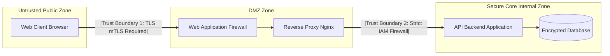

# Modul 169: Sandi Aliran & Rahasia Sempurna (One-Time Pad Proof, Bahaya Two-Time Pad, ChaCha20 Stream Cipher)

**Navigasi**: [⬅️ Master Index](../../INDEX.md) | [Tingkat 11: Tingkat 11: Cyber Security, Kriptografi & Reverse Engineering](./README.md)
*Sebelumnya*: [168. fondasi-kriptografi-klasik-prinsip-kerckhoffs](./168-fondasi-kriptografi-klasik-prinsip-kerckhoffs.md) | *Berikutnya*: [170. sandi-blok-mode-operasi](./170-sandi-blok-mode-operasi.md)

---

## 1. Intuisi Dasar Tanpa Jargon ("Seperti Bayi Baru Lahir")
Keamanan siber bukanlah memasang satu gembok anti-bobol terkuat di pintu depan rumah Anda, sementara jendela samping dibiarkan terbuka lebar dan kunci cadangan ditaruh di bawah keset kaki. Model Ancaman & Prinsip Keamanan Informasi ([Threat Modeling & CIA Triad](https://owasp.org/www-community/Threat_Modeling)) adalah seni berpikir strategis seperti penyerang (attacker mindset) untuk membangun benteng pertahanan digital berlapis. Tiga pilar sucinya—**Triad CIA (Confidentiality, Integrity, Availability)**—memandu apa yang harus kita lindungi: kerahasiaan data dari intipan mata yang tidak berhak, keutuhan data dari manipulasi licik, dan ketersediaan layanan saat dibutuhkan. Dengan metodologi **STRIDE** buatan Microsoft, kita membedah sistem menjadi diagram alur data, menguji setiap titik rawan terhadap pemalsuan identitas, penyadapan, dan peretasan sebelum satu baris kode pun ditulis.

## 2. Fondasi Teoretis & Aksiomatik / Matematis
Kerangka Kerja Triad CIA, Prinsip Least Privilege, dan Model Ancaman STRIDE (Microsoft):

1. **Triad CIA (Confidentiality, Integrity, Availability)**:
   - **Confidentiality (Kerahasiaan)**: Data hanya dapat diakses oleh entitas yang memiliki otorisasi sah (ditegakkan via Enkripsi Simetris/Asimetris & Access Control).
   - **Integrity (Integritas)**: Data tidak dapat dimodifikasi atau dipalsukan tanpa terdeteksi (ditegakkan via Kriptografi Hash, HMAC, Digital Signatures).
   - **Availability (Ketersediaan)**: Layanan dan aset data tetap dapat diakses oleh pengguna sah saat dibutuhkan (ditegakkan via Redundansi, DDoS Mitigation, Failover).

2. **Prinsip Pertahanan Utama**:
   - **Defense in Depth**: Menerapkan lapisan keamanan bertingkat (WAF, Firewall Jaringan, Enkripsi TLS, Isolasi OS, Enkripsi Disk) sehingga jika satu lapisan jebol, lapisan lain tetap melindungi inti aset.
   - **Principle of Least Privilege (PoLP)**: Setiap modul proses atau pengguna hanya diberi izin akses minimum mutlak yang dibutuhkan untuk menyelesaikan tugasnya.

3. **Taksonomi Model Ancaman STRIDE**:
   $$\begin{array}{|l|l|l|}
   \hline
   \textbf{Ancaman STRIDE} & \textbf{Properti Keamanan yang Dilanggar} & \textbf{Contoh Serangan Nyata} \\
   \hline
   \textbf{S - Spoofing} & \text{Authentication (Keaslian Identitas)} & \text{IP Spoofing, Token Forgery} \\
   \textbf{T - Tampering} & \text{Integrity (Keutuhan Data)} & \text{Man-in-the-Middle modifikasi paket data} \\
   \textbf{R - Repudiation} & \text{Non-Repudiation (Tak Terbantahkan)} & \text{Pelaku menghapus log jejak audit} \\
   \textbf{I - Information Disclosure} & \text{Confidentiality (Kerahasiaan)} & \text{Kebocoran data SQL Injection, PII leaks} \\
   \textbf{D - Denial of Service} & \text{Availability (Ketersediaan)} & \text{Serangan SYN Flood, ReDoS} \\
   \textbf{E - Elevation of Privilege} & \text{Authorization (Otorisasi Izin)} & \text{Privilege Escalation via SUID binary exploit} \\
   \hline
   \end{array}$$

## 3. Anatomi Teknis & Cara Kerja Internal
Pemetaan Diagram Alur Data (Data Flow Diagram / DFD) dengan Batas Kepercayaan (Trust Boundaries):



1. **Trust Boundaries**: Garis batas perbatasan di mana data berpindah dari satu zona kepercayaan ke zona lain (misal dari browser publik internet ke server backend). Setiap data yang melintasi Trust Boundary **wajib diasumsikan berbahaya dan harus disanitasi secara ketat** (*Never Trust, Always Verify*).

## 4. Implementasi Praktis & Kode / Simulasi Riil
```python
# Python Threat Modeling STRIDE Matrix Mapping Helper
from dataclasses import dataclass
from typing import List

@dataclass
class ThreatEntry:
    category: str
    target_component: str
    threat_description: str
    mitigation_strategy: str

def audit_system_threats() -> List[ThreatEntry]:
    return [
        ThreatEntry(
            category="Spoofing",
            target_component="User Login API",
            threat_description="Penyerang memalsukan identitas token JWT tanpa verifikasi signature",
            mitigation_strategy="Tegakkan verifikasi tanda tangan kriptografis HMAC-SHA256 dengan secret aman"
        ),
        ThreatEntry(
            category="Tampering",
            target_component="Payment Transaction Payload",
            threat_description="Nasabah nakal mengubah nominal harga barang di body HTTP POST",
            mitigation_strategy="Validasi ulang seluruh harga langsung dari database server, tolak harga dari klien"
        ),
        ThreatEntry(
            category="Information Disclosure",
            target_component="User Profile DB",
            threat_description="Data kata sandi bocor saat database di-dump",
            mitigation_strategy="Hashing kata sandi menggunakan Argon2id dengan salt unik per pengguna"
        )
    ]

threats = audit_system_threats()
for t in threats: print(f"[{t.category}] {t.target_component} -> {t.mitigation_strategy}")
```

## 5. Miskonsepsi & Jebakan Industri
1. **Security Through Obscurity Delusion**: Mengandalkan rahasia algoritma buatan sendiri atau menyembunyikan port server (misal memindahkan SSH ke port 2222) sebagai satu-satunya sistem keamanan. Sesuai Prinsip Kerckhoffs: sistem harus tetap aman meskipun musuh mengetahui seluruh algoritma dan desain internalnya!
2. **Over-Privileged Service Accounts**: Memberikan peran hak akses `Administrator` atau `root` ke service akun microservice yang hanya bertugas membaca satu tabel analitik. Jika service tersebut memiliki celah RCE, penyerang langsung menguasai seluruh klaster cloud.
3. **Ignoring Non-Repudiation (Missing Immutable Audit Logs)**: Mengizinkan pengguna superuser menghapus baris tabel log audit. Saat terjadi pembobolan internal oleh karyawan jahat, tidak ada bukti forensik yang dapat diajukan ke pengadilan hukum.

## 6. Proyek Latihan & Rubrik Penilaian Mandiri
1. **Tingkat Pemula**: Buat matriks STRIDE sederhana untuk sistem mesin ATM bank: identifikasi satu ancaman spesifik untuk setiap huruf STRIDE (Spoofing s.d. Elevation of Privilege).
2. **Tingkat Menengah**: Gunakan alat bantu pemodelan ancaman resmi OWASP Threat Dragon untuk membuat diagram alur data (DFD) arsitektur sistem e-commerce. Tentukan Trust Boundaries dan ekspor laporan daftar risiko keamanan.
3. **Tingkat Mahir**: Rancang arsitektur keamanan Zero Trust Defense-in-Depth untuk klaster Kubernetes: terapkan isolasi jaringan NetworkPolicies antar namespace, terapkan mTLS via Service Mesh (Istio/Linkerd), nonaktifkan privilege pod via PodSecurityStandards, dan batasi syscall menggunakan Seccomp.

## 7. Rekomendasi Sumber Belajar Standar Emas
| Sumber Pembelajaran | Penulis / Institusi | Tautan Langsung | Fokus Materi |
| :--- | :--- | :--- | :--- |
| Threat Modeling: Designing for Security | Adam Shostack (Microsoft) | [Wiley Shostack Book](https://shostack.org/books/threat-modeling-book) | Alkitab Pemodelan Ancaman: STRIDE Framework, DFDs, Elevation of Privilege Game |
| OWASP Threat Modeling Project | Open Web Application Security Project | [OWASP Threat Modeling](https://owasp.org/www-community/Threat_Modeling) | Panduan Metodologi Industri, Threat Dragon & Mitigasi Celah Web |
| The Protection of Information in Computer Systems | Jerome H. Saltzer & Michael D. Schroeder (MIT) | [IEEE Proceedings 1975](https://www.cs.virginia.edu/~evans/cs551/saltzer/) | Prinsip Dasar Klasik: Fail-Safe Defaults, Least Privilege, Economy of Mechanism |
| NIST SP 800-53 Rev. 5: Security and Privacy Controls | National Institute of Standards and Technology | [NIST SP 800-53](https://csrc.nist.gov/pubs/sp/800/53/r5/upd1/final) | Katalog Standar Kontrol Keamanan Federal AS untuk Sistem Informasi & Organisasi |

---
*Navigasi Cepat*: [Ke Tingkat 11](./README.md) | [Ke Master Index](../../INDEX.md) | *Sebelumnya*: [168. fondasi-kriptografi-klasik-prinsip-kerckhoffs](./168-fondasi-kriptografi-klasik-prinsip-kerckhoffs.md) | *Berikutnya*: [170. sandi-blok-mode-operasi](./170-sandi-blok-mode-operasi.md)
