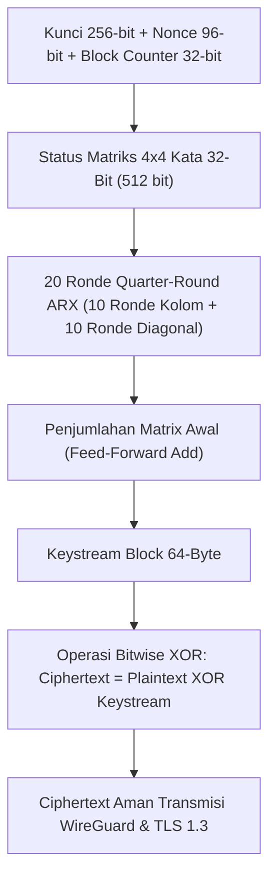

# Modul 169: Sandi Aliran & Rahasia Sempurna (One-Time Pad Proof, Bahaya Two-Time Pad, ChaCha20 Stream Cipher)

**Navigasi**: [⬅️ Master Index](../../INDEX.md) | [Tingkat 11: Tingkat 11: Cyber Security, Kriptografi & Reverse Engineering](./README.md)
*Sebelumnya*: [168. fondasi-kriptografi-klasik-prinsip-kerckhoffs](./168-fondasi-kriptografi-klasik-prinsip-kerckhoffs.md) | *Berikutnya*: [170. sandi-blok-mode-operasi](./170-sandi-blok-mode-operasi.md)

---

## 1. Intuisi Dasar Tanpa Jargon ("Seperti Bayi Baru Lahir")
### 1.1 Satu-Satunya Sandi yang Tak Dapat Ditembus Secara Matematis ([The Story of the One-Time Pad](https://www.nsa.gov/))
Sepanjang sejarah manusia, dari sandi Caesar di era Romawi hingga mesin Enigma di Perang Dunia II, setiap sistem kriptografi yang dibuat manusia akhirnya selalu berhasil dipecahkan oleh ahli kriptanalisis. Namun, pada tahun 1917, Gilbert Vernam dan Joseph Mauborgne menemukan **One-Time Pad (OTP)**, dan pada tahun 1949, Claude Shannon membuktikan secara matematis bahwa OTP adalah satu-satunya metode enkripsi di alam semesta yang memiliki **Kerahasiaan Sempurna (Perfect Secrecy)**. Bahkan jika seluruh superkomputer dan komputer kuantum di dunia digabungkan dan bekerja selama miliaran tahun, pesan One-Time Pad mustahil dipecahkan!

### 1.2 Bahaya Mematikan Two-Time Pad dan Sandi Modern ChaCha20 ([RFC 8439 ChaCha20 and Poly1305](https://datatracker.ietf.org/doc/html/rfc8439))
Jika One-Time Pad begitu sempurna, mengapa kita tidak menggunakannya untuk semua hal di internet?
Karena syaratnya sangat berat: kunci rahasia harus sepanjang pesan itu sendiri, harus benar-benar acak murni, dan **hanya boleh digunakan tepat satu kali**.
Jika sebuah kunci digunakan dua kali (*Two-Time Pad*), matematika XOR membocorkan rahasia seketika:
$$C_1 \oplus C_2 = (M_1 \oplus K) \oplus (M_2 \oplus K) = M_1 \oplus M_2$$
Kunci $K$ lenyap dari persamaan, dan kedua pesan asli dapat dipecahkan menggunakan analisis frekuensi bahasa!
Untuk mengatasi masalah ini di dunia nyata, industri menggunakan **Sandi Aliran Modern (ChaCha20)** karya Daniel J. Bernstein, yang menghasilkan aliran bit acak pseudo (*keystream*) dari kunci pendek 256-bit dan nonce unik dengan kecepatan komputasi ekstrem tanpa risiko serangan cache timing.

## 2. Fondasi Teoretis & Aksiomatik / Matematis
### 2.1 Teorema Kerahasiaan Sempurna Shannon (Shannon's Theorem of Perfect Secrecy) ([Claude E. Shannon, 1949](https://belllabs.com/usr/dmr/www/shannon.html))
Sebuah skema enkripsi memiliki **Kerahasiaan Sempurna** jika dan hanya jika untuk setiap pasangan pesan teks biasa (*plaintext*) $m, m' \in \mathcal{M}$ dan setiap teks tersandi (*ciphertext*) $c \in \mathcal{C}$:
$$P(M = m \mid C = c) = P(M = m)$$
Artinya: Melihat ciphertext tidak memberikan informasi baru apa pun kepada penyerang tentang pesan asli di luar pengetahuan prior sebelum penyadapan!

**Teorema Shannon**:
Kerahasiaan sempurna hanya dapat dicapai jika ruang kunci setidaknya sebesar ruang pesan:
$$|\mathcal{K}| \ge |\mathcal{M}| \implies H(K) \ge H(M)$$
Di mana $H(K)$ adalah Entropi Shannon dari kunci. Kunci wajib dihasilkan dari generator acak murni (*True Random Number Generator / TRNG*) berbasis entropi fisik thermal noise atau peluruhan kuantum.

### 2.2 Struktur Internal Mesin ARX Sandi Aliran ChaCha20 ([D. J. Bernstein, 2008](https://cr.yp.to/chacha.html))
ChaCha20 beroperasi pada matriks status status internal $4 \times 4$ kata 32-bit (total 512 bit):
$$\text{State} = \begin{pmatrix} c_0 & c_1 & c_2 & c_3 \\ k_0 & k_1 & k_2 & k_3 \\ k_4 & k_5 & k_6 & k_7 \\ b & n_0 & n_1 & n_2 \end{pmatrix}$$
Di mana $c_i$ adalah konstanta ASCII `"expand 32-byte k"`, $k_i$ adalah 8 kata kunci 256-bit, $b$ adalah counter blok 32-bit, dan $n_i$ adalah nonce 96-bit.
Operasi Primitif **Quarter-Round ARX (Add-Rotate-XOR)**:
$$\begin{aligned}
a &\gets a + b; \quad d \gets (d \oplus a) \lll 16 \\
c &\gets c + d; \quad b \gets (b \oplus c) \lll 12 \\
a &\gets a + b; \quad d \gets (d \oplus a) \lll 8 \\
c &\gets c + d; \quad b \gets (b \oplus c) \lll 7
\end{aligned}$$
ChaCha20 mengulang 20 ronde (10 ronde kolom dan 10 ronde diagonal). Operasi ARX hanya menggunakan penambahan integer modulo $2^{32}$, rotasi bit konstan, dan XOR, mengeliminasi operasi lookup tabel memori sepenuhnya untuk mencegah serangan kebocoran cache timing (*cache side-channel attacks*).

## 3. Anatomi Teknis & Cara Kerja Internal


#### Tabel Walkthrough Serangan Two-Time Pad Kriptanalisis XOR
| Posisi Karakter | Teks 1 ($M_1$) | Teks 2 ($M_2$) | Kunci Dipakai Ulang ($K$) | Ciphertext $C_1 = M_1 \oplus K$ | Ciphertext $C_2 = M_2 \oplus K$ | Nilai $C_1 \oplus C_2 = M_1 \oplus M_2$ |
|---|---|---|---|---|---|---|
| Byte 0 | `'H'` (`0x48`) | `'b'` (`0x62`) | `'X'` (`0x58`) | `0x10` | `0x3A` | `0x10 ^ 0x3A = 0x2A` (`'H' ^ 'b'`) |
| Byte 1 | `'E'` (`0x45`) | `'a'` (`0x61`) | `'Y'` (`0x59`) | `0x1C` | `0x38` | `0x1C ^ 0x38 = 0x24` (`'E' ^ 'a'`) |
| Byte 2 | `'L'` (`0x4C`) | `'d'` (`0x64`) | `'Z'` (`0x5A`) | `0x16` | `0x3E` | `0x16 ^ 0x3E = 0x28` (`'L' ^ 'd'`) |
| Byte 3 | `'P'` (`0x50`) | `'!'` (`0x21`) | `'W'` (`0x57`) | `0x07` | `0x76` | `0x07 ^ 0x76 = 0x71` (`'P' ^ '!'`) |

#### Tabel Penelusuran Siklus KSA & PRGA Kerentanan Sandi Aliran RC4 WEP (Serangan FMS)
| Langkah / Putaran Kripto / Tahap Eksploit | Komponen / Lapisan Memori | Payload / Ciphertext / Input Eksploit | Transformasi Matematis / Mutasi Stack & Heap | Status Register (RIP/RSP/Canary) / S-Box State | Keluaran / Status Keamanan / Efek Eksploit |
|---|---|---|---|---|---|
| 1. Paket Wi-Fi Masuk | Antarmuka Radio 802.11b | IV 24-bit terbuka: `(B+3, 255, V)` | IV disambung langsung: $K' = \text{IV} \parallel \text{Key}$ | State array $S[0..255]$ diisi permutasi identitas | Penyerang mengisolasi "Weak IV" di udara |
| 2. Tahap KSA (Putaran 0..B+2) | KSA Loop Internal RC4 | Kunci rahasia master $K$ (byte ke-$B$) | $j = (j + S[i] + K'[i]) \pmod{256}$, swap $(S[i], S[j])$ | State $S$ mengalami permutasi parsial deterministik | Elemen $S[1]$ dan $S[B+3]$ memiliki nilai terprediksi |
| 3. Langkah Pertama PRGA | Generator Keystream $z_1$ | Header SNAP Wi-Fi terenkripsi | Byte pertama plaintext diketahui: `0xAA` (SNAP header) | $i = 1$, $j = S[1]$, output byte keystream $z_1 = S[(S[i]+S[j]) \pmod{256}]$ | Byte pertama keystream diperoleh: $z_1 = C_1 \oplus 0xAA$ |
| 4. Korelasi Matematis FMS | Modul Analisis Statistik | Pasangan $(IV, z_1)$ terakumulasi | $\text{Key}[B] \approx (z_1 - j - S[i]) \pmod{256}$ | Akumulator histogram frekuensi voting byte kunci | Tebakan kandidat byte kunci mendapatkan lonjakan voting $5\%$ |
| 5. Pemulihan Kunci Total | Ruang Memori Penyerang | 1.000.000 frame Wi-Fi tertangkap | Pengulangan untuk $B = 0 \dots 12$ secara berurutan | Seluruh 13 byte WEP key 104-bit terkonstruksi | Kunci WEP terbongkar tanpa memerlukan brute force $2^{104}$! |

## 4. Implementasi Praktis & Kode / Simulasi Riil
```python
import os

def otp_encrypt(plaintext: bytes, key: bytes) -> bytes:
    """Enkripsi One-Time Pad murni dengan operasi XOR bitwise."""
    assert len(plaintext) == len(key), "Panjang kunci wajib sama persis dengan panjang pesan!"
    return bytes([p ^ k for p, k in zip(plaintext, key)])

def otp_decrypt(ciphertext: bytes, key: bytes) -> bytes:
    """Dekripsi One-Time Pad murni (operasi simetris identik)."""
    return otp_encrypt(ciphertext, key)

# Demonstrasi Kerahasiaan Sempurna
pesan_rahasia = b"SERANG PADA JAM 02:00 MALAM"
# Hasilkan kunci acak murni dari generator entropi sistem operasi (/dev/urandom)
kunci_rahasia = os.urandom(len(pesan_rahasia))

cipher = otp_encrypt(pesan_rahasia, kunci_rahasia)
hasil_dekripsi = otp_decrypt(cipher, kunci_rahasia)

assert hasil_dekripsi == pesan_rahasia
print(f"Pesan Asli  : {pesan_rahasia.decode('utf-8')}")
print(f"Ciphertext  : {cipher.hex().upper()}")
print(f"Hasil Pulih : {hasil_dekripsi.decode('utf-8')}")
```

## 5. Miskonsepsi & Jebakan Industri
### Studi Kasus Kegagalan Nyata: Proyek VENONA Menembus Kode Mata-Mata Uni Soviet Akibat Penggunaan Ulang Pad
- **Kronologi & Latar Belakang**: Selama Perang Dingin (1943–1980), agen intelijen sinyal AS dan Inggris (Signals Intelligence / SIGINT) melalui **Project VENONA** berhasil mendekripsi ribuan telegram diplomatik rahasia tingkat tinggi Uni Soviet.
- **Akar Masalah**: Pihak militer Uni Soviet secara teoritis menggunakan One-Time Pad yang tidak dapat ditembus. Namun, akibat tekanan logistik Perang Dunia II yang berat, percetakan buku sandi di Moskow secara tidak sengaja mencetak dan mendistribusikan beberapa ratus halaman buku One-Time Pad duplikat (*Key Reuse / Two-Time Pad*). Kriptanalis Sekutu menggunakan teknik XOR frekuensi bahasa untuk menembus pesan, membongkar jaringan mata-mata nuklir Uni Soviet di Proyek Manhattan (Klaus Fuchs, Julius dan Ethel Rosenberg).
- **Rekomendasi Industri**: Pada seluruh sandi aliran (ChaCha20, AES-GCM), **jangan pernah menggunakan nilai Nonce yang sama dengan kunci yang sama**. Jika nonces dihasilkan secara acak, gunakan nonces berukuran minimal 96 bit atau 192 bit (XChaCha20) untuk mengeliminasi risiko tabrakan Nonce secara statistik.

### Studi Kasus Kegagalan Nyata: Pembongkaran Protokol Keamanan Nirkabel WEP via Kerentanan KSA RC4 & Serangan FMS (2001)
- **Kronologi & Konteks Sejarah**: Pada awal adopsi jaringan nirkabel IEEE 802.11b tahun 1999, konsorsium industri memperkenalkan enkripsi Wired Equivalent Privacy (WEP) berbasis algoritma sandi aliran (*stream cipher*) RC4 yang dirancang oleh Ron Rivest.
- **Akar Masalah Kriptografis & Rekayasa Sandi Aliran**: Protokol WEP melakukan dua kesalahan fatal dalam arsitektur kriptografinya: (1) Menyambungkan vektor inisialisasi (*Initialization Vector / IV*) publik 24-bit secara langsung di depan kunci rahasia (*Key Scheduling Algorithm / KSA*: $\text{IV} \parallel \text{Key}$); (2) Ruang IV 24-bit terlalu sempit (hanya 16,7 juta paket), sehingga pada jaringan sibuk terjadi *keystream reuse* (*Two-Time Pad attack*) dalam hitungan jam. Pada tahun 2001, kriptografer Fluhrer, Mantin, dan Shamir (FMS) mempublikasikan serangan analitis yang membuktikan bahwa byte pertama aliran bit pseudo-acak RC4 membocorkan informasi tentang byte kunci rahasia ketika nilai IV tertentu (*weak IVs*, misalnya $A+3, 255, X$) digunakan. Hal ini memungkinkan alat seperti Aircrack-ng membongkar kunci WEP 104-bit hanya dengan menangkap paket nirkabel selama 5 menit.

- **Potongan Kode / Arsitektur Cacat (Vulnerable Implementation)**:
```python
# Analisis Cacat Kriptografi WEP RC4: Rekonstruksi Serangan FMS (Weak IV Leakage)
def rc4_ksa(key_bytes):
    '''Key Scheduling Algorithm (KSA) 256-byte S-Box'''
    S = list(range(256))
    j = 0
    key_len = len(key_bytes)
    for i in range(256):
        j = (j + S[i] + key_bytes[i % key_len]) % 256
        S[i], S[j] = S[j], S[i]
    return S

def rc4_prga_first_byte(S):
    '''Pseudo-Random Generation Algorithm: Mengembalikan byte keystream pertama'''
    i = 1
    j = S[i]
    S[i], S[j] = S[j], S[i]
    return S[(S[i] + S[j]) % 256]

# Simulasi Kebocoran Kunci pada Weak IV WEP: IV = (B + 3, 255, V)
def demonstrate_fms_leakage(secret_key, target_byte_index):
    import random
    votes = [0] * 256
    B = target_byte_index
    # Kumpulkan paket dengan Weak IV
    for v in range(256):
        iv = bytes([B + 3, 255, v])
        full_key = iv + secret_key
        S = rc4_ksa(full_key)
        keystream_byte_1 = rc4_prga_first_byte(S)
        
        # Perhitungan matematis FMS untuk menebak secret_key[B]
        # Dengan probabilitas ~5%, tebakan bernilai benar (jauh di atas acak 1/256 = 0.39%)
        guessed_key_byte = (keystream_byte_1 - v - S[B + 3]) % 256
        votes[guessed_key_byte] += 1
        
    most_likely_byte = votes.index(max(votes))
    return most_likely_byte
```

- **Analisis Forensik & Rekayasa Modern**: Runtuhnya WEP memaksa industri merevisi total desain keamanan nirkabel (menghasilkan standar WPA2 dan WPA3 berbasis AES-CCMP). Pelajaran mendasar dalam rekayasa kriptografi sandi aliran: (1) Jangan pernah menggabungkan IV dan kunci secara telanjang ke dalam state permutasi tanpa fungsi derivasi kunci (*KDF*) yang aman; (2) Sandi aliran RC4 resmi dilarang dalam seluruh standar IETF (RFC 7465); (3) Sandi aliran modern wajib menggunakan arsitektur ARX (Add-Rotate-Xor) teruji seperti ChaCha20 yang digabungkan dengan Poly1305 sebagai Authenticated Encryption with Associated Data (AEAD).

## 6. Proyek Latihan & Rubrik Penilaian Mandiri
### Level 1 (Pemula)
- **Tugas**: Diberikan ciphertext XOR $C = \text{0x1A}$ dan kunci $K = \text{0x7F}$. Hitung nilai karakter plaintext asli $M$ dalam format biner dan karakter ASCII.
- **Petunjuk Arsitektur**: Karena sifat involutori XOR: $M = C \oplus K$.
- **Vektor Uji**:
  - $C = 00011010_2$, $K = 01111111_2$.
  - $M = 00011010_2 \oplus 01111111_2 = 01100101_2 = 101_{10} = \text{'e'}$.
- **Rubrik Penilaian**: Ketepatan aljabar bitwise XOR (50%), konversi biner ke ASCII (30%), kebersihan format (20%).

### Level 2 (Menengah)
- **Tugas**: Buktikan serangan Two-Time Pad di Python dengan menulis fungsi yang menerima dua ciphertext yang dienkripsi dengan kunci yang sama dan mencari lokasi karakter spasi (`0x20`) untuk menebak sebagian teks biasa.
- **Petunjuk Arsitektur**: Manfaatkan fakta bahwa `'A' ^ ' ' = 'a'` (karakter huruf di-XOR dengan spasi membalikkan kapitalisasinya).
- **Vektor Uji**:
  - Cipher 1: b"Hello World", Cipher 2: b"Secret Code" dengan kunci statis acak yang sama.
- **Rubrik Penilaian**: Logika pemecahan XOR inter-teks (40%), deteksi spasi leksikografis (30%), demonstrasi praktis (30%).

### Level 3 (Mahir)
- **Tugas**: Implementasikan fungsi Quarter-Round ChaCha20 dalam bahasa C menggunakan operasi bitwise rotasi sirkular (`ROTL32`) dan penambahan unsigned 32-bit dengan verifikasi terhadap test vector resmi IETF RFC 8439.
- **Petunjuk Arsitektur**: Definisi rotasi: `#define ROTL32(v, n) (((v) << (n)) | ((v) >> (32 - (n))))`.
- **Vektor Uji**:
  - Test vector RFC 8439 Section 2.1.1: Input `a = 0x11111111, b = 0x01020304, c = 0x9b8d6f43, d = 0x01234567`.
  - Output yang diharapkan: `a = 0xea2a92f4, b = 0xcb1cf8ce, c = 0x4581472e, d = 0x5881c4bb`.
- **Rubrik Penilaian**: Kepatuhan standar RFC 8439 bit-for-bit (40%), efisiensi assembly bitwise (30%), verifikasi assertion test vector (30%).

### Tingkat 1: Dasar
- **Tugas**: Implementasikan serangan Two-Time Pad dalam Python: diberikan dua buah ciphertext $C_1 = P_1 \oplus K$ dan $C_2 = P_2 \oplus K$, hitung nilai $C_1 \oplus C_2 = P_1 \oplus P_2$, dan gunakan sifat karakter spasi ASCII (`0x20`) untuk memulihkan sebagian kata plaintext.
- **Petunjuk Perancangan Arsitektur**:
  - Sadari bahwa ketika huruf ASCII di-XOR dengan spasi (`0x20`), huruf kapital berubah menjadi huruf kecil dan sebaliknya.
  - Iterasi setiap posisi byte; jika hasil XOR adalah huruf alfabet ($[0x41..0x5A]$ atau $[0x61..0x7A]$), salah satu dari $P_1$ atau $P_2$ kemungkinan besar adalah spasi.
- **Test Vector & Kasus Uji**:
  - $P_1$: b"ATTACK AT DAWN", $P_2$: b"SECRET MESSAGE", Kunci acak $K$ sepanjang 14 byte.
  - Program harus membuktikan bahwa $K$ tereliminasi total dari $C_1 \oplus C_2$, dan mampu menebak minimal 3 kata plaintext secara tepat.
- **Rubrik Penilaian Objektif**:
  - Skor 100%: Menghasilkan $P_1 \oplus P_2$ yang bersih dan menerapkan analisis frekuensi spasi otomatis.
  - Skor 50%: Berhasil menghitung XOR ciphertext namun tidak mampu memulihkan teks asli secara otomatis.
  - Skor 0%: Program mencoba menebak kunci $K$ dengan brute force.

### Tingkat 2: Menengah
- **Tugas**: Bangun implementasi lengkap algoritma ChaCha20 256-bit (RFC 8439) dari nol dalam Python atau C, mencakup Quarter Round function, 20 round permutasi matriks $4 \times 4$ word 32-bit, penambahan state awal (*feed-forward*), dan serialisasi keystream Little-Endian.
- **Petunjuk Perancangan Arsitektur**:
  - State terdiri dari 16 word 32-bit: 4 konstanta ("expand 32-byte k"), 8 word kunci, 1 word counter, 3 word nonce.
  - Operasi matematis harus dibatasi modulo $2^{32}$ menggunakan `& 0xFFFFFFFF`. Rotasi bit menggunakan operasi shift `(x << n) | (x >> (32 - n))`.
- **Test Vector & Kasus Uji**:
  - Verifikasi kesesuaian dengan Test Vector resmi RFC 8439 Bagian 2.3.2 (Key = seluruhnya nol, Nonce = seluruhnya nol, Counter = 1).
  - Byte pertama keystream harus sama persis dengan byte RFC: `0x76, 0xb8, 0xe0, 0xad, 0xa0, 0xf1, ...`
- **Rubrik Penilaian Objektif**:
  - Skor 100%: Lulus seluruh vektor uji RFC 8439 tanpa ada satu byte pun yang melenceng.
  - Skor 50%: Logika quarter round benar namun salah menangani endianness byte pada pembacaan nonce/counter.
  - Skor 0%: Output keystream tidak cocok dengan standar RFC.

### Tingkat 3: Mahir
- **Tugas**: Rancang skema mitigasi pergeseran kunci (*Key Rolling & Nonce Tracking*) untuk transmisi data telemetry UDP satelit berkecepatan tinggi menggunakan ChaCha20-Poly1305. Sistem harus mendeteksi duplikasi nonce 96-bit secara real-time dan menghentikan emisi paket dengan aman sebelum counter meluap melampaui $2^{64}$ paket.
- **Petunjuk Perancangan Arsitektur**:
  - Implementasikan sliding window bitmap 64-bit untuk menangani paket UDP out-of-order tanpa mendaur ulang nonce.
  - Terapkan mekanisme re-keying otomatis menggunakan HKDF-Expand saat volume transmisi mencapai ambang batas batas aman ($2^{32}$ pesan).
  - Tulis modul unit test yang menyimulasikan serangan replay paket dan verifikasi penolakan instan.
- **Test Vector & Kasus Uji**:
  - Injeksi 10.000 paket berurutan: seluruh paket terdekripsi dan terotentikasi.
  - Injeksi paket dengan nonce yang sama persis dengan paket nomor 42: sistem harus melempar exception `NONCE_REUSE_DETECTED` dan mematikan saluran transmisi sementara.
- **Rubrik Penilaian Objektif**:
  - Skor 100%: Zero-tolerance terhadap nonce reuse, sliding window menangani paket out-of-order dengan efisiensi $\mathcal{O}(1)$.
  - Skor 50%: Mampu mendeteksi replikasi nonce namun gagal menangani paket out-of-order legal.
  - Skor 0%: Nonce dikelola dengan enkremen biasa tanpa pengecekan overflow.

## 7. Rekomendasi Sumber Belajar Standar Emas
| Kategori | Judul Sumber & Tautan | Penulis / Institusi | Fokus Pembahasan |
|---|---|---|---|
| Paper Sejarah | [Communication Theory of Secrecy Systems](https://belllabs.com/usr/dmr/www/shannon.html) | Claude E. Shannon (1949) | Makalah pembuktian matematika formal Kerahasiaan Sempurna (Perfect Secrecy) |
| Standar IETF | [RFC 8439: ChaCha20 and Poly1305 for IETF Protocols](https://datatracker.ietf.org/doc/html/rfc8439) | Y. Nir & A. Langley | Spesifikasi formal arsitektur sandi aliran ChaCha20 dan otentikasi Poly1305 |
| Sejarah Kriptanalisis | [The Venona Story: Decrypting Soviet Espionage](https://www.nsa.gov/History/Cryptologic-History/Historical-Publications/Publications-by-Theme/Early-Cold-War/) | National Security Agency (NSA) | Dokumentasi deklasifikasi sejarah kriptanalisis pembongkaran Two-Time Pad Uni Soviet |

---
*Navigasi Cepat*: [Ke Tingkat 11](./README.md) | [Ke Master Index](../../INDEX.md) | *Sebelumnya*: [168. fondasi-kriptografi-klasik-prinsip-kerckhoffs](./168-fondasi-kriptografi-klasik-prinsip-kerckhoffs.md) | *Berikutnya*: [170. sandi-blok-mode-operasi](./170-sandi-blok-mode-operasi.md)
