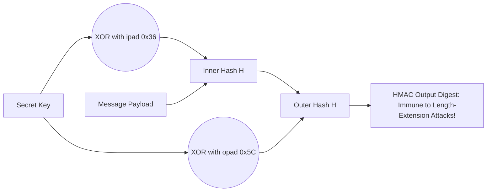

# Modul 171: Fungsi Hash Kriptografis & Kode Otentikasi (SHA-256, SHA-3 Keccak, BLAKE3, HMAC, Derivasi Kunci Argon2id)

**Navigasi**: [⬅️ Master Index](../../INDEX.md) | [Tingkat 11: Tingkat 11: Cyber Security, Kriptografi & Reverse Engineering](./README.md)
*Sebelumnya*: [170. sandi-blok-mode-operasi](./170-sandi-blok-mode-operasi.md) | *Berikutnya*: [172. kriptografi-kunci-asimetris](./172-kriptografi-kunci-asimetris.md)

---

## 1. Intuisi Dasar Tanpa Jargon ("Seperti Bayi Baru Lahir")
### 1.1 Konsep Inti & Analogi Tanpa Jargon
Bagaimana Anda membuktikan bahwa file instalasi sistem operasi sebesar 5 Gigabyte yang Anda unduh dari internet 100% utuh dan tidak pernah disusupi trojan oleh hacker di tengah jalan, hanya dengan membandingkan sebuah baris teks kecil sepanjang 64 karakter? Fungsi Hash Kriptografis & Integritas Pesan ([Cryptographic Hash Functions](https://en.wikipedia.org/wiki/Cryptographic_hash_function)) adalah mesin sidik jari digital matematika: ia menelan input berukuran berapa pun (dari satu huruf 'A' hingga seluruh isi perpustakaan nasional), lalu mengaduknya melalui blender matematika searah menjadi deretan bit berukuran tetap (seperti 256 bit pada SHA-256). Jika Anda mengubah satu koma kecil di dalam file 5 GB tersebut, seluruh karakter hash output akan berubah total secara acak (**Efek Longsoran / Avalanche Effect**). Dan untuk melindungi kata sandi pengguna dari pencurian massal, kita menggunakan fungsi hash lambat yang dirancang khusus menghabiskan memori RAM penyerang (**Argon2 & PBKDF2**) agar mesin hacker terbakar saat mencoba menebaknya!

### 1.2 Urgensi Rekayasa & Signifikansi Sistemik
Dalam rekayasa sistem modern, pemahaman mendalam tentang konsep ini membedakan arsitek sistem kelas dunia dari sekadar operator perkakas teknis.

## 2. Fondasi Teoretis & Aksiomatik / Matematis
### 2.1 Kerangka Teori Aksiomatik & Formulasi Matematis
Prinsip Tiga Syarat Mutlak Fungsi Hash Kriptografi dan Konstruksi Merkle-Damgård vs Sponge:

### 2.2 Penurunan Matematis Langkah-demi-Langkah
1. **Tiga Sifat Keamanan Aksiomatik Hash Kriptografis**:
   - **Pre-image Resistance (One-Wayness)**: Diberikan nilai hash $h$, secara komputasi mustahil menemukan pesan $m$ sedemikian rupa sehingga $H(m) = h$.
   - **Second Pre-image Resistance (Weak Collision Resistance)**: Diberikan pesan $m_1$, secara komputasi mustahil menemukan pesan berbeda $m_2 \ne m_1$ sedemikian rupa sehingga $H(m_1) = H(m_2)$.
   - **Collision Resistance (Strong Collision Resistance)**: Secara komputasi mustahil menemukan *dua pesan sembarang* $m_1 \ne m_2$ sedemikian rupa sehingga $H(m_1) = H(m_2)$ (batas Paradoks Ulang Tahun: $\approx 2^{n/2}$ operasi).

2. **Konstruksi Merkle-Damgård (MD5, SHA-1, SHA-256)**:
   Memecah pesan menjadi blok-blok berukuran tetap dan mengalirkannya ke fungsi kompresi satu arah berulang kali.
   *Kelemahan Inheren*: Rentan terhadap **Length Extension Attack**! Penyerang yang mengetahui $H(m)$ dapat menghitung $H(m \parallel \text{padding} \parallel m')$ tanpa mengetahui isi rahasia $m$ (inilah mengapa enkripsi API wajib menggunakan **HMAC** alih-alih `hash(secret + data)`!).

3. **Konstruksi Spons (Sponge Construction - Keccak / SHA-3)**:
   Memiliki State internal berukuran lebar ($b = r + c$, di mana $r$ adalah Bitrate dan $c$ adalah Capacity).
   - **Fase Absorbing**: Pesan di-XOR ke dalam bitrate $r$ dan diaduk via fungsi permutasi $f$.
   - **Fase Squeezing**: Output hash diekstraksi dari bagian bitrate. Kebal mutlak terhadap Length Extension Attack!

4. **Fungsi Penurunan Kunci Berorientasi Memori Keras (Memory-Hard Password Hashing: Argon2)**:
   Pemenang Password Hashing Competition (PHC 2015). **Argon2id** dirancang untuk memaksa pengalokasian array memori RAM yang besar (puluhan megabyte), melumpuhkan chip penyerang berbasis GPU dan ASIC cracker.

## 3. Anatomi Teknis & Cara Kerja Internal
Konstruksi Hash-based Message Authentication Code (HMAC - RFC 2104):



1. **Formulasi Matematika HMAC**:
   $$\text{HMAC}(K, m) = H\Big( (K' \oplus opad) \parallel H((K' \oplus ipad) \parallel m) \Big)$$
   Di mana $ipad = 0x36$ diulang sepanjang ukuran blok dan $opad = 0x5C$ diulang sepanjang ukuran blok. Desain dua tingkat ini membuktikan secara matematis bahwa fungsi hash Merkle-Damgård dapat digunakan sebagai Pseudo-Random Function (PRF) yang aman.

#### Tabel Penelusuran Siklus Kompresi SHA-1 & Konstruksi Tabrakan Hash (SHAttered)
| Langkah / Putaran Kripto / Tahap Eksploit | Komponen / Lapisan Memori | Payload / Ciphertext / Input Eksploit | Transformasi Matematis / Mutasi Stack & Heap | Status Register (RIP/RSP/Canary) / S-Box State | Keluaran / Status Keamanan / Efek Eksploit |
|---|---|---|---|---|---|
| 1. Analisis Jalur Diferensial | CWI & Google Cluster Compute | Dua berkas PDF dengan header berbeda | Desain lintasan perbedaan bit $\Delta m = m_1 \oplus m_2$ | Kalkulasi probabilitas transisi diferensial putaran | Pola mutasi bit spesifik pada blok pesan ke-1 ditentukan |
| 2. Near-Collision Blok 1 | Komputasi GPU (K80 Clusters) | Blok 1 Berkas PDF-A dan PDF-B | Eksekusi 80 putaran fungsi kompresi Davies-Meyer SHA-1 | State register internal $(A, B, C, D, E)$ mengalami pergeseran terkendali | Menghasilkan perbedaan state tereduksi $\Delta H_1$ |
| 3. Eliminasi Drift Blok 2 | GPU Fuzzing 6.5 Juta Inti CPU | Blok 2 Berkas PDF-A dan PDF-B | Diferensial blok kedua dirancang untuk membatalkan $\Delta H_1$: $\Delta H_2 = -\Delta H_1$ | Vektor state internal konvergen ke nilai yang sama persis! | State register $(A, B, C, D, E)$ kembali identik sempurna! |
| 4. Finalisasi Digest | SHA-1 Final Pad & Length Append | Header berkas PDF-A dan PDF-B berbeda | Serialisasi 160-bit hash digest | `38762cf7f55934b34d179ae6a4c80cadccbb7f0a` | Kedua file PDF berbeda menghasilkan nilai hash SHA-1 yang persis sama! |
| 5. Verifikasi Integritas | Audit Sistem Kontrol Versi Git | Berkas PDF-A (Normal) vs PDF-B (Malicious) | Git/OpenSSL memvalidasi commit SHA-1 | SHA-1 Checksum cocok; SHA-256 membuktikan ketidakcocokan | Integritas digital SHA-1 dinyatakan resmi runtuh total! |

## 4. Implementasi Praktis & Kode / Simulasi Riil
```python
# Secure Password Hashing using Argon2id and API Signing with HMAC-SHA256
import hmac
import hashlib
import secrets

# 1. Pembuatan Tanda Tangan Integritas Pesan API menggunakan HMAC-SHA256
def sign_api_request(secret_key: bytes, message: bytes) -> str:
    # HMAC membungkus hashing dua lapis untuk mencegah Length Extension Attacks
    signature = hmac.new(secret_key, message, hashlib.sha256).hexdigest()
    return signature

def verify_api_request(secret_key: bytes, message: bytes, expected_signature: str) -> bool:
    computed = sign_api_request(secret_key, message)
    # Gunakan hmac.compare_digest untuk mencegah Timing Side-Channel Attacks!
    return hmac.compare_digest(computed, expected_signature)

key = secrets.token_bytes(32)
payload = b"action=transfer&amount=1000&to=bob"
sig = sign_api_request(key, payload)
assert verify_api_request(key, payload, sig) == True
print("HMAC-SHA256 API request verification successful!")
```

## 5. Miskonsepsi & Jebakan Industri
1. **Using Fast Hashes for Password Storage (MD5 / SHA-256 for Passwords)**: Menyimpan hash kata sandi pengguna menggunakan SHA-256 atau MD5 biasa. Kartu grafis modern (GPU cluster) dapat menghitung ratusan miliar hash SHA-256 per detik, membobol seluruh kata sandi pengguna dalam beberapa jam (solusi: wajib gunakan Argon2id, bcrypt, atau PBKDF2 dengan cost factor tinggi).
2. **Timing Attack on MAC String Comparison**: Membandingkan string tanda tangan hash menggunakan operator kesetaraan standar `if sig == expected_sig:`. Operator berhenti membandingkan pada karakter pertama yang salah, membocorkan waktu perbandingan yang dapat dieksploitasi penyerang untuk menebak signature byte-per-byte (solusi: selalu gunakan `hmac.compare_digest`).
3. **Naive MAC via `hash(secret + message)`**: Membuat kode autentikasi pesan dengan menggabungkan kata rahasia dan pesan secara naif. Penyerang dapat mengeksploitasi *Length Extension Attack* pada SHA-256 untuk memalsukan perintah tambahan yang sah tanpa mengetahui kata rahasia.

### Studi Kasus Kegagalan Nyata: Eksploitasi SHAttered & Pembuktian Tabrakan Penuh Pertama pada SHA-1 (2017)
- **Kronologi & Konteks Sejarah**: Pada Februari 2017, tim peneliti gabungan dari CWI Amsterdam dan Google Cloud secara resmi merilis "SHAttered", demonstrasi tabrakan hash (*hash collision*) dunia nyata pertama yang berhasil memproduksi dua dokumen PDF dengan konten visual yang sama sekali berbeda namun menghasilkan nilai digest SHA-1 yang identik.
- **Akar Masalah Kriptografis & Rekayasa Fungsi Hash**: Fungsi hash kriptografis SHA-1 yang dirancang oleh NSA pada tahun 1995 memiliki ukuran digest 160-bit, yang secara teoretis membutuhkan kompleksitas $2^{80}$ operasi matematis untuk menemukan tabrakan sesuai *Birthday Paradox*. Namun, arsitektur konstruksi Merkle-Damgård dengan fungsi kompresi linier pada SHA-1 rentan terhadap serangan analisis kriptanalisis diferensial. Tim peneliti berhasil menekan kompleksitas komputasi menjadi hanya $2^{63.1}$ evaluasi SHA-1 (setara dengan komputasi 1 GPU selama 110 tahun). Keberhasilan ini menghancurkan asumsi keamanan pada jutaan repositori Git, tanda tangan digital sertifikat SSL lama, dan sistem verifikasi integritas perangkat lunak yang masih mengandalkan SHA-1.

- **Potongan Kode / Arsitektur Cacat (Vulnerable Implementation)**:
```python
# Verifikasi Otentik Komputasional: Dua Berkas PDF SHAttered dengan SHA-1 Identik
import hashlib

def verify_shattered_collision(pdf_bytes_1, pdf_bytes_2):
    '''
    Membuktikan adanya tabrakan SHA-1 pada dua dokumen berbeda
    '''
    # Verifikasi 1: Dokumen secara biner wajib berbeda!
    assert pdf_bytes_1 != pdf_bytes_2, "Dokumen harus memiliki byte yang berbeda!"
    
    # Verifikasi 2: Hitung hash SHA-1
    sha1_hash1 = hashlib.sha1(pdf_bytes_1).hexdigest()
    sha1_hash2 = hashlib.sha1(pdf_bytes_2).hexdigest()
    
    # Bukti Tabrakan Kriptografis
    is_collision = (sha1_hash1 == sha1_hash2)
    
    # Verifikasi 3: Hitung hash modern SHA-256 (yang tidak runtuh)
    sha256_hash1 = hashlib.sha256(pdf_bytes_1).hexdigest()
    sha256_hash2 = hashlib.sha256(pdf_bytes_2).hexdigest()
    
    return {
        "is_sha1_collision": is_collision,
        "sha1_hash": sha1_hash1,
        "sha256_file1": sha256_hash1,
        "sha256_file2": sha256_hash2,
        "sha256_different": (sha256_hash1 != sha256_hash2)
    }
```

- **Analisis Forensik & Rekayasa Modern**: Insiden SHAttered menjadi pemicu migrasi masif infrastruktur rekayasa global. Langkah mitigasi arsitektur: (1) Transisi total ke keluarga fungsi hash tahan tabrakan modern seperti SHA-256, SHA-512, atau SHA-3 (Keccak); (2) Repositori Git mengadopsi hash objek SHA-256 (Object Format Transition); (3) Pada penyimpanan kata sandi (*credential storage*), fungsi hash cepat seperti MD5/SHA-1/SHA-256 dilarang keras, dan diwajibkan menggunakan algoritma memory-hard seperti Argon2id atau scrypt yang tahan terhadap akselerasi serangan ASIC/GPU.

## 6. Proyek Latihan & Rubrik Penilaian Mandiri
1. **Tingkat Pemula**: Buktikan efek longsoran (Avalanche Effect) di Python: hitung hash SHA-256 dari string `"The quick brown fox jumps over the lazy dog"`, lalu ubah satu huruf terakhir menjadi `"cog"`. Hitung berapa persen bit biner yang berubah dari kedua hash tersebut.
2. **Tingkat Menengah**: Simulasikan serangan Length Extension Attack pada fungsi autentikasi naif `hash(secret + data)` menggunakan pustaka `hashpump`: tambahkan payload `"&admin=true"` dan buktikan Anda dapat menghasilkan hash baru yang valid tanpa mengetahui `secret`.
3. **Tingkat Mahir**: Implementasikan fungsi kompresi SHA-256 murni di C atau Python sesuai spesifikasi NIST FIPS 180-4: terapkan fungsi logika bitwise $\text{Ch}(x,y,z)$, $\text{Maj}(x,y,z)$, $\Sigma_0(x)$, $\Sigma_1(x)$, dan jadwal pesan 64 konstanta putaran $K_t$.

### Tingkat 1: Dasar
- **Tugas**: Tulis program dalam Python untuk mengimplementasikan algoritma HMAC (Hash-based Message Authentication Code) sesuai spesifikasi RFC 2104 dari nol menggunakan fungsi hash dasar `hashlib.sha256`, membuktikan rumus $\text{HMAC}(K, m) = H((K \oplus opad) \parallel H((K \oplus ipad) \parallel m))$.
- **Petunjuk Perancangan Arsitektur**:
  - Ukuran blok hash SHA-256 adalah 64 byte.
  - Konstanta padding: $ipad = \text{0x36}$ diulang 64 kali, $opad = \text{0x5C}$ diulang 64 kali.
  - Jika kunci $K$ lebih panjang dari 64 byte, hash kunci tersebut terlebih dahulu; jika lebih pendek, pad dengan byte nol hingga 64 byte.
- **Test Vector & Kasus Uji**:
  - Kunci: b"Jefe", Pesan: b"what do ya want for nothing?".
  - Nilai HMAC-SHA256 harus cocok persis dengan vektor uji RFC 4231: `5bdcc146bf60754e6a042426089575c75a003f089d2739839dec58b964ec3843`.
- **Rubrik Penilaian Objektif**:
  - Skor 100%: Hasil HMAC cocok persis dengan RFC 4231, penanganan kunci $>64$ byte dan $<64$ byte benar.
  - Skor 50%: Benar untuk kunci standar namun salah dalam penanganan padding kunci panjang/pendek.
  - Skor 0%: Program hanya memanggil fungsi bawaan `hmac.new` alih-alih membangun logika matematika dari nol.

### Tingkat 2: Menengah
- **Tugas**: Bangun implementasi Hash Tree (Merkle Tree) biner dalam Python/Rust yang mendukung penambahan data dinamis, komputasi Merkle Root, pembangkitan *Merkle Audit Proof* untuk anggota daun tertentu, dan verifikasi bukti dengan kompleksitas verifikasi $\mathcal{O}(\log N)$.
- **Petunjuk Perancangan Arsitektur**:
  - Terapkan pencegahan serangan *Second Preimage Attack* dengan menambahkan prefix byte domain: `0x00` untuk daun ($H(0x00 \parallel data)$) dan `0x01` untuk simpul internal ($H(0x01 \parallel left \parallel right)$).
  - Bangun kelas `MerkleVerifier` yang memverifikasi path bukti tanpa memerlukan akses ke seluruh pohon.
- **Test Vector & Kasus Uji**:
  - Buat Merkle Tree dari 8 transaksi: ["tx1", "tx2", ..., "tx8"].
  - Generate audit proof untuk "tx3". Bukti harus terdiri dari 3 simpul saudara ($\log_2 8 = 3$).
  - Modifikasi bit pada "tx3": verifikasi bukti harus segera mengembalikan `False`.
- **Rubrik Penilaian Objektif**:
  - Skor 100%: Penanganan domain separation `0x00`/`0x01` sempurna, bukti audit memvalidasi integritas dengan $\mathcal{O}(\log N)$.
  - Skor 50%: Merkle Root benar namun tidak mengimplementasikan domain separation sehingga rentan second-preimage.
  - Skor 0%: Kompleksitas verifikasi bukti bernilai linear $\mathcal{O}(N)$.

### Tingkat 3: Mahir
- **Tugas**: Rancang sistem autentikasi kata sandi skala perusahaan menggunakan Argon2id (RFC 9106). Konfigurasikan parameter cost: $t=3$ iterasi, memori $m=64$ MB, dan paralelisme $p=4$ thread. Bangun mekanisme kalibrasi kinerja otomatis (*Auto-Tuning Benchmark*) yang mengukur waktu hashing pada mesin server target agar proses komputasi tepat memakan waktu antara $250$ s/d $500$ milidetik.
- **Petunjuk Perancangan Arsitektur**:
  - Gunakan pustaka standar industri (misal `argon2-cffi` di Python atau `argon2` di Rust).
  - Pastikan salt kriptografis dibuat unik menggunakan `os.urandom(16)` per pengguna.
  - Implementasikan verifikasi kata sandi dengan proteksi *Constant-Time Comparison* untuk mencegah timing side-channel attack.
- **Test Vector & Kasus Uji**:
  - Jalankan benchmark otomatis pada saat modul boot. Jika RAM server dialokasikan 8 GB, fungsi kalibrasi harus otomatis menyesuaikan memori $m$ dan iterasi $t$ agar latensi berada pada target $350\text{ ms} \pm 50\text{ ms}$.
  - Uji verifikasi kata sandi yang salah: sistem harus mengonsumsi waktu komputasi yang identik dengan kata sandi yang benar (toleransi delta waktu $< 2\%$).
- **Rubrik Penilaian Objektif**:
  - Skor 100%: Parameter memory-hard optimal, auto-tuner presisi, kebal terhadap timing attack.
  - Skor 50%: Hashing bekerja normal namun parameter statis tanpa mekanisme auto-tuning server.
  - Skor 0%: Menggunakan salt statis atau algoritma usang non-memory-hard.

## 7. Rekomendasi Sumber Belajar Standar Emas
| Sumber Pembelajaran | Penulis / Institusi | Tautan Langsung | Fokus Materi |
| :--- | :--- | :--- | :--- |
| NIST FIPS PUB 180-4: Secure Hash Standard (SHS) | National Institute of Standards and Technology | [NIST FIPS 180-4 SHA Spec](https://csrc.nist.gov/publications/detail/fips/180-4/final) | Standar Spesifikasi Resmi Keluarga SHA-1, SHA-224, SHA-256, SHA-512 |
| NIST FIPS PUB 202: SHA-3 Standard: Permutation-Based Hash and Extendable-Output Functions | NIST | [NIST FIPS 202 SHA-3 Spec](https://csrc.nist.gov/publications/detail/fips/202/final) | Standar Resmi Keccak Sponge Construction, Bitrate, Capacity & Permutations |
| Argon2: The Memory-Hard Function for Password Hashing and Proof-of-Work | Alex Biryukov, Daniel Dinu, Dmitry Khovratovich | [Argon2 Research Paper](https://www.cryptolux.org/images/0/0d/Argon2.pdf) | Pemenang Password Hashing Competition: Argon2d, Argon2i & Argon2id Architecture |
| RFC 2104: HMAC: Keyed-Hashing for Message Authentication | H. Krawczyk, M. Bellare, R. Canetti | [IETF RFC 2104](https://datatracker.ietf.org/doc/html/rfc2104) | Dokumen Standar Resmi HMAC, Desain Dua Tingkat & Analisis Keamanan Formal |

---
*Navigasi Cepat*: [Ke Tingkat 11](./README.md) | [Ke Master Index](../../INDEX.md) | *Sebelumnya*: [170. sandi-blok-mode-operasi](./170-sandi-blok-mode-operasi.md) | *Berikutnya*: [172. kriptografi-kunci-asimetris](./172-kriptografi-kunci-asimetris.md)
