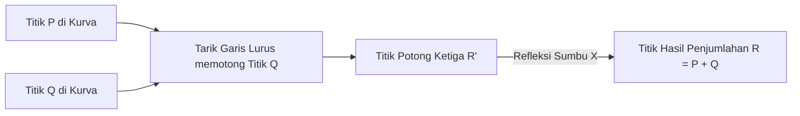

# Modul 171: Fungsi Hash Kriptografis & Kode Otentikasi (SHA-256, SHA-3 Keccak, BLAKE3, HMAC, Derivasi Kunci Argon2id)

**Navigasi**: [⬅️ Master Index](../../INDEX.md) | [Tingkat 11: Tingkat 11: Cyber Security, Kriptografi & Reverse Engineering](./README.md)
*Sebelumnya*: [170. sandi-blok-mode-operasi](./170-sandi-blok-mode-operasi.md) | *Berikutnya*: [172. kriptografi-kunci-asimetris](./172-kriptografi-kunci-asimetris.md)

---

## 1. Intuisi Dasar Tanpa Jargon ("Seperti Bayi Baru Lahir")
Bagaimana Anda dan seseorang yang belum pernah Anda temui sebelumnya dapat menyepakati sebuah kunci rahasia melalui telepon umum yang disadap oleh seluruh agen intelijen dunia, tanpa penyerang dapat menebak kunci rahasia tersebut? Kriptografi Asimetris & Teori Bilangan ([Asymmetric Cryptography & Diffie-Hellman](https://en.wikipedia.org/wiki/Public-key_cryptography)) adalah penemuan matematika paling ajaib di abad ke-20 (Whitfield Diffie, Martin Hellman, dan RSA, 1976-1977). Alih-alih menggunakan satu kunci yang sama, ia menggunakan **Pasangan Kunci Kriptografi**: sebuah **Kunci Publik** yang disebarkan bebas ke seluruh dunia agar orang lain dapat mengunci pesan untuk Anda; dan sebuah **Kunci Privat** rahasia yang hanya Anda simpan sendiri di dalam saku untuk membuka pesan tersebut. Fondasi keamanannya berakar pada fungsi satu arah matematika (*One-Way Trapdoor Functions*): sangat mudah mengalikan dua bilangan prima raksasa, tetapi mustahil memfaktorkannya kembali dalam waktu manusia!

## 2. Fondasi Teoretis & Aksiomatik / Matematis
Landasan Teori Bilangan: Faktorisasi Integer RSA vs Logaritma Diskrit Kurva Eliptik (ECC):

1. **Sistem Kriptografi RSA (Rivest, Shamir, Adleman, 1977)**:
   - Pilih dua bilangan prima raksasa independen $p$ dan $q$. Hitung modulus $n = p \cdot q$ dan fungsi totien Euler:
     $$\phi(n) = (p - 1)(q - 1)$$
   - Pilih eksponen publik $e$ sedemikian rupa sehingga $\gcd(e, \phi(n)) = 1$ (biasanya $e = 65537$).
   - Hitung kunci privat $d$ menggunakan Algoritma Euclidean Diperluas (*Modular Multiplicative Inverse*):
     $$d \equiv e^{-1} \pmod{\phi(n)} \iff e \cdot d \equiv 1 \pmod{\phi(n)}$$
   - Enkripsi dan Dekripsi (Berdasarkan Teorema Kecil Fermat & Euler):
     $$\text{Enkripsi: } c = m^e \pmod n \quad \iff \quad \text{Dekripsi: } m = c^d \pmod n$$

2. **Pertukaran Kunci Diffie-Hellman (DH Key Exchange)**:
   - Alice memilih rahasia $a$, kirim $A = g^a \pmod p$. Bob memilih rahasia $b$, kirim $B = g^b \pmod p$.
   - Kunci Rahasia Bersama: $K = B^a \pmod p = (g^b)^a \equiv (g^a)^b = A^b \pmod p$.

3. **Kriptografi Kurva Eliptik (Elliptic Curve Cryptography / ECC)**:
   Didefinisikan di atas medan berhingga $\mathbb{F}_p$ dengan persamaan Weierstrass: $y^2 = x^3 + ax + b$.
   Operasi Penjumlahan Titik Kurva membentuk grup Abelian. Masalah Logaritma Diskrit Kurva Eliptik (ECDLP):
   $$Q = d \cdot G \quad (d: \text{Kunci Privat skalar}, G: \text{Generator Base Point}, Q: \text{Kunci Publik})$$
   Sangat mudah menghitung perkalian skalar titik $dG$, namun mustahil mencari $d$ dari $Q$ dan $G$.
   **Keunggulan ECC**: Kunci ECC 256-bit (seperti Curve25519 / Ed25519) memberikan tingkat keamanan yang setara dengan kunci RSA 3072-bit, menghemat 90% komputasi dan bandwidth!

## 3. Anatomi Teknis & Cara Kerja Internal
Operasi Penjumlahan Geometris Titik pada Kurva Eliptik (Point Addition & Point Doubling):



1. **Ed25519 / Curve25519 (Daniel J. Bernstein / DJB)**:
   Menggunakan kurva Twisted Edwards ($-x^2 + y^2 = 1 - (121665/121666)x^2 y^2$) di atas medan bilangan prima $2^{255} - 19$. Kebal secara matematis terhadap serangan timing channel, tidak memerlukan pengecekan titik tak terhingga, dan mengeksekusi tanda tangan digital dalam mikrodetik ([Curve25519 High-Speed Cryptography](https://cr.yp.to/ecdh.html)).

## 4. Implementasi Praktis & Kode / Simulasi Riil
```python
# Elliptic Curve Diffie-Hellman (ECDH) Key Exchange using X25519 in Python
from cryptography.hazmat.primitives.asymmetric import x25519

# 1. Alice membangkitkan pasangan kunci privat & publik X25519
alice_private_key = x25519.X25519PrivateKey.generate()
alice_public_key = alice_private_key.public_key()

# 2. Bob membangkitkan pasangan kunci privat & publik X25519
bob_private_key = x25519.X25519PrivateKey.generate()
bob_public_key = bob_private_key.public_key()

# 3. Keduanya bertukar kunci publik melintasi jaringan publik yang disadap...
# Alice menghitung Shared Secret menggunakan kunci privat Alice + kunci publik Bob:
alice_shared_key = alice_private_key.exchange(bob_public_key)

# Bob menghitung Shared Secret menggunakan kunci privat Bob + kunci publik Alice:
bob_shared_key = bob_private_key.exchange(alice_public_key)

# Jaminan Matematika: Keduanya menghasilkan kunci simetris rahasia yang 100% IDENTIK!
assert alice_shared_key == bob_shared_key
print(f"ECDH Shared Secret successfully derived! Length: {len(alice_shared_key)} bytes")
```

## 5. Miskonsepsi & Jebakan Industri
1. **Textbook RSA without Padding Vulnerability**: Mengimplementasikan enkripsi RSA naif ($c = m^e \pmod n$) tanpa padding optimal (**OAEP** - Optimal Asymmetric Encryption Padding). Karena RSA deterministik, penyerang dapat menebak pesan pendek atau memulihkan plaintext menggunakan serangan Coppersmith / Hastad's Broadcast Attack.
2. **ECDSA Nonce / k-value Reuse Catastrophe (Sony PS3 Hack 2010)**: Menggunakan angka acak $k$ yang sama untuk menandatangani dua pesan ECDSA yang berbeda. Penyerang dapat menghitung kunci privat pengembang secara aljabar langsung: $d = (s_1 z_2 - s_2 z_1) / (r(s_2 - s_1)) \pmod n$, meruntuhkan seluruh sistem proteksi konsol game PlayStation 3 ([Fail0verflow PS3 Hack](https://events.ccc.de/congress/2010/Fahrplan/events/4087.en.html)).
3. **Small Subgroup Confinement Attack in Diffie-Hellman**: Tidak memvalidasi apakah kunci publik yang diterima dari pihak lawan berada di dalam grup siklik yang sah. Penyerang mengirimkan titik kurva dengan order kecil (*Small Subgroup*) untuk membocorkan bit kunci privat.

## 6. Proyek Latihan & Rubrik Penilaian Mandiri
1. **Tingkat Pemula**: Hitung kunci RSA manual dengan bilangan prima kecil: pilih $p=61, q=53$. Hitung modulus $n$, totien $\phi(n)$, pilih $e=17$, dan cari kunci privat $d$ menggunakan Algoritma Euclidean Diperluas.
2. **Tingkat Menengah**: Buat program Python yang membuktikan rumus kebocoran kunci privat ECDSA jika angka nonce $k$ digunakan ulang untuk dua tanda tangan berbeda (*Repeated Nonce Exploit*). Pulihkan kunci privat $d$ dari dua tanda tangan tersebut.
3. **Tingkat Mahir**: Implementasikan operasi penjumlahan titik (*Point Addition*) dan penggandaan titik (*Point Doubling*) pada kurva eliptik Weierstrass $y^2 = x^3 + ax + b \pmod p$ dari nol dalam C/Python. Gunakan algoritma *Double-and-Add* untuk mengimplementasikan perkalian skalar titik $d \cdot G$.

## 7. Rekomendasi Sumber Belajar Standar Emas
| Sumber Pembelajaran | Penulis / Institusi | Tautan Langsung | Fokus Materi |
| :--- | :--- | :--- | :--- |
| A Method for Obtaining Digital Signatures and Public-Key Cryptosystems | R. L. Rivest, A. Shamir, L. Adleman | [ACM Communications 1978 RSA Paper](https://dl.acm.org/doi/10.1145/359340.359342) | Makalah Orisinal Penemuan Algoritma Kriptografi Kunci Publik RSA |
| New Directions in Cryptography | Whitfield Diffie & Martin E. Hellman (Stanford) | [IEEE Transactions on IT 1976](https://ieeexplore.ieee.org/document/1055638) | Makalah Paling Bersejarah: Penemuan Pertukaran Kunci Diffie-Hellman Public Key |
| Curve25519: High-Speed High-Security Cryptography | Daniel J. Bernstein (DJB) | [DJB Curve25519 Paper](https://cr.yp.to/ecdh/curve25519-20060209.pdf) | Spesifikasi Desain Kurva Twisted Edwards, Constant-Time & Immune to Timing Attacks |
| Guide to Elliptic Curve Cryptography | Darrel Hankerson, Alfred Menezes, Scott Vanstone | [Springer Hankerson](https://link.springer.com/book/10.1007/b97644) | Buku Pegangan Lengkap ECC: Finite Field Arithmetic, Point Multiplication & ECDSA |

---
*Navigasi Cepat*: [Ke Tingkat 11](./README.md) | [Ke Master Index](../../INDEX.md) | *Sebelumnya*: [170. sandi-blok-mode-operasi](./170-sandi-blok-mode-operasi.md) | *Berikutnya*: [172. kriptografi-kunci-asimetris](./172-kriptografi-kunci-asimetris.md)
