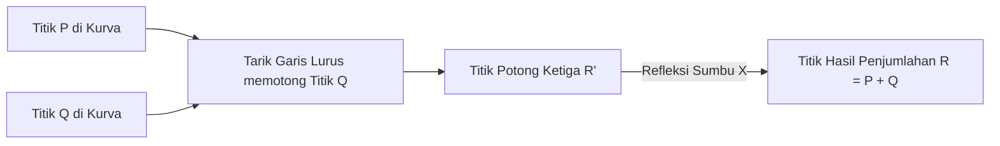

# Modul 172: Kriptografi Kunci Asimetris (Fungsi Trapdoor, Diffie-Hellman Key Exchange, RSA Faktorisasi, ECC Curve25519)

**Navigasi**: [⬅️ Master Index](../../INDEX.md) | [Tingkat 11: Tingkat 11: Cyber Security, Kriptografi & Reverse Engineering](./README.md)
*Sebelumnya*: [171. fungsi-hash-kriptografis-kode-otentikasi](./171-fungsi-hash-kriptografis-kode-otentikasi.md) | *Berikutnya*: [173. infrastruktur-kunci-publik-tls-internals](./173-infrastruktur-kunci-publik-tls-internals.md)

---

## 1. Intuisi Dasar Tanpa Jargon ("Seperti Bayi Baru Lahir")
### 1.1 Konsep Inti & Analogi Tanpa Jargon
Bagaimana Anda dan seseorang yang belum pernah Anda temui sebelumnya dapat menyepakati sebuah kunci rahasia melalui telepon umum yang disadap oleh seluruh agen intelijen dunia, tanpa penyerang dapat menebak kunci rahasia tersebut? Kriptografi Asimetris & Teori Bilangan ([Asymmetric Cryptography & Diffie-Hellman](https://en.wikipedia.org/wiki/Public-key_cryptography)) adalah penemuan matematika paling ajaib di abad ke-20 (Whitfield Diffie, Martin Hellman, dan RSA, 1976-1977). Alih-alih menggunakan satu kunci yang sama, ia menggunakan **Pasangan Kunci Kriptografi**: sebuah **Kunci Publik** yang disebarkan bebas ke seluruh dunia agar orang lain dapat mengunci pesan untuk Anda; dan sebuah **Kunci Privat** rahasia yang hanya Anda simpan sendiri di dalam saku untuk membuka pesan tersebut. Fondasi keamanannya berakar pada fungsi satu arah matematika (*One-Way Trapdoor Functions*): sangat mudah mengalikan dua bilangan prima raksasa, tetapi mustahil memfaktorkannya kembali dalam waktu manusia!

### 1.2 Urgensi Rekayasa & Signifikansi Sistemik
Dalam rekayasa sistem modern, pemahaman mendalam tentang konsep ini membedakan arsitek sistem kelas dunia dari sekadar operator perkakas teknis.

## 2. Fondasi Teoretis & Aksiomatik / Matematis
### 2.1 Kerangka Teori Aksiomatik & Formulasi Matematis
Landasan Teori Bilangan: Faktorisasi Integer RSA vs Logaritma Diskrit Kurva Eliptik (ECC):

### 2.2 Penurunan Matematis Langkah-demi-Langkah
1. **Sistem Kriptografi RSA (Rivest, Shamir, Adleman, 1977)**:
   - Pilih dua bilangan prima raksasa independen $p$ dan $q$. Hitung modulus $n = p \cdot q$ dan fungsi totien Euler:
     $$\phi(n) = (p - 1)(q - 1)$$
   - Pilih eksponen publik $e$ sedemikian rupa sehingga $\gcd(e, \phi(n)) = 1$ (biasanya $e = 65537$).
   - Hitung kunci privat $d$ menggunakan Algoritma Euclidean Diperluas (*Modular Multiplicative Inverse*):
     $$d \equiv e^{-1} \pmod{\phi(n)} \iff e \cdot d \equiv 1 \pmod{\phi(n)}$$
   - Enkripsi dan Dekripsi (Berdasarkan Teorema Kecil Fermat & Euler):
     $$\text{Enkripsi: } c = m^e \pmod n \quad \iff \quad \text{Dekripsi: } m = c^d \pmod n$$

2. **Pertukaran Kunci Diffie-Hellman (DH Key Exchange)**:
   - Alice memilih rahasia $a$, kirim $A = g^a \pmod p$. Bob memilih rahasia $b$, kirim $B = g^b \pmod p$.
   - Kunci Rahasia Bersama: $K = B^a \pmod p = (g^b)^a \equiv (g^a)^b = A^b \pmod p$.

3. **Kriptografi Kurva Eliptik (Elliptic Curve Cryptography / ECC)**:
   Didefinisikan di atas medan berhingga $\mathbb{F}_p$ dengan persamaan Weierstrass: $y^2 = x^3 + ax + b$.
   Operasi Penjumlahan Titik Kurva membentuk grup Abelian. Masalah Logaritma Diskrit Kurva Eliptik (ECDLP):
   $$Q = d \cdot G \quad (d: \text{Kunci Privat skalar}, G: \text{Generator Base Point}, Q: \text{Kunci Publik})$$
   Sangat mudah menghitung perkalian skalar titik $dG$, namun mustahil mencari $d$ dari $Q$ dan $G$.
   **Keunggulan ECC**: Kunci ECC 256-bit (seperti Curve25519 / Ed25519) memberikan tingkat keamanan yang setara dengan kunci RSA 3072-bit, menghemat 90% komputasi dan bandwidth!

## 3. Anatomi Teknis & Cara Kerja Internal
Operasi Penjumlahan Geometris Titik pada Kurva Eliptik (Point Addition & Point Doubling):



1. **Ed25519 / Curve25519 (Daniel J. Bernstein / DJB)**:
   Menggunakan kurva Twisted Edwards ($-x^2 + y^2 = 1 - (121665/121666)x^2 y^2$) di atas medan bilangan prima USD 2^{255} - 19$. Kebal secara matematis terhadap serangan timing channel, tidak memerlukan pengecekan titik tak terhingga, dan mengeksekusi tanda tangan digital dalam mikrodetik ([Curve25519 High-Speed Cryptography](https://cr.yp.to/ecdh.html)).

#### Tabel Penelusuran Siklus Pembangkitan Kunci RSA & Backdoor Kleptografis Dual_EC_DRBG
| Langkah / Putaran Kripto / Tahap Eksploit | Komponen / Lapisan Memori | Payload / Ciphertext / Input Eksploit | Transformasi Matematis / Mutasi Stack & Heap | Status Register (RIP/RSP/Canary) / S-Box State | Keluaran / Status Keamanan / Efek Eksploit |
|---|---|---|---|---|---|
| 1. Parameter Kurva P-256 | Standar NIST SP 800-90A | Titik kurva eliptik publik $P$ dan $Q$ | Hubungan rahasia perancang: $P = e \cdot Q$ ($e$ dirahasiakan) | Parameter kurva termuat di memori pustaka kripto | Pengguna mempercayai titik $P, Q$ sebagai bilangan acak wajar |
| 2. Pembangkitan State Internal | Dual_EC Generator State $s_0$ | Seed awal PRNG perangkat keras | Titik kurva dihitung: $s_{i+1} = x(\phi(s_i \cdot P))$ | Perhitungan perkalian skalar kurva eliptik | State internal baru tersimpan di memori aman |
| 3. Emisi Bit Pseudorandom | Buffer Keluaran Acak | 30 byte output acak dirilis ke aplikasi | Output byte $r_i = \text{LSB}_{240}(x(\phi(s_i \cdot Q)))$ | 30 byte acak disematkan ke dalam TLS ClientHello | Penyerang mengamati 30 byte output acak di kabel jaringan |
| 4. Rekonstruksi State via Backdoor | Mesin Kriptanalisis Penyerang | 30 byte output teramati di jaringan | Penyerang mengetahui skalar rahasia $e$: $e \cdot (s_i \cdot Q) = s_i \cdot (e \cdot Q) = s_i \cdot P$ | Penyerang menghitung hanya 256 kemungkinan koordinat $y$ | State internal rahasia $s_{i+1}$ terpecahkan instan! |
| 5. Prediksi Seluruh Kunci Sesi | Sesi TLS Terbuka | Kunci privat ephemeral TLS target | Generator penyerang memproyeksikan seluruh state masa depan | Kunci simetris AES sesi TLS didekripsi | Seluruh lalu lintas perbankan/VPN target didekripsi pasif secara instan! |

## 4. Implementasi Praktis & Kode / Simulasi Riil
```python
# Elliptic Curve Diffie-Hellman (ECDH) Key Exchange using X25519 in Python
from cryptography.hazmat.primitives.asymmetric import x25519

# 1. Alice membangkitkan pasangan kunci privat & publik X25519
alice_private_key = x25519.X25519PrivateKey.generate()
alice_public_key = alice_private_key.public_key()

# 2. Bob membangkitkan pasangan kunci privat & publik X25519
bob_private_key = x25519.X25519PrivateKey.generate()
bob_public_key = bob_private_key.public_key()

# 3. Keduanya bertukar kunci publik melintasi jaringan publik yang disadap...
# Alice menghitung Shared Secret menggunakan kunci privat Alice + kunci publik Bob:
alice_shared_key = alice_private_key.exchange(bob_public_key)

# Bob menghitung Shared Secret menggunakan kunci privat Bob + kunci publik Alice:
bob_shared_key = bob_private_key.exchange(alice_public_key)

# Jaminan Matematika: Keduanya menghasilkan kunci simetris rahasia yang 100% IDENTIK!
assert alice_shared_key == bob_shared_key
print(f"ECDH Shared Secret successfully derived! Length: {len(alice_shared_key)} bytes")
```

## 5. Miskonsepsi & Jebakan Industri
1. **Textbook RSA without Padding Vulnerability**: Mengimplementasikan enkripsi RSA naif ($c = m^e \pmod n$) tanpa padding optimal (**OAEP** - Optimal Asymmetric Encryption Padding). Karena RSA deterministik, penyerang dapat menebak pesan pendek atau memulihkan plaintext menggunakan serangan Coppersmith / Hastad's Broadcast Attack.
2. **ECDSA Nonce / k-value Reuse Catastrophe (Sony PS3 Hack 2010)**: Menggunakan angka acak $k$ yang sama untuk menandatangani dua pesan ECDSA yang berbeda. Penyerang dapat menghitung kunci privat pengembang secara aljabar langsung: $d = (s_1 z_2 - s_2 z_1) / (r(s_2 - s_1)) \pmod n$, meruntuhkan seluruh sistem proteksi konsol game PlayStation 3 ([Fail0verflow PS3 Hack](https://events.ccc.de/congress/2010/Fahrplan/events/4087.en.html)).
3. **Small Subgroup Confinement Attack in Diffie-Hellman**: Tidak memvalidasi apakah kunci publik yang diterima dari pihak lawan berada di dalam grup siklik yang sah. Penyerang mengirimkan titik kurva dengan order kecil (*Small Subgroup*) untuk membocorkan bit kunci privat.

### Studi Kasus Kegagalan Nyata: Skandal Backdoor Kleptografis NSA Dual_EC_DRBG pada RSA BSAFE (2013)
- **Kronologi & Konteks Sejarah**: Pada September 2013, dokumen yang dibocorkan oleh Edward Snowden mengonfirmasi kecurigaan komunitas kriptografer bahwa algoritma pembangkit bilangan acak Dual_EC_DRBG (yang distandarisasi oleh NIST dan dijadikan default pada pustaka komersial RSA BSAFE) secara sengaja disisipi pintu belakang (*kleptographic backdoor*) oleh National Security Agency (NSA).
- **Akar Masalah Kriptografis & Rekayasa Pintu Belakang Matematika**: Algoritma Dual_EC_DRBG menggunakan dua titik kurva eliptik $P$ dan $Q$ pada kurva NIST P-256. Jika titik $Q$ dibuat sedemikian rupa sehingga $P = e \cdot Q$ di mana nilai skalar $e$ hanya diketahui oleh perancang backdoor, maka siapa pun yang memiliki nilai $e$ dapat memulihkan seluruh state internal PRNG hanya dengan mengamati 30 byte output acak publik (misalnya dari field *Random* pada jabat tangan TLS). Dengan state yang telah diketahui, seluruh kunci enkripsi masa depan yang dihasilkan oleh generator tersebut dapat diprediksi secara instan, meruntuhkan seluruh protokol TLS, IPsec, dan VPN yang mengandalkannya.

- **Potongan Kode / Arsitektur Cacat (Vulnerable Implementation)**:
```python
# Demonstrasi Prinsip Matematika Backdoor Dual_EC_DRBG (Model Sederhana)
class ToyDualEC:
    def __init__(self, curve, P, Q):
        self.curve = curve
        self.P = P
        self.Q = Q
        
    def step(self, state):
        # State baru: s_next = x-coord(state * P)
        point_s = self.curve.scalar_mult(state, self.P)
        next_state = point_s.x
        
        # Output acak: r = x-coord(state * Q)
        point_r = self.curve.scalar_mult(state, self.Q)
        output = point_r.x
        return next_state, output

def backdoor_state_recovery(observed_output, secret_e, curve, P):
    '''
    Jika P = e * Q, maka:
    e * (state * Q) = state * (e * Q) = state * P = next_state!
    Penyerang memulihkan state internal hanya dari 1 output acak!
    '''
    # Penyerang merekonstruksi titik kurva dari observed_output
    possible_points = curve.recover_points_from_x(observed_output)
    recovered_states = []
    
    for pt in possible_points:
        # Penyerang mengalikan titik yang teramati dengan kunci privat backdoor 'e'
        next_state_point = curve.scalar_mult(secret_e, pt)
        recovered_states.append(next_state_point.x)
        
    return recovered_states # State internal PRNG terbongkar total!
```

- **Analisis Forensik & Rekayasa Modern**: Skandal Dual_EC_DRBG mengajarkan komunitas kriptografi global tentang konsep "Nothing Up My Sleeve Numbers" (NUMS). Standar rekayasa kriptografi modern menegaskan: (1) Parameter kurva eliptik dan konstanta hashing tidak boleh ditentukan secara arbiter, melainkan wajib diturunkan melalui prosedur deterministik publik (misalnya hash dari bilangan $\pi$ atau $e$); (2) Kurva modern seperti Curve25519 dan Ed25519 rancangan Daniel J. Bernstein diadopsi secara luas karena strukturnya yang transparan dan kebal terhadap celah manipulasi titik; (3) Pustaka CSPRNG dilarang mengandalkan kurva eliptik berkinerja lambat, melainkan wajib menggunakan generator berbasis sandi blok/aliran teruji seperti AES-CTR-DRBG atau ChaCha20-DRBG.

## 6. Proyek Latihan & Rubrik Penilaian Mandiri
1. **Tingkat Pemula**: Hitung kunci RSA manual dengan bilangan prima kecil: pilih $p=61, q=53$. Hitung modulus $n$, totien $\phi(n)$, pilih $e=17$, dan cari kunci privat $d$ menggunakan Algoritma Euclidean Diperluas.
2. **Tingkat Menengah**: Buat program Python yang membuktikan rumus kebocoran kunci privat ECDSA jika angka nonce $k$ digunakan ulang untuk dua tanda tangan berbeda (*Repeated Nonce Exploit*). Pulihkan kunci privat $d$ dari dua tanda tangan tersebut.
3. **Tingkat Mahir**: Implementasikan operasi penjumlahan titik (*Point Addition*) dan penggandaan titik (*Point Doubling*) pada kurva eliptik Weierstrass $y^2 = x^3 + ax + b \pmod p$ dari nol dalam C/Python. Gunakan algoritma *Double-and-Add* untuk mengimplementasikan perkalian skalar titik $d \cdot G$.

### Tingkat 1: Dasar
- **Tugas**: Implementasikan algoritma Modular Exponentiation cepat (*Square-and-Multiply*) dalam Python atau C untuk menghitung $b^e \pmod m$ untuk bilangan bulat 2048-bit, dan buktikan secara eksperimental bahwa implementasi naif rentan terhadap serangan analisis waktu (*Timing Attack*).
- **Petunjuk Perancangan Arsitektur**:
  - Bangun loop bit-demi-bit: jika bit bernilai 1, lakukan operasi perkalian modulo; jika bit bernilai 0, lewati perkalian.
  - Catat durasi waktu eksekusi presisi tinggi menggunakan `time.perf_counter_ns()`.
- **Test Vector & Kasus Uji**:
  - Uji eksponen dengan bobot Hamming rendah (misal eksponen dengan hanya 2 bit '1') vs eksponen dengan bobot Hamming tinggi (seluruh bit '1').
  - Ukur perbedaan waktu: implementasi naif akan menunjukkan selisih waktu terukur yang linier terhadap jumlah bit '1' (membocorkan private exponent).
- **Rubrik Penilaian Objektif**:
  - Skor 100%: Menghasilkan perhitungan yang tepat secara matematis dan membuktikan variasi waktu berbasis bobot Hamming.
  - Skor 50%: Algoritma bekerja benar namun pengujian timing tidak menghasilkan data statistik terukur.
  - Skor 0%: Algoritma mengalami stack overflow pada bilangan besar.

### Tingkat 2: Menengah
- **Tugas**: Bangun implementasi Diffie-Hellman Key Exchange di atas Kurva Eliptik (ECDH) menggunakan kurva Edwards standar Curve25519 (RFC 7748) dari nol. Implementasikan operasi tangga Montgomery (*Montgomery Ladder*) untuk perkalian skalar konstan (*constant-time*).
- **Petunjuk Perancangan Arsitektur**:
  - Kurva didefinisikan oleh persamaan $y^2 = x^3 + 486662 x^2 + x$ di atas medan berhingga $\mathbb{F}_{2^{255}-19}$.
  - Montgomery ladder hanya membutuhkan koordinat $X$ dan $Z$ tanpa perlu menghitung koordinat $Y$.
  - Terapkan bit clamping pada private key: `scalar[0] &= 248; scalar[31] &= 127; scalar[31] |= 64`.
- **Test Vector & Kasus Uji**:
  - Verifikasi menggunakan Test Vector resmi RFC 7748 Bagian 6.1 (Alice Private, Bob Private, Shared Secret).
  - Shared secret yang dihasilkan Alice dan Bob harus identik: `0x4a, 0x5d, 0x9d, 0x5b, 0xa4, ...`
- **Rubrik Penilaian Objektif**:
  - Skor 100%: Lulus seluruh vektor uji RFC 7748, eksekusi konstan waktu tanpa percabangan bersyarat berbasis bit skalar.
  - Skor 50%: Menghasilkan shared secret yang benar namun tidak mengimplementasikan operasi konstan waktu.
  - Skor 0%: Hasil komputasi melenceng dari standar RFC.

### Tingkat 3: Mahir
- **Tugas**: Rancang simulator serangan faktorisasi RSA berbasis serangan Coppersmith / Wiener Attack dalam Python: jika eksponen privat $d$ bernilai terlalu kecil ($d < \frac{1}{3} N^{0.25}$), bangun algoritma pecahan berlanjut (*Continued Fractions*) untuk memulihkan $d$ dan faktor prima $p, q$ dari modulus $N$ 2048-bit dalam hitungan detik.
- **Petunjuk Perancangan Arsitektur**:
  - Hitung ekspansi pecahan berlanjut dari pecahan rasional $e / N$.
  - Iterasi setiap konvergen $k / d$; periksa apakah nilai $d$ merupakan pembagi ganjil dan apakah persamaan kuadrat $x^2 - (N - \phi(N) + 1)x + N = 0$ menghasilkan akar bulat $p$ dan $q$.
- **Test Vector & Kasus Uji**:
  - Buat pasangan kunci RSA-2048 dengan eksponen privat kecil $d$ (misal 128-bit).
  - Algoritma Wiener Attack harus berhasil mengekstrak $p, q,$ dan $d$ dalam waktu $< 2$ detik pada CPU standar.
- **Rubrik Penilaian Objektif**:
  - Skor 100%: Berhasil memfaktorkan modulus 2048-bit dengan eksponen kecil secara instan menggunakan konvergen pecahan berlanjut.
  - Skor 50%: Logika Wiener benar namun hanya bekerja pada modulus kecil (512-bit) dan gagal pada 2048-bit.
  - Skor 0%: Menggunakan pencarian trial division linear.

## 7. Rekomendasi Sumber Belajar Standar Emas
| Sumber Pembelajaran | Penulis / Institusi | Tautan Langsung | Fokus Materi |
| :--- | :--- | :--- | :--- |
| A Method for Obtaining Digital Signatures and Public-Key Cryptosystems | R. L. Rivest, A. Shamir, L. Adleman | [ACM Communications 1978 RSA Paper](https://dl.acm.org/doi/10.1145/359340.359342) | Makalah Orisinal Penemuan Algoritma Kriptografi Kunci Publik RSA |
| New Directions in Cryptography | Whitfield Diffie & Martin E. Hellman (Stanford) | [IEEE Transactions on IT 1976](https://ieeexplore.ieee.org/document/1055638) | Makalah Paling Bersejarah: Penemuan Pertukaran Kunci Diffie-Hellman Public Key |
| Curve25519: High-Speed High-Security Cryptography | Daniel J. Bernstein (DJB) | [DJB Curve25519 Paper](https://cr.yp.to/ecdh/curve25519-20060209.pdf) | Spesifikasi Desain Kurva Twisted Edwards, Constant-Time & Immune to Timing Attacks |
| Guide to Elliptic Curve Cryptography | Darrel Hankerson, Alfred Menezes, Scott Vanstone | [Springer Hankerson](https://link.springer.com/book/10.1007/b97644) | Buku Pegangan Lengkap ECC: Finite Field Arithmetic, Point Multiplication & ECDSA |

---
*Navigasi Cepat*: [Ke Tingkat 11](./README.md) | [Ke Master Index](../../INDEX.md) | *Sebelumnya*: [171. fungsi-hash-kriptografis-kode-otentikasi](./171-fungsi-hash-kriptografis-kode-otentikasi.md) | *Berikutnya*: [173. infrastruktur-kunci-publik-tls-internals](./173-infrastruktur-kunci-publik-tls-internals.md)
