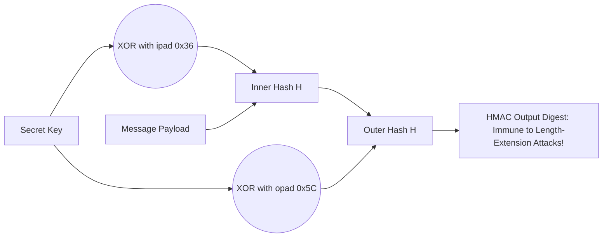

# Modul 172: Kriptografi Kunci Asimetris (Fungsi Trapdoor, Diffie-Hellman Key Exchange, RSA Faktorisasi, ECC Curve25519)

**Navigasi**: [⬅️ Master Index](../../INDEX.md) | [Tingkat 11: Tingkat 11: Cyber Security, Kriptografi & Reverse Engineering](./README.md)
*Sebelumnya*: [171. fungsi-hash-kriptografis-kode-otentikasi](./171-fungsi-hash-kriptografis-kode-otentikasi.md) | *Berikutnya*: [173. infrastruktur-kunci-publik-tls-internals](./173-infrastruktur-kunci-publik-tls-internals.md)

---

## 1. Intuisi Dasar Tanpa Jargon ("Seperti Bayi Baru Lahir")
Bagaimana Anda membuktikan bahwa file instalasi sistem operasi sebesar 5 Gigabyte yang Anda unduh dari internet 100% utuh dan tidak pernah disusupi trojan oleh hacker di tengah jalan, hanya dengan membandingkan sebuah baris teks kecil sepanjang 64 karakter? Fungsi Hash Kriptografis & Integritas Pesan ([Cryptographic Hash Functions](https://en.wikipedia.org/wiki/Cryptographic_hash_function)) adalah mesin sidik jari digital matematika: ia menelan input berukuran berapa pun (dari satu huruf 'A' hingga seluruh isi perpustakaan nasional), lalu mengaduknya melalui blender matematika searah menjadi deretan bit berukuran tetap (seperti 256 bit pada SHA-256). Jika Anda mengubah satu koma kecil di dalam file 5 GB tersebut, seluruh karakter hash output akan berubah total secara acak (**Efek Longsoran / Avalanche Effect**). Dan untuk melindungi kata sandi pengguna dari pencurian massal, kita menggunakan fungsi hash lambat yang dirancang khusus menghabiskan memori RAM penyerang (**Argon2 & PBKDF2**) agar mesin hacker terbakar saat mencoba menebaknya!

## 2. Fondasi Teoretis & Aksiomatik / Matematis
Prinsip Tiga Syarat Mutlak Fungsi Hash Kriptografi dan Konstruksi Merkle-Damgård vs Sponge:

1. **Tiga Sifat Keamanan Aksiomatik Hash Kriptografis**:
   - **Pre-image Resistance (One-Wayness)**: Diberikan nilai hash $h$, secara komputasi mustahil menemukan pesan $m$ sedemikian rupa sehingga $H(m) = h$.
   - **Second Pre-image Resistance (Weak Collision Resistance)**: Diberikan pesan $m_1$, secara komputasi mustahil menemukan pesan berbeda $m_2 \ne m_1$ sedemikian rupa sehingga $H(m_1) = H(m_2)$.
   - **Collision Resistance (Strong Collision Resistance)**: Secara komputasi mustahil menemukan *dua pesan sembarang* $m_1 \ne m_2$ sedemikian rupa sehingga $H(m_1) = H(m_2)$ (batas Paradoks Ulang Tahun: $\approx 2^{n/2}$ operasi).

2. **Konstruksi Merkle-Damgård (MD5, SHA-1, SHA-256)**:
   Memecah pesan menjadi blok-blok berukuran tetap dan mengalirkannya ke fungsi kompresi satu arah berulang kali.
   *Kelemahan Inheren*: Rentan terhadap **Length Extension Attack**! Penyerang yang mengetahui $H(m)$ dapat menghitung $H(m \parallel \text{padding} \parallel m')$ tanpa mengetahui isi rahasia $m$ (inilah mengapa enkripsi API wajib menggunakan **HMAC** alih-alih `hash(secret + data)`!).

3. **Konstruksi Spons (Sponge Construction - Keccak / SHA-3)**:
   Memiliki State internal berukuran lebar ($b = r + c$, di mana $r$ adalah Bitrate dan $c$ adalah Capacity).
   - **Fase Absorbing**: Pesan di-XOR ke dalam bitrate $r$ dan diaduk via fungsi permutasi $f$.
   - **Fase Squeezing**: Output hash diekstraksi dari bagian bitrate. Kebal mutlak terhadap Length Extension Attack!

4. **Fungsi Penurunan Kunci Berorientasi Memori Keras (Memory-Hard Password Hashing: Argon2)**:
   Pemenang Password Hashing Competition (PHC 2015). **Argon2id** dirancang untuk memaksa pengalokasian array memori RAM yang besar (puluhan megabyte), melumpuhkan chip penyerang berbasis GPU dan ASIC cracker.

## 3. Anatomi Teknis & Cara Kerja Internal
Konstruksi Hash-based Message Authentication Code (HMAC - RFC 2104):



1. **Formulasi Matematika HMAC**:
   $$\text{HMAC}(K, m) = H\Big( (K' \oplus opad) \parallel H((K' \oplus ipad) \parallel m) \Big)$$
   Di mana $ipad = 0x36$ diulang sepanjang ukuran blok dan $opad = 0x5C$ diulang sepanjang ukuran blok. Desain dua tingkat ini membuktikan secara matematis bahwa fungsi hash Merkle-Damgård dapat digunakan sebagai Pseudo-Random Function (PRF) yang aman.

## 4. Implementasi Praktis & Kode / Simulasi Riil
```python
# Secure Password Hashing using Argon2id and API Signing with HMAC-SHA256
import hmac
import hashlib
import secrets

# 1. Pembuatan Tanda Tangan Integritas Pesan API menggunakan HMAC-SHA256
def sign_api_request(secret_key: bytes, message: bytes) -> str:
    # HMAC membungkus hashing dua lapis untuk mencegah Length Extension Attacks
    signature = hmac.new(secret_key, message, hashlib.sha256).hexdigest()
    return signature

def verify_api_request(secret_key: bytes, message: bytes, expected_signature: str) -> bool:
    computed = sign_api_request(secret_key, message)
    # Gunakan hmac.compare_digest untuk mencegah Timing Side-Channel Attacks!
    return hmac.compare_digest(computed, expected_signature)

key = secrets.token_bytes(32)
payload = b"action=transfer&amount=1000&to=bob"
sig = sign_api_request(key, payload)
assert verify_api_request(key, payload, sig) == True
print("HMAC-SHA256 API request verification successful!")
```

## 5. Miskonsepsi & Jebakan Industri
1. **Using Fast Hashes for Password Storage (MD5 / SHA-256 for Passwords)**: Menyimpan hash kata sandi pengguna menggunakan SHA-256 atau MD5 biasa. Kartu grafis modern (GPU cluster) dapat menghitung ratusan miliar hash SHA-256 per detik, membobol seluruh kata sandi pengguna dalam beberapa jam (solusi: wajib gunakan Argon2id, bcrypt, atau PBKDF2 dengan cost factor tinggi).
2. **Timing Attack on MAC String Comparison**: Membandingkan string tanda tangan hash menggunakan operator kesetaraan standar `if sig == expected_sig:`. Operator berhenti membandingkan pada karakter pertama yang salah, membocorkan waktu perbandingan yang dapat dieksploitasi penyerang untuk menebak signature byte-per-byte (solusi: selalu gunakan `hmac.compare_digest`).
3. **Naive MAC via `hash(secret + message)`**: Membuat kode autentikasi pesan dengan menggabungkan kata rahasia dan pesan secara naif. Penyerang dapat mengeksploitasi *Length Extension Attack* pada SHA-256 untuk memalsukan perintah tambahan yang sah tanpa mengetahui kata rahasia.

## 6. Proyek Latihan & Rubrik Penilaian Mandiri
1. **Tingkat Pemula**: Buktikan efek longsoran (Avalanche Effect) di Python: hitung hash SHA-256 dari string `"The quick brown fox jumps over the lazy dog"`, lalu ubah satu huruf terakhir menjadi `"cog"`. Hitung berapa persen bit biner yang berubah dari kedua hash tersebut.
2. **Tingkat Menengah**: Simulasikan serangan Length Extension Attack pada fungsi autentikasi naif `hash(secret + data)` menggunakan pustaka `hashpump`: tambahkan payload `"&admin=true"` dan buktikan Anda dapat menghasilkan hash baru yang valid tanpa mengetahui `secret`.
3. **Tingkat Mahir**: Implementasikan fungsi kompresi SHA-256 murni di C atau Python sesuai spesifikasi NIST FIPS 180-4: terapkan fungsi logika bitwise $\text{Ch}(x,y,z)$, $\text{Maj}(x,y,z)$, $\Sigma_0(x)$, $\Sigma_1(x)$, dan jadwal pesan 64 konstanta putaran $K_t$.

## 7. Rekomendasi Sumber Belajar Standar Emas
| Sumber Pembelajaran | Penulis / Institusi | Tautan Langsung | Fokus Materi |
| :--- | :--- | :--- | :--- |
| NIST FIPS PUB 180-4: Secure Hash Standard (SHS) | National Institute of Standards and Technology | [NIST FIPS 180-4 SHA Spec](https://csrc.nist.gov/publications/detail/fips/180-4/final) | Standar Spesifikasi Resmi Keluarga SHA-1, SHA-224, SHA-256, SHA-512 |
| NIST FIPS PUB 202: SHA-3 Standard: Permutation-Based Hash and Extendable-Output Functions | NIST | [NIST FIPS 202 SHA-3 Spec](https://csrc.nist.gov/publications/detail/fips/202/final) | Standar Resmi Keccak Sponge Construction, Bitrate, Capacity & Permutations |
| Argon2: The Memory-Hard Function for Password Hashing and Proof-of-Work | Alex Biryukov, Daniel Dinu, Dmitry Khovratovich | [Argon2 Research Paper](https://www.cryptolux.org/images/0/0d/Argon2.pdf) | Pemenang Password Hashing Competition: Argon2d, Argon2i & Argon2id Architecture |
| RFC 2104: HMAC: Keyed-Hashing for Message Authentication | H. Krawczyk, M. Bellare, R. Canetti | [IETF RFC 2104](https://datatracker.ietf.org/doc/html/rfc2104) | Dokumen Standar Resmi HMAC, Desain Dua Tingkat & Analisis Keamanan Formal |

---
*Navigasi Cepat*: [Ke Tingkat 11](./README.md) | [Ke Master Index](../../INDEX.md) | *Sebelumnya*: [171. fungsi-hash-kriptografis-kode-otentikasi](./171-fungsi-hash-kriptografis-kode-otentikasi.md) | *Berikutnya*: [173. infrastruktur-kunci-publik-tls-internals](./173-infrastruktur-kunci-publik-tls-internals.md)
