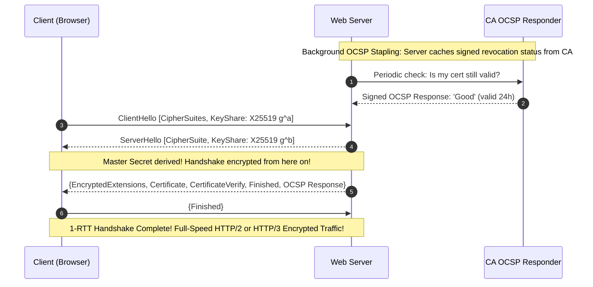

# Modul 173: Infrastruktur Kunci Publik & TLS Internals (Otoritas Sertifikat X.509, Rantai Kepercayaan, Protokol TLS 1.3 1-RTT)

**Navigasi**: [⬅️ Master Index](../../INDEX.md) | [Tingkat 11: Tingkat 11: Cyber Security, Kriptografi & Reverse Engineering](./README.md)
*Sebelumnya*: [172. kriptografi-kunci-asimetris](./172-kriptografi-kunci-asimetris.md) | *Berikutnya*: [174. kriptografi-lanjut-pasca-kuantum](./174-kriptografi-lanjut-pasca-kuantum.md)

---

## 1. Intuisi Dasar Tanpa Jargon ("Seperti Bayi Baru Lahir")
Ketika Anda membuka browser dan mengunjungi situs web bank Anda, ikon gembok kecil berwarna hijau muncul di bilah alamat URL. Bagaimana Anda tahu dengan kepastian 100% bahwa Anda benar-benar sedang berbicara dengan server bank asli, bukan dengan router hacker di kedai kopi yang sedang menyamar? Public Key Infrastructure (PKI) & TLS/SSL Internals ([PKI & TLS 1.3 Handshake](https://www.cloudflare.com/learning/ssl/what-happens-in-a-tls-handshake/)) adalah jaringan kepercayaan global yang melindungi perdagangan dunia. PKI bertindak seperti paspor internasional: lembaga otoritas sertifikat (**Certificate Authorities / CA**) yang tepercaya membubuhkan tanda tangan digital pada sertifikat digital **X.509** server bank Anda; dan protokol **TLS 1.3** mengeksekusi jabat tangan kilat 1-RTT untuk menyepakati kunci sesi enkripsi simetris yang baru serta menjamin perlindungan kerahasiaan masa lalu (**Forward Secrecy**) bahkan jika kunci privat server dicuri di masa depan!

## 2. Fondasi Teoretis & Aksiomatik / Matematis
Rantai Kepercayaan Sertifikat X.509 dan Formalisme Jabat Tangan TLS 1.3 (RFC 8446):

1. **Rantai Kepercayaan Sertifikat X.509 (Chain of Trust)**:
   $$\text{Root CA (Self-Signed, pre-installed in OS)} \xrightarrow{\text{Signs}} \text{Intermediate CA} \xrightarrow{\text{Signs}} \text{End-Entity Server Leaf Certificate}$$
   Struktur X.509 v3: Versi, Serial Number, Signature Algorithm (ECDSA/RSA), Issuer, Validity Period, Subject (Domain Name), Subject Alternative Names (SAN), dan Public Key.

2. **Protokol Jabat Tangan TLS 1.3 (1-RTT Full Handshake)**:
   Meniadakan seluruh negosiasi cipher lawas yang tidak aman (melarang RSA key exchange, melarang CBC, melarang RC4/MD5/SHA-1).
   - **ClientHello (1-RTT Start)**:
     Klien mengirimkan daftar cipher suites yang didukung (`TLS_AES_256_GCM_SHA384`), ekstensi `supported_groups` (X25519), dan langsung mengirimkan **Key Share** publik Diffie-Hellman ephemeral ($g^a$)!
   - **ServerHello**:
     Server memilih cipher suite, membalas dengan **Key Share** publik Diffie-Hellman ephemeral ($g^b$).
     *Pada detik ini, kedua belah pihak sudah memiliki Shared Secret $g^{ab}$ dan seluruh percakapan selanjutnya langsung terenkripsi!*
   - **EncryptedExtensions, Certificate, CertificateVerify, Finished**:
     Server mengirimkan sertifikat digital dan tanda tangan kriptografis untuk membuktikan kepemilikan kunci privat.

3. **Pilar Kerahasiaan Maju (Perfect Forward Secrecy / PFS)**:
   TLS 1.3 mewajibkan pertukaran kunci Diffie-Hellman sementara (*Ephemeral Diffie-Hellman*). Kunci sesi simetris dibuang dari RAM setelah koneksi berakhir. Jika di masa depan kunci privat server disita oleh polisi atau dicuri hacker, rekaman lalu lintas internet masa lalu **tetap mustahil didekripsi selamanya!**

## 3. Anatomi Teknis & Cara Kerja Internal
Diagram Waktu Jabat Tangan TLS 1.3 (1-RTT) vs Mekanisme OCSP Stapling:



1. **OCSP Stapling (RFC 6066)**: Meniadakan kebocoran privasi di mana browser harus menghubungi server CA untuk memvalidasi apakah sertifikat telah dicabut (*Online Certificate Status Protocol*). Dengan stapling, server web sendiri yang menyematkan bukti validitas bertanda tangan CA langsung di dalam jabat tangan TLS.

## 4. Implementasi Praktis & Kode / Simulasi Riil
```python
# Inspecting TLS Certificate Chain and Expiry using Python Standard Library
import ssl
import socket
from datetime import datetime

def inspect_tls_certificate(hostname: str, port: int = 443):
    # Konfigurasikan konteks SSL modern yang mematuhi standar TLS 1.2+
    context = ssl.create_default_context()
    context.minimum_version = ssl.TLSVersion.TLSv1_2

    with socket.create_connection((hostname, port), timeout=5.0) as sock:
        with context.wrap_socket(sock, server_hostname=hostname) as ssock:
            cert = ssock.getpeercert()
            cipher = ssock.cipher()
            tls_version = ssock.version()

            print(f"--- TLS Inspection for: {hostname} ---")
            print(f"Negotiated Protocol: {tls_version}")
            print(f"Negotiated Cipher  : {cipher[0]} ({cipher[2]} bits)")
            
            # Ekstrak tanggal kedaluwarsa
            expire_date_str = cert['notAfter']
            expire_date = datetime.strptime(expire_date_str, "%b %d %H:%M:%S %Y %Z")
            days_left = (expire_date - datetime.utcnow()).days
            print(f"Certificate Expiry: {expire_date} ({days_left} days remaining)")
            print(f"Subject Alt Names : {cert.get('subjectAltName', [])[:3]}")

# Uji coba inspeksi koneksi TLS
inspect_tls_certificate("google.com")
```

## 5. Miskonsepsi & Jebakan Industri
1. **Disabling Certificate Verification (`verify=False` / `InsecureSkipVerify`)**: Mematikan pemeriksaan validitas sertifikat TLS pada kode klien HTTP demi mempermudah debugging pengujian lokal. Penyerang di jaringan Wi-Fi dapat melakukan serangan *Man-in-the-Middle* dengan sertifikat palsu dan menyadap seluruh kata sandi serta token otentikasi.
2. **Static RSA Key Exchange Breaching Forward Secrecy**: Mengizinkan cipher suite kuno berbasis RSA key exchange (`TLS_RSA_WITH_AES_...`). Jika penyerang merekam seluruh lalu lintas terenkripsi hari ini dan berhasil mencuri kunci privat server sepuluh tahun ke depan, seluruh percakapan masa lalu dapat didekripsi.
3. **Unexpected Production Outage via Expired Certificate**: Lupa memperbarui sertifikat SSL yang habis masa berlakunya. Seluruh browser web di planet bumi akan memblokir akses pengguna dengan layar peringatan merah menakutkan (*NET::ERR_CERT_DATE_INVALID*).

## 6. Proyek Latihan & Rubrik Penilaian Mandiri
1. **Tingkat Pemula**: Gunakan utilitas baris perintah `openssl s_client -connect google.com:443 -tls1_3` untuk memeriksa seluruh rantai sertifikat X.509 dan parameter cipher suite yang disepakati.
2. **Tingkat Menengah**: Bangun Otoritas Sertifikat Pribadi (Private Certificate Authority / CA) mandiri menggunakan OpenSSL: buat sertifikat root self-signed, buat kunci privat server, buat Certificate Signing Request (CSR), dan tanda tangani sertifikat server menggunakan Root CA Anda.
3. **Tingkat Mahir**: Rancang arsitektur keamanan Mutual TLS (mTLS) menggunakan Python/Go: konfigurasikan server agar menolak koneksi klien kecuali klien menyajikan sertifikat X.509 klien yang sah bertanda tangan Internal CA (fondasi otentikasi Zero Trust antarmicroservice).

## 7. Rekomendasi Sumber Belajar Standar Emas
| Sumber Pembelajaran | Penulis / Institusi | Tautan Langsung | Fokus Materi |
| :--- | :--- | :--- | :--- |
| RFC 8446: The Transport Layer Security (TLS) Protocol Version 1.3 | E. Rescorla (IETF / Mozilla) | [IETF RFC 8446](https://datatracker.ietf.org/doc/html/rfc8446) | Standar Spesifikasi Resmi Protokol TLS 1.3, 1-RTT Handshake & Key Schedule |
| Bulletproof TLS and PKI, 2nd Edition | Ivan Ristić (Feisty Duck) | [Feisty Duck Ristić Book](https://www.feistyduck.com/books/bulletproof-tls-and-pki/) | Panduan Praktis SSL/TLS Terlengkap di Dunia: OpenSSL, X.509, OCSP & Ciphers |
| Cloudflare Learning Center: What happens in a TLS handshake? | Cloudflare Engineering | [Cloudflare TLS Portal](https://www.cloudflare.com/learning/ssl/what-happens-in-a-tls-handshake/) | Perbandingan Visual Langkah demi Langkah TLS 1.2 vs TLS 1.3 Handshake |
| RFC 5280: Internet X.509 Public Key Infrastructure Certificate and CRL Profile | D. Cooper et al. (IETF) | [IETF RFC 5280](https://datatracker.ietf.org/doc/html/rfc5280) | Standar Format Struktur Sertifikat X.509 v3, Extensions, SAN & CRL Rules |

---
*Navigasi Cepat*: [Ke Tingkat 11](./README.md) | [Ke Master Index](../../INDEX.md) | *Sebelumnya*: [172. kriptografi-kunci-asimetris](./172-kriptografi-kunci-asimetris.md) | *Berikutnya*: [174. kriptografi-lanjut-pasca-kuantum](./174-kriptografi-lanjut-pasca-kuantum.md)
