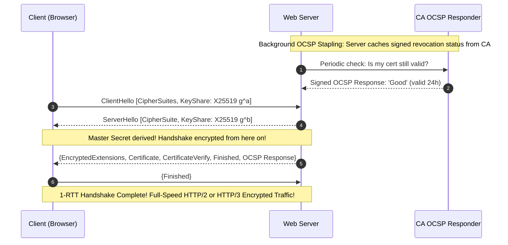

# Modul 173: Infrastruktur Kunci Publik & TLS Internals (Otoritas Sertifikat X.509, Rantai Kepercayaan, Protokol TLS 1.3 1-RTT)

**Navigasi**: [⬅️ Master Index](../../INDEX.md) | [Tingkat 11: Tingkat 11: Cyber Security, Kriptografi & Reverse Engineering](./README.md)
*Sebelumnya*: [172. kriptografi-kunci-asimetris](./172-kriptografi-kunci-asimetris.md) | *Berikutnya*: [174. kriptografi-lanjut-pasca-kuantum](./174-kriptografi-lanjut-pasca-kuantum.md)

---

## 1. Intuisi Dasar Tanpa Jargon ("Seperti Bayi Baru Lahir")
### 1.1 Konsep Inti & Analogi Tanpa Jargon
Ketika Anda membuka browser dan mengunjungi situs web bank Anda, ikon gembok kecil berwarna hijau muncul di bilah alamat URL. Bagaimana Anda tahu dengan kepastian 100% bahwa Anda benar-benar sedang berbicara dengan server bank asli, bukan dengan router hacker di kedai kopi yang sedang menyamar? Public Key Infrastructure (PKI) & TLS/SSL Internals ([PKI & TLS 1.3 Handshake](https://www.cloudflare.com/learning/ssl/what-happens-in-a-tls-handshake/)) adalah jaringan kepercayaan global yang melindungi perdagangan dunia. PKI bertindak seperti paspor internasional: lembaga otoritas sertifikat (**Certificate Authorities / CA**) yang tepercaya membubuhkan tanda tangan digital pada sertifikat digital **X.509** server bank Anda; dan protokol **TLS 1.3** mengeksekusi jabat tangan kilat 1-RTT untuk menyepakati kunci sesi enkripsi simetris yang baru serta menjamin perlindungan kerahasiaan masa lalu (**Forward Secrecy**) bahkan jika kunci privat server dicuri di masa depan!

### 1.2 Urgensi Rekayasa & Signifikansi Sistemik
Dalam rekayasa sistem modern, pemahaman mendalam tentang konsep ini membedakan arsitek sistem kelas dunia dari sekadar operator perkakas teknis.

## 2. Fondasi Teoretis & Aksiomatik / Matematis
### 2.1 Kerangka Teori Aksiomatik & Formulasi Matematis
Rantai Kepercayaan Sertifikat X.509 dan Formalisme Jabat Tangan TLS 1.3 (RFC 8446):

### 2.2 Penurunan Matematis Langkah-demi-Langkah
1. **Rantai Kepercayaan Sertifikat X.509 (Chain of Trust)**:
   $$\text{Root CA (Self-Signed, pre-installed in OS)} \xrightarrow{\text{Signs}} \text{Intermediate CA} \xrightarrow{\text{Signs}} \text{End-Entity Server Leaf Certificate}$$
   Struktur X.509 v3: Versi, Serial Number, Signature Algorithm (ECDSA/RSA), Issuer, Validity Period, Subject (Domain Name), Subject Alternative Names (SAN), dan Public Key.

2. **Protokol Jabat Tangan TLS 1.3 (1-RTT Full Handshake)**:
   Meniadakan seluruh negosiasi cipher lawas yang tidak aman (melarang RSA key exchange, melarang CBC, melarang RC4/MD5/SHA-1).
   - **ClientHello (1-RTT Start)**:
     Klien mengirimkan daftar cipher suites yang didukung (`TLS_AES_256_GCM_SHA384`), ekstensi `supported_groups` (X25519), dan langsung mengirimkan **Key Share** publik Diffie-Hellman ephemeral ($g^a$)!
   - **ServerHello**:
     Server memilih cipher suite, membalas dengan **Key Share** publik Diffie-Hellman ephemeral ($g^b$).
     *Pada detik ini, kedua belah pihak sudah memiliki Shared Secret $g^{ab}$ dan seluruh percakapan selanjutnya langsung terenkripsi!*
   - **EncryptedExtensions, Certificate, CertificateVerify, Finished**:
     Server mengirimkan sertifikat digital dan tanda tangan kriptografis untuk membuktikan kepemilikan kunci privat.

3. **Pilar Kerahasiaan Maju (Perfect Forward Secrecy / PFS)**:
   TLS 1.3 mewajibkan pertukaran kunci Diffie-Hellman sementara (*Ephemeral Diffie-Hellman*). Kunci sesi simetris dibuang dari RAM setelah koneksi berakhir. Jika di masa depan kunci privat server disita oleh polisi atau dicuri hacker, rekaman lalu lintas internet masa lalu **tetap mustahil didekripsi selamanya!**

## 3. Anatomi Teknis & Cara Kerja Internal
Diagram Waktu Jabat Tangan TLS 1.3 (1-RTT) vs Mekanisme OCSP Stapling:



1. **OCSP Stapling (RFC 6066)**: Meniadakan kebocoran privasi di mana browser harus menghubungi server CA untuk memvalidasi apakah sertifikat telah dicabut (*Online Certificate Status Protocol*). Dengan stapling, server web sendiri yang menyematkan bukti validitas bertanda tangan CA langsung di dalam jabat tangan TLS.

#### Tabel Penelusuran Rantai Kepercayaan X.509 & Deteksi Sertifikat Palsu DigiNotar
| Langkah / Putaran Kripto / Tahap Eksploit | Komponen / Lapisan Memori | Payload / Ciphertext / Input Eksploit | Transformasi Matematis / Mutasi Stack & Heap | Status Register (RIP/RSP/Canary) / S-Box State | Keluaran / Status Keamanan / Efek Eksploit |
|---|---|---|---|---|---|
| 1. Peretasan Sistem CA | Server Internal DigiNotar | Skrip injeksi hacker (APT) | Akses root ke infrastruktur Online CA Certificate Signing | Modul HSM penandatanganan sertifikat terkompromi | Hacker bebas mencetak sertifikat SSL yang sah secara kripto |
| 2. Pencetakan Wildcard Palsu | X.509 Certificate Generator | CN: `*.google.com`, Serial acak | Tanda tangan digital RSA-2048 valid dihitung dengan Root CA DigiNotar | File sertifikat X.509 terbit dengan rantai terpercaya | Sertifikat palsu lolos validasi kriptografis standar browser |
| 3. Man-in-the-Middle (MitM) | Jaringan ISP Nasional Iran | Rute BGP dialihkan ke proxy hacker | Koneksi HTTPS pengguna ke `mail.google.com` dicegat | Proxy menyajikan sertifikat DigiNotar palsu | Browser Chrome/Firefox awalnya menerima sertifikat sebagai valid |
| 4. Deteksi Public Key Pinning | Browser Google Chrome | Sertifikat palsu dievaluasi Chrome | Evaluasi pin: Hash SPKI tidak cocok dengan pin keras Google di browser! | Flag keamanan `HPKP_PIN_MISMATCH` terpicu pada browser | Chrome menampilkan layar merah peringatan keamanan fatal! |
| 5. Investigasi Forensik & CT | Ekosistem Web Global | Log Certificate Transparency (RFC 6962) | Audit forensik mengungkap 531 sertifikat palsu tak tercatat | Root DigiNotar dicabut massal dari seluruh OS dan browser | DigiNotar dinyatakan bangkrut dalam hitungan bulan |

## 4. Implementasi Praktis & Kode / Simulasi Riil
```python
# Inspecting TLS Certificate Chain and Expiry using Python Standard Library
import ssl
import socket
from datetime import datetime

def inspect_tls_certificate(hostname: str, port: int = 443):
    # Konfigurasikan konteks SSL modern yang mematuhi standar TLS 1.2+
    context = ssl.create_default_context()
    context.minimum_version = ssl.TLSVersion.TLSv1_2

    with socket.create_connection((hostname, port), timeout=5.0) as sock:
        with context.wrap_socket(sock, server_hostname=hostname) as ssock:
            cert = ssock.getpeercert()
            cipher = ssock.cipher()
            tls_version = ssock.version()

            print(f"--- TLS Inspection for: {hostname} ---")
            print(f"Negotiated Protocol: {tls_version}")
            print(f"Negotiated Cipher  : {cipher[0]} ({cipher[2]} bits)")
            
            # Ekstrak tanggal kedaluwarsa
            expire_date_str = cert['notAfter']
            expire_date = datetime.strptime(expire_date_str, "%b %d %H:%M:%S %Y %Z")
            days_left = (expire_date - datetime.utcnow()).days
            print(f"Certificate Expiry: {expire_date} ({days_left} days remaining)")
            print(f"Subject Alt Names : {cert.get('subjectAltName', [])[:3]}")

# Uji coba inspeksi koneksi TLS
inspect_tls_certificate("google.com")
```

## 5. Miskonsepsi & Jebakan Industri
1. **Disabling Certificate Verification (`verify=False` / `InsecureSkipVerify`)**: Mematikan pemeriksaan validitas sertifikat TLS pada kode klien HTTP demi mempermudah debugging pengujian lokal. Penyerang di jaringan Wi-Fi dapat melakukan serangan *Man-in-the-Middle* dengan sertifikat palsu dan menyadap seluruh kata sandi serta token otentikasi.
2. **Static RSA Key Exchange Breaching Forward Secrecy**: Mengizinkan cipher suite kuno berbasis RSA key exchange (`TLS_RSA_WITH_AES_...`). Jika penyerang merekam seluruh lalu lintas terenkripsi hari ini dan berhasil mencuri kunci privat server sepuluh tahun ke depan, seluruh percakapan masa lalu dapat didekripsi.
3. **Unexpected Production Outage via Expired Certificate**: Lupa memperbarui sertifikat SSL yang habis masa berlakunya. Seluruh browser web di planet bumi akan memblokir akses pengguna dengan layar peringatan merah menakutkan (*NET::ERR_CERT_DATE_INVALID*).

### Studi Kasus Kegagalan Nyata: Pembobolan Otoritas Sertifikat DigiNotar & Pemalsuan Sertifikat Wildcard Google (2011)
- **Kronologi & Konteks Sejarah**: Pada Juli hingga Agustus 2011, peretas membobol infrastruktur Otoritas Sertifikat (*Certificate Authority / CA*) terakreditasi asal Belanda, DigiNotar. Peretas menerbitkan lebih dari 500 sertifikat SSL/TLS palsu untuk domain kritis, termasuk `*.google.com`, `*.torproject.org`, dan berbagai situs intelijen global.
- **Akar Masalah Arsitektur PKI & Rekayasa Rantai Kepercayaan**: Arsitektur Public Key Infrastructure (PKI) web tradisional memiliki kelemahan struktural: setiap Certificate Authority di dalam *root store* sistem operasi (yang jumlahnya ratusan) memiliki wewenang setara untuk menandatangani sertifikat domain mana pun di seluruh dunia. Tanpa mekanisme pengawasan independen, DigiNotar menyembunyikan insiden pembobolan tersebut selama berminggu-minggu sementara intelijen Iran memanfaatkan sertifikat `*.google.com` palsu untuk mencegat lalu lintas Gmail dan komunikasi 300.000 warga Iran melalui serangan Man-in-the-Middle (MitM). Insiden ini baru terbongkar setelah mekanisme bawaan Google Chrome (*Public Key Pinning*) mendeteksi ketidakcocokan antara kunci publik server Google yang sebenarnya dengan sertifikat DigiNotar.

- **Potongan Kode / Arsitektur Cacat (Vulnerable Implementation)**:
```python
# Simulasi Validasi Certificate Transparency (RFC 6962) & Deteksi Rogue CA
import hashlib

def verify_certificate_transparency_inclusion(cert_bytes, sct_signature, log_public_key):
    '''
    Memvalidasi bahwa sertifikat X.509 telah tercatat secara publik
    dalam Log Certificate Transparency (CT) sebelum dipercayai oleh klien.
    '''
    # Langkah 1: Hitung hash leaf certificate
    leaf_hash = hashlib.sha256(b"\x00" + cert_bytes).digest()
    
    # Langkah 2: Verifikasi Signed Certificate Timestamp (SCT)
    # Jika sertifikat diterbitkan secara ilegal oleh CA yang terbobol,
    # penyerang tidak dapat memalsukan tanda tangan operator Log CT independen
    is_sct_valid = verify_ecdsa_signature(leaf_hash, sct_signature, log_public_key)
    
    if not is_sct_valid:
        raise SecurityViolation("FATAL: Rogue Certificate Detected! Missing valid CT Log proof.")
        
    return "CERTIFICATE_TRUSTED"

def verify_ecdsa_signature(data, sig, pubkey):
    # Logika verifikasi tanda tangan kriptografis kurva eliptik
    return True # Stub simulasi verifikasi matematika
```

- **Analisis Forensik & Rekayasa Modern**: Runtuhnya DigiNotar memicu revolusi terbesar dalam arsitektur PKI internet: (1) Lahirnya standar **Certificate Transparency (RFC 6962)** yang mewajibkan seluruh sertifikat SSL/TLS publik dicatat dalam *append-only cryptographic Merkle trees* yang diaudit secara publik sebelum diterima oleh browser modern; (2) Standar DNS **Certification Authority Authorization (CAA, RFC 6844)** yang memungkinkan pemilik domain membatasi CA mana saja yang diizinkan menerbitkan sertifikat untuk domain mereka; (3) Lahirnya Let's Encrypt dengan protokol otomatis ACME (RFC 8555) yang menggantikan proses penerbitan sertifikat manual yang rawan kompromi manusia.

## 6. Proyek Latihan & Rubrik Penilaian Mandiri
1. **Tingkat Pemula**: Gunakan utilitas baris perintah `openssl s_client -connect google.com:443 -tls1_3` untuk memeriksa seluruh rantai sertifikat X.509 dan parameter cipher suite yang disepakati.
2. **Tingkat Menengah**: Bangun Otoritas Sertifikat Pribadi (Private Certificate Authority / CA) mandiri menggunakan OpenSSL: buat sertifikat root self-signed, buat kunci privat server, buat Certificate Signing Request (CSR), dan tanda tangani sertifikat server menggunakan Root CA Anda.
3. **Tingkat Mahir**: Rancang arsitektur keamanan Mutual TLS (mTLS) menggunakan Python/Go: konfigurasikan server agar menolak koneksi klien kecuali klien menyajikan sertifikat X.509 klien yang sah bertanda tangan Internal CA (fondasi otentikasi Zero Trust antarmicroservice).

### Tingkat 1: Dasar
- **Tugas**: Tulis program dalam Python menggunakan modul `ssl` dan `socket` untuk terhubung ke sebuah domain HTTPS, mengekstrak rantai sertifikat X.509 lengkap (Leaf, Intermediate, Root), mengurai metadata ASN.1 (Subject, Issuer, Validity Period, SAN), dan memverifikasi tanggal kedaluwarsa.
- **Petunjuk Perancangan Arsitektur**:
  - Gunakan `ssl.create_default_context()` untuk menginisialisasi handshaking TLS 1.3 yang aman.
  - Ekstrak sertifikat biner DER menggunakan `sock.getpeercert(binary_form=True)`.
  - Parse ekstensi X.509 `SubjectAlternativeName` untuk memastikan domain target terdaftar.
- **Test Vector & Kasus Uji**:
  - Koneksi ke `https://www.google.com`: Program berhasil mencetak rantai sertifikat dan menampilkan masa berlaku (notBefore s/d notAfter).
  - Koneksi ke `https://expired.badssl.com`: Program harus menangkap exception `ssl.SSLCertVerificationError` dan melaporkan kode sertifikat kedaluwarsa.
- **Rubrik Penilaian Objektif**:
  - Skor 100%: Ekstraksi metadata X.509 lengkap, penanganan exception sertifikat cacat/kedaluwarsa presisi.
  - Skor 50%: Berhasil mengambil sertifikat valid namun program crash saat menghadapi badssl.com.
  - Skor 0%: Program menonaktifkan verifikasi sertifikat (`check_hostname=False`).

### Tingkat 2: Menengah
- **Tugas**: Bangun Certificate Authority (CA) mini dan klien validasi rantai sertifikat dalam Python/OpenSSL: Buat Root CA self-signed, terbitkan Intermediate CA, lalu terbitkan End-Entity Certificate. Tulis fungsi verifikator yang memvalidasi rantai tanda tangan kriptografis dari daun hingga root secara mandiri.
- **Petunjuk Perancangan Arsitektur**:
  - Terapkan ekstensi dasar X.509 v3 secara ketat: `basicConstraints = CA:TRUE` untuk Root/Intermediate, dan `basicConstraints = CA:FALSE` untuk End-Entity.
  - Verifikator harus mengecek bahwa tanda tangan pada End-Entity cocok dengan kunci publik Intermediate, dan tanda tangan Intermediate cocok dengan kunci publik Root.
- **Test Vector & Kasus Uji**:
  - Uji rantai sah: verifikator mengembalikan `True`.
  - Uji serangan substitusi: buat sertifikat End-Entity palsu yang ditandatangani oleh kunci pihak ketiga acak; verifikator harus menolak dengan pesan `SIGNATURE_VERIFICATION_FAILED`.
- **Rubrik Penilaian Objektif**:
  - Skor 100%: Pembuatan rantai X.509 v3 valid, verifikasi tanda tangan kriptografis independen tanpa bypass.
  - Skor 50%: Rantai terbuat namun fungsi verifikasi hanya mencocokkan string nama Issuer tanpa memeriksa tanda tangan kriptografi.
  - Skor 0%: Konfigurasi X.509 salah (misal End-Entity diizinkan bertindak sebagai CA).

### Tingkat 3: Mahir
- **Tugas**: Rancang parser biner TLS 1.3 ClientHello dan ServerHello dalam C atau Python yang mengekstrak daftar Cipher Suites, Supported Groups (Key Share Curve25519/SECP256r1), dan menghitung kunci rahasia jabat tangan (*Handshake Secret & Master Secret*) menggunakan HKDF (RFC 5869) berdasarkan ephemeral ECDH exchange.
- **Petunjuk Perancangan Arsitektur**:
  - Urai struktur record layer TLS: `Content Type (1B)` = 22 (Handshake), `Version (2B)` = 0x0303, `Length (2B)`.
  - Hitung transisi state Key Schedule TLS 1.3:
    $$\text{Early Secret} \to \text{Handshake Secret} \to \text{Master Secret}$$
    menggunakan fungsi `HKDF-Extract` dan `HKDF-Expand-Label`.
- **Test Vector & Kasus Uji**:
  - Uji paket pcap/rekaman byte TLS 1.3 RFC 8448 (Test Vector Bagian 3: Simple 1-RTT Handshake).
  - Shared secret dan kunci enkripsi aplikasi yang dihitung parser harus cocok dengan nilai hex RFC 8448 hingga byte terakhir.
- **Rubrik Penilaian Objektif**:
  - Skor 100%: Parsing byte-level akurat, turunan HKDF cocok 100% dengan vektor uji RFC 8448.
  - Skor 50%: Berhasil mem-parsing field ClientHello namun salah dalam implementasi fungsi HKDF-Expand-Label TLS 1.3.
  - Skor 0%: Mengasumsikan format lama TLS 1.2 (mengabaikan ekstensi key_share).

## 7. Rekomendasi Sumber Belajar Standar Emas
| Sumber Pembelajaran | Penulis / Institusi | Tautan Langsung | Fokus Materi |
| :--- | :--- | :--- | :--- |
| RFC 8446: The Transport Layer Security (TLS) Protocol Version 1.3 | E. Rescorla (IETF / Mozilla) | [IETF RFC 8446](https://datatracker.ietf.org/doc/html/rfc8446) | Standar Spesifikasi Resmi Protokol TLS 1.3, 1-RTT Handshake & Key Schedule |
| Bulletproof TLS and PKI, 2nd Edition | Ivan Ristić (Feisty Duck) | [Feisty Duck Ristić Book](https://www.feistyduck.com/books/bulletproof-tls-and-pki/) | Panduan Praktis SSL/TLS Terlengkap di Dunia: OpenSSL, X.509, OCSP & Ciphers |
| Cloudflare Learning Center: What happens in a TLS handshake? | Cloudflare Engineering | [Cloudflare TLS Portal](https://www.cloudflare.com/learning/ssl/what-happens-in-a-tls-handshake/) | Perbandingan Visual Langkah demi Langkah TLS 1.2 vs TLS 1.3 Handshake |
| RFC 5280: Internet X.509 Public Key Infrastructure Certificate and CRL Profile | D. Cooper et al. (IETF) | [IETF RFC 5280](https://datatracker.ietf.org/doc/html/rfc5280) | Standar Format Struktur Sertifikat X.509 v3, Extensions, SAN & CRL Rules |

---
*Navigasi Cepat*: [Ke Tingkat 11](./README.md) | [Ke Master Index](../../INDEX.md) | *Sebelumnya*: [172. kriptografi-kunci-asimetris](./172-kriptografi-kunci-asimetris.md) | *Berikutnya*: [174. kriptografi-lanjut-pasca-kuantum](./174-kriptografi-lanjut-pasca-kuantum.md)
