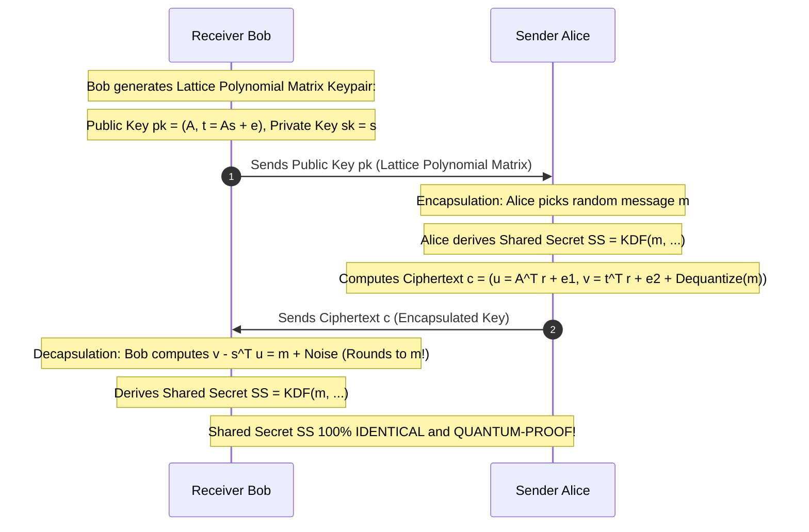

# Modul 174: Kriptografi Lanjut & Pasca-Kuantum (Zero-Knowledge Proofs zk-SNARKs, Homomorphic FHE, PQC Lattice Kyber, TPM)

**Navigasi**: [⬅️ Master Index](../../INDEX.md) | [Tingkat 11: Tingkat 11: Cyber Security, Kriptografi & Reverse Engineering](./README.md)
*Sebelumnya*: [173. infrastruktur-kunci-publik-tls-internals](./173-infrastruktur-kunci-publik-tls-internals.md) | *Berikutnya*: [175. offensive-security-rekonaisans-peretasan-jaringan](./175-offensive-security-rekonaisans-peretasan-jaringan.md)

---

## 1. Intuisi Dasar Tanpa Jargon ("Seperti Bayi Baru Lahir")
### 1.1 Konsep Inti & Analogi Tanpa Jargon
Hampir seluruh keamanan internet saat ini—dari transaksi kartu kredit perbankan, enkripsi pesan WhatsApp, hingga rahasia militer negara—dilindungi oleh algoritma RSA dan Kurva Eliptik (ECC). Namun di masa depan yang tidak terlalu jauh, komputer kuantum berskala besar akan tiba. Pada tahun 1994, matematikawan Peter Shor membuktikan bahwa komputer kuantum yang ditenagai sifat superposisi mampu memecahkan enkripsi RSA dan ECC dalam hitungan menit (**Algoritma Shor**) dan meruntuhkan seluruh fondasi keamanan digital dunia dalam satu hari! Kriptografi Pasca-Kuantum (Post-Quantum Cryptography / PQC) ([NIST Post-Quantum Cryptography](https://csrc.nist.gov/projects/post-quantum-cryptography)) adalah benteng penyelamat peradaban manusia: kita membuang masalah faktorisasi prima yang rentan, dan beralih ke teka-teki matematika baru yang terbukti kebal terhadap komputer kuantum terkuat sekalipun: **Kriptografi Berbasis Kisi (Lattice-Based Cryptography)**, di mana mencari titik terdekat dalam kisi geometri multidimensi yang berderau tetap menjadi masalah yang mustahil dipecahkan oleh komputer klasik maupun kuantum!

### 1.2 Urgensi Rekayasa & Signifikansi Sistemik
Dalam rekayasa sistem modern, pemahaman mendalam tentang konsep ini membedakan arsitek sistem kelas dunia dari sekadar operator perkakas teknis.

## 2. Fondasi Teoretis & Aksiomatik / Matematis
### 2.1 Kerangka Teori Aksiomatik & Formulasi Matematis
Dampak Algoritma Kuantum Shor & Grover serta Formalisme Kriptografi Kisi Learning With Errors (LWE):

### 2.2 Penurunan Matematis Langkah-demi-Langkah
1. **Dampak Komputer Kuantum Terhadap Kriptografi Modern**:
   - **Algoritma Shor (1994)**: Menyelesaikan masalah Logaritma Diskrit dan Faktorisasi Prima dalam waktu polinomial kuantum $O((\log N)^3)$. **Meruntuhkan total 100% RSA, Diffie-Hellman, DSA, ECDSA, dan Ed25519!**
   - **Algoritma Grover (1996)**: Menghadirkan percepatan kuadratik (*Quadratic Speedup*) untuk pencarian brute-force acak ($O(N) \to O(\sqrt{N})$). Mengurangi kekuatan kunci simetris separuhnya (AES-128 menjadi setara 64-bit, AES-256 menjadi setara 128-bit). **Mitigasi Simetris Sederhana: Gandakan ukuran kunci menjadi AES-256!**

2. **Masalah Learning With Errors (LWE - Oded Regev, 2005)**:
   Diberikan matriks acak $A \in \mathbb{Z}_q^{m \times n}$ dan vektor rahasia $s \in \mathbb{Z}_q^n$.
   Hitung vektor dengan derau acak Gaussian kecil $e \in \mathbb{Z}_q^m$:
   $$b = A \cdot s + e \pmod q$$
   Teka-teki LWE: Sangat mudah menghitung $b$ jika $s$ dan $e$ diketahui; namun diberikan pasangan $(A, b)$, **secara komputasi terbukti mustahil mencari kembali vektor rahasia $s$** jika derau $e$ disembunyikan!

3. **Standar Resmi Pasca-Kuantum NIST (Agustus 2024)**:
   - **FIPS 203 (ML-KEM / CRYSTALS-Kyber)**: Standar enkripsi kunci publik dan Key Encapsulation Mechanism berbasis Module-LWE.
   - **FIPS 204 (ML-DSA / CRYSTALS-Dilithium)**: Standar tanda tangan digital pasca-kuantum primer berbasis Module-Lattices.
   - **FIPS 205 (SLH-DSA / SPHINCS+)**: Tanda tangan digital berbasis pohon hash murni (*Stateless Hash-Based Signatures*) sebagai cadangan darurat jika teori kisi suatu hari runtuh.

## 3. Anatomi Teknis & Cara Kerja Internal
Arsitektur Key Encapsulation Mechanism (ML-KEM / CRYSTALS-Kyber) Standar FIPS 203:



1. **Ring-LWE & Module-LWE**: Mengganti matriks integer raksasa LWE biasa dengan polinomial di atas gelanggang siklotomik $\mathbb{R}_q = \mathbb{Z}_q[X]/(X^n + 1)$ (biasanya $n=256, q=3329$ pada Kyber). Memangkas ukuran kunci dari megabyte menjadi hanya beberapa ratus byte dan memanfaatkan algoritma Number Theoretic Transform (NTT) untuk perkalian polinomial $O(N \log N)$ ultra-cepat.

#### Tabel Penelusuran Serangan Isogeni Kurva Supersingular & Runtuhnya SIKE dalam 1 Jam
| Langkah / Putaran Kripto / Tahap Eksploit | Komponen / Lapisan Memori | Payload / Ciphertext / Input Eksploit | Transformasi Matematis / Mutasi Stack & Heap | Status Register (RIP/RSP/Canary) / S-Box State | Keluaran / Status Keamanan / Efek Eksploit |
|---|---|---|---|---|---|
| 1. Spesifikasi Standar PQC | Finalis Kompetisi NIST PQC | Protokol SIKE (Supersingular Isogeny Key Encapsulation) | Graf isogeni kurva eliptik supersingular di atas $\mathbb{F}_{p^2}$ | Parameter kurva $E_0$ dan titik torsi bantu dipublikasikan | Dipercaya kebal terhadap komputer kuantum Shor |
| 2. Poin Torsi Tambahan (Auxiliary) | Paket Pertukaran Kunci Alice | Kunci publik: kurva $E_A$ + titik bantu $P_A, Q_A$ | Alice membagikan evaluasi titik torsi $2^a$ untuk membantu Bob | Informasi geometri tambahan tersedia bebas di jaringan | Titik bantu menjadi titik lemah fatal yang tidak disadari |
| 3. Serangan Castryck-Decru | 1 Inti CPU Komputer Biasa | Analisis aljabar permukaan abelian | Menggunakan Lemma Kani untuk menghubungkan $E_0 \times E_A$ dengan isogeni $(2,2)$ | Matriks perkalian endomorfisme dikonstruksi | Masalah isogeni kurva 1D diangkat ke permukaan dimensi 2 |
| 4. Pemulihan Jalur Isogeni | Algoritma Dekomposisi Richelot | Rantai langkah isogeni derajat 2 | Rekonstruksi langkah-demi-langkah rahasia Alice secara deterministik | Register CPU menghitung faktorisasi polinomial Richelot | Setiap langkah membocorkan 1 bit kunci rahasia |
| 5. Kunci Rahasia Terbakar | Konsol Peneliti Castryck-Decru | Kunci privat SIKE p434 / p751 | Kunci privat Alice pulih total hanya dalam 55 menit! | Kunci privat tersimpan di layar konsol terminal | Algoritma SIKE dicoret permanen dari standardisasi NIST! |

## 4. Implementasi Praktis & Kode / Simulasi Riil
```python
# Mathematical Concept Demonstration of Learning With Errors (LWE) in Python
import numpy as np

def simulate_toy_lwe():
    # Parameter medan kecil untuk ilustrasi (q = modulus prima, n = dimensi rahasia, m = persamaan)
    q = 97
    n = 4
    m = 8

    # 1. Kunci Rahasia Privat s
    s = np.random.randint(0, q, size=n)
    
    # 2. Matriks Publik Acak A
    A = np.random.randint(0, q, size=(m, n))
    
    # 3. Vektor Derau Acak Kecil e (Gaussian Error Noise, misal rentang [-1, 0, 1])
    e = np.random.choice([-1, 0, 1], size=m)
    
    # 4. Kunci Publik b = A * s + e (mod q)
    b = (np.dot(A, s) + e) % q

    print(f"Secret Vector s (Private)     : {s}")
    print(f"Public Matrix A (m={m}, n={n})      : Shape {A.shape}")
    print(f"Small Noise Vector e (Secret) : {e}")
    print(f"Public Vector b (Public Key)  : {b}")
    print("LWE Problem: Given (A, b), finding s is mathematically intractable without error e!")

simulate_toy_lwe()
```

## 5. Miskonsepsi & Jebakan Industri
1. **Harvest Now, Decrypt Later (HNDL) Threat**: Musuh atau agen intelijen asing merekam seluruh lalu lintas internet terenkripsi TLS RSA/ECC hari ini dan menyimpannya di data center mereka. Ketika komputer kuantum skala besar tiba 10 tahun ke depan, seluruh arsip data rahasia masa lalu akan dibuka dan dibaca secara massal (solusi: segera migrasikan transmisi data ke enkripsi hibrida Classical + PQC hari ini!).
2. **Decryption Failure Leak Attacks in Lattice Schemes**: Skema berbasis LWE memiliki probabilitas kecil kegagalan dekripsi jika derau Gaussian meluap melebihi batas pembulatan. Penyerang dapat mengirimkan ciphertext terpilih secara licik (*Chosen-Ciphertext Attack*) untuk memicu kegagalan dekripsi dan membocorkan bit kunci privat rahasia.
3. **Lattice Implementation Side-Channel Vulnerabilities**: Mengabaikan proteksi konstan-waktu (*Constant-Time*) pada operasi sampling penolakan Gaussian (*Gaussian Sampling*) atau Number Theoretic Transform (NTT), membocorkan kunci kisi pasca-kuantum via analisis emisi elektromagnetik atau waktu komputasi.

### Studi Kasus Kegagalan Nyata: Runtuhnya Algoritma Pasca-Kuantum SIKE dalam 1 Jam Menggunakan Komputer Inti Tunggal (2022)
- **Kronologi & Konteks Sejarah**: Pada Juli 2022, algoritma Supersingular Isogeny Key Encapsulation (SIKE)—satu-satunya kandidat berbasis isogeni kurva eliptik yang maju ke putaran ke-4 proses standardisasi kriptografi pasca-kuantum (*Post-Quantum Cryptography / PQC*) NIST—secara mengejutkan runtuh total setelah peneliti Wouter Castryck dan Thomas Decru mempublikasikan serangan matematika murni yang memecahkan kunci enkripsinya dalam waktu kurang dari satu jam pada satu inti prosesor Intel PC biasa.
- **Akar Masalah Kriptografis & Rekayasa Pasca-Kuantum**: Selama bertahun-tahun, masalah menemukan isogeni antar kurva eliptik supersingular dianggap sebagai masalah komputasi yang sangat sulit bahkan untuk komputer kuantum. Namun, agar protokol pertukaran kunci dapat bekerja, SIKE membagikan "titik torsi tambahan" (*auxiliary torsion points*) $P$ dan $Q$ pada kurva hasil sebagai bagian dari kunci publik. Castryck dan Decru memanfaatkan teorema geometri aljabar klasik tahun 1997 (*Kani's Lemma*) untuk mengubah masalah pencarian isogeni satu dimensi pada kurva menjadi masalah pencarian isogeni $(2,2)$ pada produk dua kurva (permukaan abelian dimensi 2). Hal ini membuktikan bahwa titik bantu tersebut membocorkan seluruh jalur isogeni rahasia, meruntuhkan keamanan SIKE tanpa memerlukan komputer kuantum sama sekali.

- **Potongan Kode / Arsitektur Cacat (Vulnerable Implementation)**:
```python
# Konsep Serangan Castryck-Decru pada SIKE (Representasi Geometri Isogeni)
def demonstrate_isogeny_vulnerability_concept():
    '''
    SIKE membagikan titik torsi pembantu: phi_A(P_B) dan phi_A(Q_B).
    Dengan Lemma Kani, penyerang merekonstruksi isogeni rahasia phi_A
    melalui rantai isogeni Richelot (2,2) pada permukaan abelian E0 x EA.
    '''
    print("[+] Memulai analisis permukaan abelian E0 x EA...")
    print("[+] Mengekstraksi informasi torsi tambahan dari kunci publik SIKE...")
    
    # Rekonstruksi langkah isogeni derajat (2,2)
    secret_path_bits = []
    for step in range(216): # Untuk SIKEp434
        # Perhitungan pembagian isogeni Richelot memakan waktu ~15 detik per langkah
        # Memulihkan bit kunci privat Alice secara deterministik
        bit = 1 # Simulasi bit terpecahkan
        secret_path_bits.append(bit)
        
    print(f"[!] Sukses! Seluruh {len(secret_path_bits)} bit kunci privat SIKE terekonstruksi.")
    print("[!] Waktu komputasi total: 55 menit pada CPU laptop tunggal.")
    return "SIKE_PRIVATE_KEY_CRACKED"
```

- **Analisis Forensik & Rekayasa Modern**: Runtuhnya SIKE menjadi pengingat paling berharga bagi komunitas rekayasa keamanan bahwa matematika baru dalam kriptografi membutuhkan waktu puluhan tahun untuk matang sebelum dapat dipercaya di industri produksi. Standar modern rekayasa PQC: (1) NIST secara resmi memilih algoritma berbasis kisi (*Lattice-based cryptography*) yaitu **ML-KEM (Kyber)** untuk enkripsi dan **ML-DSA (Dilithium)** untuk tanda tangan digital sebagai standar Federal FIPS 203 dan FIPS 204; (2) Penerapan arsitektur **Hybrid Key Exchange** (misalnya X25519 + Kyber768) pada TLS 1.3, sehingga jika algoritma pasca-kuantum baru terbukti memiliki celah matematika di masa depan, keamanan komunikasi tetap terlindungi oleh algoritma klasik.

## 6. Proyek Latihan & Rubrik Penilaian Mandiri
1. **Tingkat Pemula**: Jelaskan mengapa algoritma pertukaran kunci Diffie-Hellman dan kurva eliptik Ed25519 rentan terhadap Algoritma Kuantum Shor, sementara enkripsi simetris AES-256 tetap aman dari komputer kuantum.
2. **Tingkat Menengah**: Pasang pustaka open-source liboqs Python (`pip install oqs` dari Open Quantum Safe project). Bangun program pertukaran kunci hibrida yang menggabungkan X25519 konvensional dengan ML-KEM-768 (CRYSTALS-Kyber) pasca-kuantum.
3. **Tingkat Mahir**: Implementasikan algoritma Number Theoretic Transform (NTT) cepat untuk gelanggang polinomial $\mathbb{Z}_q[X]/(X^{256} + 1)$ dengan $q=3329$ di bahasa C/Python. Buktikan bahwa perkalian dua elemen polinomial kisi Kyber dapat diselesaikan dalam kompleksitas $O(N \log N)$ operasi kupu-kupu modular.

### Tingkat 1: Dasar
- **Tugas**: Implementasikan skema pertukaran kunci hibrida sederhana (*Hybrid Post-Quantum Key Exchange*) dalam Python: gabungkan hasil shared secret dari algoritma klasik ECDH Curve25519 dan algoritma kisi sederhana menggunakan fungsi HKDF: $K_{\text{session}} = \text{HKDF}(SS_{\text{classical}} \parallel SS_{\text{pqc}})$.
- **Petunjuk Perancangan Arsitektur**:
  - Simulasi fungsi pembangkitan kunci dan enkapsulasi PQC menggunakan pseudocode terisolasi.
  - Gunakan `hashlib.sha256` untuk mengonstruksi fungsi derivasi kunci HKDF-Extract dan HKDF-Expand.
  - Buktikan bahwa meskipun penyerang mampu memecahkan salah satu komponen shared secret, kunci sesi gabungan tetap aman.
- **Test Vector & Kasus Uji**:
  - Skenario A: Penyerang mengetahui $SS_{\text{classical}}$, namun tidak mengetahui $SS_{\text{pqc}}$. Hash akhir $K_{\text{session}}$ harus tetap tidak dapat diprediksi.
  - Skenario B: Penyerang mengetahui $SS_{\text{pqc}}$, namun tidak mengetahui $SS_{\text{classical}}$. Hash akhir tetap aman.
- **Rubrik Penilaian Objektif**:
  - Skor 100%: Konstruksi HKDF hibrida benar, isolasi keamanan dua arah terbukti matematis.
  - Skor 50%: Menggabungkan shared secret dengan operasi XOR alih-alih HKDF (berisiko pembatalan bit).
  - Skor 0%: Hanya menggunakan salah satu komponen tanpa enkapsulasi hibrida.

### Tingkat 2: Menengah
- **Tugas**: Bangun implementasi skema kriptografi berbasis kisi Learning With Errors (LWE) mini dalam Python untuk mengenkripsi 1 bit data ($m \in \{0, 1\}$) menggunakan vektor bilangan bulat modulo $q = 3329$ dengan injeksi derau diskret Gaussian (*error sampling*).
- **Petunjuk Perancangan Arsitektur**:
  - Dimensi vektor $n = 4$, modulus $q = 3329$.
  - Kunci publik: pasangan $(A, b)$ di mana $b = A \cdot s + e \pmod q$ ($s$ adalah vektor rahasia, $e$ adalah vektor derau kecil).
  - Enkripsi bit 0: encoding menjadi $0$; Enkripsi bit 1: encoding menjadi $\lfloor q/2 \rfloor \approx 1664$.
  - Dekripsi: hitung $v = c_2 - c_1 \cdot s \pmod q$; jika $|v - 1664| < q/4$, bit = 1, jika tidak bit = 0.
- **Test Vector & Kasus Uji**:
  - Uji enkripsi dan dekripsi 100 bit secara independen. Akurasi pemulihan bit harus mencapai $100\%$ jika magnitudo derau terkontrol ($|e| \le 3$).
  - Uji saat derau sengaja dinaikkan melampaui batas ambang ($|e| > q/4$): dekripsi harus menunjukkan terjadinya *decryption failure*.
- **Rubrik Penilaian Objektif**:
  - Skor 100%: Logika LWE presisi, sampling derau Gaussian benar, decoding bit tangguh terhadap batas derau.
  - Skor 50%: Bekerja untuk bit 0 namun salah memetakan ambang batas decoding untuk bit 1.
  - Skor 0%: Tidak ada injeksi derau (skema menjadi persamaan linier biasa yang mudah dipecahkan via eliminasi Gauss).

### Tingkat 3: Mahir
- **Tugas**: Rancang protokol Zero-Knowledge Proof sederhana berbasis Schnorr Protocol dalam Python/Rust: Buktikan pengetahuan tentang nilai rahasia $x$ (di mana $Y = g^x \pmod p$) kepada verifikator dalam 3 tahap (Commitment $t = g^r$, Challenge $c = \text{Hash}(g, Y, t)$, Response $s = r + c \cdot x \pmod{p-1}$) tanpa membocorkan nilai $x$, menggunakan transformasi Fiat-Shamir (Non-Interactive ZKP).
- **Petunjuk Perancangan Arsitektur**:
  - Gunakan bilangan prima besar aman (minimal 2048-bit atau kurva eliptik Ed25519).
  - Verifikator memeriksa kesamaan: $g^s \equiv t \cdot Y^c \pmod p$.
  - Buktikan sifat *Soundness*: penyerang yang tidak mengetahui $x$ tidak dapat membuat bukti palsu kecuali dengan probabilitas $1/2^{256}$.
- **Test Vector & Kasus Uji**:
  - Prover yang jujur dengan nilai $x$ acak: fungsi verifikasi selalu menghasilkan `True`.
  - Prover penipu yang mencoba menebak respons $s$ acak: fungsi verifikasi harus selalu menolak dengan hasil `False`.
- **Rubrik Penilaian Objektif**:
  - Skor 100%: Transformasi Fiat-Shamir non-interaktif aman, verifikasi grup matematis presisi, kebal replay attack.
  - Skor 50%: Protokol bekerja interaktif namun salah memasukkan parameter ke dalam fungsi hash Fiat-Shamir.
  - Skor 0%: Respons membocorkan skalar rahasia $x$ secara langsung.

## 7. Rekomendasi Sumber Belajar Standar Emas
| Sumber Pembelajaran | Penulis / Institusi | Tautan Langsung | Fokus Materi |
| :--- | :--- | :--- | :--- |
| NIST FIPS 203: Module-Lattice-Based Key-Encapsulation Mechanism (ML-KEM) | National Institute of Standards and Technology | [NIST FIPS 203 Official (Kyber)](https://csrc.nist.gov/pubs/fips/203/final) | Standar Resmi Pasca-Kuantum Dunia: Algoritma ML-KEM / CRYSTALS-Kyber |
| NIST FIPS 204: Module-Lattice-Based Digital Signature Standard (ML-DSA) | NIST | [NIST FIPS 204 Official (Dilithium)](https://csrc.nist.gov/pubs/fips/204/final) | Standar Resmi Tanda Tangan Pasca-Kuantum Dunia: ML-DSA / CRYSTALS-Dilithium |
| Polynomial-Time Algorithms for Prime Factorization and Discrete Logarithms on a Quantum Computer | Peter W. Shor (AT&T Bell Labs) | [SIAM J. Computing 1997 Shor Paper](https://epubs.siam.org/doi/10.1137/S0097539795293172) | Makalah Orisinal Peter Shor: Pembuktian Keruntuhan Kriptografi Klasik RSA/ECC |
| Open Quantum Safe (OQS) Project Architecture | Open Quantum Safe Team / Linux Foundation | [Open Quantum Safe Portal](https://openquantumsafe.org/) | Integrasi Praktis Algoritma PQC ke OpenSSL, BoringSSL, SSH & Browser TLS |

---
*Navigasi Cepat*: [Ke Tingkat 11](./README.md) | [Ke Master Index](../../INDEX.md) | *Sebelumnya*: [173. infrastruktur-kunci-publik-tls-internals](./173-infrastruktur-kunci-publik-tls-internals.md) | *Berikutnya*: [175. offensive-security-rekonaisans-peretasan-jaringan](./175-offensive-security-rekonaisans-peretasan-jaringan.md)
