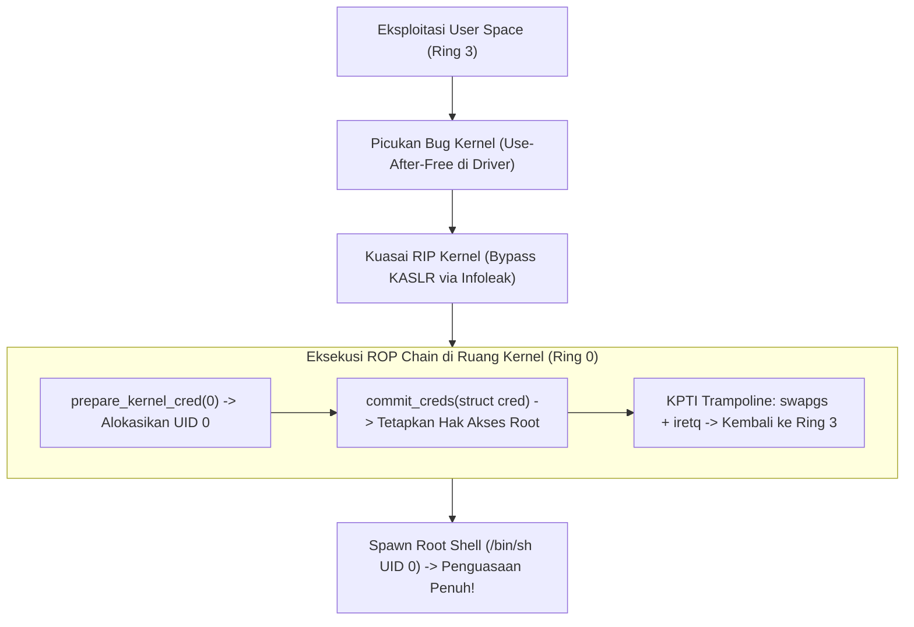

# Modul 180: Eksploitasi Kernel Linux & Hardware Hacking (Eskalasi Root commit_creds, Ekstraksi Firmware SPI, Glitching, Spectre)

**Navigasi**: [⬅️ Master Index](../../INDEX.md) | [Tingkat 11: Tingkat 11: Cyber Security, Kriptografi & Reverse Engineering](./README.md)
*Sebelumnya*: [179. mitigasi-eksploitasi-memori-cara-menembusnya](./179-mitigasi-eksploitasi-memori-cara-menembusnya.md) | *Berikutnya*: [181. defensive-security-blue-team-operasi-soc](./181-defensive-security-blue-team-operasi-soc.md)

---

## 1. Intuisi Dasar Tanpa Jargon ("Seperti Bayi Baru Lahir")
### 1.1 Benteng Terakhir: Kernel Ruang Cincin Nol ([Linux Kernel Hacking Guide](https://kernelnewbies.org/KernelHacking))
Ketika seorang penyerang berhasil mengeksekusi kode di komputer Anda sebagai pengguna biasa (misalnya melalui file dokumen jahat atau celah di browser web), mereka masih terkurung di dalam penjara *User Space (Ring 3)*. Mereka tidak bisa menyadap keyboard, tidak bisa melihat password pengguna lain, dan tidak bisa mengubah konfigurasi sistem.
Tujuan tertinggi penyerang adalah menembus benteng terakhir: **Mengeksploitasi Kernel Linux (Ring 0)** untuk menaikkan hak akses menjadi penguasa mutlak sistem (*Root Privilege Escalation*).

### 1.2 Dari Kutu Software Kernel ke Serangan Silikon Hardware ([Spectre & Meltdown Papers](https://meltdownattack.com/))
Namun, peretasan tidak berhenti di tingkat kode software sistem operasi:
1. **Eksploitasi Kernel Software (Use-After-Free, Race Conditions, Heap Overflow)**: Memanipulasi struktur memori kernel `task_struct` untuk mengubah kredensial proses penyerang (`uid = 0`).
2. **Peretasan Hardware Fisik (Hardware Hacking & Glitching)**: Menggunakan penjepit logika, probe multimeter, atau penyuntik voltase (*Fault Injection / Voltage Glitching*) pada pin chip silikon untuk mengacaukan siklus jam CPU sepersekian nanodetik, memaksa CPU melompati instruksi verifikasi keamanan password!
3. **Kerentanan Arsitektur CPU (Meltdown & Spectre)**: Mengeksploitasi mekanisme percepatan prosesor modern (*Speculative Execution & Branch Prediction*) untuk membaca seluruh rahasia memori kernel melalui efek samping jejak waktu cache (*Cache Timing Side-Channel*).

## 2. Fondasi Teoretis & Aksiomatik / Matematis
### 2.1 Formulasi Eskalasi Hak Akses Kernel Linux (`commit_creds`) ([Kernel Exploitation Fundamentals](https://github.com/JonathanSalwan/Kernel-Exploitation-Guide))
Di dalam kernel Linux, identitas hak akses setiap proses disimpan di dalam struktur `struct cred` yang ditunjuk oleh `task_struct->cred`:
$$\text{struct cred} = \{ \text{uid}, \text{gid}, \text{suid}, \text{sgid}, \text{euid}, \text{egid}, \dots \}$$
Pada kernel klasik (atau via Return-Oriented Programming di kernel / kROP), fungsi eskalasi root dieksekusi dengan memanggil dua fungsi internal kernel:
$$\text{commit\_creds}(\text{prepare\_kernel\_cred}(\text{NULL}))$$
Penjelasan Aljabar Operasi:
1. `prepare_kernel_cred(NULL)`: Mengalokasikan struktur `struct cred` baru dengan seluruh identifier diinisialisasi ke nilai $0$ (Root ID: $\text{uid} = 0, \text{gid} = 0$).
2. `commit_creds(new_cred)`: Menetapkan pointer struktur kredensial baru tersebut ke proses aktif saat ini (`current->cred = new_cred`).
Begitu eksekusi kembali ke User Space via instruksi `iretq` atau `sysretq`, proses penyerang telah berubah menjadi `root` murni (`#`).

### 2.2 Matematika Serangan Saluran Samping Meltdown & Spectre ([Lipp et al., 2018](https://meltdownattack.com/meltdown.pdf))
Eksekusi Spekulatif (*Speculative Execution*) mengeksekusi instruksi di luar urutan (*Out-of-Order Execution*) sebelum pemeriksaan izin hak akses CPU selesai diverifikasi:
Kode Kerentanan:
```c
// Instruksi 1: Pelanggaran Hak Akses (Membaca Memori Kernel Gelap)
uint8_t secret = kernel_memory_address[0];
// Instruksi 2: Memodifikasi Jejak Cache berdasarkan Nilai Rahasia
uint8_t probe = probe_array[secret * 4096];
```
Meskipun CPU akhirnya menyadari pelanggaran izin pada Instruksi 1 dan membatalkan hasil komputasi (*pipeline flush*), **jejak perubahan status cache memori pada Instruksi 2 tidak dihapus!**
Penyerang mengukur waktu pembacaan array `probe_array[k * 4096]` untuk seluruh $k \in [0, 255]$ menggunakan instruksi assembly `rdtscp`:
$$T(k) = \begin{cases} \approx 40 \text{ siklus CPU} & \text{jika } k = \text{secret (Cache Hit - Sinyal Terbaca!)} \\ \approx 250 \text{ siklus CPU} & \text{jika } k \ne \text{secret (Cache Miss - Lambat)} \end{cases}$$
Rahasia memori kernel terbongkar dengan laju hingga ratusan kilobyte per detik!

## 3. Anatomi Teknis & Cara Kerja Internal


#### Tabel Walkthrough Serangan Cache Timing Flush+Reload
| Siklus Jam | Tindakan Penyerang | Status Saluran Memori Cache L1/L3 | Waktu Eksekusi Pengukuran (`rdtscp`) | Keputusan Logika |
|---|---|---|---|---|
| Tahap 1 | Jalankan `clflush` pada seluruh elemen `probe_array` | Bersih 100% (Seluruh baris cache dikosongkan) | - | Setup Awal |
| Tahap 2 | Picukan eksekusi spekulatif membaca `secret` | Elemen `probe_array[secret * 4096]` ditarik ke cache | - | Pola Tercetak |
| Tahap 3 | Ukur waktu akses `probe_array[0 * 4096]` | Cache Miss (Data diambil dari DRAM) | 260 siklus | Nilai 0 Salah |
| Tahap 4 | Ukur waktu akses `probe_array[65 * 4096]` | **Cache Hit (Data sudah ada di L1 Cache!)** | **38 siklus CPU** | **RAHASIA = 65 ('A')!** |

#### Tabel Penelusuran Eksploitasi Kernel Linux eBPF Out-of-Bounds (CVE-2021-3490)
| Langkah / Putaran Kripto / Tahap Eksploit | Komponen / Lapisan Memori | Payload / Ciphertext / Input Eksploit | Transformasi Matematis / Mutasi Stack & Heap | Status Register (RIP/RSP/Canary) / S-Box State | Keluaran / Status Keamanan / Efek Eksploit |
|---|---|---|---|---|---|
| 1. Pemuatan Bytecode eBPF | Syscall `bpf(BPF_PROG_LOAD)` | Program eBPF rakitan pengguna non-root | Operasi bitwise 32-bit: `BPF_ALU32_REG` pada register R1 | Verifier kernel memvalidasi batasan nilai register | Verifier salah melacak rentang nilai minimum & maksimum register! |
| 2. Eksploitasi Bug Verifier | Kernel `kernel/bpf/verifier.c` | Trik manipulasi batasan matematika | Verifier percaya nilai register bernilai konstan 0, padahal bernilai riil 1 | Register BPF R1 memuat nilai di luar jangkauan izin verifier | Verifier kernel tertipu dan meloloskan bytecode berbahaya |
| 3. Akses Out-of-Bounds Memori | Array Peta eBPF (BPF Map) | Offset pointer melampaui ukuran array | Aritmatika pointer BPF: `ptr + R1 * 0x1000` | Pointer membaca/menulis memori kernel di luar batas peta array | Kemampuan Arbitrary Kernel Read/Write primitif tercapai |
| 4. Pencarian Struktur Kredensial | Ruang Memori Kernel Linux | Penelusuran pointer `task_struct` proses | Melacak struktur `current->cred` pada memori kernel proses saat ini | Pointer `struct cred` proses penyerang ditemukan di RAM | Lokasi UID, GID, EUID, EGID proses terpetakan |
| 5. Eskalasi Hak Akses Root | Modul Eksploitasi Ring 0 | Penulisan nilai 0 ke field `uid/gid` | `current->cred->uid = 0; current->cred->euid = 0;` | Register kernel mengonfirmasi hak akses root penuh | Proses biasa langsung berubah menjadi `root (UID 0)` tanpa jejak password! |

## 4. Implementasi Praktis & Kode / Simulasi Riil
```c
#define _GNU_SOURCE
#include <stdio.h>
#include <stdint.h>
#include <x86intrin.h>

// Contoh demonstrasi pengukuran latensi pembacaan memori Cache vs DRAM (Flush + Reload)
#define CACHE_HIT_THRESHOLD 80  // Batas ambang batas siklus CPU cache hit tipikal

uint8_t probe_array[256 * 4096];

// Fungsi membaca register penghitung stempel waktu CPU secara presisi
inline uint64_t measure_access_time(volatile uint8_t *addr) {
    uint32_t aux;
    uint64_t start = __rdtscp(&aux);
    uint8_t val = *addr;
    (void)val; // Hindari optimasi compiler
    uint64_t end = __rdtscp(&aux);
    return end - start;
}

int main(void) {
    // 1. Kosongkan baris cache memori menggunakan instruksi assembly clflush
    for (int i = 0; i < 256; i++) {
        _mm_clflush(&probe_array[i * 4096]);
    }

    // 2. Akses satu elemen rahasia (simulasikan eksekusi spekulatif memuat nilai 42)
    volatile uint8_t dummy = probe_array[42 * 4096];
    (void)dummy;

    // 3. Pindai seluruh 256 halaman dan ukur waktu akses siklusnya
    printf("Memindai status jejak cache timing...\n");
    for (int i = 0; i < 256; i++) {
        uint64_t cycles = measure_access_time(&probe_array[i * 4096]);
        if (cycles < CACHE_HIT_THRESHOLD) {
            printf("[TERDETEKSI CACHE HIT] Nilai Rahasia: %d (Waktu Akses: %lu siklus CPU!)\n", i, cycles);
        }
    }

    return 0;
}
```

## 5. Miskonsepsi & Jebakan Industri
### Studi Kasus Kegagalan Nyata: Runtuhnya Keamanan Seluruh Prosesor Dunia oleh Celah Meltdown & Spectre (2018)
- **Kronologi & Latar Belakang**: Pada Januari 2018, tim peneliti Google Project Zero dan akademisi universitas mengumumkan penemuan cacat desain fundamental pada mikroteknologi prosesor Intel, AMD, dan ARM yang telah diproduksi selama lebih dari 20 tahun.
- **Akar Masalah**: Untuk mengejar skor benchmark performa yang tinggi, perancang prosesor mengizinkan unit *Out-of-Order Execution* membaca memori kernel berhak akses tinggi secara spekulatif sebelum sirkuit perangkat keras memeriksa bit proteksi hak akses *User/Supervisor Page Fault*. Efek samping dari komputasi yang dibatalkan tersebut tetap membekas pada kondisi panas/dinginnya baris cache L1/L2/L3.
- **Rekomendasi Industri**: Pada tingkat sistem operasi, terapkan isolasi tabel halaman kernel penuh **Kernel Page Table Isolation (KPTI)** yang memisahkan seluruh pemetaan memori kernel dari tabel halaman user space saat aplikasi berjalan di Ring 3. Di tingkat kompilator, gunakan teknik mitigasi *Retpoline* untuk mencegah manipulasi cabang prediktor tidak langsung.

### Studi Kasus Kegagalan Nyata: Ekskalasi Hak Akses Root Kernel Linux via Celah Logika Verifier eBPF (CVE-2021-3490)
- **Kronologi & Konteks Sejarah**: Pada Mei 2021, peneliti keamanan Manfred Paul menemukan celah eskalasi hak akses (*Local Privilege Escalation / LPE*) kritis pada subsistem extended Berkeley Packet Filter (eBPF) kernel Linux (CVE-2021-3490). Celah ini memungkinkan pengguna biasa tanpa wewenang (*unprivileged user*) untuk membobol keamanan kernel Ring 0 dan mendapatkan kontrol root instan pada server Ubuntu, Debian, dan Fedora.
- **Akar Masalah Rekayasa Kernel & Pelacakan Batas Register**: eBPF dirancang agar pengguna dapat menjalankan kode mikro di dalam ruang memori kernel secara aman melalui mekanisme verifikasi statis (*eBPF verifier*). Verifier bertanggung jawab melacak batas rentang nilai minimum dan maksimum dari setiap register untuk mencegah akses memori out-of-bounds. Pada implementasi fungsi operasi bitwise 32-bit (`scalar32_min_max_and` / `or` / `xor`), terdapat kekeliruan logika matematika dalam memprediksi batasan register hasil operasi. Penyerang menyusun instruksi eBPF licik di mana verifier kernel menyimpulkan bahwa sebuah register pasti bernilai 0 (sehingga dianggap aman), padahal saat dieksekusi secara nyata oleh JIT compiler CPU, register tersebut memuat nilai berbeda. Perbedaan persepsi antara verifier dan CPU ini memungkinkan program eBPF membaca dan menulis memori kernel apa pun secara bebas (*arbitrary kernel read/write*), menimpa struktur kredensial `struct cred` proses penyerang menjadi UID 0 (root).

- **Potongan Kode / Arsitektur Cacat (Vulnerable Implementation)**:
```c
// Rekonstruksi Eksploitasi Kernel Linux: Penimpaan Kredensial task_struct menjadi Root (UID 0)
#include <stdint.h>
#include <unistd.h>

struct cred {
    int32_t usage;
    uint32_t uid;   // User ID
    uint32_t gid;   // Group ID
    uint32_t suid;  // Saved UID
    uint32_t sgid;  // Saved GID
    uint32_t euid;  // Effective UID -> INI TARGET PENYERANG!
    uint32_t egid;  // Effective GID
};

// Fungsi yang dieksekusi setelah mendapatkan primitif Arbitrary Kernel Write
void elevate_to_root(uint64_t cred_address_in_kernel) {
    // Menimpa nilai uid, gid, suid, sgid, euid, egid menjadi 0 (ROOT)
    uint32_t zero_ids[8] = {0, 0, 0, 0, 0, 0, 0, 0};
    
    // Tulis ke memori kernel di offset cred->uid
    kernel_write_bytes(cred_address_in_kernel + 4, zero_ids, sizeof(zero_ids));
    
    // Verifikasi di ruang pengguna:
    if (getuid() == 0) {
        // SYSTEM SHELL ROOT BERHASIL DIDAPATKAN!
        execl("/bin/sh", "sh", NULL);
    }
}
```

- **Analisis Forensik & Rekayasa Modern**: Insiden eBPF CVE-2021-3490 mendorong reformasi drastis dalam tata kelola keamanan kernel Linux: (1) Distribusi Linux besar (Ubuntu, RedHat, Debian) kini secara default menonaktifkan eBPF untuk pengguna non-root (`kernel.unprivileged_bpf_disabled = 1`); (2) Pengenalan teknik verifikasi formal berbasis model matematis (*Formal Verification*) pada eBPF verifier untuk membuktikan secara matematis bahwa pelacakan rentang nilai register tidak memiliki celah logika; (3) Pengerasan struktur data keamanan kernel (`struct cred` dibuat read-only kecuali saat dimodifikasi via fungsi kernel sah `commit_creds`).

## 6. Proyek Latihan & Rubrik Penilaian Mandiri
### Level 1 (Pemula)
- **Tugas**: Periksa status kerentanan mitigasi hardware CPU sistem operasi Linux Anda terhadap serangan Meltdown dan Spectre menggunakan antarmuka virtual `/sys/devices/system/cpu/vulnerabilities/`.
- **Petunjuk Arsitektur**: Jalankan perintah `cat /sys/devices/system/cpu/vulnerabilities/*`.
- **Vektor Uji**:
  - Verifikasi keberadaan status mitigasi seperti `Mitigation: PTI` (Meltdown) dan `Mitigation: Retpolines` (Spectre v2).
- **Rubrik Penilaian**: Identifikasi file status kerentanan kernel (50%), analisis arti status mitigasi (30%), kebersihan dokumentasi (20%).

### Level 2 (Menengah)
- **Tugas**: Tulis program C untuk mendeteksi keberadaan instruksi assembly `clflush` dan ukur waktu latensi rata-rata akses DRAM vs L1 Data Cache pada prosesor Anda.
- **Petunjuk Arsitektur**: Bandingkan waktu eksekusi `__rdtscp` sebelum dan sesudah instruksi `_mm_clflush(&variable)`.
- **Vektor Uji**:
  - Akses sebelum clflush (L1 Cache): $\approx 30–60$ siklus.
  - Akses setelah clflush (DRAM Main Memory): $\approx 200–350$ siklus.
- **Rubrik Penilaian**: Ketepatan penggunaan intrinsics x86 (40%), analisis rasio kontras latensi (30%), penanganan serialisasi CPU (30%).

### Level 3 (Mahir)
- **Tugas**: Rancang skema mitigasi isolasi Kernel Page Table Isolation (KPTI) konseptual yang memetakan dua salinan tabel halaman level tertinggi (CR3 register swapping): satu tabel halaman minimal untuk User Space (hanya memuat trampolin entry/exit) dan satu tabel halaman lengkap untuk Kernel Space.
- **Petunjuk Arsitektur**: Jelaskan secara detail bagaimana instruksi assembly `swapgs` dan pembalikan bit ke-12 register CR3 dilakukan di dalam handler entry point interupsi tanpa memicu *Double Fault (#DF)*.
- **Vektor Uji**:
  - Langkah-langkah transisi register CR3 dan penanganan TLB PCID (*Process Context Identifiers*) untuk meminimalkan penalti flush TLB.
- **Rubrik Penilaian**: Keakuratan teknis switching CR3 (40%), penanganan TLB PCID (30%), pencegahan eksploitasi bypass spekulatif (30%).

### Tingkat 1: Dasar
- **Tugas**: Tulis modul kernel Linux sederhana (Loadable Kernel Module / LKM) dalam C yang mencetak alamat memori pointer `current` (`struct task_struct`) dan nilai UID proses saat ini ke ring buffer kernel dmesg saat modul di-load via `insmod`.
- **Petunjuk Perancangan Arsitektur**:
  - Gunakan header kernel: `<linux/init.h>`, `<linux/module.h>`, `<linux/sched.h>`, `<linux/cred.h>`.
  - Baca UID via makro `current_uid().val`.
  - Gunakan `pr_info()` untuk mencetak log ke dmesg.
- **Test Vector & Kasus Uji**:
  - Load modul: `sudo insmod test_module.ko`.
  - Jalankan `dmesg | tail -n 5`: Harus muncul log mencetak alamat `task_struct` (misal `0xffff888012345678`) dan `UID: 0`.
- **Rubrik Penilaian Objektif**:
  - Skor 100%: Modul kernel terkompilasi bersih tanpa warning, mencetak alamat memori kernel dan UID dengan aman.
  - Skor 50%: Modul berfungsi namun memicu compiler warning akibat kesalahan header kernel.
  - Skor 0%: Modul memicu Kernel Panic (Oops) saat di-load.

### Tingkat 2: Menengah
- **Tugas**: Bangun program pemantau sistem berbasis eBPF (BCC / libbpf) dalam C/Python yang memasang kprobe pada syscall `sys_enter_execve`. Ekstrak nama biner yang dieksekusi, PID, dan UID proses, lalu filter secara otomatis setiap eksekusi biner yang mencurigakan (misal eksekusi shell dari dalam direktori `/tmp` atau `/dev/shm`).
- **Petunjuk Perancangan Arsitektur**:
  - Gunakan helper eBPF `bpf_get_current_pid_tgid()` dan `bpf_get_current_uid_gid()`.
  - Baca string argumen path filename menggunakan `bpf_probe_read_user_str()`.
  - Kirim event ke user space melalui ring buffer atau perf event buffer.
- **Test Vector & Kasus Uji**:
  - Eksekusi biner normal `/bin/ls`: Detektor mencatat aktivitas dengan status NORMAL.
  - Eksekusi biner `/tmp/malicious_exploit`: Detektor harus segera mencetak peringatan merah: "ALERT: Suspicious execution detected from temporary directory by PID <pid>".
- **Rubrik Penilaian Objektif**:
  - Skor 100%: Program eBPF lulus verifier kernel tanpa error, ekstraksi parameter string efisien tanpa memory leak.
  - Skor 50%: Program berjalan namun menggunakan fungsi pemindaian string yang boros CPU pada kernel space.
  - Skor 0%: Program ditolak oleh verifier kernel saat di-load.

### Tingkat 3: Mahir
- **Tugas**: Rancang simulator serangan Hardware Fault Injection (*Clock/Voltage Glitching*) dalam simulasi Python/C: Simulasikan CPU pipeline sederhana yang mengeksekusi instruksi perbandingan keamanan `if (user_is_authenticated == 1) grant_admin();`. Injeksi lonjakan tegangan (glitch) pada siklus clock spesifik untuk membalikkan bit flag register CPU atau melompati instruksi `jne/je` (*Skip Instruction Attack*).
- **Petunjuk Perancangan Arsitektur**:
  - Modelkan siklus pipeline: Fetch $\to$ Decode $\to$ Execute $\to$ Writeback.
  - Definisikan fungsi `inject_glitch(cycle_number, glitch_type)` yang memodifikasi Program Counter (PC) atau register status flags.
  - Implementasikan teknik pertahanan perangkat lunak tahan-glitch (*Glitch-Resistant Coding*): evaluasi ganda dengan variabel independen dan komparasi redundan (*Double-Check & Hardened Conditionals*).
- **Test Vector & Kasus Uji**:
  - Eksekusi kode naif tanpa glitch: Akses ditolak.
  - Eksekusi kode naif dengan glitch pada siklus ke-4: Glitch melompati perbandingan, akses admin terbuka ilegal!
  - Eksekusi kode hardened dengan perbandingan ganda independen: Glitch pada siklus ke-4 tetap gagal membuka akses admin dan memicu alarm `TAMPER_DETECTED`.
- **Rubrik Penilaian Objektif**:
  - Skor 100%: Simulasi pipeline CPU dan injeksi glitch akurat, teknik mitigasi defensif hardened sukses menahan serangan.
  - Skor 50%: Simulasi glitch berhasil namun mitigasi defensif masih dapat ditembus oleh glitch kedua.
  - Skor 0%: Tidak ada pemodelan siklus clock instruksi.

## 7. Rekomendasi Sumber Belajar Standar Emas
| Kategori | Judul Sumber & Tautan | Penulis / Institusi | Fokus Pembahasan |
|---|---|---|---|
| Paper Meltdown | [Meltdown: Reading Kernel Memory from User Space](https://meltdownattack.com/meltdown.pdf) | Moritz Lipp, Michael Schwarz, et al. (USENIX Security 2018) | Publikasi asli penemuan serangan kebocoran memori kernel berbasis eksekusi spekulatif |
| Paper Spectre | [Spectre Attacks: Exploiting Speculative Execution](https://spectreattack.com/spectre.pdf) | Paul Kocher, Jann Horn, et al. (IEEE S&P 2019) | Penemuan manipulasi branch predictor dan serangan cache timing universal lintas-arsitektur |
| Dokumentasi Kernel | [Kernel Page Table Isolation (KPTI)](https://docs.kernel.org/arch/x86/pti.html) | Linux Kernel Documentation Team | Arsitektur pemisahan tabel halaman virtual Linux untuk membentengi memori kernel Ring 0 |

---
*Navigasi Cepat*: [Ke Tingkat 11](./README.md) | [Ke Master Index](../../INDEX.md) | *Sebelumnya*: [179. mitigasi-eksploitasi-memori-cara-menembusnya](./179-mitigasi-eksploitasi-memori-cara-menembusnya.md) | *Berikutnya*: [181. defensive-security-blue-team-operasi-soc](./181-defensive-security-blue-team-operasi-soc.md)
