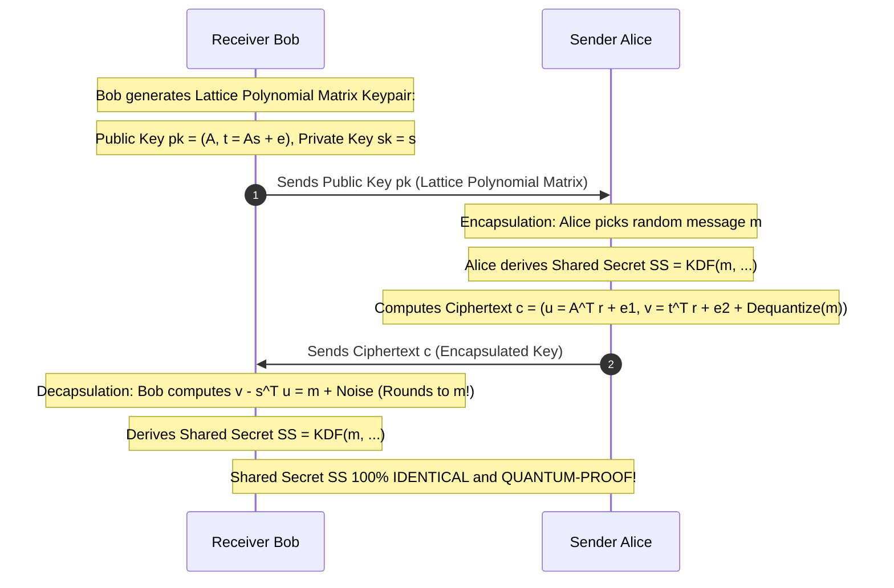

# Modul 180: Eksploitasi Kernel Linux & Hardware Hacking (Eskalasi Root commit_creds, Ekstraksi Firmware SPI, Glitching, Spectre)

**Navigasi**: [⬅️ Master Index](../../INDEX.md) | [Tingkat 11: Tingkat 11: Cyber Security, Kriptografi & Reverse Engineering](./README.md)
*Sebelumnya*: [179. mitigasi-eksploitasi-memori-cara-menembusnya](./179-mitigasi-eksploitasi-memori-cara-menembusnya.md) | *Berikutnya*: [181. defensive-security-blue-team-operasi-soc](./181-defensive-security-blue-team-operasi-soc.md)

---

## 1. Intuisi Dasar Tanpa Jargon ("Seperti Bayi Baru Lahir")
Hampir seluruh keamanan internet saat ini—dari transaksi kartu kredit perbankan, enkripsi pesan WhatsApp, hingga rahasia militer negara—dilindungi oleh algoritma RSA dan Kurva Eliptik (ECC). Namun di masa depan yang tidak terlalu jauh, komputer kuantum berskala besar akan tiba. Pada tahun 1994, matematikawan Peter Shor membuktikan bahwa komputer kuantum yang ditenagai sifat superposisi mampu memecahkan enkripsi RSA dan ECC dalam hitungan menit (**Algoritma Shor**) dan meruntuhkan seluruh fondasi keamanan digital dunia dalam satu hari! Kriptografi Pasca-Kuantum (Post-Quantum Cryptography / PQC) ([NIST Post-Quantum Cryptography](https://csrc.nist.gov/projects/post-quantum-cryptography)) adalah benteng penyelamat peradaban manusia: kita membuang masalah faktorisasi prima yang rentan, dan beralih ke teka-teki matematika baru yang terbukti kebal terhadap komputer kuantum terkuat sekalipun: **Kriptografi Berbasis Kisi (Lattice-Based Cryptography)**, di mana mencari titik terdekat dalam kisi geometri multidimensi yang berderau tetap menjadi masalah yang mustahil dipecahkan oleh komputer klasik maupun kuantum!

## 2. Fondasi Teoretis & Aksiomatik / Matematis
Dampak Algoritma Kuantum Shor & Grover serta Formalisme Kriptografi Kisi Learning With Errors (LWE):

1. **Dampak Komputer Kuantum Terhadap Kriptografi Modern**:
   - **Algoritma Shor (1994)**: Menyelesaikan masalah Logaritma Diskrit dan Faktorisasi Prima dalam waktu polinomial kuantum $O((\log N)^3)$. **Meruntuhkan total 100% RSA, Diffie-Hellman, DSA, ECDSA, dan Ed25519!**
   - **Algoritma Grover (1996)**: Menghadirkan percepatan kuadratik (*Quadratic Speedup*) untuk pencarian brute-force acak ($O(N) \to O(\sqrt{N})$). Mengurangi kekuatan kunci simetris separuhnya (AES-128 menjadi setara 64-bit, AES-256 menjadi setara 128-bit). **Mitigasi Simetris Sederhana: Gandakan ukuran kunci menjadi AES-256!**

2. **Masalah Learning With Errors (LWE - Oded Regev, 2005)**:
   Diberikan matriks acak $A \in \mathbb{Z}_q^{m \times n}$ dan vektor rahasia $s \in \mathbb{Z}_q^n$.
   Hitung vektor dengan derau acak Gaussian kecil $e \in \mathbb{Z}_q^m$:
   $$b = A \cdot s + e \pmod q$$
   Teka-teki LWE: Sangat mudah menghitung $b$ jika $s$ dan $e$ diketahui; namun diberikan pasangan $(A, b)$, **secara komputasi terbukti mustahil mencari kembali vektor rahasia $s$** jika derau $e$ disembunyikan!

3. **Standar Resmi Pasca-Kuantum NIST (Agustus 2024)**:
   - **FIPS 203 (ML-KEM / CRYSTALS-Kyber)**: Standar enkripsi kunci publik dan Key Encapsulation Mechanism berbasis Module-LWE.
   - **FIPS 204 (ML-DSA / CRYSTALS-Dilithium)**: Standar tanda tangan digital pasca-kuantum primer berbasis Module-Lattices.
   - **FIPS 205 (SLH-DSA / SPHINCS+)**: Tanda tangan digital berbasis pohon hash murni (*Stateless Hash-Based Signatures*) sebagai cadangan darurat jika teori kisi suatu hari runtuh.

## 3. Anatomi Teknis & Cara Kerja Internal
Arsitektur Key Encapsulation Mechanism (ML-KEM / CRYSTALS-Kyber) Standar FIPS 203:



1. **Ring-LWE & Module-LWE**: Mengganti matriks integer raksasa LWE biasa dengan polinomial di atas gelanggang siklotomik $\mathbb{R}_q = \mathbb{Z}_q[X]/(X^n + 1)$ (biasanya $n=256, q=3329$ pada Kyber). Memangkas ukuran kunci dari megabyte menjadi hanya beberapa ratus byte dan memanfaatkan algoritma Number Theoretic Transform (NTT) untuk perkalian polinomial $O(N \log N)$ ultra-cepat.

## 4. Implementasi Praktis & Kode / Simulasi Riil
```python
# Mathematical Concept Demonstration of Learning With Errors (LWE) in Python
import numpy as np

def simulate_toy_lwe():
    # Parameter medan kecil untuk ilustrasi (q = modulus prima, n = dimensi rahasia, m = persamaan)
    q = 97
    n = 4
    m = 8

    # 1. Kunci Rahasia Privat s
    s = np.random.randint(0, q, size=n)
    
    # 2. Matriks Publik Acak A
    A = np.random.randint(0, q, size=(m, n))
    
    # 3. Vektor Derau Acak Kecil e (Gaussian Error Noise, misal rentang [-1, 0, 1])
    e = np.random.choice([-1, 0, 1], size=m)
    
    # 4. Kunci Publik b = A * s + e (mod q)
    b = (np.dot(A, s) + e) % q

    print(f"Secret Vector s (Private)     : {s}")
    print(f"Public Matrix A (m={m}, n={n})      : Shape {A.shape}")
    print(f"Small Noise Vector e (Secret) : {e}")
    print(f"Public Vector b (Public Key)  : {b}")
    print("LWE Problem: Given (A, b), finding s is mathematically intractable without error e!")

simulate_toy_lwe()
```

## 5. Miskonsepsi & Jebakan Industri
1. **Harvest Now, Decrypt Later (HNDL) Threat**: Musuh atau agen intelijen asing merekam seluruh lalu lintas internet terenkripsi TLS RSA/ECC hari ini dan menyimpannya di data center mereka. Ketika komputer kuantum skala besar tiba 10 tahun ke depan, seluruh arsip data rahasia masa lalu akan dibuka dan dibaca secara massal (solusi: segera migrasikan transmisi data ke enkripsi hibrida Classical + PQC hari ini!).
2. **Decryption Failure Leak Attacks in Lattice Schemes**: Skema berbasis LWE memiliki probabilitas kecil kegagalan dekripsi jika derau Gaussian meluap melebihi batas pembulatan. Penyerang dapat mengirimkan ciphertext terpilih secara licik (*Chosen-Ciphertext Attack*) untuk memicu kegagalan dekripsi dan membocorkan bit kunci privat rahasia.
3. **Lattice Implementation Side-Channel Vulnerabilities**: Mengabaikan proteksi konstan-waktu (*Constant-Time*) pada operasi sampling penolakan Gaussian (*Gaussian Sampling*) atau Number Theoretic Transform (NTT), membocorkan kunci kisi pasca-kuantum via analisis emisi elektromagnetik atau waktu komputasi.

## 6. Proyek Latihan & Rubrik Penilaian Mandiri
1. **Tingkat Pemula**: Jelaskan mengapa algoritma pertukaran kunci Diffie-Hellman dan kurva eliptik Ed25519 rentan terhadap Algoritma Kuantum Shor, sementara enkripsi simetris AES-256 tetap aman dari komputer kuantum.
2. **Tingkat Menengah**: Pasang pustaka open-source liboqs Python (`pip install oqs` dari Open Quantum Safe project). Bangun program pertukaran kunci hibrida yang menggabungkan X25519 konvensional dengan ML-KEM-768 (CRYSTALS-Kyber) pasca-kuantum.
3. **Tingkat Mahir**: Implementasikan algoritma Number Theoretic Transform (NTT) cepat untuk gelanggang polinomial $\mathbb{Z}_q[X]/(X^{256} + 1)$ dengan $q=3329$ di bahasa C/Python. Buktikan bahwa perkalian dua elemen polinomial kisi Kyber dapat diselesaikan dalam kompleksitas $O(N \log N)$ operasi kupu-kupu modular.

## 7. Rekomendasi Sumber Belajar Standar Emas
| Sumber Pembelajaran | Penulis / Institusi | Tautan Langsung | Fokus Materi |
| :--- | :--- | :--- | :--- |
| NIST FIPS 203: Module-Lattice-Based Key-Encapsulation Mechanism (ML-KEM) | National Institute of Standards and Technology | [NIST FIPS 203 Official (Kyber)](https://csrc.nist.gov/pubs/fips/203/final) | Standar Resmi Pasca-Kuantum Dunia: Algoritma ML-KEM / CRYSTALS-Kyber |
| NIST FIPS 204: Module-Lattice-Based Digital Signature Standard (ML-DSA) | NIST | [NIST FIPS 204 Official (Dilithium)](https://csrc.nist.gov/pubs/fips/204/final) | Standar Resmi Tanda Tangan Pasca-Kuantum Dunia: ML-DSA / CRYSTALS-Dilithium |
| Polynomial-Time Algorithms for Prime Factorization and Discrete Logarithms on a Quantum Computer | Peter W. Shor (AT&T Bell Labs) | [SIAM J. Computing 1997 Shor Paper](https://epubs.siam.org/doi/10.1137/S0097539795293172) | Makalah Orisinal Peter Shor: Pembuktian Keruntuhan Kriptografi Klasik RSA/ECC |
| Open Quantum Safe (OQS) Project Architecture | Open Quantum Safe Team / Linux Foundation | [Open Quantum Safe Portal](https://openquantumsafe.org/) | Integrasi Praktis Algoritma PQC ke OpenSSL, BoringSSL, SSH & Browser TLS |

---
*Navigasi Cepat*: [Ke Tingkat 11](./README.md) | [Ke Master Index](../../INDEX.md) | *Sebelumnya*: [179. mitigasi-eksploitasi-memori-cara-menembusnya](./179-mitigasi-eksploitasi-memori-cara-menembusnya.md) | *Berikutnya*: [181. defensive-security-blue-team-operasi-soc](./181-defensive-security-blue-team-operasi-soc.md)
