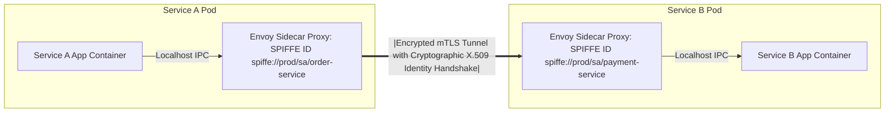

# Modul 181: Defensive Security, Blue Team & Operasi SOC (STRIDE Threat Modeling, Zero-Trust mTLS, DevSecOps SAST/DAST, SIEM)

**Navigasi**: [⬅️ Master Index](../../INDEX.md) | [Tingkat 11: Tingkat 11: Cyber Security, Kriptografi & Reverse Engineering](./README.md)
*Sebelumnya*: [180. eksploitasi-kernel-linux-hardware-hacking](./180-eksploitasi-kernel-linux-hardware-hacking.md) | *Berikutnya*: [182. respon-insiden-forensik-digital](./182-respon-insiden-forensik-digital.md)

---

## 1. Intuisi Dasar Tanpa Jargon ("Seperti Bayi Baru Lahir")
### 1.1 Konsep Inti & Analogi Tanpa Jargon
Di masa lalu, keamanan kantor perusahaan didasarkan pada model 'Kastil dan Parit Air': siapa pun yang berada di luar kantor dianggap musuh dan dihadang oleh firewall; tetapi siapa pun yang berhasil masuk ke dalam kantor fisik atau tersambung ke VPN dipercaya 100% dan bebas menjelajahi seluruh database dan server internal! Ketika karyawan mulai bekerja dari rumah di seluruh dunia dan server dipindahkan ke cloud AWS/GCP, model kastil runtuh total: satu laptop karyawan yang terkena malware dapat menginfeksi seluruh data center perusahaan. Keamanan Cloud, IAM & Arsitektur Zero Trust ([Zero Trust Architecture NIST SP 800-207](https://csrc.nist.gov/publications/detail/sp/800-207/final)) adalah paradigma keamanan modern yang menyatakan: **'Jangan Pernah Percaya, Selalu Verifikasi' (Never Trust, Always Verify)**. Tidak peduli apakah Anda terhubung dari internet luar atau dari kabel di dalam ruangan server data center, setiap panggilan API, setiap akses database, dan setiap orang **wajib membuktikan identitas kriptografisnya** (**mTLS & IAM**) pada setiap permintaan individual secara terus-menerus!

### 1.2 Urgensi Rekayasa & Signifikansi Sistemik
Dalam rekayasa sistem modern, pemahaman mendalam tentang konsep ini membedakan arsitek sistem kelas dunia dari sekadar operator perkakas teknis.

## 2. Fondasi Teoretis & Aksiomatik / Matematis
### 2.1 Kerangka Teori Aksiomatik & Formulasi Matematis
Prinsip Aksiomatik Arsitektur Zero Trust (NIST SP 800-207) dan Model Evaluasi Kebijakan IAM:

### 2.2 Penurunan Matematis Langkah-demi-Langkah
1. **Tujuh Prinsip Aksiomatik Zero Trust Architecture (ZTA - NIST SP 800-207)**:
   - Semua sumber data dan layanan komputasi dianggap sebagai sumber daya (*Resources*).
   - Semua komunikasi wajib diamankan melintasi batas jaringan fisik apa pun (*Perimeter-less*).
   - Akses ke sumber daya individual diberikan secara dinamis per sesi (*Per-Session Authorization*).
   - Hak akses ditentukan oleh kebijakan dinamis (*Dynamic Policy*): identitas pengguna, status kesehatan perangkat klien, lokasi geografis, dan postur ancaman.
   - Seluruh perangkat keras dan aset perusahaan dipantau status keamanannya secara berkala (*Continuous Posture Assessment*).
   - Autentikasi dan otorisasi bersifat dinamis dan ditegakkan secara ketat sebelum akses diizinkan.
   - Seluruh data lalu lintas diinspeksi, dicatat (*Logged*), dan dianalisis telemetrinya secara real-time.

2. **Arsitektur Entitas Logis Zero Trust (Policy Engine & Enforcement Point)**:

$$\text{Subject (Klien/Service)} \xrightarrow{\text{Request}} \mathbf{PEP \text{ (Policy Enforcement Point)}} \xrightarrow{\text{Access Granted}} \text{Target Enterprise Resource}$$
$$\uparrow \quad \text{Evaluasi Kontrol Statis & Dinamis}$$
$$\mathbf{PDP \text{ (Policy Decision Point)}} = \Big\{ \text{Policy Engine (Aturan IAM)} \ + \ \text{Policy Administrator (Penerbit Kredensial)} \Big\}$$

3. **Model Kontrol Akses Lanjut (RBAC vs ABAC)**:
   - **RBAC (Role-Based Access Control)**: Akses ditentukan oleh peran jabatan kaku (`Role = "FinancialAuditor"`).
   - **ABAC (Attribute-Based Access Control)**: Akses dievaluasi berdasarkan kombinasi atribut multidimensi secara dinamis:
     $$\text{Allow} \iff (\text{User.Dept} == \text{"Finance"}) \land (\text{Resource.Class} == \text{"Confidential"}) \land (\text{Env.Time} \in [09:00, 17:00]) \land (\text{Device.IsCompliant})$$

## 3. Anatomi Teknis & Cara Kerja Internal
Arsitektur Layanan Zero Trust Service Mesh Menggunakan Mutual TLS (mTLS) dan SPIFFE Identitas Mesin:



1. **SPIFFE / SPIRE (Secure Production Identity Framework for Everyone)**:
   Standar terbuka CNCF untuk memberikan identitas kriptografi otomatis kepada beban kerja (*Workloads*) di cloud. Meniadakan kunci API rahasia statis yang dibakar di file konfigurasi; setiap container menerima sertifikat X.509 berumur pendek (Short-lived SVID) yang otomatis dirotasi setiap jam.

#### Tabel Penelusuran Eksploitasi Worm NotPetya via EternalBlue & Keruntuhan Jaringan Global Maersk
| Langkah / Putaran Kripto / Tahap Eksploit | Komponen / Lapisan Memori | Payload / Ciphertext / Input Eksploit | Transformasi Matematis / Mutasi Stack & Heap | Status Register (RIP/RSP/Canary) / S-Box State | Keluaran / Status Keamanan / Efek Eksploit |
|---|---|---|---|---|---|
| 1. Kompromi Update Software | Server Pajak Ukraina M.E.Doc | Paket update terinfeksi backdoor | Perangkat lunak akuntansi M.E.Doc mendownload modul NotPetya | Server korporat Ukraina terinfeksi otomatis | Backdoor aktif serempak di ribuan perusahaan multinasional |
| 2. Propagasi Internal Cepat | Jaringan Lokal Enterprise | Port TCP 445 (SMBv1) & PsExec | Eksploit EternalBlue (MS17-010) membanjiri buffer kernel SMB | Ring 0 kernel Windows terkompromi via groom pool | Infeksi melompat ke seluruh server Windows yang belum dipatch |
| 3. Pencurian Kredensial Memori | Layanan Subsistem Keamanan LSASS | Modul mini-Mimikatz memori dump | Ekstraksi hash NTLM dan plaintext password dari memori proses | Kredensial Domain Admin tersimpan di RAM | NotPetya menguasai akun Domain Controller Active Directory |
| 4. Penghancuran Disk MBR | Master Boot Record Sektor 0 | Payload wiper disk palsu | Sektor 0 hard disk ditimpa dengan bootloader enkripsi palsu XOR | Partisi NTFS dan MFT dikorupsi tanpa kunci pemulihan | Pesan tebusan palsu ditampilkan; data terhapus permanen! |
| 5. Pemadaman Logistik Global | Infrastruktur Raksasa Maersk | Seluruh Active Directory lumpuh | 45.000 PC dan 4.000 server padam dalam waktu 7 menit | Pelabuhan kontainer kapal di seluruh dunia macet | Kerugian $10 Miliar; restorasi via 1 DC offline di Ghana |

## 4. Implementasi Praktis & Kode / Simulasi Riil
```json
// Fine-Grained Least Privilege AWS IAM JSON Policy Statement
// Menegakkan pembatasan akses S3 bucket produksi secara ketat hanya dari VPC resmi!
{
  "Version": "2012-10-17",
  "Statement": [
    {
      "Sid": "AllowStrictS3ReadWithVPCEndpointRestriction",
      "Effect": "Allow",
      "Action": [
        "s3:GetObject",
        "s3:ListBucket"
      ],
      "Resource": [
        "arn:aws:s3:::corporate-finance-ledger-prod",
        "arn:aws:s3:::corporate-finance-ledger-prod/*"
      ],
      "Condition": {
        "StringEquals": {
          "aws:sourceVpce": "vpce-0123456789abcdef0" // Tolak seluruh akses jika bukan dari jaringan VPC internal!
        },
        "Bool": {
          "aws:SecureTransport": "true" // Tolak keras akses tanpa enkripsi HTTPS TLS!
        }
      }
    }
  ]
}
```

## 5. Miskonsepsi & Jebakan Industri
1. **Overly Permissive IAM Wildcard Asterisks (`"Action": "*"`)**: Memberikan izin `"Action": "s3:*"` atau `"Resource": "*"` pada peran IAM server backend. Jika server tersebut memiliki celah SSRF, penyerang dapat menghapus seluruh bucket data perusahaan di cloud.
2. **Long-Lived Static Cloud Access Keys**: Mengunduh pasangan kunci akses permanen AWS (`AKIA...` access key) dan menyimpannya di laptop pengembang. Kunci dapat bocor secara tidak sengaja ke GitHub publik dan digunakan penyerang untuk menyewa ribuan GPU mining kripto dalam beberapa menit.
3. **Zero Trust Implementation Fatigue (Bypassing PEP)**: Merancang aturan Zero Trust yang terlalu kaku sehingga menghalangi produktivitas harian developer, memicu developer membangun jalan pintas gelap (*Shadow IT*) yang sama sekali tidak terpantau oleh tim keamanan.

### Studi Kasus Kegagalan Nyata: Bencana Serangan Siber NotPetya & Kelumpuhan Raksasa Logistik Maersk via EternalBlue (2017)
- **Kronologi & Konteks Sejarah**: Pada 27 Juni 2017, serangan siber destruktif NotPetya menyapu dunia, melumpuhkan bank, bandara, rumah sakit, dan perusahaan multinasional besar. Korban paling terdampak adalah raksasa perkapalan global A.P. Moller-Maersk, yang menangani 20% logistik kontainer dunia. Dalam hitungan menit, seluruh 45.000 komputer desktop, 4.000 server fisik/virtual, dan ratusan jaringan pelabuhan Maersk di seluruh benua mati total, memicu kerugian ekonomi global melampaui $10 Miliar.
- **Akar Masalah Arsitektur Keamanan Jaringan & Propagasi Otomatis**: Meskipun menyamar sebagai ransomware, NotPetya sebenarnya adalah senjata siber destruktif (*wiper*) di mana proses dekripsi secara matematis mustahil dilakukan. Kecepatan penyebarannya yang menghancurkan disebabkan oleh kombinasi maut tiga elemen: (1) Penetrasi awal melalui rantai pasok pembaruan perangkat lunak pajak Ukraina M.E.Doc; (2) Propagasi lateral otomatis menggunakan eksploitasi kernel SMBv1 EternalBlue (MS17-010); (3) Alat pemanen kredensial memori LSASS terintegrasi yang mencuri token otentikasi administrator jaringan. Jaringan internal Maersk yang datar (*flat network topology*) tanpa segmentasi antar kantor wilayah memungkinkan NotPetya menyebar ke seluruh infrastruktur dunia dalam waktu kurang dari 10 menit. Maersk hanya terselamatkan karena satu-satunya Domain Controller yang tersisa dalam keadaan offline akibat pemadaman listrik di sebuah kantor cabang di Ghana.

- **Potongan Kode / Arsitektur Cacat (Vulnerable Implementation)**:
```text
# Aturan Deteksi Suricata / Snort IDS untuk Serangan Eksploit EternalBlue (SMBv1 Overflow)
alert tcp any any -> any 445 (
    msg:"ET EXPLOIT-KIT EternalBlue SMBv1 Trans2 Secondary Memory Grooming Attempt";
    flow:to_server,established;
    content:"|FF|SMB|32|"; offset:4; depth:5; 
    # Deteksi parameter SMB_COM_TRANSACTION2_SECONDARY dengan manipulasi byte displacement:
    content:"|00 00 00 00|"; distance:29; within:4;
    byte_test:2,>,1024,12,relative,little;
    classtype:attempted-admin;
    sid:2024218;
    rev:3;
    metadata:created_at 2017_05_12, cve CVE_2017_0144;
)
```

- **Analisis Forensik & Rekayasa Modern**: NotPetya menjadi studi kasus utama dalam desain ketahanan arsitektur perusahaan: (1) Implementasi **Zero Trust Architecture (ZTA)** dan mikrosegmentasi jaringan internal ketat—kantor cabang tidak boleh memiliki konektivitas langsung tanpa batas ke pusat data utama; (2) Penegakan manajemen kerentanan dan siklus patching darurat (*Emergency Patch Management*) untuk seluruh port administrasi internal; (3) Menonaktifkan protokol warisan yang rentan seperti SMBv1 di seluruh armada sistem operasi; (4) Menjaga cadangan data offline terisolasi (*Air-Gapped Immutable Backups*) yang tidak dapat diakses atau dienkripsi dari jaringan aktif.

## 6. Proyek Latihan & Rubrik Penilaian Mandiri
1. **Tingkat Pemula**: Evaluasi kebijakan IAM di atas: tentukan apakah permohonan baca file yang berasal dari laptop rumah pengembang via koneksi internet biasa (bukan dari VPC internal) akan diizinkan atau ditolak oleh Policy Engine AWS.
2. **Tingkat Menengah**: Rancang kebijakan otorisasi berbasis atribut (Attribute-Based Access Control / ABAC) menggunakan Open Policy Agent (OPA) dan bahasa kebijakan Rego: izinkan akses dokumen hanya jika departemen pengguna sama dengan departemen dokumen dan jam akses berada di antara pukul 08:00 hingga 18:00.
3. **Tingkat Mahir**: Implementasikan arsitektur Mutual TLS (mTLS) Service Mesh end-to-end di klaster Kubernetes lokal menggunakan Cilium atau Istio: tegakkan otentikasi identitas SPIFFE antar-pod, definisikan aturan otorisasi `AuthorizationPolicy` yang secara eksplisit melarang Pod Frontend berbicara langsung ke Pod Database tanpa melalui Pod Backend, dan buktikan ketiadaan akses via perintah curl.

### Tingkat 1: Dasar
- **Tugas**: Tulis parser log insiden keamanan dalam Python yang membaca berkas log akses web atau log firewall dalam format JSON/Syslog, mengidentifikasi alamat IP dengan frekuensi kegagalan autentikasi abnormal (misal $> 5$ kali percobaan gagal dalam 1 menit), dan mengekspor daftar blokir IP ke format aturan firewall `iptables` / `ufw`.
- **Petunjuk Perancangan Arsitektur**:
  - Gunakan `collections.defaultdict` dengan sliding-window timestamp untuk melacak jumlah percobaan per IP.
  - Generate perintah penolakan: `iptables -A INPUT -s <IP> -j DROP`.
- **Test Vector & Kasus Uji**:
  - Masukan log berisi 50 entri normal dan 10 entri gagal berurutan dari IP `198.51.100.42` dalam jendela waktu 30 detik.
  - Parser harus menghasilkan berkas `blocked_ips.sh` yang memuat perintah pemblokiran untuk `198.51.100.42`.
- **Rubrik Penilaian Objektif**:
  - Skor 100%: Logika sliding-window akurat, parsing format log bersih, sintaksis perintah firewall benar.
  - Skor 50%: Menghitung jumlah gagal total tanpa membatasi jendela waktu (menghukum pengguna yang salah ketik beberapa kali dalam sebulan).
  - Skor 0%: Program gagal mem-parsing format timestamp log.

### Tingkat 2: Menengah
- **Tugas**: Bangun agen deteksi ancaman endpoint mikro (Mini-EDR Agent) dalam Python/C yang memantau pembuatan proses baru secara real-time via Linux `/proc` filesystem atau Netlink Socket, memeriksa garis keturunan pohon proses (*Process Ancestry / Parent-Child Relationship*), dan memicu peringatan jika proses shell (`/bin/sh`, `bash`, `powershell`) dijalankan oleh server web (`nginx`, `apache2`, `php-fpm`).
- **Petunjuk Perancangan Arsitektur**:
  - Pantau pembuatan proses via Netlink `PROC_EVENT_EXEC` atau polling berkala `/proc/[pid]/stat`.
  - Baca field `ppid` (Parent PID) dan cocokkan nama proses induk di `/proc/[ppid]/comm`.
  - Jika `comm` induk adalah server web dan anak adalah shell: tandai sebagai *Web Shell Execution Attempt*.
- **Test Vector & Kasus Uji**:
  - Skenario A: Pengguna terminal normal mengetik `bash` di SSH -> Status NORMAL (Induk: `sshd`).
  - Skenario B: Skrip pengujian menyimulasikan proses bernama `nginx` memanggil `sh -c id` -> Agen mencetak "HIGH ALERT: Web Shell Activity Detected from Parent nginx!".
- **Rubrik Penilaian Objektif**:
  - Skor 100%: Deteksi relasi parent-child akurat tanpa false positive pada eksekusi normal, latensi deteksi $< 100\text{ ms}$.
  - Skor 50%: Deteksi bekerja namun menggunakan scanning `/proc` berat yang memakan beban CPU berlebihan.
  - Skor 0%: Hanya mengecek nama proses anak tanpa memvalidasi proses induk.

### Tingkat 3: Mahir
- **Tugas**: Rancang arsitektur segmentasi jaringan Zero-Trust Software-Defined Perimeter (SDP) dalam konfigurasi skrip deklaratif: Tulis aturan kebijakan mTLS (Mutual TLS) dan eBPF packet filter yang mengisolasi database backend agar hanya menerima koneksi TCP terenkripsi dari pod aplikasi mikro yang memiliki sertifikat identitas SPIFFE/SPIRE yang valid, menolak secara mutlak seluruh koneksi langsung dari subnet jaringan lain.
- **Petunjuk Perancangan Arsitektur**:
  - Implementasikan program eBPF tipe `BPF_PROG_TYPE_SOCK_OPS` atau skrip iptables/nftables canggih.
  - Lakukan verifikasi sertifikat mTLS X.509 pada layer aplikasi dengan validasi identitas SAN: `spiffe://cluster.local/ns/prod/sa/order-service`.
  - Tulis skrip verifikasi otomatis yang menguji koneksi dari pod sah vs pod penyusup di jaringan yang sama.
- **Test Vector & Kasus Uji**:
  - Uji pod `order-service` dengan sertifikat mTLS valid: Koneksi ke DB berhasil (HTTP 200 / SQL OK).
  - Uji pod lain pada namespace yang sama mencoba koneksi telnet/tcp langsung ke port DB: Paket di-drop pada level socket kernel sebelum jabat tangan TCP selesai.
- **Rubrik Penilaian Objektif**:
  - Skor 100%: Penegakan Zero-Trust ketat di tingkat kernel/jaringan, validasi SPIFFE ID presisi, kebal terhadap pergerakan lateral lateral movement.
  - Skor 50%: Verifikasi bekerja di level aplikasi mTLS namun port jaringan masih terbuka untuk port scanning mentah.
  - Skor 0%: Sertifikat klien tidak divalidasi identitasnya.

## 7. Rekomendasi Sumber Belajar Standar Emas
| Sumber Pembelajaran | Penulis / Institusi | Tautan Langsung | Fokus Materi |
| :--- | :--- | :--- | :--- |
| NIST Special Publication 800-207: Zero Trust Architecture | Scott Rose, Oliver Borchert et al. (NIST) | [NIST SP 800-207 Zero Trust](https://csrc.nist.gov/publications/detail/sp/800-207/final) | Dokumen Standar Resmi Asli Arsitektur Zero Trust Dunia: PEP, PDP & Deployment Models |
| SPIFFE & SPIRE: Universal Machine Identity Framework | CNCF SPIFFE Project | [SPIFFE Official Portal](https://spiffe.io/) | Workload Identity, SVID Cryptographic Certificates, Attestation & Zero Trust |
| Google BeyondCorp: A New Approach to Enterprise Security | Rory Ward & Betsy Beyer (Google) | [Google BeyondCorp Research Papers](https://research.google/pubs/pub43231/) | Makalah Pelopor Industri Implementasi Zero Trust Tanpa VPN di Lingkungan Google Global |
| AWS Well-Architected Framework: Security Pillar | Amazon Web Services | [AWS Security Pillar Whitepaper](https://docs.aws.amazon.com/wellarchitected/latest/security-pillar/welcome.html) | Manajemen Identitas IAM Terpusat, Deteksi Ancaman, Perlindungan Infrastruktur & Data |

---
*Navigasi Cepat*: [Ke Tingkat 11](./README.md) | [Ke Master Index](../../INDEX.md) | *Sebelumnya*: [180. eksploitasi-kernel-linux-hardware-hacking](./180-eksploitasi-kernel-linux-hardware-hacking.md) | *Berikutnya*: [182. respon-insiden-forensik-digital](./182-respon-insiden-forensik-digital.md)
