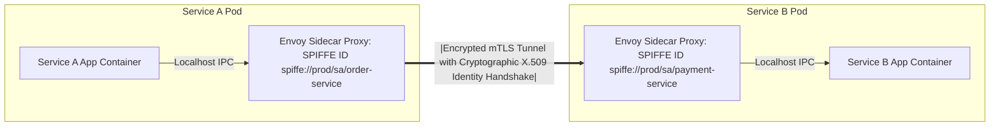

# Modul 182: Respon Insiden & Forensik Digital (NIST Incident Response, Forensik Memori RAM Volatility, Disk Forensics Autopsy)

**Navigasi**: [⬅️ Master Index](../../INDEX.md) | [Tingkat 11: Tingkat 11: Cyber Security, Kriptografi & Reverse Engineering](./README.md)
*Sebelumnya*: [181. defensive-security-blue-team-operasi-soc](./181-defensive-security-blue-team-operasi-soc.md) | *Berikutnya*: [183. komputasi-vektorisasi-numerik-tensor](../12-ai-machine-learning-mlops/183-komputasi-vektorisasi-numerik-tensor.md)

---

## 1. Intuisi Dasar Tanpa Jargon ("Seperti Bayi Baru Lahir")
Di masa lalu, keamanan kantor perusahaan didasarkan pada model 'Kastil dan Parit Air': siapa pun yang berada di luar kantor dianggap musuh dan dihadang oleh firewall; tetapi siapa pun yang berhasil masuk ke dalam kantor fisik atau tersambung ke VPN dipercaya 100% dan bebas menjelajahi seluruh database dan server internal! Ketika karyawan mulai bekerja dari rumah di seluruh dunia dan server dipindahkan ke cloud AWS/GCP, model kastil runtuh total: satu laptop karyawan yang terkena malware dapat menginfeksi seluruh data center perusahaan. Keamanan Cloud, IAM & Arsitektur Zero Trust ([Zero Trust Architecture NIST SP 800-207](https://csrc.nist.gov/publications/detail/sp/800-207/final)) adalah paradigma keamanan modern yang menyatakan: **'Jangan Pernah Percaya, Selalu Verifikasi' (Never Trust, Always Verify)**. Tidak peduli apakah Anda terhubung dari internet luar atau dari kabel di dalam ruangan server data center, setiap panggilan API, setiap akses database, dan setiap orang **wajib membuktikan identitas kriptografisnya** (**mTLS & IAM**) pada setiap permintaan individual secara terus-menerus!

## 2. Fondasi Teoretis & Aksiomatik / Matematis
Prinsip Aksiomatik Arsitektur Zero Trust (NIST SP 800-207) dan Model Evaluasi Kebijakan IAM:

1. **Tujuh Prinsip Aksiomatik Zero Trust Architecture (ZTA - NIST SP 800-207)**:
   - Semua sumber data dan layanan komputasi dianggap sebagai sumber daya (*Resources*).
   - Semua komunikasi wajib diamankan melintasi batas jaringan fisik apa pun (*Perimeter-less*).
   - Akses ke sumber daya individual diberikan secara dinamis per sesi (*Per-Session Authorization*).
   - Hak akses ditentukan oleh kebijakan dinamis (*Dynamic Policy*): identitas pengguna, status kesehatan perangkat klien, lokasi geografis, dan postur ancaman.
   - Seluruh perangkat keras dan aset perusahaan dipantau status keamanannya secara berkala (*Continuous Posture Assessment*).
   - Autentikasi dan otorisasi bersifat dinamis dan ditegakkan secara ketat sebelum akses diizinkan.
   - Seluruh data lalu lintas diinspeksi, dicatat (*Logged*), dan dianalisis telemetrinya secara real-time.

2. **Arsitektur Entitas Logis Zero Trust (Policy Engine & Enforcement Point)**:

$$\text{Subject (Klien/Service)} \xrightarrow{\text{Request}} \mathbf{PEP \text{ (Policy Enforcement Point)}} \xrightarrow{\text{Access Granted}} \text{Target Enterprise Resource}$$
$$\uparrow \quad \text{Evaluasi Kontrol Statis & Dinamis}$$
$$\mathbf{PDP \text{ (Policy Decision Point)}} = \Big\{ \text{Policy Engine (Aturan IAM)} \ + \ \text{Policy Administrator (Penerbit Kredensial)} \Big\}$$

3. **Model Kontrol Akses Lanjut (RBAC vs ABAC)**:
   - **RBAC (Role-Based Access Control)**: Akses ditentukan oleh peran jabatan kaku (`Role = "FinancialAuditor"`).
   - **ABAC (Attribute-Based Access Control)**: Akses dievaluasi berdasarkan kombinasi atribut multidimensi secara dinamis:
     $$\text{Allow} \iff (\text{User.Dept} == \text{"Finance"}) \land (\text{Resource.Class} == \text{"Confidential"}) \land (\text{Env.Time} \in [09:00, 17:00]) \land (\text{Device.IsCompliant})$$

## 3. Anatomi Teknis & Cara Kerja Internal
Arsitektur Layanan Zero Trust Service Mesh Menggunakan Mutual TLS (mTLS) dan SPIFFE Identitas Mesin:



1. **SPIFFE / SPIRE (Secure Production Identity Framework for Everyone)**:
   Standar terbuka CNCF untuk memberikan identitas kriptografi otomatis kepada beban kerja (*Workloads*) di cloud. Meniadakan kunci API rahasia statis yang dibakar di file konfigurasi; setiap container menerima sertifikat X.509 berumur pendek (Short-lived SVID) yang otomatis dirotasi setiap jam.

## 4. Implementasi Praktis & Kode / Simulasi Riil
```json
// Fine-Grained Least Privilege AWS IAM JSON Policy Statement
// Menegakkan pembatasan akses S3 bucket produksi secara ketat hanya dari VPC resmi!
{
  "Version": "2012-10-17",
  "Statement": [
    {
      "Sid": "AllowStrictS3ReadWithVPCEndpointRestriction",
      "Effect": "Allow",
      "Action": [
        "s3:GetObject",
        "s3:ListBucket"
      ],
      "Resource": [
        "arn:aws:s3:::corporate-finance-ledger-prod",
        "arn:aws:s3:::corporate-finance-ledger-prod/*"
      ],
      "Condition": {
        "StringEquals": {
          "aws:sourceVpce": "vpce-0123456789abcdef0" // Tolak seluruh akses jika bukan dari jaringan VPC internal!
        },
        "Bool": {
          "aws:SecureTransport": "true" // Tolak keras akses tanpa enkripsi HTTPS TLS!
        }
      }
    }
  ]
}
```

## 5. Miskonsepsi & Jebakan Industri
1. **Overly Permissive IAM Wildcard Asterisks (`"Action": "*"`)**: Memberikan izin `"Action": "s3:*"` atau `"Resource": "*"` pada peran IAM server backend. Jika server tersebut memiliki celah SSRF, penyerang dapat menghapus seluruh bucket data perusahaan di cloud.
2. **Long-Lived Static Cloud Access Keys**: Mengunduh pasangan kunci akses permanen AWS (`AKIA...` access key) dan menyimpannya di laptop pengembang. Kunci dapat bocor secara tidak sengaja ke GitHub publik dan digunakan penyerang untuk menyewa ribuan GPU mining kripto dalam beberapa menit.
3. **Zero Trust Implementation Fatigue (Bypassing PEP)**: Merancang aturan Zero Trust yang terlalu kaku sehingga menghalangi produktivitas harian developer, memicu developer membangun jalan pintas gelap (*Shadow IT*) yang sama sekali tidak terpantau oleh tim keamanan.

## 6. Proyek Latihan & Rubrik Penilaian Mandiri
1. **Tingkat Pemula**: Evaluasi kebijakan IAM di atas: tentukan apakah permohonan baca file yang berasal dari laptop rumah pengembang via koneksi internet biasa (bukan dari VPC internal) akan diizinkan atau ditolak oleh Policy Engine AWS.
2. **Tingkat Menengah**: Rancang kebijakan otorisasi berbasis atribut (Attribute-Based Access Control / ABAC) menggunakan Open Policy Agent (OPA) dan bahasa kebijakan Rego: izinkan akses dokumen hanya jika departemen pengguna sama dengan departemen dokumen dan jam akses berada di antara pukul 08:00 hingga 18:00.
3. **Tingkat Mahir**: Implementasikan arsitektur Mutual TLS (mTLS) Service Mesh end-to-end di klaster Kubernetes lokal menggunakan Cilium atau Istio: tegakkan otentikasi identitas SPIFFE antar-pod, definisikan aturan otorisasi `AuthorizationPolicy` yang secara eksplisit melarang Pod Frontend berbicara langsung ke Pod Database tanpa melalui Pod Backend, dan buktikan ketiadaan akses via perintah curl.

## 7. Rekomendasi Sumber Belajar Standar Emas
| Sumber Pembelajaran | Penulis / Institusi | Tautan Langsung | Fokus Materi |
| :--- | :--- | :--- | :--- |
| NIST Special Publication 800-207: Zero Trust Architecture | Scott Rose, Oliver Borchert et al. (NIST) | [NIST SP 800-207 Zero Trust](https://csrc.nist.gov/publications/detail/sp/800-207/final) | Dokumen Standar Resmi Asli Arsitektur Zero Trust Dunia: PEP, PDP & Deployment Models |
| SPIFFE & SPIRE: Universal Machine Identity Framework | CNCF SPIFFE Project | [SPIFFE Official Portal](https://spiffe.io/) | Workload Identity, SVID Cryptographic Certificates, Attestation & Zero Trust |
| Google BeyondCorp: A New Approach to Enterprise Security | Rory Ward & Betsy Beyer (Google) | [Google BeyondCorp Research Papers](https://research.google/pubs/pub43231/) | Makalah Pelopor Industri Implementasi Zero Trust Tanpa VPN di Lingkungan Google Global |
| AWS Well-Architected Framework: Security Pillar | Amazon Web Services | [AWS Security Pillar Whitepaper](https://docs.aws.amazon.com/wellarchitected/latest/security-pillar/welcome.html) | Manajemen Identitas IAM Terpusat, Deteksi Ancaman, Perlindungan Infrastruktur & Data |

---
*Navigasi Cepat*: [Ke Tingkat 11](./README.md) | [Ke Master Index](../../INDEX.md) | *Sebelumnya*: [181. defensive-security-blue-team-operasi-soc](./181-defensive-security-blue-team-operasi-soc.md) | *Berikutnya*: [183. komputasi-vektorisasi-numerik-tensor](../12-ai-machine-learning-mlops/183-komputasi-vektorisasi-numerik-tensor.md)
