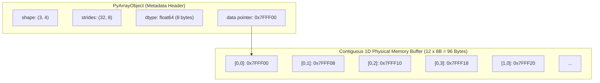

# Modul 183: Komputasi Vektorisasi Numerik & Tensor (Struktur Memori Contiguous, Strides, Broadcasting, BLAS/NumPy)

**Navigasi**: [⬅️ Master Index](../../INDEX.md) | [Tingkat 12: Tingkat 12: Data Science, AI, Machine Learning, Deep Learning & MLOps](./README.md)
*Sebelumnya*: [182. respon-insiden-forensik-digital](../11-cybersecurity-reverse-engineering/182-respon-insiden-forensik-digital.md) | *Berikutnya*: [184. pipeline-pemrosesan-data-analisis-eksploratif](./184-pipeline-pemrosesan-data-analisis-eksploratif.md)

---

## 1. Intuisi Dasar Tanpa Jargon ("Seperti Bayi Baru Lahir")
Bayangkan Anda seorang kasir supermarket yang harus mengalikan 1.000 harga barang dengan pajak 10%. Jika Anda mengambil kalkulator, mengetik satu per satu harga barang, menekan tombol kali 1,1, lalu menuliskan hasilnya di kertas seribu kali secara berurutan, Anda bekerja seperti *Python loop tradisional* yang lambat dan boros overhead ([Python Loop Overhead Analysis](https://docs.python.org/3/glossary.html#term-interpreted)).

Namun, bagaimana jika Anda memiliki stempel raksasa selebar 100 baris yang bisa menekan 100 angka sekaligus dalam satu hentakan tangan? Itulah **vektorisasi numerik (SIMD & BLAS)** ([Intel Intrinsics Guide](https://www.intel.com/content/www/us/en/docs/intrinsics-guide/index.html)). Dalam memori komputer, angka-angka disusun berdampingan tanpa jeda (*contiguous array*). Daripada CPU mengeksekusi instruksi per elemen, instruksi vektor (seperti AVX-512) memuat 8 atau 16 angka floating-point sekaligus ke dalam register selebar 512-bit dan menyelesaikannya dalam satu siklus clock tunggal ([NumPy Array Memory Layout](https://numpy.org/doc/stable/dev/internals.code-explanations.html)).

## 2. Fondasi Teoretis & Aksiomatik / Matematis
Secara matematis dan arsitektural, array $N$-dimensi (Tensor) direpresentasikan sebagai blok memori 1D linier dengan pointer dasar $P_{base}$, tipe data ukuran $S$ bytes, tuple bentuk dimensi (shape) $(d_0, d_1, \dots, d_{k-1})$, dan tuple langkah loncatan memori (*strides*) $(s_0, s_1, \dots, s_{k-1})$ ([Netlib BLAS Technical Standards](https://www.netlib.org/blas/)).

Alamat memori fisik untuk elemen berindeks $(i_0, i_1, \dots, i_{k-1})$ dihitung secara eksak melalui relasi linier:
$$\text{Memory Address}(i_0, i_1, \dots, i_{k-1}) = P_{base} + \sum_{j=0}^{k-1} i_j \cdot s_j$$

Pada susunan memori baris-utama (*C-contiguous order*):
$$s_{k-1} = S, \quad s_j = s_{j+1} \cdot d_{j+1} = S \prod_{m=j+1}^{k-1} d_m$$

**Aturan Penyiaran Dimensi (Broadcasting Rules)** ([NumPy Broadcasting Documentation](https://numpy.org/doc/stable/user/basics.broadcasting.html)):
Dua dimensi kompatibel jika dan hanya jika:
1. Kedua dimensi bernilai sama: $d_{1, j} = d_{2, j}$
2. Salah satu dimensi bernilai 1: $d_{1, j} = 1 \lor d_{2, j} = 1$, di mana stride untuk dimensi bernilai 1 disetel secara virtual menjadi $s_j = 0$ (mengulang data tanpa alokasi memori fisik baru).

## 3. Anatomi Teknis & Cara Kerja Internal
Struktur internal tensor pada NumPy (`PyArrayObject`) dan PyTorch (`at::Tensor`) memisahkan metadata header dari buffer data aktual:



Ketika operasi `transpose()` atau `reshape()` dipanggil, data memori fisik tidak pernah disalin (*zero-copy view*); sistem hanya memanipulasi nilai `shape` dan `strides` di tingkat header metadata ([PyTorch Internals Architecture](http://blog.ezyang.com/2019/05/pytorch-internals/)).

## 4. Implementasi Praktis & Kode / Simulasi Riil
```python
import numpy as np
import time

# 1. Analisis Strides dan Manipulasi Memori Kontigu
arr = np.arange(12, dtype=np.int64).reshape(3, 4)
print(f"Bentuk Array: {arr.shape}")
print(f"Strides (Bytes): {arr.strides} -> {arr.strides[0]} bytes per baris, {arr.strides[1]} bytes per kolom")
print(f"C-Contiguous: {arr.flags.c_contiguous}")

# Transposisi adalah operasi zero-copy view: data tidak digandakan!
transposed = arr.T
print(f"Transposed Strides: {transposed.strides}")
print(f"Fortran-Contiguous: {transposed.flags.f_contiguous}")
assert transposed.base is arr.base, "Transposisi harus berbagi buffer memori yang sama (Zero-Copy)!"

# 2. Benchmark Performa: Pure Python Loop vs BLAS Vectorized SIMD
N = 2_000_000
x = np.random.randn(N)
y = np.random.randn(N)

# Pure Python Loop
start = time.perf_counter()
res_loop = [x[i] * y[i] for i in range(N)]
dur_loop = time.perf_counter() - start

# Vectorized BLAS / SIMD
start = time.perf_counter()
res_simd = x * y
dur_simd = time.perf_counter() - start

print(f"Durasi Python Loop : {dur_loop*1000:.2f} ms")
print(f"Durasi Vectorized   : {dur_simd*1000:.2f} ms")
print(f"Peningkatan Kecepatan: {dur_loop / dur_simd:.1f}x lebih cepat!")
```

## 5. Miskonsepsi & Jebakan Industri
Jebakan Memori Non-Kontigu (*Cache Thrashing*): Ketika melakukan operasi pereduksian (seperti `arr.sum(axis=0)`) pada matriks hasil transposisi yang berukuran masif, memori diakses secara melompat-melompat (*non-stride-1*), merusak hierarki cache L1/L2 CPU dan memicu penurunan performa hingga puluhan kali lipat ([Ulrich Drepper - What Every Programmer Should Know About Memory](https://people.freebsd.org/~lstewart/articles/cpumemory.pdf)). Gunakan `np.ascontiguousarray()` jika komputasi berikutnya berorientasi baris.

## 6. Proyek Latihan & Rubrik Penilaian Mandiri
### Level 1 (Pemula)
Buat matriks 2D berukuran $5 \times 5$ dengan NumPy, ekstrak baris ganjil dan kolom genap menggunakan strided slicing, lalu buktikan bahwa array hasil slicing memiliki basis memori (`.base`) yang sama dengan matriks asli.
*Rubrik*: Output menampilkan `.shape`, `.strides`, dan perbandingan `result.base is original`.

### Level 2 (Menengah)
Implementasikan fungsi komputasi jarak Euclidean matriks berpasangan (*Pairwise Distance Matrix*) antara dua set titik $A \in \mathbb{R}^{M \times D}$ dan $B \in \mathbb{R}^{N \times D}$ murni menggunakan penyiaran dimensi (*broadcasting*) tanpa ada for-loop:
$$\|A_i - B_j\|_2 = \sqrt{\sum_{k=1}^D (A_{ik} - B_{jk})^2}$$
*Rubrik*: Tidak ada loop Python, shape perantara berukuran $(M, 1, D)$ dan $(1, N, D)$, lolos pengujian toleransi numerik terhadap `scipy.spatial.distance.cdist`.

### Level 3 (Mahir)
Tulis pustaka mini array strided 2D dari awal menggunakan modul Python `ctypes` dan blok memori murni. Implementasikan kalkulasi pointer `(row * s0 + col * s1)`, fungsi `reshape`, fungsi `transpose`, dan cetak pemetaan alamat memori fisik setiap elemen.
*Rubrik*: Mendukung manipulasi stride positif/negatif, operasi view zero-copy, dan bebas memory leak.

## 7. Rekomendasi Sumber Belajar Standar Emas
| Sumber Pembelajaran | Penulis / Institusi | Tautan Langsung | Fokus Materi |
| :--- | :--- | :--- | :--- |
| NumPy Internal Architecture & Strides | NumPy Developers Group | [NumPy Internals Guide](https://numpy.org/doc/stable/dev/internals.code-explanations.html) | Alokasi Memori, Ndarray C-API, Strides & Flags |
| Basic Linear Algebra Subprograms (BLAS) | Netlib / University of Tennessee | [Netlib BLAS Specifications](https://www.netlib.org/blas/) | Standar Operasi Matriks Level 1, 2, dan 3 |
| Dive into Systems: Vector Architecture & SIMD | Suzanne J. Matthews et al. | [Dive into Systems Textbook](https://diveintosystems.org/) | SIMD Registers, Data Alignment, Cache Locality |
| PyTorch Tensor Design & Storage Internals | Edward Z. Yang (Meta AI) | [ezyang's PyTorch Blog](http://blog.ezyang.com/2019/05/pytorch-internals/) | Pemisahan Storage Tensor, Dispatcher, dan Views |

---
*Navigasi Cepat*: [Ke Tingkat 12](./README.md) | [Ke Master Index](../../INDEX.md) | *Sebelumnya*: [182. respon-insiden-forensik-digital](../11-cybersecurity-reverse-engineering/182-respon-insiden-forensik-digital.md) | *Berikutnya*: [184. pipeline-pemrosesan-data-analisis-eksploratif](./184-pipeline-pemrosesan-data-analisis-eksploratif.md)
