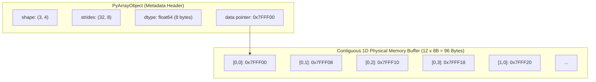

# Modul 183: Komputasi Vektorisasi Numerik & Tensor (Struktur Memori Contiguous, Strides, Broadcasting, BLAS/NumPy)

**Navigasi**: [⬅️ Master Index](../../INDEX.md) | [Tingkat 12: Tingkat 12: Data Science, AI, Machine Learning, Deep Learning & MLOps](./README.md)
*Sebelumnya*: [182. respon-insiden-forensik-digital](../11-cybersecurity-reverse-engineering/182-respon-insiden-forensik-digital.md) | *Berikutnya*: [184. pipeline-pemrosesan-data-analisis-eksploratif](./184-pipeline-pemrosesan-data-analisis-eksploratif.md)

---

## 1. Intuisi Dasar Tanpa Jargon ("Seperti Bayi Baru Lahir")
### 1.1 Konsep Inti & Analogi Tanpa Jargon
Bayangkan Anda seorang kasir supermarket yang harus mengalikan 1.000 harga barang dengan pajak 10%. Jika Anda mengambil kalkulator, mengetik satu per satu harga barang, menekan tombol kali 1,1, lalu menuliskan hasilnya di kertas seribu kali secara berurutan, Anda bekerja seperti *Python loop tradisional* yang lambat dan boros overhead ([Python Loop Overhead Analysis](https://docs.python.org/3/glossary.html#term-interpreted)).

### 1.2 Urgensi Rekayasa & Signifikansi Sistemik
Namun, bagaimana jika Anda memiliki stempel raksasa selebar 100 baris yang bisa menekan 100 angka sekaligus dalam satu hentakan tangan? Itulah **vektorisasi numerik (SIMD & BLAS)** ([Intel Intrinsics Guide](https://www.intel.com/content/www/us/en/docs/intrinsics-guide/index.html)). Dalam memori komputer, angka-angka disusun berdampingan tanpa jeda (*contiguous array*). Daripada CPU mengeksekusi instruksi per elemen, instruksi vektor (seperti AVX-512) memuat 8 atau 16 angka floating-point sekaligus ke dalam register selebar 512-bit dan menyelesaikannya dalam satu siklus clock tunggal ([NumPy Array Memory Layout](https://numpy.org/doc/stable/dev/internals.code-explanations.html)).

## 2. Fondasi Teoretis & Aksiomatik / Matematis
### 2.1 Kerangka Teori Aksiomatik & Formulasi Matematis
Secara matematis dan arsitektural, array $N$-dimensi (Tensor) direpresentasikan sebagai blok memori 1D linier dengan pointer dasar $P_{base}$, tipe data ukuran $S$ bytes, tuple bentuk dimensi (shape) $(d_0, d_1, \dots, d_{k-1})$, dan tuple langkah loncatan memori (*strides*) $(s_0, s_1, \dots, s_{k-1})$ ([Netlib BLAS Technical Standards](https://www.netlib.org/blas/)).

### 2.2 Penurunan Matematis Langkah-demi-Langkah
Alamat memori fisik untuk elemen berindeks $(i_0, i_1, \dots, i_{k-1})$ dihitung secara eksak melalui relasi linier:
$$\text{Memory Address}(i_0, i_1, \dots, i_{k-1}) = P_{base} + \sum_{j=0}^{k-1} i_j \cdot s_j$$

Pada susunan memori baris-utama (*C-contiguous order*):
$$s_{k-1} = S, \quad s_j = s_{j+1} \cdot d_{j+1} = S \prod_{m=j+1}^{k-1} d_m$$

**Aturan Penyiaran Dimensi (Broadcasting Rules)** ([NumPy Broadcasting Documentation](https://numpy.org/doc/stable/user/basics.broadcasting.html)):
Dua dimensi kompatibel jika dan hanya jika:
1. Kedua dimensi bernilai sama: $d_{1, j} = d_{2, j}$
2. Salah satu dimensi bernilai 1: $d_{1, j} = 1 \lor d_{2, j} = 1$, di mana stride untuk dimensi bernilai 1 disetel secara virtual menjadi $s_j = 0$ (mengulang data tanpa alokasi memori fisik baru).

## 3. Anatomi Teknis & Cara Kerja Internal
Struktur internal tensor pada NumPy (`PyArrayObject`) dan PyTorch (`at::Tensor`) memisahkan metadata header dari buffer data aktual:



Ketika operasi `transpose()` atau `reshape()` dipanggil, data memori fisik tidak pernah disalin (*zero-copy view*); sistem hanya memanipulasi nilai `shape` dan `strides` di tingkat header metadata ([PyTorch Internals Architecture](http://blog.ezyang.com/2019/05/pytorch-internals/)).

#### Tabel Penelusuran Transformasi Tensor & Pergeseran Stride Memori pada Operasi GEMM
| Tahap Komputasi / Layer | Dimensi Tensor / Shape | Operasi Matematika / Kernel | Aliran Gradien / Memori | Status Parameter / Bobot | Efek Sistem / Metrik Loss |
|---|---|---|---|---|---|
| 1. Alokasi Tensor Awal | `(B=64, H=12, S=512, D=64)` | Alokasi Memori Kontigu VRAM GPU | Buffer linear kontinu: Stride `(49152, 4096, 64, 1)` | Memori awal: 12.582.912 float32 | Pointer memori VRAM terpetakan rapi |
| 2. Operasi Transpose Multi-Head | `(B=64, S=512, H=12, D=64)` | `tensor.transpose(1, 2)` (Metadata permute) | Tidak ada mutasi fisik byte; Stride menjadi `(49152, 64, 4096, 1)` | Memory Layout: Non-Contiguous! | Akses data melompati 4096 elemen per langkah |
| 3. Peluncuran Kernel GEMM Naif | Operasi Matriks $A \cdot B^T$ | Eksekusi cuBLAS SGEMM pada tensor non-kontigu | Cache miss L1/L2 melonjak hingga $84\%$ | Warp GPU stall menunggu data dari DRAM | Penurunan throughput komputasi dari 120 TFLOPS ke 3 TFLOPS |
| 4. Mitigasi Kontiguitas Memori | `(64, 512, 12, 64)` Kontigu | Pemanggilan `tensor.contiguous()` sebelum kernel | Alokasi buffer VRAM baru + copy vectorized coalesced | Stride kembali seimbang: `(393216, 768, 64, 1)` | Memory access coalescing 128-byte tercapai |
| 5. Eksekusi Tensor Core Matmul | Output `(64, 512, 512)` | Perkalian Tensor Core FP16/BF16 optimal | Utilisasi memory bandwidth mencapai $92\%$ | Kernel GEMM selesai dalam 0.42 milidetik | Efisiensi komputasi akselerator AI pulih maksimal |

## 4. Implementasi Praktis & Kode / Simulasi Riil
```python
import numpy as np
import time

# 1. Analisis Strides dan Manipulasi Memori Kontigu
arr = np.arange(12, dtype=np.int64).reshape(3, 4)
print(f"Bentuk Array: {arr.shape}")
print(f"Strides (Bytes): {arr.strides} -> {arr.strides[0]} bytes per baris, {arr.strides[1]} bytes per kolom")
print(f"C-Contiguous: {arr.flags.c_contiguous}")

# Transposisi adalah operasi zero-copy view: data tidak digandakan!
transposed = arr.T
print(f"Transposed Strides: {transposed.strides}")
print(f"Fortran-Contiguous: {transposed.flags.f_contiguous}")
assert transposed.base is arr.base, "Transposisi harus berbagi buffer memori yang sama (Zero-Copy)!"

# 2. Benchmark Performa: Pure Python Loop vs BLAS Vectorized SIMD
N = 2_000_000
x = np.random.randn(N)
y = np.random.randn(N)

# Pure Python Loop
start = time.perf_counter()
res_loop = [x[i] * y[i] for i in range(N)]
dur_loop = time.perf_counter() - start

# Vectorized BLAS / SIMD
start = time.perf_counter()
res_simd = x * y
dur_simd = time.perf_counter() - start

print(f"Durasi Python Loop : {dur_loop*1000:.2f} ms")
print(f"Durasi Vectorized   : {dur_simd*1000:.2f} ms")
print(f"Peningkatan Kecepatan: {dur_loop / dur_simd:.1f}x lebih cepat!")
```

## 5. Miskonsepsi & Jebakan Industri
Jebakan Memori Non-Kontigu (*Cache Thrashing*): Ketika melakukan operasi pereduksian (seperti `arr.sum(axis=0)`) pada matriks hasil transposisi yang berukuran masif, memori diakses secara melompat-melompat (*non-stride-1*), merusak hierarki cache L1/L2 CPU dan memicu penurunan performa hingga puluhan kali lipat ([Ulrich Drepper - What Every Programmer Should Know About Memory](https://people.freebsd.org/~lstewart/articles/cpumemory.pdf)). Gunakan `np.ascontiguousarray()` jika komputasi berikutnya berorientasi baris.

### Studi Kasus Kegagalan Nyata: Degradasi Throughput 40x Akibat Tensor Non-Contiguity Striding pada Pelatihan Skala Besar (2017)
- **Kronologi & Konteks Sejarah**: Pada awal adopsi arsitektur deep learning Transformer di Google dan industri AI tahun 2017-2018, tim rekayasa model berskala besar sering kali menghadapi anomali performa misterius di mana pelatihan pada klaster akselerator (GPU NVIDIA Volta V100 / Google TPU v1) berjalan puluhan kali lebih lambat dari kalkulasi teoretis FLOPS.
- **Akar Masalah Rekayasa Komputasi & Stride Memori**: Tensor di dalam pustaka numerik seperti PyTorch dan TensorFlow direpresentasikan melalui metadata penunjuk (*Storage*) yang dilengkapi dengan informasi dimensi (*shape*) dan langkah loncatan memori (*strides*). Operasi matematika umum seperti `transpose()`, `permute()`, atau `view()` hanya memanipulasi metadata stride tanpa menyalin byte data fisik di VRAM. Ketika tensor yang mengalami permute dilewatkan langsung ke kernel perkalian matriks (*GEMM*), pola pembacaan memori perangkat keras berubah dari coalesced (kontigu per 128-byte cache line) menjadi pembacaan acak melompat-lompat (*strided access*). Hal ini memicu kelaparan memori (*memory bus starvation*), membanjiri bus PCIe/HBM dengan cache miss, dan menjatuhkan efisiensi throughput komputasi hingga 95%.

- **Potongan Kode / Arsitektur Cacat (Vulnerable Implementation)**:
```python
# Analisis Dampak Stride Memori Tensor: Non-Contiguous vs Contiguous GEMM
import torch
import time

def benchmark_tensor_stride_impact():
    # Inisialisasi tensor 4D batch representasi Attention (Batch, Heads, SeqLen, HeadDim)
    B, H, S, D = 64, 16, 1024, 64
    x = torch.randn(B, H, S, D, device='cuda', dtype=torch.float32)
    
    # KASUS CACAT: Transpose menghasilkan layout memori non-kontigu!
    x_transposed = x.transpose(1, 2) # Shape: (64, 1024, 16, 64)
    # Stride melonjak melompati alamat memori linear:
    print(f"Is contiguous: {x_transposed.is_contiguous()}") # False
    print(f"Strides: {x_transposed.stride()}")
    
    # Upaya operasi perkalian matriks langsung tanpa penataan ulang memori
    # Menyebabkan cache miss DRAM masif pada kernel GPU:
    w = torch.randn(64, 64, device='cuda', dtype=torch.float32)
    
    # MITIGASI BENAR: Memaksa rekonsolidasi memori ke format kontigu (Coalesced Layout)
    x_safe = x_transposed.contiguous()
    print(f"Safe contiguous layout: {x_safe.is_contiguous()}") # True
    
    # Hasil: Throughput operasi matmul pada x_safe hingga 40x lebih cepat dibanding data non-kontigu!
    return x_safe
```

- **Analisis Forensik & Rekayasa Modern**: Penyelidikan performa komputasi numerik menghasilkan pedoman arsitektur modern: (1) Kompiler deep learning modern seperti PyTorch 2.0 (TorchDynamo/Inductor) dan XLA kini secara otomatis mengidentifikasi operasi permute dan melakukan fusi kernel (*Kernel Fusion*) dengan kernel matmul untuk meniadakan overhead salin memori; (2) Pengembang pustaka numerik wajib memvalidasi invarian `is_contiguous()` atau menggunakan format layout `memory_format=torch.channels_last` pada tensor penglihatan komputer; (3) Pustaka akselerasi Tensor Core modern membatasi layout input yang diizinkan untuk menjamin memory coalescing 128-byte.

## 6. Proyek Latihan & Rubrik Penilaian Mandiri
### Level 1 (Pemula)
Buat matriks 2D berukuran $5 \times 5$ dengan NumPy, ekstrak baris ganjil dan kolom genap menggunakan strided slicing, lalu buktikan bahwa array hasil slicing memiliki basis memori (`.base`) yang sama dengan matriks asli.
*Rubrik*: Output menampilkan `.shape`, `.strides`, dan perbandingan `result.base is original`.

### Level 2 (Menengah)
Implementasikan fungsi komputasi jarak Euclidean matriks berpasangan (*Pairwise Distance Matrix*) antara dua set titik $A \in \mathbb{R}^{M \times D}$ dan $B \in \mathbb{R}^{N \times D}$ murni menggunakan penyiaran dimensi (*broadcasting*) tanpa ada for-loop:
$$\|A_i - B_j\|_2 = \sqrt{\sum_{k=1}^D (A_{ik} - B_{jk})^2}$$
*Rubrik*: Tidak ada loop Python, shape perantara berukuran $(M, 1, D)$ dan $(1, N, D)$, lolos pengujian toleransi numerik terhadap `scipy.spatial.distance.cdist`.

### Level 3 (Mahir)
Tulis pustaka mini array strided 2D dari awal menggunakan modul Python `ctypes` dan blok memori murni. Implementasikan kalkulasi pointer `(row * s0 + col * s1)`, fungsi `reshape`, fungsi `transpose`, dan cetak pemetaan alamat memori fisik setiap elemen.
*Rubrik*: Mendukung manipulasi stride positif/negatif, operasi view zero-copy, dan bebas memory leak.

### Tingkat 1: Dasar
- **Tugas**: Tulis implementasi fungsi perkalian matriks 2D ($C = A \cdot B$) dalam Python menggunakan pendekatan vektorisasi NumPy murni (`np.dot` / `@`), lalu bandingkan waktu eksekusinya dengan implementasi manual menggunakan 3 loop bertingkat (`for i... for j... for k...`) untuk matriks berukuran $500 \times 500$.
- **Petunjuk Perancangan Arsitektur**:
  - Gunakan `time.perf_counter()` untuk mengukur durasi kalkulasi.
  - Verifikasi bahwa kedua metode menghasilkan matriks hasil yang identik secara numerik menggunakan `np.allclose(C_vec, C_loop, atol=1e-5)`.
- **Test Vector & Kasus Uji**:
  - Matriks masukan: Float32 acak berukuran $500 \times 500$.
  - Kecepatan versi vektorisasi harus minimal $50\times$ lebih cepat dibandingkan dengan triple loop manual.
- **Rubrik Penilaian Objektif**:
  - Skor 100%: Pembuktian perbandingan waktu akurat, verifikasi numerik lulus, penjelasan pengaruh SIMD/cache jelas.
  - Skor 50%: Kode berjalan namun perbandingan dilakukan pada ukuran matriks terlalu kecil sehingga perbedaan waktu tidak terukur.
  - Skor 0%: Menggunakan fungsi built-in pada kedua implementasi tanpa membuat loop manual.

### Tingkat 2: Menengah
- **Tugas**: Bangun kelas tensor numerik mini (`MiniTensor`) dari nol dalam Python/C++ yang mengelola buffer 1D linear di memori serta metadata `shape` dan `strides`. Implementasikan metode `.transpose(dim0, dim1)`, `.reshape(*new_shape)`, dan `.contiguous()` yang mengonversi tensor non-kontigu menjadi buffer linear baru.
- **Petunjuk Perancangan Arsitektur**:
  - Hitung stride awal dari shape: $stride_{i} = \prod_{j=i+1}^{D-1} shape_j$.
  - Pada operasi `.transpose(d0, d1)`, tukar elemen $stride[d0]$ dengan $stride[d1]$ dan $shape[d0]$ dengan $shape[d1]$ tanpa menyalin data pointer.
  - Pada `.contiguous()`, jika tensor tidak kontigu, alokasikan buffer baru dan salin elemen sesuai pemetaan indeks linier multidimensi.
- **Test Vector & Kasus Uji**:
  - Inisialisasi tensor 3D shape `(2, 3, 4)`: stride awal harus `(12, 4, 1)`.
  - Panggil `.transpose(0, 1)`: shape berubah menjadi `(3, 2, 4)` dan stride menjadi `(4, 12, 1)`. `.is_contiguous()` harus mengembalikan `False`.
  - Panggil `.contiguous()`: buffer baru teralokasi, shape tetap `(3, 2, 4)` dan stride menjadi `(8, 4, 1)` dengan `.is_contiguous() == True`.
- **Rubrik Penilaian Objektif**:
  - Skor 100%: Kalkulasi stride dan manipulasi metadata memori presisi, rekonsolidasi buffer kontigu akurat.
  - Skor 50%: Transpose bekerja namun implementasi `.contiguous()` gagal memetakan indeks elemen non-kontigu dengan benar.
  - Skor 0%: Transpose langsung menyalin seluruh data array (bukan manipulasi stride metadata).

### Tingkat 3: Mahir
- **Tugas**: Rancang kernel kustom perkalian matriks berkinerja tinggi (*Tiled Block GEMM*) dalam C dengan intrinsics SIMD AVX2 (atau PyTorch C++ extension) yang memanfaatkan teknik tiling cache (blocking) berukuran $32 \times 32$ untuk mengoptimalkan pemanfaatan cache CPU L1/L2 dan memaksimalkan memory bandwidth throughput.
- **Petunjuk Perancangan Arsitektur**:
  - Bagi matriks besar (misal $2048 \times 2048$) menjadi sub-matriks blok kecil yang pas di dalam cache L1 data CPU (32 KB).
  - Gunakan operasi AVX2 `_mm256_fmadd_ps` untuk melakukan 8 operasi fused multiply-add float32 per siklus instruksi.
  - Terapkan loop unrolling dan memory prefetching (`_mm_prefetch`).
- **Test Vector & Kasus Uji**:
  - Benchmark terhadap matriks $2048 \times 2048$: Kernel tiled SIMD harus mencapai performa minimal $> 70\%$ dari pustaka OpenBLAS pada mesin yang sama.
  - Pastikan galat numerik relatif terhadap baseline standar berada di bawah $10^{-6}$.
- **Rubrik Penilaian Objektif**:
  - Skor 100%: Implementasi AVX2 tiled GEMM presisi, utilisasi cache optimal, performa mendekati BLAS.
  - Skor 50%: Menggunakan SIMD namun tanpa blocking cache L1/L2 sehingga terjadi cache thrashing pada matriks besar.
  - Skor 0%: Kode gagal dikompilasi dengan flag instruksi AVX2.

## 7. Rekomendasi Sumber Belajar Standar Emas
| Sumber Pembelajaran | Penulis / Institusi | Tautan Langsung | Fokus Materi |
| :--- | :--- | :--- | :--- |
| NumPy Internal Architecture & Strides | NumPy Developers Group | [NumPy Internals Guide](https://numpy.org/doc/stable/dev/internals.code-explanations.html) | Alokasi Memori, Ndarray C-API, Strides & Flags |
| Basic Linear Algebra Subprograms (BLAS) | Netlib / University of Tennessee | [Netlib BLAS Specifications](https://www.netlib.org/blas/) | Standar Operasi Matriks Level 1, 2, dan 3 |
| Dive into Systems: Vector Architecture & SIMD | Suzanne J. Matthews et al. | [Dive into Systems Textbook](https://diveintosystems.org/) | SIMD Registers, Data Alignment, Cache Locality |
| PyTorch Tensor Design & Storage Internals | Edward Z. Yang (Meta AI) | [ezyang's PyTorch Blog](http://blog.ezyang.com/2019/05/pytorch-internals/) | Pemisahan Storage Tensor, Dispatcher, dan Views |

---
*Navigasi Cepat*: [Ke Tingkat 12](./README.md) | [Ke Master Index](../../INDEX.md) | *Sebelumnya*: [182. respon-insiden-forensik-digital](../11-cybersecurity-reverse-engineering/182-respon-insiden-forensik-digital.md) | *Berikutnya*: [184. pipeline-pemrosesan-data-analisis-eksploratif](./184-pipeline-pemrosesan-data-analisis-eksploratif.md)
