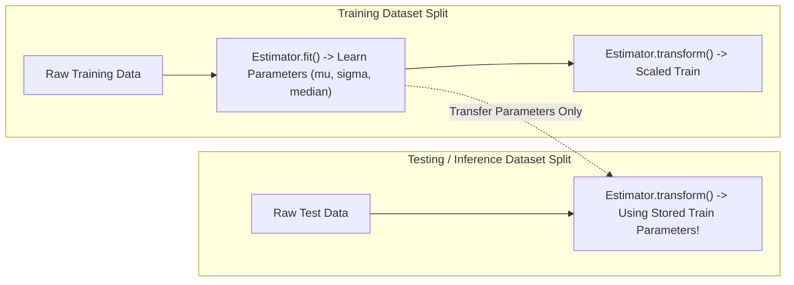

# Modul 184: Pipeline Pemrosesan Data & Analisis Eksploratif (Pembersihan Data, Imputasi MCAR/MAR, Outliers, Feature Engineering)

**Navigasi**: [⬅️ Master Index](../../INDEX.md) | [Tingkat 12: Tingkat 12: Data Science, AI, Machine Learning, Deep Learning & MLOps](./README.md)
*Sebelumnya*: [183. komputasi-vektorisasi-numerik-tensor](./183-komputasi-vektorisasi-numerik-tensor.md) | *Berikutnya*: [185. teori-pembelajaran-mesin-statistik](./185-teori-pembelajaran-mesin-statistik.md)

---

## 1. Intuisi Dasar Tanpa Jargon ("Seperti Bayi Baru Lahir")
Jika Anda ingin melatih atlet olimpiade, Anda tidak bisa memberinya makanan basi, beracun, atau piring kosong setengah matang. Jika makanannya buruk, performanya pasti hancur. Dalam machine learning, ada adagium terkenal: *Garbage In, Garbage Out* ([Google ML Data Preparation Best Practices](https://developers.google.com/machine-learning/data-prep)).

Pipeline pemrosesan data adalah pabrik sterilisasi dan pengolahan bahan mentah. Ketika data datang dari dunia nyata, ia penuh dengan lubang data yang hilang (*missing values*), angka aneh tak masuk akal (*outliers* seperti usia pasien tertulis 999 tahun), serta satuan pengukuran yang berbeda-beda. Pemrosesan data membersihkan kotoran ini dan mengubah variabel mentah menjadi sinyal matematika tajam yang siap dilahap model pembelajaran ([Scikit-Learn Preprocessing Pipelines](https://scikit-learn.org/stable/modules/preprocessing.html)).

## 2. Fondasi Teoretis & Aksiomatik / Matematis
Taksonomi data hilang menurut Donald Rubin (1976) mendikte metode imputasi yang valid secara statistik ([Little & Rubin - Statistical Analysis with Missing Data](https://onlinelibrary.wiley.com/doi/book/10.1002/9781119013563)):
1. **Missing Completely at Random (MCAR)**: Probabilitas hilangnya data tidak bergantung pada variabel teramati maupun tak teramati: $P(M \mid Y_{obs}, Y_{mis}) = P(M)$.
2. **Missing at Random (MAR)**: Probabilitas hilangnya data bergantung pada variabel teramati, tetapi independen dari nilai yang hilang itu sendiri: $P(M \mid Y_{obs}, Y_{mis}) = P(M \mid Y_{obs})$.
3. **Missing Not at Random (MNAR)**: Probabilitas hilangnya data bergantung secara langsung pada nilai data yang hilang tersebut: $P(M \mid Y_{obs}, Y_{mis}) \neq P(M \mid Y_{obs})$.

**Deteksi Outlier Multivariat Jarak Mahalanobis**:
Untuk vektor observasi $x \in \mathbb{R}^p$ dengan rata-rata sampel $\mu$ dan matriks kovarians $\Sigma$:
$$D_M(x) = \sqrt{(x - \mu)^T \Sigma^{-1} (x - \mu)} \sim \sqrt{\chi^2_p}$$
Observasi dianggap outlier jika kuadrat jarak Mahalanobis $D_M^2(x) > \chi^2_{p, 1-\alpha}$ ([NIST Multivariat Outlier Detection](https://www.itl.nist.gov/div898/handbook/eda/section3/eda35h.htm)).

**Penskalaan Fitur Robust Scaling**:
$$x_{robust} = \frac{x - \text{median}(x)}{\text{IQR}(x)} = \frac{x - Q_2}{Q_3 - Q_1}$$

## 3. Anatomi Teknis & Cara Kerja Internal
Arsitektur pipeline data modern menerapkan prinsip transformasi stateful fit-transform untuk mencegah kebocoran data (*data leakage*):



Kunci utama pipeline: parameter penskalaan $(\mu, \sigma)$ atau kamus encoding kategori **hanya boleh dihitung dari training set** dan dibekukan. Jika parameter dihitung dari gabungan train dan test set, terjadi kebocoran informasi masa depan (*data leakage*) yang memalsukan metrik evaluasi model ([Data Leakage in Machine Learning - Kaufman et al.](https://www.cs.umb.edu/~ding/history/470_670_fall_2011/papers/cs670_Tran_Datamining_Leakage_2012.pdf)).

## 4. Implementasi Praktis & Kode / Simulasi Riil
```python
import numpy as np
import pandas as pd
from sklearn.base import BaseEstimator, TransformerMixin
from sklearn.pipeline import Pipeline
from sklearn.compose import ColumnTransformer
from sklearn.impute import SimpleImputer
from sklearn.preprocessing import RobustScaler, OneHotEncoder

# Pembuatan Dataset Sintetis Kotor
np.random.seed(42)
n_samples = 1000
data = pd.DataFrame({
    'age': np.random.choice([25, 30, 45, np.nan, 200], size=n_samples, p=[0.3, 0.4, 0.2, 0.08, 0.02]),
    'income': np.random.exponential(scale=50000, size=n_samples),
    'city': np.random.choice(['Jakarta', 'Surabaya', 'Bandung', None], size=n_samples, p=[0.5, 0.3, 0.15, 0.05])
})

# Custom Robust Outlier Clipper
class OutlierClipper(BaseEstimator, TransformerMixin):
    def __init__(self, factor=1.5):
        self.factor = factor
    def fit(self, X, y=None):
        X_arr = np.asarray(X)
        q25, q75 = np.nanpercentile(X_arr, [25, 75], axis=0)
        iqr = q75 - q25
        self.lower_ = q25 - (self.factor * iqr)
        self.upper_ = q75 + (self.factor * iqr)
        return self
    def transform(self, X):
        X_arr = np.asarray(X)
        return np.clip(X_arr, self.lower_, self.upper_)

# Pipeline Modular End-to-End
numeric_pipeline = Pipeline([
    ('imputer', SimpleImputer(strategy='median')),
    ('clipper', OutlierClipper(factor=1.5)),
    ('scaler', RobustScaler())
])

categorical_pipeline = Pipeline([
    ('imputer', SimpleImputer(strategy='constant', fill_value='UNKNOWN')),
    ('onehot', OneHotEncoder(handle_unknown='ignore', sparse_output=False))
])

preprocessor = ColumnTransformer(transformers=[
    ('num', numeric_pipeline, ['age', 'income']),
    ('cat', categorical_pipeline, ['city'])
])

# Eksekusi Transformasi
processed_matrix = preprocessor.fit_transform(data)
print(f"Bentuk Matriks Pasca-Preprocessing: {processed_matrix.shape}")
print(f"Bebas NaN: {not np.isnan(processed_matrix).any()}")
print(f"Sample Baris Pertama Transformasi:\n{processed_matrix[0]}")
```

## 5. Miskonsepsi & Jebakan Industri
*Target Leakage via Feature Preprocessing*: Melakukan normalisasi data (seperti `StandardScaler().fit_transform(X)`) sebelum pembagian train-test split adalah kesalahan paling fatal dalam sains data. Hal ini menyebabkan rata-rata dan deviasi standar dari data pengujian bocor ke data pelatihan, menghasilkan skor akurasi semu tinggi di laboratorium yang anjlok drastis saat dideploy ke sistem produksi riil ([Scikit-Learn Common Pitfalls](https://scikit-learn.org/stable/common_pitfalls.html)).

## 6. Proyek Latihan & Rubrik Penilaian Mandiri
### Level 1 (Pemula)
Buat pipeline `ColumnTransformer` yang memproses kolom usia (imputasi mean, scaling min-max) dan kolom status perkawinan (imputasi modus, One-Hot Encoding), lalu terapkan pada DataFrame buatan dengan 100 baris.
*Rubrik*: Kode pipeline tereksekusi tanpa galat, output bertipe numpy ndarray 2D.

### Level 2 (Menengah)
Implementasikan detektor outlier multivariat berbasis Jarak Mahalanobis dalam bentuk kelas Scikit-Learn kustom (`MahalanobisOutlierDetector`), yang menghitung kovarians invers $\Sigma^{-1}$ pada `fit()`, memotong data di atas ambang kuantil $\chi^2$, dan menangani matriks kovarians singular via regularisasi pseudo-invers.
*Rubrik*: Mendukung penanganan matriks singular, menghitung nilai p-value distribusi $\chi^2$.

### Level 3 (Mahir)
Bangun sistem imputasi berantai (*MICE - Multivariate Imputation by Chained Equations*) dari nol menggunakan regresi linier dan regresi logistik iteratif untuk mengisi data hilang pada dataset multi-atribut numerik dan kategorikal hingga mencapai konvergensi selisih $\Delta < 10^{-4}$.
*Rubrik*: Mendukung loop iteratif imputasi bersyarat, konvergensi tervalidasi secara komputasional.

## 7. Rekomendasi Sumber Belajar Standar Emas
| Sumber Pembelajaran | Penulis / Institusi | Tautan Langsung | Fokus Materi |
| :--- | :--- | :--- | :--- |
| Scikit-Learn Data Preprocessing & Pipelines | Scikit-Learn Core Developers | [Scikit-Learn Preprocessing User Guide](https://scikit-learn.org/stable/modules/preprocessing.html) | Pipeline, ColumnTransformer, Feature Unions |
| Statistical Analysis with Missing Data | Roderick J. A. Little & Donald B. Rubin | [Wiley Series in Probability & Statistics](https://onlinelibrary.wiley.com/doi/book/10.1002/9781119013563) | Mekanisme MCAR, MAR, MNAR, Algoritma EM |
| Feature Engineering for Machine Learning | Alice Zheng & Amanda Casari | [O'Reilly Media Portal](https://www.oreilly.com/library/view/feature-engineering-for/9781491953235/) | Binning, Log Transforms, Outliers, Target Encoding |
| Google Rules of Machine Learning: Best Practices | Martin Zinkevich (Google Research) | [Google ML Rules](https://developers.google.com/machine-learning/guides/rules-of-ml) | Pipeline Data Hygiene, Feature Monitoring, Leakage |

---
*Navigasi Cepat*: [Ke Tingkat 12](./README.md) | [Ke Master Index](../../INDEX.md) | *Sebelumnya*: [183. komputasi-vektorisasi-numerik-tensor](./183-komputasi-vektorisasi-numerik-tensor.md) | *Berikutnya*: [185. teori-pembelajaran-mesin-statistik](./185-teori-pembelajaran-mesin-statistik.md)
