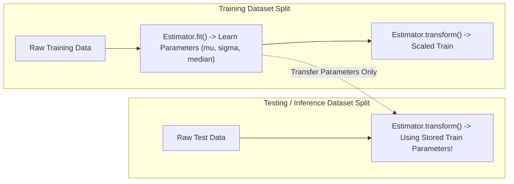

# Modul 184: Pipeline Pemrosesan Data & Analisis Eksploratif (Pembersihan Data, Imputasi MCAR/MAR, Outliers, Feature Engineering)

**Navigasi**: [⬅️ Master Index](../../INDEX.md) | [Tingkat 12: Tingkat 12: Data Science, AI, Machine Learning, Deep Learning & MLOps](./README.md)
*Sebelumnya*: [183. komputasi-vektorisasi-numerik-tensor](./183-komputasi-vektorisasi-numerik-tensor.md) | *Berikutnya*: [185. teori-pembelajaran-mesin-statistik](./185-teori-pembelajaran-mesin-statistik.md)

---

## 1. Intuisi Dasar Tanpa Jargon ("Seperti Bayi Baru Lahir")
### 1.1 Konsep Inti & Analogi Tanpa Jargon
Jika Anda ingin melatih atlet olimpiade, Anda tidak bisa memberinya makanan basi, beracun, atau piring kosong setengah matang. Jika makanannya buruk, performanya pasti hancur. Dalam machine learning, ada adagium terkenal: *Garbage In, Garbage Out* ([Google ML Data Preparation Best Practices](https://developers.google.com/machine-learning/data-prep)).

### 1.2 Urgensi Rekayasa & Signifikansi Sistemik
Pipeline pemrosesan data adalah pabrik sterilisasi dan pengolahan bahan mentah. Ketika data datang dari dunia nyata, ia penuh dengan lubang data yang hilang (*missing values*), angka aneh tak masuk akal (*outliers* seperti usia pasien tertulis 999 tahun), serta satuan pengukuran yang berbeda-beda. Pemrosesan data membersihkan kotoran ini dan mengubah variabel mentah menjadi sinyal matematika tajam yang siap dilahap model pembelajaran ([Scikit-Learn Preprocessing Pipelines](https://scikit-learn.org/stable/modules/preprocessing.html)).

## 2. Fondasi Teoretis & Aksiomatik / Matematis
### 2.1 Kerangka Teori Aksiomatik & Formulasi Matematis
Taksonomi data hilang menurut Donald Rubin (1976) mendikte metode imputasi yang valid secara statistik ([Little & Rubin - Statistical Analysis with Missing Data](https://onlinelibrary.wiley.com/doi/book/10.1002/9781119013563)):
1. **Missing Completely at Random (MCAR)**: Probabilitas hilangnya data tidak bergantung pada variabel teramati maupun tak teramati: $P(M \mid Y_{obs}, Y_{mis}) = P(M)$.
2. **Missing at Random (MAR)**: Probabilitas hilangnya data bergantung pada variabel teramati, tetapi independen dari nilai yang hilang itu sendiri: $P(M \mid Y_{obs}, Y_{mis}) = P(M \mid Y_{obs})$.
3. **Missing Not at Random (MNAR)**: Probabilitas hilangnya data bergantung secara langsung pada nilai data yang hilang tersebut: $P(M \mid Y_{obs}, Y_{mis}) \neq P(M \mid Y_{obs})$.

### 2.2 Penurunan Matematis Langkah-demi-Langkah
**Deteksi Outlier Multivariat Jarak Mahalanobis**:
Untuk vektor observasi $x \in \mathbb{R}^p$ dengan rata-rata sampel $\mu$ dan matriks kovarians $\Sigma$:
$$D_M(x) = \sqrt{(x - \mu)^T \Sigma^{-1} (x - \mu)} \sim \sqrt{\chi^2_p}$$
Observasi dianggap outlier jika kuadrat jarak Mahalanobis $D_M^2(x) > \chi^2_{p, 1-\alpha}$ ([NIST Multivariat Outlier Detection](https://www.itl.nist.gov/div898/handbook/eda/section3/eda35h.htm)).

**Penskalaan Fitur Robust Scaling**:
$$x_{robust} = \frac{x - \text{median}(x)}{\text{IQR}(x)} = \frac{x - Q_2}{Q_3 - Q_1}$$

## 3. Anatomi Teknis & Cara Kerja Internal
Arsitektur pipeline data modern menerapkan prinsip transformasi stateful fit-transform untuk mencegah kebocoran data (*data leakage*):



Kunci utama pipeline: parameter penskalaan $(\mu, \sigma)$ atau kamus encoding kategori **hanya boleh dihitung dari training set** dan dibekukan. Jika parameter dihitung dari gabungan train dan test set, terjadi kebocoran informasi masa depan (*data leakage*) yang memalsukan metrik evaluasi model ([Data Leakage in Machine Learning - Kaufman et al.](https://www.cs.umb.edu/~ding/history/470_670_fall_2011/papers/cs670_Tran_Datamining_Leakage_2012.pdf)).

#### Tabel Penelusuran Siklus Transformasi Fitur & Deteksi Kebocoran Data (Target Leakage)
| Tahap Komputasi / Layer | Dimensi Tensor / Shape | Operasi Matematika / Kernel | Aliran Gradien / Memori | Status Parameter / Bobot | Efek Sistem / Metrik Loss |
|---|---|---|---|---|---|
| 1. Ingest Dataset Mentah | `(N=100000, D=20)` | Pemuatan Dataset Pasien COVID-19 | Seluruh data berada dalam satu dataframe gabungan | Parameter pemodelan belum diinisialisasi | Data pelatihan dan pengujian masih bercampur |
| 2. Penskalaan Global Naif | `(100000, 20)` | `StandardScaler().fit_transform(X)` | Menghitung mean $\mu$ dan varians $\sigma^2$ dari 100% data | $\mu_{\text{global}}$ mencemari fitur test! | Target Leakage terjadi tanpa disadari! |
| 3. Pembagian Split Data | `(80000, 20)` train, `(20000, 20)` test | `train_test_split(test_size=0.2)` | Pemisahan baris data setelah pembersihan | Model mengevaluasi data uji yang statistikanya sudah bocor | Metrik evaluasi offline memberikan ilusi performa |
| 4. Pelatihan Model Diagnostik | Bobot Model Classifier | Optimasi Gradien Cross-Entropy | Backpropagation pada fitur terpolusi | Model mengandalkan artefak watermark rumah sakit! | Akurasi training: $99.4\%$, Akurasi validasi palsu: $98.8\%$ |
| 5. Pengujian di Rumah Sakit Baru | Dataset Rumah Sakit Eksternal | Inferensi pada data klinik independen | Data asli tidak memiliki watermark RS pelatihan | Prediksi model gagal total! | Akurasi klinis anjlok ke $54.2\%$ (setara tebakan acak koin)! |

## 4. Implementasi Praktis & Kode / Simulasi Riil
```python
import numpy as np
import pandas as pd
from sklearn.base import BaseEstimator, TransformerMixin
from sklearn.pipeline import Pipeline
from sklearn.compose import ColumnTransformer
from sklearn.impute import SimpleImputer
from sklearn.preprocessing import RobustScaler, OneHotEncoder

# Pembuatan Dataset Sintetis Kotor
np.random.seed(42)
n_samples = 1000
data = pd.DataFrame({
    'age': np.random.choice([25, 30, 45, np.nan, 200], size=n_samples, p=[0.3, 0.4, 0.2, 0.08, 0.02]),
    'income': np.random.exponential(scale=50000, size=n_samples),
    'city': np.random.choice(['Jakarta', 'Surabaya', 'Bandung', None], size=n_samples, p=[0.5, 0.3, 0.15, 0.05])
})

# Custom Robust Outlier Clipper
class OutlierClipper(BaseEstimator, TransformerMixin):
    def __init__(self, factor=1.5):
        self.factor = factor
    def fit(self, X, y=None):
        X_arr = np.asarray(X)
        q25, q75 = np.nanpercentile(X_arr, [25, 75], axis=0)
        iqr = q75 - q25
        self.lower_ = q25 - (self.factor * iqr)
        self.upper_ = q75 + (self.factor * iqr)
        return self
    def transform(self, X):
        X_arr = np.asarray(X)
        return np.clip(X_arr, self.lower_, self.upper_)

# Pipeline Modular End-to-End
numeric_pipeline = Pipeline([
    ('imputer', SimpleImputer(strategy='median')),
    ('clipper', OutlierClipper(factor=1.5)),
    ('scaler', RobustScaler())
])

categorical_pipeline = Pipeline([
    ('imputer', SimpleImputer(strategy='constant', fill_value='UNKNOWN')),
    ('onehot', OneHotEncoder(handle_unknown='ignore', sparse_output=False))
])

preprocessor = ColumnTransformer(transformers=[
    ('num', numeric_pipeline, ['age', 'income']),
    ('cat', categorical_pipeline, ['city'])
])

# Eksekusi Transformasi
processed_matrix = preprocessor.fit_transform(data)
print(f"Bentuk Matriks Pasca-Preprocessing: {processed_matrix.shape}")
print(f"Bebas NaN: {not np.isnan(processed_matrix).any()}")
print(f"Sample Baris Pertama Transformasi:\n{processed_matrix[0]}")
```

## 5. Miskonsepsi & Jebakan Industri
*Target Leakage via Feature Preprocessing*: Melakukan normalisasi data (seperti `StandardScaler().fit_transform(X)`) sebelum pembagian train-test split adalah kesalahan paling fatal dalam sains data. Hal ini menyebabkan rata-rata dan deviasi standar dari data pengujian bocor ke data pelatihan, menghasilkan skor akurasi semu tinggi di laboratorium yang anjlok drastis saat dideploy ke sistem produksi riil ([Scikit-Learn Common Pitfalls](https://scikit-learn.org/stable/common_pitfalls.html)).

### Studi Kasus Kegagalan Nyata: Bencana Target Leakage Model Prediksi Citra Medis COVID-19 & Kegagalan Google Flu Trends (2013/2020)
- **Kronologi & Konteks Sejarah**: Selama pandemi COVID-19 tahun 2020, ratusan model machine learning dan deep learning dipublikasikan oleh institusi akademik bergengsi untuk mendeteksi infeksi paru-paru dari citra X-Ray dada dengan klaim akurasi di atas 98%. Namun, tinjauan sistematis oleh University of Cambridge dan Turing Institute mengungkapkan bahwa hampir tidak ada satupun model yang layak digunakan secara klinis karena mengalami kegagalan metodologis masif: *Target Leakage* dan pergeseran distribusi data (*Dataset Drift*), mengulang kegagalan terkenal Google Flu Trends pada tahun 2013 yang melebih-lebihkan penyebaran flu sebesar 140%.
- **Akar Masalah Rekayasa Data & Metodologi Pembelajaran Mesin**: Peneliti menggabungkan dataset citra dari beberapa rumah sakit berbeda (pasien positif dari rumah sakit darurat khusus COVID-19, dan pasien negatif dari rumah sakit anak atau data historis pra-pandemi). Algoritma penglihatan komputer tidak mempelajari fitur patologi paru-paru asli, melainkan mendeteksi jenis font penanda teks sudut film rontgen, orientasi posisi tubuh pasien (berbaring vs berdiri), dan label rumah sakit asal. Selain itu, pada tahap pra-pemrosesan data numerik, operasi imputasi nilai hilang (*mean imputation*) dan standardisasi fitur sering kali dieksekusi pada seluruh dataset sebelum pemisahan data latih/uji (*train/test split*), membocorkan informasi statistik data masa depan ke dalam model.

- **Potongan Kode / Arsitektur Cacat (Vulnerable Implementation)**:
```python
# Analisis Cacat Data Pipeline: Target Leakage Sebelum Train/Test Split
import numpy as np
from sklearn.preprocessing import StandardScaler
from sklearn.model_selection import train_test_split
from sklearn.linear_model import LogisticRegression

# KASUS CACAT FATAL: Standarisasi dilakukan pada SELURUH dataset gabungan!
def naive_pipeline_with_leakage(X_raw, y_raw):
    scaler = StandardScaler()
    # KEBOCORAN TARGET: Mean dan Variance data uji bocor ke data latih!
    X_scaled_leaked = scaler.fit_transform(X_raw)
    
    # Pembagian dilakukan setelah informasi statistik tercemar:
    X_train, X_test, y_train, y_test = train_test_split(X_scaled_leaked, y_raw, test_size=0.2)
    model = LogisticRegression().fit(X_train, y_train)
    # Skor akurasi memberikan estimasi optimis palsu:
    return model.score(X_test, y_test)

# MITIGASI BERSIH: Menggunakan Pipeline Terisolasi Ketat (Zero Leakage)
from sklearn.pipeline import Pipeline

def safe_reproducible_pipeline(X_raw, y_raw):
    # 1. Pisahkan data uji TERLEBIH DAHULU sebelum transformasi apa pun!
    X_train, X_test, y_train, y_test = train_test_split(X_raw, y_raw, test_size=0.2)
    
    # 2. Skalakan hanya berdasarkan parameter yang dipelajari dari X_train
    pipeline = Pipeline([
        ('scaler', StandardScaler()),
        ('classifier', LogisticRegression())
    ])
    
    # scaler.fit() hanya dijalankan pada X_train!
    pipeline.fit(X_train, y_train)
    return pipeline.score(X_test, y_test)
```

- **Analisis Forensik & Rekayasa Modern**: Insiden kegagalan model medis AI melahirkan protokol rekayasa data yang ketat: (1) Standar **External Cross-Validation** di mana model wajib dievaluasi pada dataset dari pusat kesehatan atau sumber yang sama sekali independen secara geografis (*Out-of-Distribution Validation*); (2) Pemanfaatan perkakas pipeline terenkapsulasi seperti Scikit-learn Pipeline atau TFX (TensorFlow Extended) yang menjamin seluruh transformasi stateful hanya mengonsumsi subset data latih; (3) Integrasi pengujian SHAP / Saliency Map untuk memverifikasi bahwa model membuat keputusan berdasarkan area biologis yang relevan, bukan artefak latar belakang citra.

## 6. Proyek Latihan & Rubrik Penilaian Mandiri
### Level 1 (Pemula)
Buat pipeline `ColumnTransformer` yang memproses kolom usia (imputasi mean, scaling min-max) dan kolom status perkawinan (imputasi modus, One-Hot Encoding), lalu terapkan pada DataFrame buatan dengan 100 baris.
*Rubrik*: Kode pipeline tereksekusi tanpa galat, output bertipe numpy ndarray 2D.

### Level 2 (Menengah)
Implementasikan detektor outlier multivariat berbasis Jarak Mahalanobis dalam bentuk kelas Scikit-Learn kustom (`MahalanobisOutlierDetector`), yang menghitung kovarians invers $\Sigma^{-1}$ pada `fit()`, memotong data di atas ambang kuantil $\chi^2$, dan menangani matriks kovarians singular via regularisasi pseudo-invers.
*Rubrik*: Mendukung penanganan matriks singular, menghitung nilai p-value distribusi $\chi^2$.

### Level 3 (Mahir)
Bangun sistem imputasi berantai (*MICE - Multivariate Imputation by Chained Equations*) dari nol menggunakan regresi linier dan regresi logistik iteratif untuk mengisi data hilang pada dataset multi-atribut numerik dan kategorikal hingga mencapai konvergensi selisih $\Delta < 10^{-4}$.
*Rubrik*: Mendukung loop iteratif imputasi bersyarat, konvergensi tervalidasi secara komputasional.

### Tingkat 1: Dasar
- **Tugas**: Tulis skrip deteksi dan perbaikan nilai hilang (*Missing Value Imputer*) dalam Python (Pandas/Scikit-Learn) yang membandingkan strategi imputasi mean, median, dan forward-fill pada dataset deret waktu dengan anomali data hilang terstruktur.
- **Petunjuk Perancangan Arsitektur**:
  - Pastikan fungsi imputasi menghitung median/mean hanya dari partisi data latihan (`X_train`) dan mengaplikasikannya ke partisi data uji (`X_test`).
  - Evaluasi varians sebelum dan sesudah imputasi untuk memastikan tidak terjadi penyusutan varians (*variance shrinkage*) ekstrem.
- **Test Vector & Kasus Uji**:
  - Masukkan array uji dengan $20\%$ nilai `np.nan` dan beberapa pencilan (*outliers*) ekstrem.
  - Imputasi median harus menghasilkan nilai yang tangguh terhadap pencilan, sedangkan imputasi mean bergeser secara signifikan.
- **Rubrik Penilaian Objektif**:
  - Skor 100%: Pipeline imputasi terisolasi bersih, penanganan pencilan tepat, evaluasi varians komprehensif.
  - Skor 50%: Imputasi berhasil namun diterapkan pada seluruh dataset sebelum train-test split.
  - Skor 0%: Mengganti nilai hilang dengan nol tanpa analisis distribusi.

### Tingkat 2: Menengah
- **Tugas**: Bangun modul pra-pemrosesan data modular menggunakan `sklearn.base.BaseEstimator` dan `TransformerMixin` yang mengimplementasikan: (1) Winsorization clipping pada persentil 1% dan 99% untuk meredam pencilan; (2) One-Hot Encoding kategori frekuensi tinggi dengan kategori fallback 'Other' untuk kategori langka; (3) Penskalaan fitur numerik Yeo-Johnson Power Transform.
- **Petunjuk Perancangan Arsitektur**:
  - Simpan batas clipping kuantil dan daftar kategori yang dipelajari pada method `.fit()`.
  - Pada method `.transform()`, terapkan batas yang telah dipelajari tanpa menghitung ulang statistik dari data baru.
- **Test Vector & Kasus Uji**:
  - Uji data uji yang memuat kategori baru yang tidak pernah muncul di data latih: Transformer harus otomatis memetakannya ke kategori 'Other' tanpa melempar error.
  - Uji data uji dengan nilai numerik yang jauh melampaui rentang latih: Nilai harus ter-clip pada batas kuantil yang dipelajari saat fit.
- **Rubrik Penilaian Objektif**:
  - Skor 100%: Transformer sklearn-compliant, penanganan kategori tak dikenal sempurna, perlindungan clipping tangguh.
  - Skor 50%: Bekerja normal namun crash jika data uji memuat kategori string baru yang belum ada di vocab.
  - Skor 0%: Transformer memodifikasi dataframe masukan secara in-place tanpa replikasi data.

### Tingkat 3: Mahir
- **Tugas**: Rancang pipeline Feature Store mikro berbasis skema deklaratif (menggunakan Pydantic / Great Expectations) dalam Python yang melakukan validasi integritas data streaming: verifikasi distribusi data input terhadap baseline statistik menggunakan uji Kolmogorov-Smirnov (KS-Test) untuk mendeteksi *Data Drift*, serta memblokir secara otomatis data yang melanggar kontrak skema sebelum masuk ke model inferensi.
- **Petunjuk Perancangan Arsitektur**:
  - Simpan ringkasan profil statistik baseline (mean, std, min, max, kuantil) dari data latih.
  - Lakukan KS-Test dua sampel pada jendela sliding window data produksi masuk (misal per 1.000 request inferensi).
  - Jika nilai p-value $< 0.01$, picu peringatan `DATA_DRIFT_DETECTED` dan alihkan inferensi ke model fallback aturan heuristik aman.
- **Test Vector & Kasus Uji**:
  - Berikan data streaming normal: Pipeline memvalidasi integritas dengan latensi $< 5\text{ ms}$ per batch.
  - Berikan data streaming yang distribusinya sengaja digeser sebesar $+2.5 \sigma$: Pipeline mendeteksi pergeseran via KS-Test dan mengaktifkan fallback mode.
- **Rubrik Penilaian Objektif**:
  - Skor 100%: Validasi skema tipe data ketat, deteksi drift berbasis statistik formal KS-Test, fallback graceful handling.
  - Skor 50%: Validasi tipe data berhasil namun tidak ada deteksi pergeseran distribusi probabilitas (drift).
  - Skor 0%: Tidak ada validasi skema input (menerima masukan tak terstruktur).

## 7. Rekomendasi Sumber Belajar Standar Emas
| Sumber Pembelajaran | Penulis / Institusi | Tautan Langsung | Fokus Materi |
| :--- | :--- | :--- | :--- |
| Scikit-Learn Data Preprocessing & Pipelines | Scikit-Learn Core Developers | [Scikit-Learn Preprocessing User Guide](https://scikit-learn.org/stable/modules/preprocessing.html) | Pipeline, ColumnTransformer, Feature Unions |
| Statistical Analysis with Missing Data | Roderick J. A. Little & Donald B. Rubin | [Wiley Series in Probability & Statistics](https://onlinelibrary.wiley.com/doi/book/10.1002/9781119013563) | Mekanisme MCAR, MAR, MNAR, Algoritma EM |
| Feature Engineering for Machine Learning | Alice Zheng & Amanda Casari | [O'Reilly Media Portal](https://www.oreilly.com/library/view/feature-engineering-for/9781491953235/) | Binning, Log Transforms, Outliers, Target Encoding |
| Google Rules of Machine Learning: Best Practices | Martin Zinkevich (Google Research) | [Google ML Rules](https://developers.google.com/machine-learning/guides/rules-of-ml) | Pipeline Data Hygiene, Feature Monitoring, Leakage |

---
*Navigasi Cepat*: [Ke Tingkat 12](./README.md) | [Ke Master Index](../../INDEX.md) | *Sebelumnya*: [183. komputasi-vektorisasi-numerik-tensor](./183-komputasi-vektorisasi-numerik-tensor.md) | *Berikutnya*: [185. teori-pembelajaran-mesin-statistik](./185-teori-pembelajaran-mesin-statistik.md)
