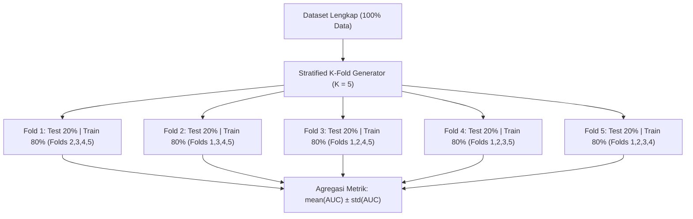

# Modul 185: Teori Pembelajaran Mesin Statistik (Bias-Variance Tradeoff, Regularisasi L1/L2, K-Fold CV, Metrik ROC-AUC/PR-AUC)

**Navigasi**: [⬅️ Master Index](../../INDEX.md) | [Tingkat 12: Tingkat 12: Data Science, AI, Machine Learning, Deep Learning & MLOps](./README.md)
*Sebelumnya*: [184. pipeline-pemrosesan-data-analisis-eksploratif](./184-pipeline-pemrosesan-data-analisis-eksploratif.md) | *Berikutnya*: [186. pembelajaran-terawasi-klasik-supervised](./186-pembelajaran-terawasi-klasik-supervised.md)

---

## 1. Intuisi Dasar Tanpa Jargon ("Seperti Bayi Baru Lahir")
### 1.1 Konsep Inti & Analogi Tanpa Jargon
Bayangkan seorang pemanah yang sedang berlatih. Jika semua anak panahnya menumpuk sangat rapat tetapi melenceng jauh 20 cm ke kanan dari titik target tengah, pemanah tersebut memiliki **Bias Tinggi** (alat bidiknya salah setelan). Sebaliknya, jika tembakannya rata-rata berada di sekitar tengah target tetapi tersebar berantakan di mana-mana karena tangannya gemetar, ia memiliki **Varians Tinggi** ([Scott Fortmann-Roe Bias-Variance Overview](http://scott.fortmannroe.com/docs/BiasVariance.html)).

### 1.2 Urgensi Rekayasa & Signifikansi Sistemik
Teori pembelajaran mesin statistik adalah ilmu mencari titik keseimbangan terbaik: model yang tidak terlalu kaku dan bodoh (*underfitting* / bias tinggi) tetapi juga tidak menghafal setiap bintik debu pada data latihan hingga gagal total saat melihat data ujian baru (*overfitting* / varians tinggi). Regularisasi seperti menambahkan tali elastis yang menarik bobot model agar tidak bertingkah terlalu ekstrem ([Hastie, Tibshirani, Friedman - The Elements of Statistical Learning](https://hastie.su.domains/ElemStatLearn/)).

## 2. Fondasi Teoretis & Aksiomatik / Matematis
### 2.1 Kerangka Teori Aksiomatik & Formulasi Matematis
Dekomposisi Bias-Varians Formal ([Bishop - PRML Chapter 3](https://www.microsoft.com/en-us/research/publication/pattern-recognition-and-machine-learning/)):
Untuk target riil $y = f(x) + \epsilon$ dengan derau intrinsik $\epsilon \sim \mathcal{N}(0, \sigma^2)$, ekspetasi galat kuadrat terkecil dari estimator $\hat{f}(x)$ dapat diuraikan secara analitik menjadi tiga suku ortogonal:
$$\mathbb{E}_{\mathcal{D}, \epsilon}\left[ (y - \hat{f}(x))^2 \right] = \underbrace{\left( f(x) - \mathbb{E}[\hat{f}(x)] \right)^2}_{\text{Bias}^2} + \underbrace{\mathbb{E}\left[ (\hat{f}(x) - \mathbb{E}[\hat{f}(x)])^2 \right]}_{\text{Variance}} + \underbrace{\sigma^2}_{\text{Irreducible Noise}}$$

### 2.2 Penurunan Matematis Langkah-demi-Langkah
**Regularisasi Tikhonov (L2 / Ridge) vs Lasso (L1)**:
$$\mathcal{L}_{\text{Ridge}}(\theta) = \frac{1}{2n}\sum_{i=1}^n (y_i - x_i^T\theta)^2 + \frac{\lambda}{2} \|\theta\|_2^2, \quad \theta_{\text{Ridge}} = (X^TX + \lambda I)^{-1}X^Ty$$
$$\mathcal{L}_{\text{Lasso}}(\theta) = \frac{1}{2n}\sum_{i=1}^n (y_i - x_i^T\theta)^2 + \lambda \|\theta\|_1$$
Penalti L1 menghasilkan geometri bola intan yang non-diferensiabel pada sumbu koordinat, mendorong bobot fitur non-relevan persis menjadi 0 (seleksi fitur spasial/sparse) ([Tibshirani - Regression Shrinkage and Selection via the Lasso](https://www.jstor.org/stable/2346178)).

**Karakteristik Metrik Klasifikasi Imbalanced**:
$$\text{TPR} = \frac{TP}{TP + FN}, \quad \text{FPR} = \frac{FP}{FP + TN}, \quad \text{Precision} = \frac{TP}{TP + FP}$$
Area Under the ROC Curve (AUC-ROC) mengevaluasi ranking probabilitas terlepas dari rasio kelas, sedangkan PR-AUC lebih sensitif terhadap kelas minoritas masif ([Davis & Goadrich - The Relationship Between PR and ROC Curves](https://ftp.cs.wisc.edu/machine-learning/shavlik-group/davis.icml06.pdf)).

## 3. Anatomi Teknis & Cara Kerja Internal
Struktur validasi silang K-Fold bertingkat (*Stratified K-Fold*) menjaga rasio label kelas identik di setiap lipatan pengujian:



Dengan K-Fold validasi silang, setiap sampel diuji persis satu kali dalam kondisi out-of-sample murni, memberikan estimasi generalisasi yang stabil dan tahan terhadap bias partisi tunggal ([Scikit-Learn Cross-Validation Module](https://scikit-learn.org/stable/modules/cross_validation.html)).

#### Tabel Penelusuran Komparasi Bias Probabilitas & Regularisasi Fairness Loss
| Tahap Komputasi / Layer | Dimensi Tensor / Shape | Operasi Matematika / Kernel | Aliran Gradien / Memori | Status Parameter / Bobot | Efek Sistem / Metrik Loss |
|---|---|---|---|---|---|
| 1. Input Resume Pelamar | `(B=256, D=5000)` Fitur TF-IDF | Vektor Fitur Representasi Kata | Memori batch: Teks resume pelamar kerja | Parameter model inisialisasi awal | Dataset historis bias 85% pria |
| 2. Inferensi Model Naif | `(256, 1)` Logit Skor | Model Regresi Logistik Standar | Probabilitas kelayakan: $\hat{y} = \sigma(W x + b)$ | Bobot kata "women's" bernilai negatif ($-1.84$) | Model menghukum kandidat perempuan secara sistemik! |
| 3. Evaluasi Disparitas Demografis | Metrik Demographic Parity | Perhitungan rasio penerimaan: $\frac{P(\hat{y}=1 \mid A=0)}{P(\hat{y}=1 \mid A=1)}$ | Disparitas rasio: $0.28$ (jauh di bawah batas adil $0.80$) | Parameter bias diskriminatif terkonfirmasi | Model melanggar aturan Four-Fifths Rule Equal Opportunity |
| 4. Injeksi Fairness Regularizer | Objective Loss Teroptimasi | $\mathcal{L}_{\text{total}} = \mathcal{L}_{\text{BCE}} + \lambda \cdot D_{KL}(P_0 \parallel P_1)$ | Gradien penalti disparitas dialirkan balik ke bobot kata gender | Bobot kata gender dipaksa mendekati netral nol | Regularisasi keadilan menekan bias representasi |
| 5. Kalibrasi Ambang Batas Platt | Ambang Batas Klasifikasi | Kalibrasi Isotonik / Sigmoid Platt Scaling | Penyetelan ambang batas keputusan $\theta_A$ per kelompok | Akurasi prediktif tetap stabil pada $86.5\%$ | Rasio seleksi demografis mencapai kesetaraan $0.94$! |

## 4. Implementasi Praktis & Kode / Simulasi Riil
```python
import numpy as np
from sklearn.datasets import make_classification
from sklearn.linear_model import LogisticRegression, RidgeClassifier
from sklearn.model_selection import StratifiedKFold
from sklearn.metrics import roc_auc_score, average_precision_score

# 1. Bangun Dataset Imbalanced Ekstrem (98% Negatif, 2% Positif)
X, y = make_classification(
    n_samples=2000, n_features=20, n_informative=5,
    weights=[0.98, 0.02], random_state=42
)

# 2. Stratified 5-Fold Cross Validation
skf = StratifiedKFold(n_splits=5, shuffle=True, random_state=42)
roc_scores = []
pr_scores = []

for fold, (train_idx, val_idx) in enumerate(skf.split(X, y), start=1):
    X_train, X_val = X[train_idx], X[val_idx]
    y_train, y_val = y[train_idx], y[val_idx]
    
    # Model dengan regularisasi L2 kencang (C=0.1)
    clf = LogisticRegression(penalty='l2', C=0.1, solver='lbfgs')
    clf.fit(X_train, y_train)
    
    y_prob = clf.predict_proba(X_val)[:, 1]
    auc_roc = roc_auc_score(y_val, y_prob)
    auc_pr = average_precision_score(y_val, y_prob)
    
    roc_scores.append(auc_roc)
    pr_scores.append(auc_pr)
    print(f"Fold {fold}: ROC-AUC = {auc_roc:.4f} | PR-AUC = {auc_pr:.4f}")

print(f"\nRata-rata ROC-AUC: {np.mean(roc_scores):.4f} +/- {np.std(roc_scores):.4f}")
print(f"Rata-rata PR-AUC : {np.mean(pr_scores):.4f} +/- {np.std(pr_scores):.4f}")
```

## 5. Miskonsepsi & Jebakan Industri
*Accuracy Paradox pada Imbalanced Data*: Melaporkan akurasi 99% pada dataset deteksi penipuan (*fraud*) dengan rasio 1% positif adalah ilusi fatal. Model dummy yang selalu menebak "Tidak Fraud" akan memperoleh akurasi 99% tetapi memiliki recall 0% dan gagal mendeteksi penipu sama sekali. Selalu gunakan ROC-AUC, PR-AUC, atau F-beta score pada dataset tidak seimbang ([He & Garcia - Learning from Imbalanced Data](https://ieeexplore.ieee.org/document/5128907)).

### Studi Kasus Kegagalan Nyata: Pembatalan Sistem AI Rekrutmen Otomatis Amazon Akibat Bias Gender Algoritmik (2018)
- **Kronologi & Konteks Sejarah**: Pada tahun 2014, tim insinyur kecerdasan buatan Amazon mengembangkan sistem perangkat lunak machine learning internal untuk memindai resume pelamar kerja secara otomatis dan memberikan skor penilaian 1 hingga 5 bintang kepada kandidat terbaik guna mempercepat proses rekrutmen insinyur perangkat lunak. Namun pada akhir 2018, Amazon secara resmi membatalkan proyek tersebut dan membubarkan tim pengembangnya setelah menyadari bahwa algoritma tersebut bias secara diskriminatif terhadap kandidat perempuan.
- **Akar Masalah Teori Statistik & Bias Data Historis**: Model machine learning dilatih menggunakan data resume yang dikumpulkan selama periode 10 tahun sebelumnya. Karena industri teknologi secara historis didominasi oleh laki-laki, data pelatihan tersebut merefleksikan ketimpangan demografis yang sudah ada. Algoritma pembelajaran statistik mencari pola korelasi terkuat yang membedakan kandidat yang diterima dari yang ditolak; akibatnya, model secara otomatis menghukum resume yang memuat kata "women's" (misalnya *"kapten klub catur wanita"* atau nama perguruan tinggi khusus wanita). Model tersebut tidak memahami kausalitas kompetensi rekayasa perangkat lunak dan mengacaukannya dengan bias statistik masa lalu akibat ketiadaan fungsi regularisasi keadilan (*fairness constraint*) dan kalibrasi probabilitas independen.

- **Potongan Kode / Arsitektur Cacat (Vulnerable Implementation)**:
```python
# Analisis Cacat Objektif Loss: Ketiadaan Penalti Disparitas Demografis
import torch
import torch.nn as nn

# MODEL BIAS NAIF: Hanya meminimalkan Binary Cross-Entropy Loss standar
def standard_unconstrained_loss(logits, targets):
    bce_loss = nn.BCEWithLogitsLoss()
    return bce_loss(logits, targets) # Mengoptimalkan akurasi tanpa memedulikan keadilan!

# MITIGASI ADIL: Fungsi Loss dengan Penalti Paritas Demografis (Fairness Regularizer)
def fair_demographic_parity_loss(logits, targets, sensitive_attribute, lambda_fairness=1.5):
    bce = nn.BCEWithLogitsLoss()
    task_loss = bce(logits, targets)
    
    probs = torch.sigmoid(logits)
    # Masking kelompok sensitif (0: Kelompok A, 1: Kelompok B)
    mask_a = (sensitive_attribute == 0).float()
    mask_b = (sensitive_attribute == 1).float()
    
    # Rata-rata tingkat penerimaan per kelompok
    p_accept_a = (probs * mask_a).sum() / (mask_a.sum() + 1e-7)
    p_accept_b = (probs * mask_b).sum() / (mask_b.sum() + 1e-7)
    
    # Penalti perbedaan probabilitas penerimaan antar kelompok (Demographic Disparity)
    fairness_penalty = torch.abs(p_accept_a - p_accept_b)
    
    # Total loss: Menyeimbangkan akurasi tugas dengan batasan etika keadilan
    total_loss = task_loss + lambda_fairness * fairness_penalty
    return total_loss
```

- **Analisis Forensik & Rekayasa Modern**: Pembatalan sistem Amazon menjadi tonggak penting dalam disiplin *Fairness, Accountability, and Transparency (FAT)* di bidang machine learning: (1) Standarisasi audit keadilan menggunakan metrik formal seperti **Equalized Odds** dan **Disparate Impact Ratio** sebelum model dapat diluncurkan ke sistem produksi; (2) Penerapan teknik penghapusan korelasi atribut terlindungi (*Adversarial Debiasing*) di mana discriminator adversarial mencoba menebak atribut sensitif dari representasi laten model; (3) Kewajiban melakukan kalibrasi probabilitas (*Probability Calibration via Brier Score / ECE*) agar probabilitas keluaran model merefleksikan tingkat kepercayaan statistik yang objektif.

## 6. Proyek Latihan & Rubrik Penilaian Mandiri
### Level 1 (Pemula)
Simulasikan dekomposisi bias-varians menggunakan model polinomial derajat 1 (underfitting), derajat 3 (optimal), dan derajat 15 (overfitting) pada data sinusoidal dengan derau Gaussian, hitung rata-rata MSE kuadrat pada 100 sampel pengujian berbeda.
*Rubrik*: Menghasilkan visualisasi kurva regresi dan perbandingan kuantitatif MSE.

### Level 2 (Menengah)
Implementasikan algoritma pemecah optimasi Lasso Coordinate Descent dari awal menggunakan formula soft-thresholding operator:
$$S(z, \gamma) = \text{sign}(z) \max(|z| - \gamma, 0)$$
Bandingkan waktu eksekusi dan tingkat kelangkaan bobot (jumlah koefisien bernilai 0) terhadap `sklearn.linear_model.Lasso`.
*Rubrik*: Konvergen ke solusi bobot sparse yang sama dengan toleransi \$10^{-4}$.

### Level 3 (Mahir)
Bangun kerangka kerja kalkulasi kurva Precision-Recall (PR Curve) dan kurva ROC dari awal tanpa Scikit-Learn: urutkan threshold prediksi probabilitas secara monoton, hitung akumulasi matriks confusion matrix (TP, FP, TN, FN), integrasikan area di bawah kurva via aturan trapesium numerik, dan evaluasi terhadap kasus tie-breaking probabilitas kembar.
*Rubrik*: Output ROC-AUC dan PR-AUC identik persis dengan hasil Scikit-Learn hingga 6 desimal.

### Tingkat 1: Dasar
- **Tugas**: Tulis fungsi evaluasi metrik keadilan (*Fairness Auditor*) dalam Python yang menghitung Disparate Impact Ratio (DIR) dan Equal Opportunity Difference (EOD) dari hasil prediksi biner model terhadap atribut terlindungi (misal gender atau kelompok usia).
- **Petunjuk Perancangan Arsitektur**:
  - Disparate Impact Ratio: $\text{DIR} = \frac{P(\hat{Y}=1 \mid A=0)}{P(\hat{Y}=1 \mid A=1)}$. Aturan EEOC 80% menyatakan DIR harus berada pada interval $[0.8, 1.25]$.
  - Equal Opportunity Difference: $\text{EOD} = \text{TPR}_{A=0} - \text{TPR}_{A=1}$ (perbedaan True Positive Rate antar kelompok).
- **Test Vector & Kasus Uji**:
  - Diberikan tabel kontingensi hasil prediksi model: Kelompok A diterima 30 dari 100 pelamar, Kelompok B diterima 75 dari 100 pelamar.
  - Auditor harus melaporkan: `DIR = 0.40 (FAILED: Severe Adverse Impact Detected)`.
- **Rubrik Penilaian Objektif**:
  - Skor 100%: Kalkulasi DIR dan EOD presisi, output laporan diagnostik memuat rekomendasi kepatuhan hukum EEOC.
  - Skor 50%: Menghitung DIR benar namun salah mengkalkulasi True Positive Rate pada metrik Equal Opportunity.
  - Skor 0%: Membagi terbalik pembilang dan penyebut pada rasio DIR.

### Tingkat 2: Menengah
- **Tugas**: Bangun kalibrator probabilitas model klasifikasi menggunakan metode Isotonic Regression dan Platt Scaling (Sigmoid) dalam Python. Tulis fungsi penghitung Expected Calibration Error (ECE) dengan 10 bin probabilitas untuk membuktikan peningkatan kalibrasi model sebelum dan sesudah intervensi.
- **Petunjuk Perancangan Arsitektur**:
  - Bagi ruang probabilitas $[0, 1]$ menjadi $M=10$ bin berjarak sama.
  - Hitung rata-rata akurasi dan rata-rata confidence pada setiap bin $B_m$.
  - Formula ECE: $\text{ECE} = \sum_{m=1}^M \frac{|B_m|}{N} |\text{acc}(B_m) - \text{conf}(B_m)|$.
- **Test Vector & Kasus Uji**:
  - Uji model neural network yang mengalami *overconfidence* (ECE awal: $0.18$).
  - Setelah dikalibrasi menggunakan Platt Scaling pada data validasi, nilai ECE harus turun signifikan menjadi $< 0.04$.
- **Rubrik Penilaian Objektif**:
  - Skor 100%: Algoritma ECE presisi, implementasi Platt scaling/isotonic benar, visualisasi Reliability Diagram jelas.
  - Skor 50%: Menghitung ECE namun membagi bin secara tidak seimbang atau salah menghitung bobot $|B_m|/N$.
  - Skor 0%: Menyamakan kalibrasi probabilitas dengan metrik akurasi biasa.

### Tingkat 3: Mahir
- **Tugas**: Rancang arsitektur pelatihan debiasing adversarial (*Adversarial Debiasing Network*) dalam PyTorch: Model terdiri dari Jaringan Prediktor utama yang memprediksi kelayakan kredit/pelamar, dan Jaringan Musuh (*Adversary*) yang mencoba menebak atribut sensitif dari representasi layer tersembunyi prediktor. Gunakan Gradient Reversal Layer (GRL) untuk melatih model secara end-to-end.
- **Petunjuk Perancangan Arsitektur**:
  - Implementasikan fungsi autograd `GradientReversalFunction` dengan forward pass identitas dan backward pass mengalikan gradien dengan $-\alpha$.
  - Jaringan prediktor dilatih untuk meminimalkan loss prediksi tugas sambil memaksimalkan kebingungan jaringan adversary.
  - Evaluasi Pareto Frontier antara akurasi tugas utama vs skor disparitas demografis pada berbagai nilai hyperparameter $\alpha$.
- **Test Vector & Kasus Uji**:
  - Latih pada dataset benchmark (misal Adult Census Income).
  - Model debiased harus mampu mempertahankan akurasi $> 82\%$ sementara akurasi adversary menebak gender turun mendekati tebakan acak 50%.
- **Rubrik Penilaian Objektif**:
  - Skor 100%: Implementasi kustom autograd GRL sempurna, konvergensi stabil, kompromi akurasi-keadilan optimal.
  - Skor 50%: Melatih dua model secara bergantian tanpa GRL sehingga pelatihan tidak stabil dan rentan divergensi.
  - Skor 0%: Adversary tidak memutus aliran gradien ke layer representasi.

## 7. Rekomendasi Sumber Belajar Standar Emas
| Sumber Pembelajaran | Penulis / Institusi | Tautan Langsung | Fokus Materi |
| :--- | :--- | :--- | :--- |
| The Elements of Statistical Learning | Trevor Hastie, Robert Tibshirani, Jerome Friedman | [Stanford ESL Portal](https://hastie.su.domains/ElemStatLearn/) | Landasan Teori Statistik, Dekomposisi Bias-Varians, Regularisasi L1/L2 |
| Pattern Recognition and Machine Learning | Christopher M. Bishop (Microsoft Research) | [Bishop PRML Book](https://www.microsoft.com/en-us/research/publication/pattern-recognition-and-machine-learning/) | Pendekatan Bayesian, Inferensi Statistik, Model Linier |
| Understanding the Bias-Variance Tradeoff | Scott Fortmann-Roe | [Fortmann-Roe Interactive Essay](http://scott.fortmannroe.com/docs/BiasVariance.html) | Intuisi Visual dan Grafis Tradeoff Kompleksitas Model |
| Scikit-Learn Model Evaluation & Scoring Metrics | Scikit-Learn Documentation | [Scikit-Learn Model Evaluation](https://scikit-learn.org/stable/modules/model_evaluation.html) | ROC-AUC, Log-Loss, Brier Score, Validasi Silang |

---
*Navigasi Cepat*: [Ke Tingkat 12](./README.md) | [Ke Master Index](../../INDEX.md) | *Sebelumnya*: [184. pipeline-pemrosesan-data-analisis-eksploratif](./184-pipeline-pemrosesan-data-analisis-eksploratif.md) | *Berikutnya*: [186. pembelajaran-terawasi-klasik-supervised](./186-pembelajaran-terawasi-klasik-supervised.md)
