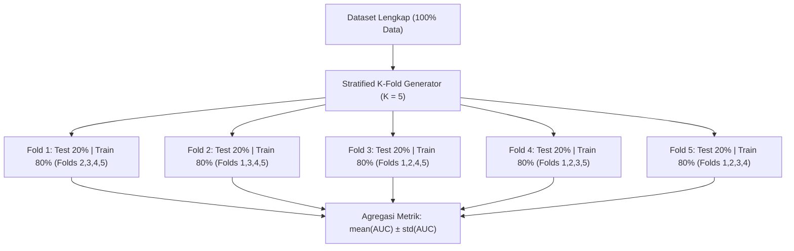

# Modul 185: Teori Pembelajaran Mesin Statistik (Bias-Variance Tradeoff, Regularisasi L1/L2, K-Fold CV, Metrik ROC-AUC/PR-AUC)

**Navigasi**: [⬅️ Master Index](../../INDEX.md) | [Tingkat 12: Tingkat 12: Data Science, AI, Machine Learning, Deep Learning & MLOps](./README.md)
*Sebelumnya*: [184. pipeline-pemrosesan-data-analisis-eksploratif](./184-pipeline-pemrosesan-data-analisis-eksploratif.md) | *Berikutnya*: [186. pembelajaran-terawasi-klasik-supervised](./186-pembelajaran-terawasi-klasik-supervised.md)

---

## 1. Intuisi Dasar Tanpa Jargon ("Seperti Bayi Baru Lahir")
Bayangkan seorang pemanah yang sedang berlatih. Jika semua anak panahnya menumpuk sangat rapat tetapi melenceng jauh 20 cm ke kanan dari titik target tengah, pemanah tersebut memiliki **Bias Tinggi** (alat bidiknya salah setelan). Sebaliknya, jika tembakannya rata-rata berada di sekitar tengah target tetapi tersebar berantakan di mana-mana karena tangannya gemetar, ia memiliki **Varians Tinggi** ([Scott Fortmann-Roe Bias-Variance Overview](http://scott.fortmannroe.com/docs/BiasVariance.html)).

Teori pembelajaran mesin statistik adalah ilmu mencari titik keseimbangan terbaik: model yang tidak terlalu kaku dan bodoh (*underfitting* / bias tinggi) tetapi juga tidak menghafal setiap bintik debu pada data latihan hingga gagal total saat melihat data ujian baru (*overfitting* / varians tinggi). Regularisasi seperti menambahkan tali elastis yang menarik bobot model agar tidak bertingkah terlalu ekstrem ([Hastie, Tibshirani, Friedman - The Elements of Statistical Learning](https://hastie.su.domains/ElemStatLearn/)).

## 2. Fondasi Teoretis & Aksiomatik / Matematis
Dekomposisi Bias-Varians Formal ([Bishop - PRML Chapter 3](https://www.microsoft.com/en-us/research/publication/pattern-recognition-and-machine-learning/)):
Untuk target riil $y = f(x) + \epsilon$ dengan derau intrinsik $\epsilon \sim \mathcal{N}(0, \sigma^2)$, ekspetasi galat kuadrat terkecil dari estimator $\hat{f}(x)$ dapat diuraikan secara analitik menjadi tiga suku ortogonal:
$$\mathbb{E}_{\mathcal{D}, \epsilon}\left[ (y - \hat{f}(x))^2 \right] = \underbrace{\left( f(x) - \mathbb{E}[\hat{f}(x)] \right)^2}_{\text{Bias}^2} + \underbrace{\mathbb{E}\left[ (\hat{f}(x) - \mathbb{E}[\hat{f}(x)])^2 \right]}_{\text{Variance}} + \underbrace{\sigma^2}_{\text{Irreducible Noise}}$$

**Regularisasi Tikhonov (L2 / Ridge) vs Lasso (L1)**:
$$\mathcal{L}_{\text{Ridge}}(\theta) = \frac{1}{2n}\sum_{i=1}^n (y_i - x_i^T\theta)^2 + \frac{\lambda}{2} \|\theta\|_2^2, \quad \theta_{\text{Ridge}} = (X^TX + \lambda I)^{-1}X^Ty$$
$$\mathcal{L}_{\text{Lasso}}(\theta) = \frac{1}{2n}\sum_{i=1}^n (y_i - x_i^T\theta)^2 + \lambda \|\theta\|_1$$
Penalti L1 menghasilkan geometri bola intan yang non-diferensiabel pada sumbu koordinat, mendorong bobot fitur non-relevan persis menjadi 0 (seleksi fitur spasial/sparse) ([Tibshirani - Regression Shrinkage and Selection via the Lasso](https://www.jstor.org/stable/2346178)).

**Karakteristik Metrik Klasifikasi Imbalanced**:
$$\text{TPR} = \frac{TP}{TP + FN}, \quad \text{FPR} = \frac{FP}{FP + TN}, \quad \text{Precision} = \frac{TP}{TP + FP}$$
Area Under the ROC Curve (AUC-ROC) mengevaluasi ranking probabilitas terlepas dari rasio kelas, sedangkan PR-AUC lebih sensitif terhadap kelas minoritas masif ([Davis & Goadrich - The Relationship Between PR and ROC Curves](https://ftp.cs.wisc.edu/machine-learning/shavlik-group/davis.icml06.pdf)).

## 3. Anatomi Teknis & Cara Kerja Internal
Struktur validasi silang K-Fold bertingkat (*Stratified K-Fold*) menjaga rasio label kelas identik di setiap lipatan pengujian:



Dengan K-Fold validasi silang, setiap sampel diuji persis satu kali dalam kondisi out-of-sample murni, memberikan estimasi generalisasi yang stabil dan tahan terhadap bias partisi tunggal ([Scikit-Learn Cross-Validation Module](https://scikit-learn.org/stable/modules/cross_validation.html)).

## 4. Implementasi Praktis & Kode / Simulasi Riil
```python
import numpy as np
from sklearn.datasets import make_classification
from sklearn.linear_model import LogisticRegression, RidgeClassifier
from sklearn.model_selection import StratifiedKFold
from sklearn.metrics import roc_auc_score, average_precision_score

# 1. Bangun Dataset Imbalanced Ekstrem (98% Negatif, 2% Positif)
X, y = make_classification(
    n_samples=2000, n_features=20, n_informative=5,
    weights=[0.98, 0.02], random_state=42
)

# 2. Stratified 5-Fold Cross Validation
skf = StratifiedKFold(n_splits=5, shuffle=True, random_state=42)
roc_scores = []
pr_scores = []

for fold, (train_idx, val_idx) in enumerate(skf.split(X, y), start=1):
    X_train, X_val = X[train_idx], X[val_idx]
    y_train, y_val = y[train_idx], y[val_idx]
    
    # Model dengan regularisasi L2 kencang (C=0.1)
    clf = LogisticRegression(penalty='l2', C=0.1, solver='lbfgs')
    clf.fit(X_train, y_train)
    
    y_prob = clf.predict_proba(X_val)[:, 1]
    auc_roc = roc_auc_score(y_val, y_prob)
    auc_pr = average_precision_score(y_val, y_prob)
    
    roc_scores.append(auc_roc)
    pr_scores.append(auc_pr)
    print(f"Fold {fold}: ROC-AUC = {auc_roc:.4f} | PR-AUC = {auc_pr:.4f}")

print(f"\nRata-rata ROC-AUC: {np.mean(roc_scores):.4f} +/- {np.std(roc_scores):.4f}")
print(f"Rata-rata PR-AUC : {np.mean(pr_scores):.4f} +/- {np.std(pr_scores):.4f}")
```

## 5. Miskonsepsi & Jebakan Industri
*Accuracy Paradox pada Imbalanced Data*: Melaporkan akurasi 99% pada dataset deteksi penipuan (*fraud*) dengan rasio 1% positif adalah ilusi fatal. Model dummy yang selalu menebak "Tidak Fraud" akan memperoleh akurasi 99% tetapi memiliki recall 0% dan gagal mendeteksi penipu sama sekali. Selalu gunakan ROC-AUC, PR-AUC, atau F-beta score pada dataset tidak seimbang ([He & Garcia - Learning from Imbalanced Data](https://ieeexplore.ieee.org/document/5128907)).

## 6. Proyek Latihan & Rubrik Penilaian Mandiri
### Level 1 (Pemula)
Simulasikan dekomposisi bias-varians menggunakan model polinomial derajat 1 (underfitting), derajat 3 (optimal), dan derajat 15 (overfitting) pada data sinusoidal dengan derau Gaussian, hitung rata-rata MSE kuadrat pada 100 sampel pengujian berbeda.
*Rubrik*: Menghasilkan visualisasi kurva regresi dan perbandingan kuantitatif MSE.

### Level 2 (Menengah)
Implementasikan algoritma pemecah optimasi Lasso Coordinate Descent dari awal menggunakan formula soft-thresholding operator:
$$S(z, \gamma) = \text{sign}(z) \max(|z| - \gamma, 0)$$
Bandingkan waktu eksekusi dan tingkat kelangkaan bobot (jumlah koefisien bernilai 0) terhadap `sklearn.linear_model.Lasso`.
*Rubrik*: Konvergen ke solusi bobot sparse yang sama dengan toleransi $10^{-4}$.

### Level 3 (Mahir)
Bangun kerangka kerja kalkulasi kurva Precision-Recall (PR Curve) dan kurva ROC dari awal tanpa Scikit-Learn: urutkan threshold prediksi probabilitas secara monoton, hitung akumulasi matriks confusion matrix (TP, FP, TN, FN), integrasikan area di bawah kurva via aturan trapesium numerik, dan evaluasi terhadap kasus tie-breaking probabilitas kembar.
*Rubrik*: Output ROC-AUC dan PR-AUC identik persis dengan hasil Scikit-Learn hingga 6 desimal.

## 7. Rekomendasi Sumber Belajar Standar Emas
| Sumber Pembelajaran | Penulis / Institusi | Tautan Langsung | Fokus Materi |
| :--- | :--- | :--- | :--- |
| The Elements of Statistical Learning | Trevor Hastie, Robert Tibshirani, Jerome Friedman | [Stanford ESL Portal](https://hastie.su.domains/ElemStatLearn/) | Landasan Teori Statistik, Dekomposisi Bias-Varians, Regularisasi L1/L2 |
| Pattern Recognition and Machine Learning | Christopher M. Bishop (Microsoft Research) | [Bishop PRML Book](https://www.microsoft.com/en-us/research/publication/pattern-recognition-and-machine-learning/) | Pendekatan Bayesian, Inferensi Statistik, Model Linier |
| Understanding the Bias-Variance Tradeoff | Scott Fortmann-Roe | [Fortmann-Roe Interactive Essay](http://scott.fortmannroe.com/docs/BiasVariance.html) | Intuisi Visual dan Grafis Tradeoff Kompleksitas Model |
| Scikit-Learn Model Evaluation & Scoring Metrics | Scikit-Learn Documentation | [Scikit-Learn Model Evaluation](https://scikit-learn.org/stable/modules/model_evaluation.html) | ROC-AUC, Log-Loss, Brier Score, Validasi Silang |

---
*Navigasi Cepat*: [Ke Tingkat 12](./README.md) | [Ke Master Index](../../INDEX.md) | *Sebelumnya*: [184. pipeline-pemrosesan-data-analisis-eksploratif](./184-pipeline-pemrosesan-data-analisis-eksploratif.md) | *Berikutnya*: [186. pembelajaran-terawasi-klasik-supervised](./186-pembelajaran-terawasi-klasik-supervised.md)
