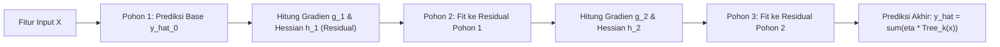

# Modul 186: Pembelajaran Terawasi Klasik / Supervised (Regresi Linier OLS, Logistik, Naive Bayes, SVM Kernel RBF, XGBoost)

**Navigasi**: [⬅️ Master Index](../../INDEX.md) | [Tingkat 12: Tingkat 12: Data Science, AI, Machine Learning, Deep Learning & MLOps](./README.md)
*Sebelumnya*: [185. teori-pembelajaran-mesin-statistik](./185-teori-pembelajaran-mesin-statistik.md) | *Berikutnya*: [187. pembelajaran-tak-terawasi-unsupervised](./187-pembelajaran-tak-terawasi-unsupervised.md)

---

## 1. Intuisi Dasar Tanpa Jargon ("Seperti Bayi Baru Lahir")
Pembelajaran terawasi (*supervised learning*) seperti seorang murid yang belajar mempersiapkan ujian nasional dengan memegang buku kumpulan soal beserta kunci jawabannya. Setiap kali murid mencoba mengerjakan soal (membuat prediksi), ia langsung mencocokkan jawabannya dengan kunci jawaban asli (label kebenaran atau *ground truth*). Jika ia salah, ia menghitung seberapa jauh jawabannya melenceng dan memperbaiki cara berpikirnya ([Scikit-Learn Supervised Learning Guide](https://scikit-learn.org/stable/supervised_learning.html)).

Ada dua jenis tugas utama di sini:
1. **Regresi**: Memprediksi angka kontinu (seperti memprediksi harga rumah atau suhu udara).
2. **Klasifikasi**: Memprediksi kategori diskret (seperti mendeteksi apakah email adalah spam atau bukan spam, atau apakah foto rontgen menunjukkan tumor ganas atau jinak) ([Vapnik - The Nature of Statistical Learning Theory](https://link.springer.com/book/10.1007/978-1-4757-3264-1)).

## 2. Fondasi Teoretis & Aksiomatik / Matematis
Formulasi Matematis Pilar Algoritma Klasik:

1. **Regresi Linier Ordinary Least Squares (OLS)**:
Mencari vektor bobot $\beta$ yang meminimalkan residual kuadrat:
$$\min_{\beta} \|y - X\beta\|_2^2 \implies \hat{\beta} = (X^T X)^{-1} X^T y$$
Di bawah Asumsi Teorema Gauss-Markov (homoskedastisitas, eksogenitas ketat), estimator OLS adalah *Best Linear Unbiased Estimator* (BLUE) ([Greene - Econometric Analysis](https://www.pearson.com/en-us/subject-catalog/p/econometric-analysis/P200000003333)).

2. **Regresi Logistik & Optimasi Maksimum Likelihood (MLE)**:
Memodelkan log-odds probabilitas kelas Bernoulli:
$$P(y=1 \mid x) = \sigma(w^T x) = \frac{1}{1 + e^{-w^T x}}$$
Log-Likelihood Loss (Binary Cross-Entropy):
$$\ell(w) = -\sum_{i=1}^n \left[ y_i \ln \sigma(w^T x_i) + (1 - y_i) \ln(1 - \sigma(w^T x_i)) \right]$$

3. **Support Vector Machines (SVM) & Kernel Trick**:
Memaksimalkan margin geometris hiperbidang pemisah $\frac{2}{\|w\|}$:
$$\min_{w, b, \xi} \frac{1}{2} \|w\|^2 + C \sum_{i=1}^n \xi_i \quad \text{s.t.} \quad y_i(w^T \phi(x_i) + b) \ge 1 - \xi_i, \quad \xi_i \ge 0$$
Kernel Radial Basis Function (RBF) memproyeksikan data ke ruang Hilbert berdimensi tak hingga:
$$K(x, x') = \exp(-\gamma \|x - x'\|^2)$$

4. **Extreme Gradient Boosting (XGBoost)**:
Optimasi objektif Taylor orde kedua pada pohon keputusan $f_t$:
$$\mathcal{L}^{(t)} \approx \sum_{i=1}^n \left[ g_i f_t(x_i) + \frac{1}{2} h_i f_t^2(x_i) \right] + \Omega(f_t)$$
Di mana $g_i = \partial_{\hat{y}^{(t-1)}} l(y_i, \hat{y}^{(t-1)})$ dan $h_i = \partial^2_{\hat{y}^{(t-1)}} l(y_i, \hat{y}^{(t-1)})$ ([Chen & Guestrin - XGBoost: A Scalable Tree Boosting System](https://arxiv.org/abs/1603.02754)).

## 3. Anatomi Teknis & Cara Kerja Internal
Arsitektur pohon keputusan ensemble Gradient Boosted Trees (XGBoost/LightGBM) membangun pohon secara aditif bertahap:



Setiap pohon baru dilatih bukan untuk memprediksi label asli secara langsung, melainkan mengoreksi galat (residual gradien orde satu dan dua) dari kombinasi linear pohon-pohon sebelumnya ([Friedman - Greedy Function Approximation: A Gradient Boosting Machine](https://www.jstor.org/stable/2699986)).

## 4. Implementasi Praktis & Kode / Simulasi Riil
```python
import numpy as np
from sklearn.datasets import make_moons
from sklearn.model_selection import train_test_split
from sklearn.svm import SVC
from sklearn.metrics import accuracy_score
import xgboost as xgb

# 1. Dataset Non-Linier Kompleks (Two Moons)
X, y = make_moons(n_samples=1500, noise=0.25, random_state=42)
X_train, X_test, y_train, y_test = train_test_split(X, y, test_size=0.3, random_state=42)

# 2. Support Vector Classifier dengan Kernel RBF
svm_model = SVC(kernel='rbf', C=1.0, gamma='scale')
svm_model.fit(X_train, y_train)
svm_preds = svm_model.predict(X_test)
print(f"Akurasi SVM RBF Kernel : {accuracy_score(y_test, svm_preds)*100:.2f}%")

# 3. XGBoost Classifier dengan Regularisasi L2
xgb_model = xgb.XGBClassifier(
    n_estimators=100,
    max_depth=4,
    learning_rate=0.05,
    reg_lambda=1.0,
    eval_metric='logloss',
    random_state=42
)
xgb_model.fit(X_train, y_train)
xgb_preds = xgb_model.predict(X_test)
print(f"Akurasi XGBoost Classifier: {accuracy_score(y_test, xgb_preds)*100:.2f}%")

# Verifikasi Vektor Pendukung SVM
print(f"Jumlah Support Vectors SVM: {len(svm_model.support_vectors_)}")
```

## 5. Miskonsepsi & Jebakan Industri
*Multikolinearitas Tinggi pada Regresi OLS*: Ketika dua atau lebih variabel independen memiliki korelasi linier sangat tinggi ($r > 0.95$), matriks gramian $X^T X$ mendekati kondisi singular (matriks ill-conditioned). Hal ini menyebabkan nilai determinan mendekati 0, nilai varians koefisien meledak tak hingga, dan tanda koefisien menjadi tidak stabil atau berlawanan secara intuitif. Gunakan *Variance Inflation Factor* (VIF) atau regularisasi Ridge/Lasso untuk menstabilkan estimasi ([Belsley et al. - Conditioning Diagnostics](https://onlinelibrary.wiley.com/doi/book/10.1002/0471725153)).

## 6. Proyek Latihan & Rubrik Penilaian Mandiri
### Level 1 (Pemula)
Terapkan model Regresi Logistik dan Naive Bayes Gaussian pada dataset iris/wine, hitung Confusion Matrix dan metrik F1-Score menggunakan validasi silang 5-fold.
*Rubrik*: Output mencakup matriks kebingungan dan metrik presisi/recall per kelas.

### Level 2 (Menengah)
Bangun implementasi algoritma Regresi Linier OLS dari nol menggunakan dekomposisi QR matriks ($X = QR$) untuk menghindari invers langsung matriks $X^TX$ yang rawan galat numerik:
$$\beta = R^{-1} Q^T y$$
Buktikan bahwa dekomposisi QR memiliki batas galat numerik (*condition number*) $\kappa(R) = \kappa(X)$ dibandingkan $\kappa(X^T X) = \kappa(X)^2$.
*Rubrik*: Kode teruji terhadap matriks dengan condition number besar ($> 10^8$).

### Level 3 (Mahir)
Implementasikan algoritma pemisah pohon keputusan CART (*Classification and Regression Trees*) dari nol: buat fungsi kalkulasi Gini Impurity terbaik untuk pembagian biner fitur kontinu, bangun struktur pohon rekursif dengan kriteria stopping (kedalaman maksimum, minimal sampel), dan bandingkan hasil prediksi terhadap `sklearn.tree.DecisionTreeClassifier`.
*Rubrik*: Menghasilkan struktur pohon yang dapat divisualisasikan dan menghasilkan pohon identik.

## 7. Rekomendasi Sumber Belajar Standar Emas
| Sumber Pembelajaran | Penulis / Institusi | Tautan Langsung | Fokus Materi |
| :--- | :--- | :--- | :--- |
| XGBoost: A Scalable Tree Boosting System | Tianqi Chen & Carlos Guestrin (ACM KDD) | [XGBoost Paper on arXiv](https://arxiv.org/abs/1603.02754) | Formulasi Hessian, Algoritma Weighted Quantile Sketch |
| Scikit-Learn Supervised Algorithms Manual | Scikit-Learn Core Team | [Scikit-Learn Supervised Learning](https://scikit-learn.org/stable/supervised_learning.html) | SVM Dual Formulation, OLS, Regresi Logistik |
| Support-Vector Networks | Corinna Cortes & Vladimir Vapnik | [Springer Machine Learning Journal](https://link.springer.com/article/10.1007/BF00994018) | Fondasi Asli SVM, Soft-Margin, Kernel Primitif |
| Greedy Function Approximation: A Gradient Boosting Machine | Jerome H. Friedman | [Annals of Statistics](https://www.jstor.org/stable/2699986) | Landasan Teoretis Gradient Boosting Trees Asli |

---
*Navigasi Cepat*: [Ke Tingkat 12](./README.md) | [Ke Master Index](../../INDEX.md) | *Sebelumnya*: [185. teori-pembelajaran-mesin-statistik](./185-teori-pembelajaran-mesin-statistik.md) | *Berikutnya*: [187. pembelajaran-tak-terawasi-unsupervised](./187-pembelajaran-tak-terawasi-unsupervised.md)
