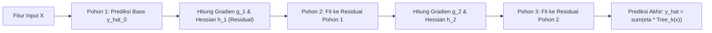

# Modul 186: Pembelajaran Terawasi Klasik / Supervised (Regresi Linier OLS, Logistik, Naive Bayes, SVM Kernel RBF, XGBoost)

**Navigasi**: [⬅️ Master Index](../../INDEX.md) | [Tingkat 12: Tingkat 12: Data Science, AI, Machine Learning, Deep Learning & MLOps](./README.md)
*Sebelumnya*: [185. teori-pembelajaran-mesin-statistik](./185-teori-pembelajaran-mesin-statistik.md) | *Berikutnya*: [187. pembelajaran-tak-terawasi-unsupervised](./187-pembelajaran-tak-terawasi-unsupervised.md)

---

## 1. Intuisi Dasar Tanpa Jargon ("Seperti Bayi Baru Lahir")
### 1.1 Konsep Inti & Analogi Tanpa Jargon
Pembelajaran terawasi (*supervised learning*) seperti seorang murid yang belajar mempersiapkan ujian nasional dengan memegang buku kumpulan soal beserta kunci jawabannya. Setiap kali murid mencoba mengerjakan soal (membuat prediksi), ia langsung mencocokkan jawabannya dengan kunci jawaban asli (label kebenaran atau *ground truth*). Jika ia salah, ia menghitung seberapa jauh jawabannya melenceng dan memperbaiki cara berpikirnya ([Scikit-Learn Supervised Learning Guide](https://scikit-learn.org/stable/supervised_learning.html)).

### 1.2 Urgensi Rekayasa & Signifikansi Sistemik
Ada dua jenis tugas utama di sini:
1. **Regresi**: Memprediksi angka kontinu (seperti memprediksi harga rumah atau suhu udara).
2. **Klasifikasi**: Memprediksi kategori diskret (seperti mendeteksi apakah email adalah spam atau bukan spam, atau apakah foto rontgen menunjukkan tumor ganas atau jinak) ([Vapnik - The Nature of Statistical Learning Theory](https://link.springer.com/book/10.1007/978-1-4757-3264-1)).

## 2. Fondasi Teoretis & Aksiomatik / Matematis
### 2.1 Kerangka Teori Aksiomatik & Formulasi Matematis
Formulasi Matematis Pilar Algoritma Klasik:

### 2.2 Penurunan Matematis Langkah-demi-Langkah
1. **Regresi Linier Ordinary Least Squares (OLS)**:
Mencari vektor bobot $\beta$ yang meminimalkan residual kuadrat:
$$\min_{\beta} \|y - X\beta\|_2^2 \implies \hat{\beta} = (X^T X)^{-1} X^T y$$
Di bawah Asumsi Teorema Gauss-Markov (homoskedastisitas, eksogenitas ketat), estimator OLS adalah *Best Linear Unbiased Estimator* (BLUE) ([Greene - Econometric Analysis](https://www.pearson.com/en-us/subject-catalog/p/econometric-analysis/P200000003333)).

2. **Regresi Logistik & Optimasi Maksimum Likelihood (MLE)**:
Memodelkan log-odds probabilitas kelas Bernoulli:
$$P(y=1 \mid x) = \sigma(w^T x) = \frac{1}{1 + e^{-w^T x}}$$
Log-Likelihood Loss (Binary Cross-Entropy):
$$\ell(w) = -\sum_{i=1}^n \left[ y_i \ln \sigma(w^T x_i) + (1 - y_i) \ln(1 - \sigma(w^T x_i)) \right]$$

3. **Support Vector Machines (SVM) & Kernel Trick**:
Memaksimalkan margin geometris hiperbidang pemisah $\frac{2}{\|w\|}$:
$$\min_{w, b, \xi} \frac{1}{2} \|w\|^2 + C \sum_{i=1}^n \xi_i \quad \text{s.t.} \quad y_i(w^T \phi(x_i) + b) \ge 1 - \xi_i, \quad \xi_i \ge 0$$
Kernel Radial Basis Function (RBF) memproyeksikan data ke ruang Hilbert berdimensi tak hingga:
$$K(x, x') = \exp(-\gamma \|x - x'\|^2)$$

4. **Extreme Gradient Boosting (XGBoost)**:
Optimasi objektif Taylor orde kedua pada pohon keputusan $f_t$:
$$\mathcal{L}^{(t)} \approx \sum_{i=1}^n \left[ g_i f_t(x_i) + \frac{1}{2} h_i f_t^2(x_i) \right] + \Omega(f_t)$$
Di mana $g_i = \partial_{\hat{y}^{(t-1)}} l(y_i, \hat{y}^{(t-1)})$ dan $h_i = \partial^2_{\hat{y}^{(t-1)}} l(y_i, \hat{y}^{(t-1)})$ ([Chen & Guestrin - XGBoost: A Scalable Tree Boosting System](https://arxiv.org/abs/1603.02754)).

## 3. Anatomi Teknis & Cara Kerja Internal
Arsitektur pohon keputusan ensemble Gradient Boosted Trees (XGBoost/LightGBM) membangun pohon secara aditif bertahap:



Setiap pohon baru dilatih bukan untuk memprediksi label asli secara langsung, melainkan mengoreksi galat (residual gradien orde satu dan dua) dari kombinasi linear pohon-pohon sebelumnya ([Friedman - Greedy Function Approximation: A Gradient Boosting Machine](https://www.jstor.org/stable/2699986)).

#### Tabel Penelusuran Regresi Otoregresif Penetapan Harga Zillow & Kegagalan Rezim Volatilitas
| Tahap Komputasi / Layer | Dimensi Tensor / Shape | Operasi Matematika / Kernel | Aliran Gradien / Memori | Status Parameter / Bobot | Efek Sistem / Metrik Loss |
|---|---|---|---|---|---|
| 1. Ingest Data Properti Pasar | `(B=5000, D=35)` Fitur Properti | Nilai Historis Penjualan Rumah 12 Bulan | Buffer data transaksi real-estate | Parameter regresi inisialisasi awal | Asumsi pasar: Tren kenaikan harga stabil $+1.2\%$ per bulan |
| 2. Inferensi Algoritma Zestimate | `(5000, 1)` Nilai Taksiran Harga | Model Ensembel Gradient Boosted Trees | Model memprediksi nilai jual 3 bulan ke depan | Prediksi optimis berdasarkan tren tertinggal (*lagged*) | Nilai prediksi rata-rata: $\$420.000$ per unit properti |
| 3. Pembelian Otomatis Zillow Offers | Saldo Kas Korporat (\$ Miliar) | Eksekusi Penawaran Beli Kas Tunai | Zillow membeli ribuan rumah pada harga taksiran algoritma | Akumulasi inventaris: 27.000 unit rumah di neraca | Sistem otomatis membeli tanpa verifikasi inspeksi manusia |
| 4. Pergeseran Rezim Pasar (Shift) | Pasar Real Estate AS H2 2021 | Kenaikan suku bunga The Fed + perlambatan permintaan | Harga pasar riil anjlok $-8\%$ di bawah harga beli Zillow | Algoritma lambat menyesuaikan karena moving average tertinggal | Zillow menahan inventaris rumah yang terdepresiasi harian |
| 5. Likuidasi Darurat & Write-Down | Laporan Keuangan Zillow Q3 2021 | Penjualan Rugi Massal ke Investor Institusi | Kerugian write-down aset properti tercatat: $\$540.000.000$ | Unit bisnis Zillow Offers ditutup permanen | PHK massal 25% karyawan dan kejatuhan harga saham Zillow! |

## 4. Implementasi Praktis & Kode / Simulasi Riil
```python
import numpy as np
from sklearn.datasets import make_moons
from sklearn.model_selection import train_test_split
from sklearn.svm import SVC
from sklearn.metrics import accuracy_score
import xgboost as xgb

# 1. Dataset Non-Linier Kompleks (Two Moons)
X, y = make_moons(n_samples=1500, noise=0.25, random_state=42)
X_train, X_test, y_train, y_test = train_test_split(X, y, test_size=0.3, random_state=42)

# 2. Support Vector Classifier dengan Kernel RBF
svm_model = SVC(kernel='rbf', C=1.0, gamma='scale')
svm_model.fit(X_train, y_train)
svm_preds = svm_model.predict(X_test)
print(f"Akurasi SVM RBF Kernel : {accuracy_score(y_test, svm_preds)*100:.2f}%")

# 3. XGBoost Classifier dengan Regularisasi L2
xgb_model = xgb.XGBClassifier(
    n_estimators=100,
    max_depth=4,
    learning_rate=0.05,
    reg_lambda=1.0,
    eval_metric='logloss',
    random_state=42
)
xgb_model.fit(X_train, y_train)
xgb_preds = xgb_model.predict(X_test)
print(f"Akurasi XGBoost Classifier: {accuracy_score(y_test, xgb_preds)*100:.2f}%")

# Verifikasi Vektor Pendukung SVM
print(f"Jumlah Support Vectors SVM: {len(svm_model.support_vectors_)}")
```

## 5. Miskonsepsi & Jebakan Industri
*Multikolinearitas Tinggi pada Regresi OLS*: Ketika dua atau lebih variabel independen memiliki korelasi linier sangat tinggi ($r > 0.95$), matriks gramian $X^T X$ mendekati kondisi singular (matriks ill-conditioned). Hal ini menyebabkan nilai determinan mendekati 0, nilai varians koefisien meledak tak hingga, dan tanda koefisien menjadi tidak stabil atau berlawanan secara intuitif. Gunakan *Variance Inflation Factor* (VIF) atau regularisasi Ridge/Lasso untuk menstabilkan estimasi ([Belsley et al. - Conditioning Diagnostics](https://onlinelibrary.wiley.com/doi/book/10.1002/0471725153)).

### Studi Kasus Kegagalan Nyata: Keruntuhan Bisnis Zillow Offers ($500 Juta Write-Down) Akibat Algoritma Regresi yang Terjebak Lag Pasar (2021)
- **Kronologi & Konteks Sejarah**: Pada November 2021, perusahaan raksasa teknologi real-estate Zillow mengumumkan penghentian permanen unit bisnis pembelian rumah otomatis mereka (*Zillow Offers*), melakukan pemutusan hubungan kerja terhadap 25% tenaga kerjanya (sekitar 2.000 karyawan), dan mencatat kerugian penghapusan nilai aset (*write-down*) lebih dari $500 Juta.
- **Akar Masalah Rekayasa Model Regresi & Dinamika Pasar**: Bisnis Zillow Offers bertaruh pada algoritma pembelajaran mesin terawasi (*Supervised Learning*) mereka, *Zestimate*, untuk memprediksi harga rumah di masa depan dan secara otomatis mengajukan penawaran pembelian tunai langsung kepada pemilik rumah (*iBuying*). Algoritma tersebut memiliki dua cacat fatal: (1) Mengandalkan fitur rata-rata tertinggal (*lagged moving averages*) yang bekerja sangat baik saat pasar sedang naik secara mulus, namun mengalami kebutaan (*regime blindness*) ketika dinamika pasar berbalik arah; (2) Kurangnya pemodelan ketidakpastian (*Prediction Intervals / Uncertainty Estimation*) dan ambang batas risiko ekstrim. Di tengah volatilitas pasar dan disrupsi rantai pasok renovasi rumah pasca-pandemi, algoritma terus-menerus menawar harga rumah di atas nilai pasar wajar (*winner's curse*), menumpuk puluhan ribu rumah yang terpaksa dijual rugi secara obral.

- **Potongan Kode / Arsitektur Cacat (Vulnerable Implementation)**:
```python
# Analisis Cacat Pemodelan: Regresi Deterministik Tanpa Estimasi Ketidakpastian
import numpy as np

# MODEL CACAT ZILLOW: Regresi titik deterministik tanpa batas interval ketidakpastian
def naive_house_price_bid(model, property_features):
    # Model hanya menghasilkan satu angka prediksi titik (Point Estimate)
    predicted_price = model.predict(property_features)
    
    # CACAT FATAL: Menawar harga beli agresif tanpa memperhitungkan volatilitas pasar!
    bid_offer = predicted_price * 0.985 # Margin tipis 1.5%
    return bid_offer # Jika pasar turun 5%, perusahaan mengalami kerugian instan!

# MITIGASI AMAN: Regresi Kuantil (Quantile Regression) dengan Estimasi Risiko Volatilitas
def robust_risk_aware_bid(model_lower_q10, model_median_q50, model_upper_q90, property_features, market_volatility):
    # Mengestimasi rentang distribusi probabilitas harga rumah
    lower_bound_p10 = model_lower_q10.predict(property_features)
    median_price = model_median_q50.predict(property_features)
    upper_bound_p90 = model_upper_q90.predict(property_features)
    
    uncertainty_spread = upper_bound_p90 - lower_bound_p10
    
    # Jika ketidakpastian model tinggi atau volatilitas pasar naik, kurangi agresivitas penawaran:
    if uncertainty_spread / median_price > 0.12 or market_volatility > 0.15:
        # Gunakan batas bawah konservatif untuk melindungi neraca perusahaan
        safe_bid = lower_bound_p10 * 0.92
    else:
        safe_bid = median_price * 0.95
        
    return safe_bid
```

- **Analisis Forensik & Rekayasa Modern**: Bencana Zillow mendefinisikan ulang penerapan supervised learning pada keputusan bisnis berisiko tinggi: (1) Larangan menggunakan prediksi titik deterministik (*point estimates*) untuk transaksi modal bernilai jutaan dolar tanpa menyertakan **Conformal Prediction** atau interval kuantil keyakinan ($10\%$ s/d $90\%$); (2) Penerapan **Human-in-the-Loop Guardrails** di mana deviasi harga di atas batas volatilitas tertentu wajib diverifikasi oleh appraiser manusia berlisensi; (3) Integrasi pengujian ketahanan stres (*Stress-Testing & Scenario Analysis*) terhadap pembalikan rezim ekonomi (suku bunga tinggi, penurunan likuiditas pasar).

## 6. Proyek Latihan & Rubrik Penilaian Mandiri
### Level 1 (Pemula)
Terapkan model Regresi Logistik dan Naive Bayes Gaussian pada dataset iris/wine, hitung Confusion Matrix dan metrik F1-Score menggunakan validasi silang 5-fold.
*Rubrik*: Output mencakup matriks kebingungan dan metrik presisi/recall per kelas.

### Level 2 (Menengah)
Bangun implementasi algoritma Regresi Linier OLS dari nol menggunakan dekomposisi QR matriks ($X = QR$) untuk menghindari invers langsung matriks $X^TX$ yang rawan galat numerik:
$$\beta = R^{-1} Q^T y$$
Buktikan bahwa dekomposisi QR memiliki batas galat numerik (*condition number*) $\kappa(R) = \kappa(X)$ dibandingkan $\kappa(X^T X) = \kappa(X)^2$.
*Rubrik*: Kode teruji terhadap matriks dengan condition number besar ($> 10^8$).

### Level 3 (Mahir)
Implementasikan algoritma pemisah pohon keputusan CART (*Classification and Regression Trees*) dari nol: buat fungsi kalkulasi Gini Impurity terbaik untuk pembagian biner fitur kontinu, bangun struktur pohon rekursif dengan kriteria stopping (kedalaman maksimum, minimal sampel), dan bandingkan hasil prediksi terhadap `sklearn.tree.DecisionTreeClassifier`.
*Rubrik*: Menghasilkan struktur pohon yang dapat divisualisasikan dan menghasilkan pohon identik.

### Tingkat 1: Dasar
- **Tugas**: Implementasikan algoritma Regresi Linier Berganda menggunakan persamaan normal tertutup (*Closed-Form Normal Equation*) $\theta = (X^T X)^{-1} X^T y$ dari nol dalam Python menggunakan NumPy (tanpa pustaka machine learning pihak ketiga), dan tambahkan regularisasi Ridge (L2) $\theta = (X^T X + \lambda I)^{-1} X^T y$.
- **Petunjuk Perancangan Arsitektur**:
  - Tambahkan kolom bias 1 pada matriks $X$: `X = np.c_[np.ones(X.shape[0]), X]`.
  - Pastikan matriks identitas $I$ pada regularisasi Ridge tidak menambahkan penalti pada koefisien intercept bias $\theta_0$ (`I[0, 0] = 0`).
- **Test Vector & Kasus Uji**:
  - Diberikan dataset sintetis dengan multikolinearitas tinggi antar fitur ($X_2 \approx 2 X_1$).
  - Persamaan normal standar akan mengalami instabilitas numerik (determinan mendekati nol), sedangkan Regresi Ridge dengan $\lambda = 1.0$ menghasilkan bobot koefisien yang stabil dan teratur.
- **Rubrik Penilaian Objektif**:
  - Skor 100%: Implementasi matriks presisi, penanganan pengecualian bias pada regularisasi Ridge tepat, verifikasi numerik akurat.
  - Skor 50%: Benar untuk persamaan normal standar namun salah menerapkan matriks identitas pada Ridge.
  - Skor 0%: Menggunakan loop iterasi alih-alih operasi aljabar linier matriks.

### Tingkat 2: Menengah
- **Tugas**: Bangun model Regresi Kuantil (*Quantile Regression*) menggunakan algoritma Gradient Boosting atau Pinball Loss function dalam Python untuk memprediksi kuantil ke-10 ($q=0.10$), ke-50 (median), dan ke-90 ($q=0.90$) dari data dengan heteroskedastisitas tinggi (varians membesar seiring nilai fitur).
- **Petunjuk Perancangan Arsitektur**:
  - Pinball Loss: $\mathcal{L}_q(y, \hat{y}) = \max(q(y - \hat{y}), (1-q)(\hat{y} - y))$.
  - Latih 3 model terpisah untuk masing-masing kuantil atau model neural network multi-output.
  - Terapkan mekanisme perbaikan pembalikan kuantil (*Quantile Crossing Correction*) untuk memastikan $\hat{y}_{0.10} \le \hat{y}_{0.50} \le \hat{y}_{0.90}$ untuk setiap sampel.
- **Test Vector & Kasus Uji**:
  - Evaluasi pada dataset heteroskedastis: Sekitar $\approx 80\%$ sampel data uji harus berada di dalam interval $[\hat{y}_{0.10}, \hat{y}_{0.90}]$.
  - Tidak boleh ada satu pun sampel data uji yang memiliki $\hat{y}_{0.10} > \hat{y}_{0.90}$.
- **Rubrik Penilaian Objektif**:
  - Skor 100%: Implementasi pinball loss akurat, penanganan quantile crossing efektif, cakupan interval empiris sesuai target.
  - Skor 50%: Model kuantil bekerja namun mengabaikan fenomena quantile crossing di mana batas bawah melampaui batas atas.
  - Skor 0%: Menggunakan loss MSE standar untuk semua kuantil.

### Tingkat 3: Mahir
- **Tugas**: Rancang sistem Conformal Prediction bebas distribusi (*Distribution-Free Conformal Prediction*) dalam Python: Bangun pembungkus (wrapper) di atas model regresi apa pun yang menjamin secara matematis bahwa interval prediksi yang dihasilkan memiliki cakupan kebenaran $1 - \alpha$ (misal $95\%$) pada data masa depan tanpa asumsi distribusi Gaussian.
- **Petunjuk Perancangan Arsitektur**:
  - Bagi data menjadi Data Latih (Train) dan Data Kalibrasi (Calibration).
  - Latih model pada Train. Hitung skor non-konformitas pada data kalibrasi: $s_i = |y_i - \hat{y}_i|$.
  - Hitung kuantil konformal: $\hat{q} = \text{Quantile}\left(s, \frac{\lceil (n+1)(1-\alpha) \rceil}{n}\right)$.
  - Interval prediksi untuk data baru: $[\hat{y}_{\text{new}} - \hat{q}, \hat{y}_{\text{new}} + \hat{q}]$.
- **Test Vector & Kasus Uji**:
  - Uji pada 5 dataset real-estate dengan distribusi skewed dan pencilan berat dengan target coverage $95\%$ ($\alpha = 0.05$).
  - Evaluasi empiris pada data uji independen: Tingkat cakupan observasi nyata yang masuk ke dalam interval harus berada pada rentang $[94.5\%, 95.5\%]$.
- **Rubrik Penilaian Objektif**:
  - Skor 100%: Pembuktian matematis cakupan konformal terbukti empiris, penanganan finite-sample correction presisi.
  - Skor 50%: Mengasumsikan batas $\pm 1.96 \sigma$ Gaussian biasa alih-alih Conformal Prediction non-parametrik.
  - Skor 0%: Menghitung kuantil kalibrasi pada data latih alih-alih set kalibrasi terisolasi.

## 7. Rekomendasi Sumber Belajar Standar Emas
| Sumber Pembelajaran | Penulis / Institusi | Tautan Langsung | Fokus Materi |
| :--- | :--- | :--- | :--- |
| XGBoost: A Scalable Tree Boosting System | Tianqi Chen & Carlos Guestrin (ACM KDD) | [XGBoost Paper on arXiv](https://arxiv.org/abs/1603.02754) | Formulasi Hessian, Algoritma Weighted Quantile Sketch |
| Scikit-Learn Supervised Algorithms Manual | Scikit-Learn Core Team | [Scikit-Learn Supervised Learning](https://scikit-learn.org/stable/supervised_learning.html) | SVM Dual Formulation, OLS, Regresi Logistik |
| Support-Vector Networks | Corinna Cortes & Vladimir Vapnik | [Springer Machine Learning Journal](https://link.springer.com/article/10.1007/BF00994018) | Fondasi Asli SVM, Soft-Margin, Kernel Primitif |
| Greedy Function Approximation: A Gradient Boosting Machine | Jerome H. Friedman | [Annals of Statistics](https://www.jstor.org/stable/2699986) | Landasan Teoretis Gradient Boosting Trees Asli |

---
*Navigasi Cepat*: [Ke Tingkat 12](./README.md) | [Ke Master Index](../../INDEX.md) | *Sebelumnya*: [185. teori-pembelajaran-mesin-statistik](./185-teori-pembelajaran-mesin-statistik.md) | *Berikutnya*: [187. pembelajaran-tak-terawasi-unsupervised](./187-pembelajaran-tak-terawasi-unsupervised.md)
