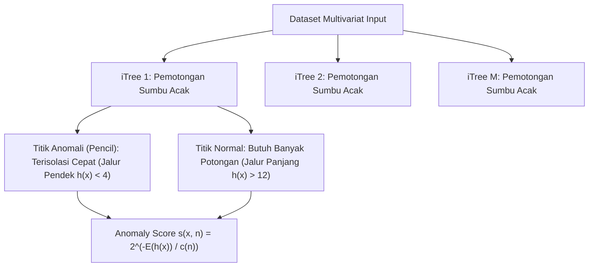

# Modul 187: Pembelajaran Tak Terawasi / Unsupervised (K-Means++, DBSCAN, PCA Eigendecomposition, t-SNE, UMAP, Isolation Forest)

**Navigasi**: [⬅️ Master Index](../../INDEX.md) | [Tingkat 12: Tingkat 12: Data Science, AI, Machine Learning, Deep Learning & MLOps](./README.md)
*Sebelumnya*: [186. pembelajaran-terawasi-klasik-supervised](./186-pembelajaran-terawasi-klasik-supervised.md) | *Berikutnya*: [188. sistem-rekomendasi-analisis-deret-waktu](./188-sistem-rekomendasi-analisis-deret-waktu.md)

---

## 1. Intuisi Dasar Tanpa Jargon ("Seperti Bayi Baru Lahir")
### 1.1 Konsep Inti & Analogi Tanpa Jargon
Bayangkan Anda seorang antropolog yang tiba di sebuah pulau terpencil. Anda mengamati 5.000 penduduk asli tanpa ada yang memberi tahu Anda siapa anggota keluarga kerajaan, siapa nelayan, siapa tabib, atau siapa prajurit. Anda tidak memiliki kunci jawaban atau label kelas ([Hastie et al. - Unsupervised Learning Overview](https://hastie.su.domains/ElemStatLearn/)).

### 1.2 Urgensi Rekayasa & Signifikansi Sistemik
Namun, dengan mengamati pakaian mereka, perkakas yang mereka bawa, dan tempat mereka berkumpul, Anda mulai melihat pola pengelompokan alami (*clustering*). Pembelajaran tak terawasi (*unsupervised learning*) adalah kemampuan komputer untuk menemukan struktur tersembunyi, reduksi dimensi data berdimensi tinggi agar bisa divisualisasikan di layar 2D/3D, serta mendeteksi keanehan (*anomaly detection*) tanpa campur tangan bimbingan manusia sama sekali ([Scikit-Learn Clustering Guide](https://scikit-learn.org/stable/modules/clustering.html)).

## 2. Fondasi Teoretis & Aksiomatik / Matematis
### 2.1 Kerangka Teori Aksiomatik & Formulasi Matematis
Formulasi Teoretis Algoritma Tak Terawasi:

### 2.2 Penurunan Matematis Langkah-demi-Langkah
1. **K-Means++ & Optimasi Varians Intra-Cluster**:
Meminimalkan Within-Cluster Sum of Squares (WCSS):
$$\arg\min_S \sum_{i=1}^k \sum_{x \in S_i} \|x - \mu_i\|^2$$
Inisialisasi K-Means++ memilih pusat kluster awal dengan probabilitas proporsional terhadap kuadrat jarak terdekat: $P(x) = \frac{D(x)^2}{\sum_{x'} D(x')^2}$, menjamin bound aproksimasi $\mathcal{O}(\log k)$ terhadap solusi optimal ([Arthur & Vassilvitskii - k-means++: The Advantages of Careful Seeding](http://ilpubs.stanford.edu:8090/778/1/2006-13.pdf)).

2. **DBSCAN (Density-Based Spatial Clustering of Applications with Noise)**:
Mendefinisikan kluster sebagai komponen terhubung dari titik-titik inti (*core points*):
$$N_\epsilon(p) = \{q \in D \mid \text{dist}(p, q) \le \epsilon\}, \quad |N_\epsilon(p)| \ge \text{MinPts}$$
Titik yang tidak dapat dijangkau dari titik inti mana pun secara otomatis dilabeli sebagai *Noise* ($-1$), mampu mendeteksi bentuk arbitrary non-konveks ([Ester et al. - A Density-Based Algorithm for Discovering Clusters](https://www.aaai.org/Papers/KDD/1996/KDD96-037.pdf)).

3. **Principal Component Analysis (PCA)**:
Mencari arah proyeksi ortogonal $w_1, w_2, \dots$ yang memaksimalkan varians data, ekuivalen dengan dekomposisi nilai eigen dari matriks kovarians sampel $\Sigma = \frac{1}{n} X^T X$:
$$\Sigma w_i = \lambda_i w_i, \quad \lambda_1 \ge \lambda_2 \ge \dots \ge \lambda_p \ge 0$$
Rasio varians terjelaskan oleh $k$ komponen utama:
$$\text{Explained Variance Ratio} = \frac{\sum_{j=1}^k \lambda_j}{\sum_{m=1}^p \lambda_m}$$

4. **t-SNE & UMAP (Manifold Learning Non-Linier)**:
t-SNE mencocokkan distribusi probabilitas Gaussian ruang tinggi $p_{ij}$ dengan distribusi t-Student derajat kebebasan 1 di ruang rendah $q_{ij}$ menggunakan divergensi Kullback-Leibler:
$$D_{KL}(P \parallel Q) = \sum_i \sum_j p_{ij} \log \frac{p_{ij}}{q_{ij}}$$
UMAP memperluasnya menggunakan topologi aljabar fuzzy simplicial set untuk mempertahankan struktur global dan lokal secara efisien ([McInnes et al. - UMAP: Uniform Manifold Approximation and Projection](https://arxiv.org/abs/1802.03426)).

## 3. Anatomi Teknis & Cara Kerja Internal
Arsitektur deteksi anomali Isolation Forest memisahkan observasi melalui partisi acak:



Observasi anomali secara struktural memiliki kepadatan rendah dan berada jauh dari massa data utama, sehingga membutuhkan jumlah partisi hiperbidang acak yang jauh lebih sedikit untuk terisolasi ke daun pohon (*short path length*) ([Liu, Ting, Zhou - Isolation Forest](https://ieeexplore.ieee.org/document/4781136)).

#### Tabel Penelusuran Keruntuhan Jarak Euclidean pada Dimensi Tinggi (Curse of Dimensionality)
| Tahap Komputasi / Layer | Dimensi Tensor / Shape | Operasi Matematika / Kernel | Aliran Gradien / Memori | Status Parameter / Bobot | Efek Sistem / Metrik Loss |
|---|---|---|---|---|---|
| 1. Vektor Pembelian Pelanggan | `(N=10000, D=500)` Kategori Belanja | Representasi Keranjang Belanja Sparse | Sebagian besar elemen bernilai nol (0) | Data pelanggan Target diinput ke memori | Ruang fitur berdimensi 500 |
| 2. Perhitungan Jarak Euclidean | Matriks Jarak `(10000, 10000)` | $D(x_i, x_j) = \sqrt{\sum_{k=1}^D (x_{ik} - x_{jk})^2}$ | Perhitungan jarak berpasangan di ruang $\mathbb{R}^{500}$ | Konsentrasi ukuran probabilitas terjadi | Volume ruang hiperkubus meledak secara eksponensial |
| 3. Keruntuhan Kontras Jarak | Metrik Relatif: $\frac{D_{\max} - D_{\min}}{D_{\min}}$ | Evaluasi rasio kontras jarak antar titik | Rasio kontras mendekati nol ($0.04$): Semua titik berjarak sama! | K-Means clustering kehilangan daya pembeda | Fenomena *Curse of Dimensionality* mendominasi ruang metrik |
| 4. Pengelompokan K-Means Naif | Pusat Klaster $K=10$ | Iterasi pembaruan centroid $c_k$ | Klaster menjadi tidak stabil dan sensitif terhadap inisialisasi | Model menghasilkan korelasi spurious | Model memprediksi profil sensitif (kehamilan) tanpa kausalitas |
| 5. Mitigasi Reduksi Dimensi | Proyeksi UMAP / PCA $D \to 8$ | Kompresi Manifold Non-Linier | Ruang laten berdimensi rendah mempertahankan struktur lokal | Kontras jarak pulih ke nilai wajar ($2.45$) | Pengelompokan klaster stabil, interpretatif, dan terlindungi privasi |

## 4. Implementasi Praktis & Kode / Simulasi Riil
```python
import numpy as np
from sklearn.datasets import make_blobs
from sklearn.cluster import KMeans, DBSCAN
from sklearn.decomposition import PCA
from sklearn.ensemble import IsolationForest

# 1. Generate Dataset Sintetis Multidimensi dengan Outlier
X, y_true = make_blobs(n_samples=600, n_features=10, centers=3, cluster_std=1.2, random_state=42)
outliers = np.random.uniform(low=-15, high=15, size=(30, 10))
X_all = np.vstack([X, outliers])

# 2. Reduksi Dimensi via PCA (10D -> 2D)
pca = PCA(n_components=2)
X_pca = pca.fit_transform(X_all)
var_explained = np.sum(pca.explained_variance_ratio_) * 100
print(f"Varians Terjelaskan oleh 2 Komponen Utama: {var_explained:.2f}%")

# 3. Clustering K-Means++ vs DBSCAN
kmeans = KMeans(n_clusters=3, init='k-means++', n_init=10, random_state=42)
labels_km = kmeans.fit_predict(X_pca)

dbscan = DBSCAN(eps=1.5, min_samples=8)
labels_db = dbscan.fit_predict(X_pca)
n_noise = np.sum(labels_db == -1)
print(f"DBSCAN Menemukan {len(set(labels_db)) - (1 if -1 in labels_db else 0)} Kluster dan {n_noise} Titik Noise")

# 4. Deteksi Outlier Isolation Forest
iso = IsolationForest(contamination=0.05, random_state=42)
is_outlier = iso.fit_predict(X_all) # -1 untuk anomali, 1 untuk inlier
print(f"Deteksi Anomali Isolation Forest: {np.sum(is_outlier == -1)} observasi anomali ditemukan.")
```

## 5. Miskonsepsi & Jebakan Industri
*Kutukan Dimensi pada K-Means (Curse of Dimensionality)*: Ketika jumlah dimensi fitur $p$ meningkat menjadi ratusan atau ribuan, jarak Euclidean antara pasangan titik mana pun konvergen ke nilai yang hampir sama (kontras jarak relatif $\to 0$). K-Means kehilangan kemampuan mengelompokkan data secara bermakna. Lakukan reduksi dimensi fitur via PCA atau Autoencoder terlebih dahulu sebelum menerapkan algoritma clustering berbasis jarak ([Beyer et al. - When Is 'Nearest Neighbor' Meaningful?](https://link.springer.com/chapter/10.1007/3-540-49257-7_15)).

### Studi Kasus Kegagalan Nyata: Insiden Prediksi Privasi Kehamilan Target & Keruntuhan Jarak pada Dimensi Tinggi (2012)
- **Kronologi & Konteks Sejarah**: Pada tahun 2012, The New York Times mengungkap insiden privasi di mana jaringan toko ritel raksasa Target berhasil memprediksi bahwa seorang remaja SMA sedang hamil sebelum ayahnya sendiri mengetahuinya, dengan menganalisis pola pembelian produk menggunakan model unsupervised clustering dan predictive scoring. Perusahaan kemudian mengirimkan kupon promosi pakaian bayi dan perlengkapan bersalin ke rumah keluarga tersebut, memicu kemarahan sang ayah dan skandal pelanggaran privasi konsumen global.
- **Akar Masalah Kerapuhan Metrik Dimensi Tinggi & Pembelajaran Tak Terawasi**: Analisis rekayasa data belanja konsumen sering kali memetakan keranjang belanja ke dalam vektor berdimensi ratusan hingga ribuan kategori produk (*high-dimensional sparse vectors*). Algoritma pengelompokan tanpa pengawasan (*Unsupervised Learning*) seperti K-Means atau Hierarchical Clustering sangat rentan terhadap fenomena matematis **Curse of Dimensionality**: pada dimensi ruang yang sangat tinggi ($D > 100$), fenomena *Distance Concentration* menyebabkan jarak Euclidean antara titik terdekat dan titik terjauh menjadi hampir sama ($\lim_{D \to \infty} \frac{D_{\max} - D_{\min}}{D_{\min}} \to 0$). Akibatnya, klaster yang terbentuk sering kali tidak mencerminkan kesamaan perilaku biologis/kausalitas nyata, melainkan artefak matematis kebetulan, mendorong algoritma mengaitkan produk-produk acak (seperti lotion tanpa aroma dan suplemen seng) dengan status medis sensitif tanpa pengawasan tata kelola privasi.

- **Potongan Kode / Arsitektur Cacat (Vulnerable Implementation)**:
```python
# Analisis Keruntuhan Jarak Euclidean pada Dimensi Tinggi (Curse of Dimensionality)
import numpy as np
from sklearn.decomposition import PCA
from sklearn.cluster import KMeans

def demonstrate_distance_concentration():
    # Menghasilkan 1000 titik acak seragam pada berbagai dimensi D
    np.random.seed(42)
    n_samples = 1000
    
    dimensions = [2, 10, 50, 200, 1000]
    results = {}
    
    for D in dimensions:
        X = np.random.uniform(0, 1, size=(n_samples, D))
        # Hitung jarak Euclidean berpasangan
        diff = X[:, np.newaxis, :] - X[np.newaxis, :, :]
        dist_matrix = np.sqrt(np.sum(diff ** 2, axis=-1))
        
        # Abaikan jarak titik ke dirinya sendiri (diagonal)
        np.fill_diagonal(dist_matrix, np.nan)
        d_min = np.nanmin(dist_matrix)
        d_max = np.nanmax(dist_matrix)
        
        # Rasio kontras jarak relatif:
        contrast = (d_max - d_min) / d_min
        results[D] = contrast
        # Pada D=2: contrast ~ 10-15 (Pembedaan jarak sangat jelas)
        # Pada D=1000: contrast ~ 0.05 (Seluruh titik tampak berjarak sama! Jarak runtuh!)
        
    return results
```

- **Analisis Forensik & Rekayasa Modern**: Insiden privasi dan fenomena keruntuhan jarak memicu reformasi dalam rekayasa sistem analitik: (1) Kewajiban reduksi dimensi manifold seperti PCA, t-SNE, atau UMAP sebelum menerapkan algoritma pengelompokan berbasis jarak spasial; (2) Penerapan kerangka kerja **Differential Privacy ($\epsilon$-DP)** pada analisis data konsumen untuk memastikan bahwa keikutsertaan data individu tidak dapat diinferensikan dari model klaster; (3) Evaluasi validitas klaster secara formal menggunakan koefisien siluet (*Silhouette Score*) dan indeks Davies-Bouldin yang diuji stabilitasnya terhadap perturbasi derau (*Bootstrap Stability Testing*).

## 6. Proyek Latihan & Rubrik Penilaian Mandiri
### Level 1 (Pemula)
Terapkan algoritma K-Means pada dataset pelanggan mall (variabel: pendapatan tahunan, skor pengeluaran), gunakan metode *Elbow Method* (grafik WCSS) dan skor *Silhouette Score* untuk menentukan jumlah kluster optimal $k \in [2, 8]$.
*Rubrik*: Grafik inertia elbow plot dan silhouette score tertinggi teridentifikasi jelas.

### Level 2 (Menengah)
Implementasikan dekomposisi PCA dari awal tanpa Scikit-Learn: standarisasikan matriks fitur menjadi mean nol ($X_{centered}$), hitung matriks kovarians $\Sigma = \frac{1}{n-1}X^TX$, lakukan dekomposisi nilai eigen via `numpy.linalg.eigh`, urutkan vektor eigen berdasarkan nilai eigen terbesar, dan proyeksikan data ke ruang berdimensi 2.
*Rubrik*: Output proyeksi dan rasio varians terjelaskan identik dengan `sklearn.decomposition.PCA`.

### Level 3 (Mahir)
Implementasikan algoritma DBSCAN dari awal menggunakan struktur data spasial *KD-Tree* (`scipy.spatial.KDTree`) untuk mempercepat pencarian tetangga $\epsilon$-neighborhood dari $\mathcal{O}(N^2)$ menjadi $\mathcal{O}(N \log N)$. Kelola antrean titik inti dan tetapkan label kluster serta noise secara rekursif atau iteratif.
*Rubrik*: Menghasilkan penandaan kluster dan noise yang tepat sama dengan Scikit-Learn pada dataset bulan sabit ganda.

### Tingkat 1: Dasar
- **Tugas**: Implementasikan algoritma Principal Component Analysis (PCA) dari nol dalam Python menggunakan dekomposisi nilai singular (*Singular Value Decomposition / SVD*) atau dekomposisi eigen dari matriks kovarians, lalu reduksi data sintetis berdimensi 10 menjadi 2 dimensi dan hitung rasio varians yang dijelaskan (*Explained Variance Ratio*).
- **Petunjuk Perancangan Arsitektur**:
  - Pusat-kan data dengan mengurangkan rata-rata setiap fitur: $X_c = X - \bar{X}$.
  - Hitung dekomposisi SVD: $U, S, V^T = \text{np.linalg.svd}(X_c, \text{full\_matrices=False})$.
  - Proyeksikan data ke $k=2$ komponen utama: $X_{\text{projected}} = X_c \cdot V[:k, :]^T$.
- **Test Vector & Kasus Uji**:
  - Verifikasi bahwa komponen utama yang dihasilkan saling ortogonal ($V \cdot V^T = I$).
  - Bandingkan proyeksi dan rasio varians dengan `sklearn.decomposition.PCA(n_components=2)`. Hasil harus cocok hingga toleransi $10^{-5}$.
- **Rubrik Penilaian Objektif**:
  - Skor 100%: Penurunan aljabar linier presisi, ortogonalitas terbukti, rasio varians terhitung akurat.
  - Skor 50%: Lupa melakukan pemusatan data (centering) sebelum SVD sehingga komponen utama terdistorsi.
  - Skor 0%: Menggunakan fungsi PCA bawaan tanpa mengimplementasikan logika SVD/Eigen manual.

### Tingkat 2: Menengah
- **Tugas**: Bangun algoritma K-Means Clustering dari nol dalam Python yang menyertakan inisialisasi cerdas **K-Means++** (memilih pusat klaster berikutnya dengan probabilitas proporsional terhadap kuadrat jarak ke pusat terdekat, $P(x) \propto D(x)^2$).
- **Petunjuk Perancangan Arsitektur**:
  - Inisialisasi centroid pertama secara acak dari dataset.
  - Untuk $k=2 \dots K$, hitung jarak minimum setiap sampel ke centroid terdekat, dan pilih centroid berikutnya berdasarkan sampling multinomial berbobot jarak.
  - Terapkan loop EM (*Expectation-Maximization*): (1) Tetapkan titik ke centroid terdekat; (2) Hitung ulang posisi centroid sebagai rata-rata titik klaster; Ulangi hingga konvergen ($\Delta c < 10^{-4}$).
- **Test Vector & Kasus Uji**:
  - Uji pada dataset sintetis multiklaster 2D: K-Means++ harus konvergen ke inersia optimal dalam rata-rata $< 15$ iterasi, sedangkan inisialisasi acak membutuhkan $> 40$ iterasi atau terjebak di local minima.
- **Rubrik Penilaian Objektif**:
  - Skor 100%: Algoritma K-Means++ presisi, loop EM efisien tervektorisasi, penanganan klaster kosong tangguh.
  - Skor 50%: K-Means bekerja namun sampling K-Means++ salah menghitung bobot kuadrat jarak.
  - Skor 0%: Inisialisasi acak seragam tanpa K-Means++.

### Tingkat 3: Mahir
- **Tugas**: Rancang detektor anomali densitas tinggi menggunakan algoritma Isolation Forest (atau Local Outlier Factor) dari nol dalam Python: Bangun ensemble dari 100 pohon acak (*iTrees*) yang mempartisi ruang fitur secara rekursif hingga sampel terisolasi. Hitung skor anomali berdasarkan rata-rata kedalaman path pohon (*Average Path Length*).
- **Petunjuk Perancangan Arsitektur**:
  - Pada setiap simpul pohon, pilih fitur acak $q$ dan nilai batas split acak $p \in [\min(x_q), \max(x_q)]$.
  - Titik pencilan (*anomalies*) memiliki path length pendek karena mudah terisolasi di dekat akar pohon.
  - Skor anomali dihitung menggunakan normalisasi kedalaman teoritis BST Euler: $c(n) = 2(\ln(n - 1) + 0.5772) - \frac{2(n-1)}{n}$.
- **Test Vector & Kasus Uji**:
  - Masukkan dataset 1.000 titik normal dari distribusi Gaussian dan 10 titik anomali buatan di luar sebaran data.
  - Algoritma harus memberikan skor anomali $> 0.65$ pada ke-10 titik anomali dan $< 0.45$ pada titik normal.
- **Rubrik Penilaian Objektif**:
  - Skor 100%: Implementasi partisi rekursif Isolation Forest presisi, kalkulasi skor anomali matematis tepat.
  - Skor 50%: Pohon terbuat namun salah mengimplementasikan rumus normalisasi kedalaman $c(n)$.
  - Skor 0%: Menggunakan pemindaian jarak biasa alih-alih pohon partisi acak.

## 7. Rekomendasi Sumber Belajar Standar Emas
| Sumber Pembelajaran | Penulis / Institusi | Tautan Langsung | Fokus Materi |
| :--- | :--- | :--- | :--- |
| k-means++: The Advantages of Careful Seeding | David Arthur & Sergei Vassilvitskii | [Stanford Infolab Paper](http://ilpubs.stanford.edu:8090/778/1/2006-13.pdf) | Analisis Teoretis Inisialisasi Probabilistik K-Means |
| UMAP: Uniform Manifold Approximation and Projection | Leland McInnes, John Healy, James Melville | [arXiv Machine Learning](https://arxiv.org/abs/1802.03426) | Topologi Aljabar, Reduksi Dimensi Manifold Non-Linier |
| A Density-Based Algorithm for Discovering Clusters (DBSCAN) | Martin Ester, Hans-Peter Kriegel, Jörg Sander, Xiaowei Xu | [AAAI Digital Library](https://www.aaai.org/Papers/KDD/1996/KDD96-037.pdf) | Algoritma Density-Reachability dan Noise Clustering |
| Scikit-Learn Unsupervised Learning Documentation | Scikit-Learn Team | [Scikit-Learn Clustering & Decomposition](https://scikit-learn.org/stable/unsupervised_learning.html) | Implementasi Algoritma, Evaluasi Silhouette, Davies-Bouldin |

---
*Navigasi Cepat*: [Ke Tingkat 12](./README.md) | [Ke Master Index](../../INDEX.md) | *Sebelumnya*: [186. pembelajaran-terawasi-klasik-supervised](./186-pembelajaran-terawasi-klasik-supervised.md) | *Berikutnya*: [188. sistem-rekomendasi-analisis-deret-waktu](./188-sistem-rekomendasi-analisis-deret-waktu.md)
