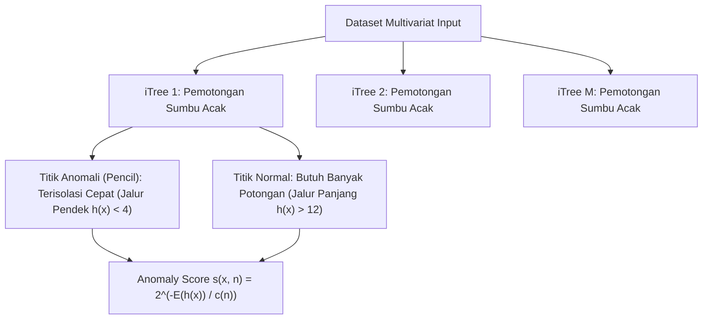

# Modul 187: Pembelajaran Tak Terawasi / Unsupervised (K-Means++, DBSCAN, PCA Eigendecomposition, t-SNE, UMAP, Isolation Forest)

**Navigasi**: [⬅️ Master Index](../../INDEX.md) | [Tingkat 12: Tingkat 12: Data Science, AI, Machine Learning, Deep Learning & MLOps](./README.md)
*Sebelumnya*: [186. pembelajaran-terawasi-klasik-supervised](./186-pembelajaran-terawasi-klasik-supervised.md) | *Berikutnya*: [188. sistem-rekomendasi-analisis-deret-waktu](./188-sistem-rekomendasi-analisis-deret-waktu.md)

---

## 1. Intuisi Dasar Tanpa Jargon ("Seperti Bayi Baru Lahir")
Bayangkan Anda seorang antropolog yang tiba di sebuah pulau terpencil. Anda mengamati 5.000 penduduk asli tanpa ada yang memberi tahu Anda siapa anggota keluarga kerajaan, siapa nelayan, siapa tabib, atau siapa prajurit. Anda tidak memiliki kunci jawaban atau label kelas ([Hastie et al. - Unsupervised Learning Overview](https://hastie.su.domains/ElemStatLearn/)).

Namun, dengan mengamati pakaian mereka, perkakas yang mereka bawa, dan tempat mereka berkumpul, Anda mulai melihat pola pengelompokan alami (*clustering*). Pembelajaran tak terawasi (*unsupervised learning*) adalah kemampuan komputer untuk menemukan struktur tersembunyi, reduksi dimensi data berdimensi tinggi agar bisa divisualisasikan di layar 2D/3D, serta mendeteksi keanehan (*anomaly detection*) tanpa campur tangan bimbingan manusia sama sekali ([Scikit-Learn Clustering Guide](https://scikit-learn.org/stable/modules/clustering.html)).

## 2. Fondasi Teoretis & Aksiomatik / Matematis
Formulasi Teoretis Algoritma Tak Terawasi:

1. **K-Means++ & Optimasi Varians Intra-Cluster**:
Meminimalkan Within-Cluster Sum of Squares (WCSS):
$$\arg\min_S \sum_{i=1}^k \sum_{x \in S_i} \|x - \mu_i\|^2$$
Inisialisasi K-Means++ memilih pusat kluster awal dengan probabilitas proporsional terhadap kuadrat jarak terdekat: $P(x) = \frac{D(x)^2}{\sum_{x'} D(x')^2}$, menjamin bound aproksimasi $\mathcal{O}(\log k)$ terhadap solusi optimal ([Arthur & Vassilvitskii - k-means++: The Advantages of Careful Seeding](http://ilpubs.stanford.edu:8090/778/1/2006-13.pdf)).

2. **DBSCAN (Density-Based Spatial Clustering of Applications with Noise)**:
Mendefinisikan kluster sebagai komponen terhubung dari titik-titik inti (*core points*):
$$N_\epsilon(p) = \{q \in D \mid \text{dist}(p, q) \le \epsilon\}, \quad |N_\epsilon(p)| \ge \text{MinPts}$$
Titik yang tidak dapat dijangkau dari titik inti mana pun secara otomatis dilabeli sebagai *Noise* ($-1$), mampu mendeteksi bentuk arbitrary non-konveks ([Ester et al. - A Density-Based Algorithm for Discovering Clusters](https://www.aaai.org/Papers/KDD/1996/KDD96-037.pdf)).

3. **Principal Component Analysis (PCA)**:
Mencari arah proyeksi ortogonal $w_1, w_2, \dots$ yang memaksimalkan varians data, ekuivalen dengan dekomposisi nilai eigen dari matriks kovarians sampel $\Sigma = \frac{1}{n} X^T X$:
$$\Sigma w_i = \lambda_i w_i, \quad \lambda_1 \ge \lambda_2 \ge \dots \ge \lambda_p \ge 0$$
Rasio varians terjelaskan oleh $k$ komponen utama:
$$\text{Explained Variance Ratio} = \frac{\sum_{j=1}^k \lambda_j}{\sum_{m=1}^p \lambda_m}$$

4. **t-SNE & UMAP (Manifold Learning Non-Linier)**:
t-SNE mencocokkan distribusi probabilitas Gaussian ruang tinggi $p_{ij}$ dengan distribusi t-Student derajat kebebasan 1 di ruang rendah $q_{ij}$ menggunakan divergensi Kullback-Leibler:
$$D_{KL}(P \parallel Q) = \sum_i \sum_j p_{ij} \log \frac{p_{ij}}{q_{ij}}$$
UMAP memperluasnya menggunakan topologi aljabar fuzzy simplicial set untuk mempertahankan struktur global dan lokal secara efisien ([McInnes et al. - UMAP: Uniform Manifold Approximation and Projection](https://arxiv.org/abs/1802.03426)).

## 3. Anatomi Teknis & Cara Kerja Internal
Arsitektur deteksi anomali Isolation Forest memisahkan observasi melalui partisi acak:



Observasi anomali secara struktural memiliki kepadatan rendah dan berada jauh dari massa data utama, sehingga membutuhkan jumlah partisi hiperbidang acak yang jauh lebih sedikit untuk terisolasi ke daun pohon (*short path length*) ([Liu, Ting, Zhou - Isolation Forest](https://ieeexplore.ieee.org/document/4781136)).

## 4. Implementasi Praktis & Kode / Simulasi Riil
```python
import numpy as np
from sklearn.datasets import make_blobs
from sklearn.cluster import KMeans, DBSCAN
from sklearn.decomposition import PCA
from sklearn.ensemble import IsolationForest

# 1. Generate Dataset Sintetis Multidimensi dengan Outlier
X, y_true = make_blobs(n_samples=600, n_features=10, centers=3, cluster_std=1.2, random_state=42)
outliers = np.random.uniform(low=-15, high=15, size=(30, 10))
X_all = np.vstack([X, outliers])

# 2. Reduksi Dimensi via PCA (10D -> 2D)
pca = PCA(n_components=2)
X_pca = pca.fit_transform(X_all)
var_explained = np.sum(pca.explained_variance_ratio_) * 100
print(f"Varians Terjelaskan oleh 2 Komponen Utama: {var_explained:.2f}%")

# 3. Clustering K-Means++ vs DBSCAN
kmeans = KMeans(n_clusters=3, init='k-means++', n_init=10, random_state=42)
labels_km = kmeans.fit_predict(X_pca)

dbscan = DBSCAN(eps=1.5, min_samples=8)
labels_db = dbscan.fit_predict(X_pca)
n_noise = np.sum(labels_db == -1)
print(f"DBSCAN Menemukan {len(set(labels_db)) - (1 if -1 in labels_db else 0)} Kluster dan {n_noise} Titik Noise")

# 4. Deteksi Outlier Isolation Forest
iso = IsolationForest(contamination=0.05, random_state=42)
is_outlier = iso.fit_predict(X_all) # -1 untuk anomali, 1 untuk inlier
print(f"Deteksi Anomali Isolation Forest: {np.sum(is_outlier == -1)} observasi anomali ditemukan.")
```

## 5. Miskonsepsi & Jebakan Industri
*Kutukan Dimensi pada K-Means (Curse of Dimensionality)*: Ketika jumlah dimensi fitur $p$ meningkat menjadi ratusan atau ribuan, jarak Euclidean antara pasangan titik mana pun konvergen ke nilai yang hampir sama (kontras jarak relatif $\to 0$). K-Means kehilangan kemampuan mengelompokkan data secara bermakna. Lakukan reduksi dimensi fitur via PCA atau Autoencoder terlebih dahulu sebelum menerapkan algoritma clustering berbasis jarak ([Beyer et al. - When Is 'Nearest Neighbor' Meaningful?](https://link.springer.com/chapter/10.1007/3-540-49257-7_15)).

## 6. Proyek Latihan & Rubrik Penilaian Mandiri
### Level 1 (Pemula)
Terapkan algoritma K-Means pada dataset pelanggan mall (variabel: pendapatan tahunan, skor pengeluaran), gunakan metode *Elbow Method* (grafik WCSS) dan skor *Silhouette Score* untuk menentukan jumlah kluster optimal $k \in [2, 8]$.
*Rubrik*: Grafik inertia elbow plot dan silhouette score tertinggi teridentifikasi jelas.

### Level 2 (Menengah)
Implementasikan dekomposisi PCA dari awal tanpa Scikit-Learn: standarisasikan matriks fitur menjadi mean nol ($X_{centered}$), hitung matriks kovarians $\Sigma = \frac{1}{n-1}X^TX$, lakukan dekomposisi nilai eigen via `numpy.linalg.eigh`, urutkan vektor eigen berdasarkan nilai eigen terbesar, dan proyeksikan data ke ruang berdimensi 2.
*Rubrik*: Output proyeksi dan rasio varians terjelaskan identik dengan `sklearn.decomposition.PCA`.

### Level 3 (Mahir)
Implementasikan algoritma DBSCAN dari awal menggunakan struktur data spasial *KD-Tree* (`scipy.spatial.KDTree`) untuk mempercepat pencarian tetangga $\epsilon$-neighborhood dari $\mathcal{O}(N^2)$ menjadi $\mathcal{O}(N \log N)$. Kelola antrean titik inti dan tetapkan label kluster serta noise secara rekursif atau iteratif.
*Rubrik*: Menghasilkan penandaan kluster dan noise yang tepat sama dengan Scikit-Learn pada dataset bulan sabit ganda.

## 7. Rekomendasi Sumber Belajar Standar Emas
| Sumber Pembelajaran | Penulis / Institusi | Tautan Langsung | Fokus Materi |
| :--- | :--- | :--- | :--- |
| k-means++: The Advantages of Careful Seeding | David Arthur & Sergei Vassilvitskii | [Stanford Infolab Paper](http://ilpubs.stanford.edu:8090/778/1/2006-13.pdf) | Analisis Teoretis Inisialisasi Probabilistik K-Means |
| UMAP: Uniform Manifold Approximation and Projection | Leland McInnes, John Healy, James Melville | [arXiv Machine Learning](https://arxiv.org/abs/1802.03426) | Topologi Aljabar, Reduksi Dimensi Manifold Non-Linier |
| A Density-Based Algorithm for Discovering Clusters (DBSCAN) | Martin Ester, Hans-Peter Kriegel, Jörg Sander, Xiaowei Xu | [AAAI Digital Library](https://www.aaai.org/Papers/KDD/1996/KDD96-037.pdf) | Algoritma Density-Reachability dan Noise Clustering |
| Scikit-Learn Unsupervised Learning Documentation | Scikit-Learn Team | [Scikit-Learn Clustering & Decomposition](https://scikit-learn.org/stable/unsupervised_learning.html) | Implementasi Algoritma, Evaluasi Silhouette, Davies-Bouldin |

---
*Navigasi Cepat*: [Ke Tingkat 12](./README.md) | [Ke Master Index](../../INDEX.md) | *Sebelumnya*: [186. pembelajaran-terawasi-klasik-supervised](./186-pembelajaran-terawasi-klasik-supervised.md) | *Berikutnya*: [188. sistem-rekomendasi-analisis-deret-waktu](./188-sistem-rekomendasi-analisis-deret-waktu.md)
