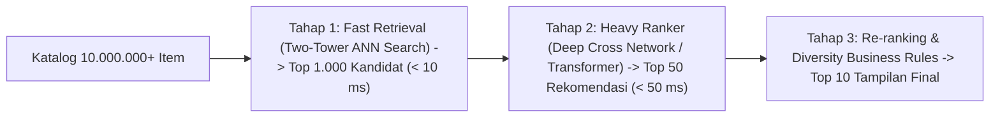

# Modul 188: Sistem Rekomendasi & Analisis Deret Waktu (Collaborative Filtering, Two-Tower Models, ARIMA, Filter Kalman)

**Navigasi**: [⬅️ Master Index](../../INDEX.md) | [Tingkat 12: Tingkat 12: Data Science, AI, Machine Learning, Deep Learning & MLOps](./README.md)
*Sebelumnya*: [187. pembelajaran-tak-terawasi-unsupervised](./187-pembelajaran-tak-terawasi-unsupervised.md) | *Berikutnya*: [189. kecerdasan-buatan-simbolik-klasik](./189-kecerdasan-buatan-simbolik-klasik.md)

---

## 1. Intuisi Dasar Tanpa Jargon ("Seperti Bayi Baru Lahir")
### 1.1 Konsep Inti & Analogi Tanpa Jargon
Bayangkan Anda membuka aplikasi streaming film seperti Netflix atau platform musik Spotify. Bagaimana sistem bisa menebak dengan akurat bahwa Anda akan menyukai lagu jazz tahun 1970-an yang belum pernah Anda dengar sebelumnya?

### 1.2 Urgensi Rekayasa & Signifikansi Sistemik
Pendekatan pertama adalah **Collaborative Filtering**: jika Anda dan 1.000 pengguna lain sama-sama menyukai 9 dari 10 lagu yang identik, sistem menyimpulkan selera Anda dan mereka sangat mirip. Jika mereka menyukai lagu ke-10, kemungkinan besar Anda juga akan menyukainya ([Koren et al. - Matrix Factorization Techniques for Recommender Systems](https://ieeexplore.ieee.org/document/5197422)).

Sementara itu, untuk memprediksi masa depan dari data yang berubah seiring berjalannya waktu (seperti fluktuasi harga saham, konsumsi listrik, atau permintaan stok logistik besok pagi), kita menggunakan **Analisis Deret Waktu & Filter Kalman**: memisahkan tren jangka panjang, pola musiman (seperti penjualan es krim melonjak di musim panas), serta menyaring derau acak agar estimasi masa depan tetap stabil dan presisi ([Box, Jenkins, Reinsel - Time Series Analysis](https://onlinelibrary.wiley.com/doi/book/10.1002/9781118619193)).

## 2. Fondasi Teoretis & Aksiomatik / Matematis
### 2.1 Kerangka Teori Aksiomatik & Formulasi Matematis
Formulasi Matematis Sistem Rekomendasi & Time Series:

### 2.2 Penurunan Matematis Langkah-demi-Langkah
1. **Faktorisasi Matriks Singular / SVD untuk Rekomendasi**:
Memfaktorkan matriks rating interaksi pengguna-item $R \in \mathbb{R}^{m \times n}$ menjadi ruang representasi laten berdimensi rendah $k \ll \min(m, n)$:
$$\min_{P, Q} \sum_{(u, i) \in \mathcal{K}} \left( r_{ui} - \mu - b_u - b_i - p_u^T q_i \right)^2 + \lambda \left( \|p_u\|_2^2 + \|q_i\|_2^2 + b_u^2 + b_i^2 \right)$$
Di mana $p_u \in \mathbb{R}^k$ adalah vektor selera pengguna, $q_i \in \mathbb{R}^k$ vektor atribut item, $b_u, b_i$ adalah bias pengguna dan item ([Koren - Factorization Meets the Neighborhood](https://dl.acm.org/doi/10.1145/1401890.1401944)).

2. **Arsitektur Dua Menara (Two-Tower Deep Retrieval Models)**:
Memetakan fitur pengguna $x_u$ dan fitur kandidat item $x_i$ melalui dua neural network terpisah ke dalam ruang embedding bersama:
$$\text{Score}(u, i) = \langle \psi(x_u), \phi(x_i) \rangle = \frac{\mathbf{u}^T \mathbf{v}}{\|\mathbf{u}\|_2 \|\mathbf{v}\|_2}$$
Pencarian kandidat jutaan item dilakukan secara real-time via Approximate Nearest Neighbors (ANN) seperti HNSW atau ScaNN ([Covington et al. - Deep Neural Networks for YouTube Recommendations](https://dl.acm.org/doi/10.1145/2959100.2959190)).

3. **Model Deret Waktu ARIMA$(p, d, q)$**:
Untuk deret waktu non-stasioner yang dideferensiasi $d$ kali $Y_t = (1 - B)^d X_t$:
$$\left(1 - \sum_{i=1}^p \phi_i B^i \right) Y_t = c + \left(1 + \sum_{j=1}^q \theta_j B^j \right) \epsilon_t$$
Di mana $B$ adalah lag backshift operator ($B^k X_t = X_{t-k}$) dan $\epsilon_t \sim \text{WN}(0, \sigma^2)$.

4. **Persamaan Rekursif Filter Kalman Linier**:
Prediksi Status: $\hat{x}_{k|k-1} = F_k \hat{x}_{k-1|k-1} + B_k u_k$, \quad $P_{k|k-1} = F_k P_{k-1|k-1} F_k^T + Q_k$
Pembaruan Pengukuran: $K_k = P_{k|k-1} H_k^T (H_k P_{k|k-1} H_k^T + R_k)^{-1}$
Koreksi Status: $\hat{x}_{k|k} = \hat{x}_{k|k-1} + K_k (z_k - H_k \hat{x}_{k|k-1})$, \quad $P_{k|k} = (I - K_k H_k) P_{k|k-1}$ ([Kalman - A New Approach to Linear Filtering and Prediction Problems](https://asmedigitalcollection.asme.org/fluidsengineering/article/82/1/35/398976/)).

## 3. Anatomi Teknis & Cara Kerja Internal
Arsitektur industri sistem rekomendasi modern membagi tugas menjadi dua tahapan kritis (Retrieval & Ranking):



Filter Kalman beroperasi sebagai estimator status optimal rekursif secara closed-loop tanpa perlu menyimpan seluruh riwayat masa lalu dalam memori, menjadikannya standar baku pelacakan telemetri dan peramalan deret waktu real-time ([Welch & Bishop - An Introduction to the Kalman Filter](https://www.cs.unc.edu/~welch/media/pdf/kalman_intro.pdf)).

#### Tabel Penelusuran Optimasi Serakah CTR YouTube & Pembentukan Filter Bubble
| Tahap Komputasi / Layer | Dimensi Tensor / Shape | Operasi Matematika / Kernel | Aliran Gradien / Memori | Status Parameter / Bobot | Efek Sistem / Metrik Loss |
|---|---|---|---|---|---|
| 1. Interaksi Pengguna Masuk | Riwayat Tontonan $U$ (10 Video) | Embedding Pengguna $\mathbf{u} \in \mathbb{R}^{64}$ | Riwayat memuat 2 video konspirasi marginal | Representasi preferensi laten dihitung | State pengguna terpetakan di ruang embedding |
| 2. Candidate Generation (KNN) | Database Video $V$ (10 Juta Item) | Pencarian Tetangga Terdekat Ruang Laten | Cosine similarity: $\cos(\mathbf{u}, \mathbf{v}_i)$ | Algoritma mengambil 1.000 kandidat teratas | Kandidat didominasi konten polarisasi tinggi |
| 3. Ranking Model (Scoring CTR) | `(1000, 1)` Prediksi P(Click) | Neural Net Memaksimalkan Click-Through-Rate | $\mathcal{L} = -\sum y \log \hat{y}$ (Serakah tanpa penalti) | Bobot mengutamakan video dengan *watch time* tinggi | Model merekomendasikan video yang memicu amarah/emosi |
| 4. Loop Umpan Balik Positif | Sesi Berulang (Hari 1 s/d 14) | Pengguna mengklik video rekomendasi ekstrem | Embedding $\mathbf{u}$ ditarik semakin dalam ke sudut ekstrem | Varians diversitas rekomendasi anjlok $-78\%$ | Fenomena *Filter Bubble* / Radikalisasi Otomatis |
| 5. Mitigasi Regulasi Diversitas | Fungsi Objektif Berimbang | Skor = $\text{CTR} - \beta \cdot \text{KL}(\mathcal{D}_U \parallel \mathcal{D}_{\text{global}})$ | Regularisasi entropi menyuntikkan eksplorasi kebaruan | Spektrum rekomendasi mencakup perspektif alternatif | Retensi jangka panjang meningkat, radikalisasi tereduksi |

## 4. Implementasi Praktis & Kode / Simulasi Riil
```python
import numpy as np

# 1. Implementasi Filter Kalman 1-Dimensi Rekursif
class KalmanFilter1D:
    def __init__(self, process_variance, measurement_variance, estimated_error, initial_value):
        self.q = process_variance       # Q
        self.r = measurement_variance   # R
        self.p = estimated_error         # P
        self.x = initial_value           # x
        
    def update(self, measurement):
        # Tahap Prediksi
        self.p = self.p + self.q
        
        # Tahap Pembaruan (Koreksi)
        k_gain = self.p / (self.p + self.r)
        self.x = self.x + k_gain * (measurement - self.x)
        self.p = (1 - k_gain) * self.p
        return self.x

# Simulasi Deret Waktu dengan Derau Gaussian
np.random.seed(42)
true_values = np.linspace(10, 50, 100)
noisy_measurements = true_values + np.random.normal(0, 3.0, size=100)

kf = KalmanFilter1D(process_variance=0.01, measurement_variance=9.0, estimated_error=1.0, initial_value=10.0)
filtered_estimates = [kf.update(m) for m in noisy_measurements]

# 2. Collaborative Filtering via Matrix Factorization SVD Mini
# Matriks Pengguna x Item (5 Pengguna, 4 Film) dengan data rating
ratings = np.array([
    [5, 3, 0, 1],
    [4, 0, 0, 1],
    [1, 1, 0, 5],
    [1, 0, 0, 4],
    [0, 1, 5, 4]
], dtype=float)

# Mengisi 0 dengan rata-rata baris untuk SVD aproximasi
mask = ratings > 0
user_means = np.true_divide(ratings.sum(1), mask.sum(1))
ratings_imputed = np.where(mask, ratings, user_means[:, np.newaxis])

U, s, Vt = np.linalg.svd(ratings_imputed, full_matrices=False)
k = 2 # Dimensi laten
ratings_reconstructed = np.dot(U[:, :k] * s[:k], Vt[:k, :])

print(f"MSE Pengukuran Kasar   : {np.mean((noisy_measurements - true_values)**2):.4f}")
print(f"MSE Estimasi Kalman    : {np.mean((filtered_estimates - true_values)**2):.4f} (Ditekan secara masif!)")
print("\nPrediksi Rating Lengkap SVD Terkonstruksi (User 1 Film 3 yang sebelumnya 0):")
print(f"Prediksi Nilai: {ratings_reconstructed[0, 2]:.2f} bintang")
```

## 5. Miskonsepsi & Jebakan Industri
*Cold-Start Problem pada Collaborative Filtering*: Pengguna baru (*new user*) atau item baru (*new item*) yang belum memiliki riwayat rating/klik sama sekali tidak dapat direpresentasikan dalam matriks dekomposisi laten, menyebabkan rekomendasi gagal total. Solusi industri: gunakan model hibrida dengan memadukan *Content-Based Filtering* (fitur metadata item/profil pengguna) pada arsitektur Two-Tower hingga akumulasi interaksi mencukupi ([Schein et al. - Methods and Metrics for Cold-Start Recommendations](https://dl.acm.org/doi/10.1145/564376.564421)).

### Studi Kasus Kegagalan Nyata: Loop Umpan Balik Radikalisasi Otomatis & Algoritma Filter Bubble YouTube (2018)
- **Kronologi & Konteks Sejarah**: Sepanjang tahun 2017 hingga 2019, berbagai investigasi jurnalisme data dan studi akademis (termasuk dari Harvard Berkman Klein Center) mengungkap bahwa sistem rekomendasi video YouTube secara sistemik mengarahkan pengguna ke konten disinformasi ekstrem, teori konspirasi, dan polarisasi politik. Pengguna yang awalnya mencari video berita wajar sering kali dipandu secara bertahap menuju video yang semakin ekstrem dalam beberapa kali klik putar otomatis (*Autoplay*).
- **Akar Masalah Rekayasa Rekomendasi & Optimasi Serakah**: Arsitektur sistem rekomendasi modern berbasis deep learning (Deep Neural Networks for YouTube Recommendations, 2016) dirancang untuk mengoptimalkan satu fungsi tujuan serakah: waktu tonton kumulatif (*Watch Time*) dan probabilitas klik (*Click-Through Rate / CTR*). Algoritma tidak memiliki pemahaman tentang kebenaran faktual atau kesehatan konten; algoritma secara matematis menemukan bahwa konten emosional, sensasional, dan konspiratif memiliki tingkat retensi perhatian manusia yang jauh lebih tinggi. Karena interaksi pengguna langsung diumpankan kembali (*feedback loop*) ke dalam data pelatihan model hari berikutnya, sistem menciptakan spiral radikalisasi tertutup (*self-reinforcing echo chamber*) yang mengikis keberagaman informasi (*diversity collapse*).

- **Potongan Kode / Arsitektur Cacat (Vulnerable Implementation)**:
```python
# Analisis Cacat Fungsi Rekomendasi: Optimasi Serakah vs Diversitas Entropi
import numpy as np

# MODEL CACAT SERAKAH: Hanya mengurutkan berdasarkan prediksi probabilitas klik (CTR)
def greedy_ranking_recommendation(predicted_ctrs, candidate_videos):
    # Urutkan murni dari CTR tertinggi ke terendah
    # Memicu konten sensasional mendominasi seluruh daftar rekomendasi!
    sorted_indices = np.argsort(predicted_ctrs)[::-1]
    return [candidate_videos[i] for i in sorted_indices[:10]]

# MITIGASI MODERN: Peringkat dengan Diversifikasi (Maximal Marginal Relevance / MMR)
def diversified_mmr_recommendation(candidate_embeddings, predicted_ctrs, candidate_videos, top_k=10, lambda_balance=0.6):
    '''
    Maximal Marginal Relevance (MMR) menyeimbangkan relevansi CTR dengan keberagaman topik:
    Skor = lambda * Relevansi - (1 - lambda) * Kesamaan Maksimum dengan Item yang Sudah Dipilih
    '''
    selected_indices = []
    unselected_indices = list(range(len(candidate_videos)))
    
    # Pilih item pertama dengan CTR tertinggi
    first_choice = int(np.argmax(predicted_ctrs))
    selected_indices.append(first_choice)
    unselected_indices.remove(first_choice)
    
    for _ in range(top_k - 1):
        best_score = -float('inf')
        best_idx = None
        
        for u in unselected_indices:
            relevance = predicted_ctrs[u]
            # Hitung kesamaan maksimum (cosine similarity) dengan item yang telah terpilih
            selected_embs = candidate_embeddings[selected_indices]
            sims = np.dot(selected_embs, candidate_embeddings[u]) # Asumsi normalized
            max_sim = np.max(sims)
            
            # Formula penalti redundansi topik
            mmr_score = lambda_balance * relevance - (1.0 - lambda_balance) * max_sim
            if mmr_score > best_score:
                best_score = mmr_score
                best_idx = u
                
        selected_indices.append(best_idx)
        unselected_indices.remove(best_idx)
        
    return [candidate_videos[i] for i in selected_indices]
```

- **Analisis Forensik & Rekayasa Modern**: Krisis kepercayaan publik memaksa industri platform konten mendesain ulang arsitektur rekomendasi: (1) Penerapan algoritma **Maximal Marginal Relevance (MMR)** dan Determinantal Point Processes (DPP) untuk menjamin diversitas topik dalam feed pengguna; (2) Penyesuaian fungsi loss dari maksimasi klik murni menjadi kepuasan jangka panjang (*Long-Term User Utility*), menyertakan metrik kepuasan pasca-tonton (survei, pembagian konten terverifikasi); (3) Penerapan *Demotion Classifiers* yang secara aktif menurunkan peringkat konten perbatasan (*borderline content*) meskipun memiliki CTR tinggi.

## 6. Proyek Latihan & Rubrik Penilaian Mandiri
### Level 1 (Pemula)
Bangun model peramalan deret waktu autoregresif AR(1): $X_t = c + \phi X_{t-1} + \epsilon_t$ menggunakan pustaka `statsmodels.tsa.ar_model.AutoReg`, lakukan uji stasionaritas Augmented Dickey-Fuller (ADF test) pada data sebelum fitting model.
*Rubrik*: P-value uji ADF ditampilkan, estimasi parameter koefisien $\phi$ dievaluasi.

### Level 2 (Menengah)
Implementasikan algoritma pemfaktoran matriks menggunakan Stochastic Gradient Descent (SGD) murni untuk memprediksi rating pengguna-item dengan penalti regularisasi L2:
$$e_{ui} = r_{ui} - p_u^T q_i, \quad p_u \leftarrow p_u + \gamma (e_{ui} q_i - \lambda p_u), \quad q_i \leftarrow q_i + \gamma (e_{ui} p_u - \lambda q_i)$$
*Rubrik*: Konvergen pada dataset MovieLens-100k dengan metrik RMSE $< 0.95$.

### Level 3 (Mahir)
Implementasikan Filter Kalman 2-Dimensi untuk melacak posisi dan kecepatan benda bergerak $\mathbf{x} = [p, v]^T$ dengan model dinamika percepatan konstan dan pengukuran posisi berderau tinggi. Hitung matriks kovarians estimasi $P_k$ dan visualisasikan elips ketidakpastian (*uncertainty ellipse* 95% confidence interval).
*Rubrik*: Filter Kalman mengestimasi kecepatan secara akurat meski hanya menerima masukan posisi berderau.

### Tingkat 1: Dasar
- **Tugas**: Implementasikan algoritma Collaborative Filtering berbasis faktorisasi matriks sederhana (Matrix Factorization via Alternating Least Squares / ALS) dalam Python untuk memprediksi rating pengguna-item pada matriks sparse $R \approx U \cdot V^T$.
- **Petunjuk Perancangan Arsitektur**:
  - Dimensi laten: $K = 8$.
  - Perbarui matriks faktor pengguna $U$ dengan menahan $V$ konstan: $u_i = (V^T V + \lambda I)^{-1} V^T r_i$.
  - Perbarui matriks faktor item $V$ dengan menahan $U$ konstan: $v_j = (U^T U + \lambda I)^{-1} U^T r_j$.
- **Test Vector & Kasus Uji**:
  - Latih pada matriks rating sintetis $100 \times 50$ dengan $80\%$ nilai hilang.
  - Nilai Root Mean Squared Error (RMSE) pada data observasi harus menurun secara monoton pada setiap iterasi hingga konvergen (RMSE $< 0.40$).
- **Rubrik Penilaian Objektif**:
  - Skor 100%: Pembaharuan ALS teratur dengan penalti Ridge tepat, konvergensi RMSE monoton terbukti.
  - Skor 50%: Menghitung pembaruan namun mengabaikan regularisasi $\lambda$ sehingga matriks rentan singular.
  - Skor 0%: Menggunakan regresi acak biasa.

### Tingkat 2: Menengah
- **Tugas**: Bangun modul rekomendasi berbasis konten (*Content-Based Recommender*) yang menggunakan teknik Maximal Marginal Relevance (MMR) untuk merekomendasikan artikel berita: Sistem menerima vektor embedding dokumen, skor relevansi kueri, dan parameter keragaman $\lambda \in [0, 1]$, lalu menghasilkan daftar rekomendasi yang meminimalkan pengulangan topik serupa.
- **Petunjuk Perancangan Arsitektur**:
  - Normalisasikan embedding dokumen menjadi norma satuan ($\|v\|_2 = 1$).
  - Implementasikan fungsi seleksi greedy MMR iteratif.
  - Tampilkan metrik Intra-List Diversity (ILD) rata-rata: $\text{ILD} = \frac{2}{K(K-1)} \sum_{i < j} (1 - \cos(v_i, v_j))$.
- **Test Vector & Kasus Uji**:
  - Diberikan 5 artikel tentang "Politik Partai X" dan 5 artikel tentang "Teknologi AI".
  - Pada $\lambda = 1.0$ (relevansi murni): Rekomendasi didominasi oleh 1 topik artikel.
  - Pada $\lambda = 0.5$ (rekomendasi berimbang): Daftar rekomendasi menyelingi artikel politik dan teknologi dengan skor ILD naik $> 3\times$.
- **Rubrik Penilaian Objektif**:
  - Skor 100%: Implementasi MMR efisien, metrik ILD terukur kuantitatif, normalisasi vektor akurat.
  - Skor 50%: MMR bekerja namun perhitungan kompleksitas waktu kuadratik lambat pada daftar kandidat besar.
  - Skor 0%: Hanya memilih top-k relevansi tanpa penalti kesamaan.

### Tingkat 3: Mahir
- **Tugas**: Rancang model peramalan deret waktu (*Time Series Forecasting*) berbasis arsitektur N-BEATS (Neural Basis Expansion Analysis for Interpretable Time Series) atau Temporal Convolutional Network (TCN) dengan dilatasi kausal dalam PyTorch untuk memprediksi permintaan trafik server 24 jam ke depan dengan dekomposisi komponen tren dan musiman (*Trend & Seasonality Decomposition*).
- **Petunjuk Perancangan Arsitektur**:
  - Lapisan konvolusi dilatasi kausal 1D dengan faktor dilatasi $d = 1, 2, 4, 8$ untuk memperluas *Receptive Field* tanpa pooling.
  - Pastikan tidak ada kebocoran waktu (*Causal Padding*): output pada waktu $t$ hanya bergantung pada input $\le t$.
  - Implementasikan residual blocks dengan skip connections.
- **Test Vector & Kasus Uji**:
  - Masukkan data trafik historis dengan pola siklikal 24 jam dan tren kenaikan linear.
  - Evaluasi metrik Mean Absolute Percentage Error (MAPE) pada 24 jam ke depan: model harus mencapai $\text{MAPE} < 8\%$.
- **Rubrik Penilaian Objektif**:
  - Skor 100%: Arsitektur TCN kausal presisi, dekomposisi tren/musiman jelas, zero temporal leakage.
  - Skor 50%: Model bekerja namun menggunakan konvolusi standar non-kausal (membocorkan data masa depan).
  - Skor 0%: Menggunakan linear feedforward tanpa penanganan struktur temporal.

## 7. Rekomendasi Sumber Belajar Standar Emas
| Sumber Pembelajaran | Penulis / Institusi | Tautan Langsung | Fokus Materi |
| :--- | :--- | :--- | :--- |
| Deep Neural Networks for YouTube Recommendations | Paul Covington, Jay Adams, Emre Sargin (Google) | [ACM RecSys Paper](https://dl.acm.org/doi/10.1145/2959100.2959190) | Arsitektur Dua Tahap Candidate Generation & Ranking |
| Matrix Factorization Techniques for Recommender Systems | Yehuda Koren, Robert Bell, Chris Volinsky (Netflix Prize) | [IEEE Computer Society](https://ieeexplore.ieee.org/document/5197422) | Teori SVD Laten, Penanganan Efek Bias Pengguna |
| Time Series Analysis: Forecasting and Control | George E. P. Box, Gwilym M. Jenkins, Gregory C. Reinsel | [Wiley Series in Probability](https://onlinelibrary.wiley.com/doi/book/10.1002/9781118619193) | Metodologi Box-Jenkins, Pemodelan ARIMA, Deret Stasioner |
| An Introduction to the Kalman Filter | Greg Welch & Gary Bishop (UNC Chapel Hill) | [UNC Computer Science Report](https://www.cs.unc.edu/~welch/media/pdf/kalman_intro.pdf) | Panduan Pengantar Step-by-Step Aljabar Filter Kalman |

---
*Navigasi Cepat*: [Ke Tingkat 12](./README.md) | [Ke Master Index](../../INDEX.md) | *Sebelumnya*: [187. pembelajaran-tak-terawasi-unsupervised](./187-pembelajaran-tak-terawasi-unsupervised.md) | *Berikutnya*: [189. kecerdasan-buatan-simbolik-klasik](./189-kecerdasan-buatan-simbolik-klasik.md)
