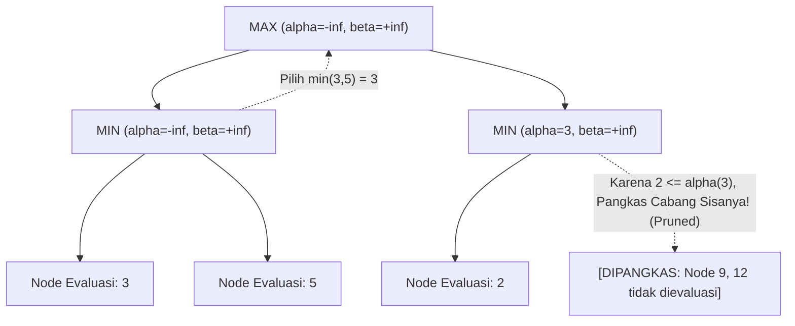

# Modul 189: Kecerdasan Buatan Simbolik Klasik (Pencarian Jalur A*, Minimax Alpha-Beta Pruning, Constraint Satisfaction, HMM)

**Navigasi**: [⬅️ Master Index](../../INDEX.md) | [Tingkat 12: Tingkat 12: Data Science, AI, Machine Learning, Deep Learning & MLOps](./README.md)
*Sebelumnya*: [188. sistem-rekomendasi-analisis-deret-waktu](./188-sistem-rekomendasi-analisis-deret-waktu.md) | *Berikutnya*: [190. fondasi-pembelajaran-mendalam-autodiferensiasi](./190-fondasi-pembelajaran-mendalam-autodiferensiasi.md)

---

## 1. Intuisi Dasar Tanpa Jargon ("Seperti Bayi Baru Lahir")
Jauh sebelum era deep learning dan data raksasa, para ilmuwan kecerdasan buatan percaya bahwa kecerdasan sejati dapat dibangun dengan menuliskan aturan logika, pohon keputusan, dan pencarian strategi formal secara eksplisit: inilah **Good Old-Fashioned AI (GOFAI)** atau AI Simbolik ([Russell & Norvig - Artificial Intelligence: A Modern Approach](https://aima.cs.berkeley.edu/)).

Bayangkan Anda bermain catur melawan grandmaster atau mencari rute terpendek di peta labirin jalanan kota. Anda tidak membutuhkan miliaran foto jalan untuk menebak arah; Anda menggunakan logika: "Jika saya belok kiri, jarak saya ke tujuan berkurang 2 km (heuristik); jika musuh mengancam menteri saya, saya harus memotong cabangnya (*alpha-beta pruning*)". AI simbolik memecahkan masalah melalui penalaran logika murni yang pasti, dapat dibuktikan secara matematika, dan 100% transparan tanpa kotak hitam (*explainable AI*) ([Hart, Nilsson, Raphael - A Formal Basis for Heuristic Determination of Minimum Cost Paths](https://ieeexplore.ieee.org/document/4082128)).

## 2. Fondasi Teoretis & Aksiomatik / Matematis
Formulasi Matematis Algoritma Klasik AI Simbolik:

1. **Algoritma Pencarian Jalur Heuristik A\***:
Mengevaluasi setiap simpul $n$ dalam graf menggunakan fungsi biaya terestimasi:
$$f(n) = g(n) + h(n)$$
Di mana $g(n)$ adalah biaya aktual dari simpul awal ke $n$, dan $h(n)$ adalah estimasi heuristik ke tujuan.
*Teorema Admissibility & Monotonicity*: Jika $h(n)$ *admissible* ($0 \le h(n) \le h^*(n)$ di mana $h^*(n)$ biaya riil minimum) dan *konsisten* ($h(n) \le c(n, a, n') + h(n')$), maka A\* dijamin menemukan jalur optimal terpendek tanpa mengunjungi ulang simpul yang telah ditutup ([Nilsson - Principles of Artificial Intelligence](https://link.springer.com/book/10.1007/978-3-662-09438-9)).

2. **Algoritma Minimax & Pemangkasan Alpha-Beta ($\alpha$-$\beta$ Pruning)**:
Untuk permainan zero-sum dua pemain deterministik:
$$V(s) = \begin{cases} \text{Utility}(s), & \text{jika } \text{Terminal}(s) \\ \max_{a} V(\text{Result}(s, a)), & \text{jika } \text{Player}(s) = \text{MAX} \\ \min_{a} V(\text{Result}(s, a)), & \text{jika } \text{Player}(s) = \text{MIN} \end{cases}$$
Parameter $\alpha$ (skor terbaik MAX sejauh ini) dan $\beta$ (skor terbaik MIN sejauh ini). Cabang dipangkas (*pruned*) seketika jika:
$$\alpha \ge \beta$$
Mengurangi kompleksitas komputasi pohon dari $\mathcal{O}(b^d)$ menjadi $\mathcal{O}(b^{d/2})$ pada urutan evaluasi optimal ([Knuth & Moore - An Analysis of Alpha-Beta Pruning](https://www.sciencedirect.com/science/article/pii/0004370275900193)).

3. **Constraint Satisfaction Problems (CSP) & Konsistensi Busur AC-3**:
Variabel $X = \{X_1, \dots, X_n\}$, domain $D = \{D_1, \dots, D_n\}$, kendala $C$. Algoritma AC-3 menghapus nilai $x \in D_i$ jika tidak ada pasangan valid $y \in D_j$ yang memenuhi kendala biner $C_{ij}$ ([Mackworth - Consistency in Networks of Relations](https://www.sciencedirect.com/science/article/pii/0004370277900078)).

4. **Hidden Markov Models (HMM) & Algoritma Viterbi**:
Status tersembunyi $Z_t \in \{S_1, \dots, S_N\}$, observasi $X_t \in \{v_1, \dots, v_M\}$. Mencari urutan status tersembunyi paling mungkin melalui pemrograman dinamis:
$$V_{1, k} = P(X_1 \mid Z_1 = k) \pi_k, \quad V_{t, k} = P(X_t \mid Z_t = k) \max_{j} \left( V_{t-1, j} A_{jk} \right)$$

## 3. Anatomi Teknis & Cara Kerja Internal
Mekanisme kerja internal pemangkasan cabang pada pohon pencarian Alpha-Beta Pruning:



Dengan memangkas cabang pohon permainan yang secara matematis tidak akan pernah dipilih oleh pemain rasional, kedalaman pencarian mesin catur (seperti Deep Blue atau Stockfish klasik) dapat digandakan dalam batas waktu komputasi yang sama ([Campbell et al. - Deep Blue](https://www.sciencedirect.com/science/article/pii/S0004370201001291)).

## 4. Implementasi Praktis & Kode / Simulasi Riil
```python
import heapq

# 1. Algoritma Pencarian Jalur A* pada Grid 2D
def a_star_search(grid, start, goal):
    # Heuristik Jarak Manhattan: |x1 - x2| + |y1 - y2|
    def heuristic(a, b):
        return abs(a[0] - b[0]) + abs(a[1] - b[1])
        
    rows, cols = len(grid), len(grid[0])
    frontier = [] # Priority Queue (f_score, cost, current_node)
    heapq.heappush(frontier, (heuristic(start, goal), 0, start))
    
    came_from = {}
    cost_so_far = {start: 0}
    
    while frontier:
        _, current_cost, current = heapq.heappop(frontier)
        
        if current == goal:
            # Rekonstruksi Jalur
            path = []
            curr = goal
            while curr != start:
                path.append(curr)
                curr = came_from[curr]
            path.append(start)
            return path[::-1]
            
        for dx, dy in [(-1, 0), (1, 0), (0, -1), (0, 1)]:
            neighbor = (current[0] + dx, current[1] + dy)
            if 0 <= neighbor[0] < rows and 0 <= neighbor[1] < cols:
                if grid[neighbor[0]][neighbor[1]] == 1:
                    continue # Rintangan / Dinding
                    
                new_cost = current_cost + 1
                if neighbor not in cost_so_far or new_cost < cost_so_far[neighbor]:
                    cost_so_far[neighbor] = new_cost
                    priority = new_cost + heuristic(neighbor, goal)
                    heapq.heappush(frontier, (priority, new_cost, neighbor))
                    came_from[neighbor] = current
    return None

# Uji Grid (0 = Jalan, 1 = Tembok Rintangan)
grid = [
    [0, 0, 0, 0, 0],
    [1, 1, 1, 1, 0],
    [0, 0, 0, 0, 0],
    [0, 1, 1, 1, 1],
    [0, 0, 0, 0, 0]
]
path = a_star_search(grid, start=(0, 0), goal=(4, 0))
print(f"Jalur Terpendek A* Ditemukan ({len(path)} langkah):")
print(path)
assert path is not None and path[-1] == (4, 0)
```

## 5. Miskonsepsi & Jebakan Industri
*Inadmissible Heuristic pada Algoritma A\**: Jika fungsi heuristik $h(n)$ mengestimasi biaya lebih besar dari jarak riil yang sebenarnya ($h(n) > h^*(n)$), algoritma A\* kehilangan garansi optimalitas matematisnya (*admissibility violation*). A\* akan mengambil jalan pintas yang salah dan menghasilkan jalur suboptimal. Selalu pastikan heuristik tidak pernah melebih-lebihkan (*never overestimates*) jarak sebenarnya ([Russell & Norvig AIMA Chapter 3](https://aima.cs.berkeley.edu/)).

## 6. Proyek Latihan & Rubrik Penilaian Mandiri
### Level 1 (Pemula)
Implementasikan permainan Tic-Tac-Toe dengan mesin AI berbasis algoritma Minimax murni tanpa batasan kedalaman, buktikan bahwa AI tidak akan pernah bisa dikalahkan oleh pemain manusia mana pun (hasil selalu seri atau AI menang).
*Rubrik*: AI memainkan langkah optimal sempurna di setiap giliran papan.

### Level 2 (Menengah)
Implementasikan pemecah teka-teki Sudoku berbasis Constraint Satisfaction Problem (CSP) menggunakan algoritma Backtracking dengan heuristik Minimum Remaining Values (MRV) dan propagasi kendala busur Forward Checking / AC-3.
*Rubrik*: Mampu menyelesaikan Sudoku level 'Hard' dalam waktu kurang dari 1 detik.

### Level 3 (Mahir)
Bangun algoritma Viterbi untuk penandaan kelas kata (*Part-of-Speech Tagging*) menggunakan model Hidden Markov Model (HMM) dari awal: estimasikan matriks transisi status $A_{jk}$ dan matriks emisi $B_{ki}$ dari korpus teks berlabel, dan decoding kalimat masukan menjadi urutan POS tag optimal via dynamic programming.
*Rubrik*: Decoding tervalidasi terhadap korpus Brown / Penn Treebank mini dengan akurasi $> 90\%$.

## 7. Rekomendasi Sumber Belajar Standar Emas
| Sumber Pembelajaran | Penulis / Institusi | Tautan Langsung | Fokus Materi |
| :--- | :--- | :--- | :--- |
| Artificial Intelligence: A Modern Approach (4th Ed.) | Stuart Russell & Peter Norvig (UC Berkeley) | [AIMA Official Portal](https://aima.cs.berkeley.edu/) | Standar Emas AI Simbolik, A*, Minimax, CSP, HMM |
| A Formal Basis for Heuristic Determination of Minimum Cost Paths | Peter E. Hart, Nils J. Nilsson, Bertram Raphael | [IEEE Transactions on Systems Science](https://ieeexplore.ieee.org/document/4082128) | Makalah Penemuan Asli Algoritma A* dan Bukti Admissibility |
| An Analysis of Alpha-Beta Pruning | Donald E. Knuth & Ronald W. Moore | [Artificial Intelligence Journal](https://www.sciencedirect.com/science/article/pii/0004370275900193) | Analisis Kompleksitas Matematika Cabang Alpha-Beta |
| Consistency in Networks of Relations (AC-3 Algorithm) | Alan K. Mackworth | [Artificial Intelligence Journal](https://www.sciencedirect.com/science/article/pii/0004370277900078) | Fondasi Formal Constraint Satisfaction & Arc Consistency |

---
*Navigasi Cepat*: [Ke Tingkat 12](./README.md) | [Ke Master Index](../../INDEX.md) | *Sebelumnya*: [188. sistem-rekomendasi-analisis-deret-waktu](./188-sistem-rekomendasi-analisis-deret-waktu.md) | *Berikutnya*: [190. fondasi-pembelajaran-mendalam-autodiferensiasi](./190-fondasi-pembelajaran-mendalam-autodiferensiasi.md)
