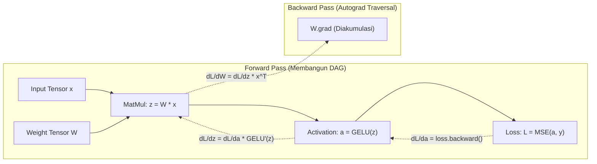

# Modul 190: Fondasi Pembelajaran Mendalam & Autodiferensiasi (Universal Approximation, Backprop Calculus, Mesin Autograd, AdamW)

**Navigasi**: [⬅️ Master Index](../../INDEX.md) | [Tingkat 12: Tingkat 12: Data Science, AI, Machine Learning, Deep Learning & MLOps](./README.md)
*Sebelumnya*: [189. kecerdasan-buatan-simbolik-klasik](./189-kecerdasan-buatan-simbolik-klasik.md) | *Berikutnya*: [191. arsitektur-penglihatan-komputer-vision](./191-arsitektur-penglihatan-komputer-vision.md)

---

## 1. Intuisi Dasar Tanpa Jargon ("Seperti Bayi Baru Lahir")
Bagaimana sebuah jaringan saraf tiruan (*neural network*) bisa belajar mengenali tulisan tangan, suara manusia, atau mendeteksi penyakit? Bayangkan Anda tersesat di sebuah perbukitan luas di malam hari yang berkabut tebal tanpa lampu senter. Anda ingin menemukan titik terendah dari lembah (*titik error/loss minimum*).

Meskipun Anda tidak bisa melihat sekeliling, Anda bisa merasakan kemiringan tanah di bawah telapak kaki Anda. Jika tanah miring ke bawah ke arah depan-kiri, Anda melangkah ke arah tersebut. Itulah **Backpropagation & Autodiferensiasi** ([Rumelhart, Hinton, Williams - Nature 1986](https://www.nature.com/articles/323533a0)): kalkulus turunan parsial menghitung ke mana arah kemiringan bukit kesalahan (gradien) untuk setiap bobot sinapsis, dan algoritma pengoptimal (seperti AdamW) menggerakkan jutaan bobot menuruni lembah kesalahan tersebut hingga model menjadi cerdas ([Goodfellow et al. - Deep Learning Book](https://www.deeplearningbook.org/)).

## 2. Fondasi Teoretis & Aksiomatik / Matematis
Landasan Matematis Pembelajaran Mendalam:

1. **Teorema Aproksimasi Universal (Universal Approximation Theorem)**:
Dinyatakan oleh Cybenko (1989) dan Hornik (1991): Jaringan feedforward dengan satu lapisan tersembunyi berukuran berhingga dan fungsi aktivasi non-linier non-polinomial $\sigma(\cdot)$ dapat mengaproksimasi sembarang fungsi kontinu $f \in C(K)$ pada himpunan kompak $K \subset \mathbb{R}^n$ dengan toleransi $\epsilon > 0$:
$$F(x) = \sum_{i=1}^m v_i \sigma(w_i^T x + b_i), \quad |F(x) - f(x)| < \epsilon, \quad \forall x \in K$$

2. **Kalkulus Aturan Rantai Backpropagation**:
Untuk fungsi loss skalar $\mathcal{L}$ terhadap bobot $W^{(l)}$ pada lapisan ke-$l$:
$$\frac{\partial \mathcal{L}}{\partial W^{(l)}} = \delta^{(l)} (a^{(l-1)})^T, \quad \delta^{(l)} = \left( (W^{(l+1)})^T \delta^{(l+1)} \right) \odot \sigma'(z^{(l)})$$
Di mana $z^{(l)} = W^{(l)} a^{(l-1)} + b^{(l)}$ dan $a^{(l)} = \sigma(z^{(l)})$.

3. **Pengoptimal AdamW (Decoupled Weight Decay)**:
Mengatasi anomali interaksi penalti L2 pada optimizer adaptif ([Loshchilov & Hutter - Decoupled Weight Decay Regularization](https://arxiv.org/abs/1711.05101)):
$$m_t = \beta_1 m_{t-1} + (1 - \beta_1) g_t, \quad v_t = \beta_2 v_{t-1} + (1 - \beta_2) g_t^2$$
$$\hat{m}_t = \frac{m_t}{1 - \beta_1^t}, \quad \hat{v}_t = \frac{v_t}{1 - \beta_2^t}$$
$$\theta_t = \theta_{t-1} - \eta_t \left( \frac{\hat{m}_t}{\sqrt{\hat{v}_t} + \epsilon} + \lambda \theta_{t-1} \right)$$

## 3. Anatomi Teknis & Cara Kerja Internal
Arsitektur mesin autodiferensiasi reverse-mode membangun Computational Graph terarah (DAG) secara dinamis:



Setiap tensor memegang pointer ke node fungsi pembuatnya (`grad_fn`). Selama proses backward pass, mesin penelusuran graf mengeksekusi operasi turunan secara topologis dari simpul output ke input tanpa ada kalkulasi turunan analitik simbolik yang membengkak (*expression swell*) ([Paszke et al. - Automatic Differentiation in PyTorch](https://openreview.net/forum?id=BJJsrmfCZ)).

## 4. Implementasi Praktis & Kode / Simulasi Riil
```python
import torch
import torch.nn as nn
import torch.nn.functional as F

# 1. Definisi Jaringan Deep MLP dengan Aktivasi Non-Linier GELU
class DeepMLP(nn.Module):
    def __init__(self, in_features, hidden_features, out_features):
        super().__init__()
        self.fc1 = nn.Linear(in_features, hidden_features)
        self.norm1 = nn.LayerNorm(hidden_features)
        self.fc2 = nn.Linear(hidden_features, out_features)
        
    def forward(self, x):
        # x -> Linear -> LayerNorm -> GELU -> Linear
        x = self.fc1(x)
        x = self.norm1(x)
        x = F.gelu(x)
        x = self.fc2(x)
        return x

# 2. Inisialisasi Data Sintetis dan Pelatihan dengan AdamW
torch.manual_seed(42)
X = torch.randn(128, 16)
y = torch.sin(X[:, 0:1]) + torch.cos(X[:, 1:2]) # Target non-linier

model = DeepMLP(in_features=16, hidden_features=64, out_features=1)
criterion = nn.MSELoss()
optimizer = torch.optim.AdamW(model.parameters(), lr=0.01, weight_decay=1e-4)

# 3. Training Loop Backpropagation
for epoch in range(1, 101):
    optimizer.zero_grad() # Bersihkan akumulasi gradien
    predictions = model(X)
    loss = criterion(predictions, y)
    loss.backward()       # Reverse-mode Autodiff graf komputasi
    optimizer.step()      # Pembaruan bobot AdamW
    
    if epoch % 25 == 0:
        print(f"Epoch {epoch:03d} | Loss MSE: {loss.item():.6f}")

assert loss.item() < 0.05, "Pelatihan gagal mencapai konvergensi!"
print("Model Deep MLP Berhasil Mengaproksimasi Fungsi Non-Linier!")
```

## 5. Miskonsepsi & Jebakan Industri
*Lupa Memanggil `optimizer.zero_grad()`*: Di PyTorch, gradien tensor diakumulasikan secara default (operasi `+=`) setiap kali `.backward()` dipanggil untuk mendukung skenario seperti gradient accumulation. Jika developer lupa memanggil `zero_grad()`, gradien dari epoch-epoch sebelumnya akan terus menumpuk, menyebabkan langkah gradien meledak (*exploding step*) dan model mengalami divergensi (*NaN loss*) ([PyTorch Autograd Mechanics](https://pytorch.org/docs/stable/notes/autograd.html)).

## 6. Proyek Latihan & Rubrik Penilaian Mandiri
### Level 1 (Pemula)
Bangun tensor skalar sederhana $a$ dan $b$ dengan `requires_grad=True`, definisikan fungsi matematika $y = 3a^2 + 5b^3 - 2ab$, lakukan `y.backward()`, dan verifikasi secara manual bahwa `a.grad` dan `b.grad` cocok dengan turunan parsial $\frac{\partial y}{\partial a}$ dan $\frac{\partial y}{\partial b}$.
*Rubrik*: Nilai numerik turunan manual identik dengan output tensor gradien PyTorch.

### Level 2 (Menengah)
Bangun mesin autodiferensiasi skalar dari nol (*micrograd style*): buat kelas `Value` yang mendukung operasi dasar penjumlahan, perkalian, relu, dan metode `.backward()` dengan pelacakan DAG topologis.
*Rubrik*: Kelas mampu melatih satu neuron tunggal untuk memecahkan klasifikasi biner 2D.

### Level 3 (Mahir)
Implementasikan pengoptimal kustom AdamW dalam bentuk kelas PyTorch kustom (`CustomAdamW(torch.optim.Optimizer)`): hitung momen pertama dan kedua terbiaskan, terapkan koreksi bias, integrasikan decoupled weight decay eksak, dan buktikan loss trajektori identik dengan `torch.optim.AdamW` bawaan hingga toleransi $10^{-6}$.
*Rubrik*: Trajektori bobot dan parameter model identik sempurna pada 100 iterasi training.

## 7. Rekomendasi Sumber Belajar Standar Emas
| Sumber Pembelajaran | Penulis / Institusi | Tautan Langsung | Fokus Materi |
| :--- | :--- | :--- | :--- |
| Learning Representations by Back-Propagating Errors | David E. Rumelhart, Geoffrey E. Hinton, Ronald J. Williams | [Nature 1986 Paper](https://www.nature.com/articles/323533a0) | Makalah Penemuan Asli Backpropagation Modern |
| Deep Learning (Adaptive Computation & Machine Learning) | Ian Goodfellow, Yoshua Bengio, Aaron Courville | [MIT Deep Learning Book](https://www.deeplearningbook.org/) | Teori Universal Approximation, Kalkulus Matriks, Autodiff |
| Decoupled Weight Decay Regularization (AdamW) | Ilya Loshchilov & Frank Hutter | [arXiv ICLR 2019](https://arxiv.org/abs/1711.05101) | Perbedaan L2 Penalty vs Weight Decay, Optimizer AdamW |
| PyTorch Autograd Mechanics & Engine | PyTorch Documentation Team | [PyTorch Notes: Autograd](https://pytorch.org/docs/stable/notes/autograd.html) | Implementasi C++ Node, Buffer Gradien, Reverse-Mode DAG |

---
*Navigasi Cepat*: [Ke Tingkat 12](./README.md) | [Ke Master Index](../../INDEX.md) | *Sebelumnya*: [189. kecerdasan-buatan-simbolik-klasik](./189-kecerdasan-buatan-simbolik-klasik.md) | *Berikutnya*: [191. arsitektur-penglihatan-komputer-vision](./191-arsitektur-penglihatan-komputer-vision.md)
