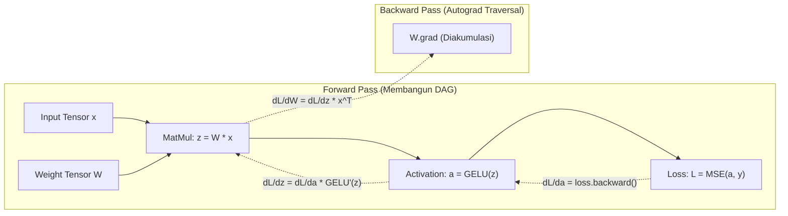

# Modul 190: Fondasi Pembelajaran Mendalam & Autodiferensiasi (Universal Approximation, Backprop Calculus, Mesin Autograd, AdamW)

**Navigasi**: [⬅️ Master Index](../../INDEX.md) | [Tingkat 12: Tingkat 12: Data Science, AI, Machine Learning, Deep Learning & MLOps](./README.md)
*Sebelumnya*: [189. kecerdasan-buatan-simbolik-klasik](./189-kecerdasan-buatan-simbolik-klasik.md) | *Berikutnya*: [191. arsitektur-penglihatan-komputer-vision](./191-arsitektur-penglihatan-komputer-vision.md)

---

## 1. Intuisi Dasar Tanpa Jargon ("Seperti Bayi Baru Lahir")
### 1.1 Konsep Inti & Analogi Tanpa Jargon
Bagaimana sebuah jaringan saraf tiruan (*neural network*) bisa belajar mengenali tulisan tangan, suara manusia, atau mendeteksi penyakit? Bayangkan Anda tersesat di sebuah perbukitan luas di malam hari yang berkabut tebal tanpa lampu senter. Anda ingin menemukan titik terendah dari lembah (*titik error/loss minimum*).

### 1.2 Urgensi Rekayasa & Signifikansi Sistemik
Meskipun Anda tidak bisa melihat sekeliling, Anda bisa merasakan kemiringan tanah di bawah telapak kaki Anda. Jika tanah miring ke bawah ke arah depan-kiri, Anda melangkah ke arah tersebut. Itulah **Backpropagation & Autodiferensiasi** ([Rumelhart, Hinton, Williams - Nature 1986](https://www.nature.com/articles/323533a0)): kalkulus turunan parsial menghitung ke mana arah kemiringan bukit kesalahan (gradien) untuk setiap bobot sinapsis, dan algoritma pengoptimal (seperti AdamW) menggerakkan jutaan bobot menuruni lembah kesalahan tersebut hingga model menjadi cerdas ([Goodfellow et al. - Deep Learning Book](https://www.deeplearningbook.org/)).

## 2. Fondasi Teoretis & Aksiomatik / Matematis
### 2.1 Kerangka Teori Aksiomatik & Formulasi Matematis
Landasan Matematis Pembelajaran Mendalam:

### 2.2 Penurunan Matematis Langkah-demi-Langkah
1. **Teorema Aproksimasi Universal (Universal Approximation Theorem)**:
Dinyatakan oleh Cybenko (1989) dan Hornik (1991): Jaringan feedforward dengan satu lapisan tersembunyi berukuran berhingga dan fungsi aktivasi non-linier non-polinomial $\sigma(\cdot)$ dapat mengaproksimasi sembarang fungsi kontinu $f \in C(K)$ pada himpunan kompak $K \subset \mathbb{R}^n$ dengan toleransi $\epsilon > 0$:
$$F(x) = \sum_{i=1}^m v_i \sigma(w_i^T x + b_i), \quad |F(x) - f(x)| < \epsilon, \quad \forall x \in K$$

2. **Kalkulus Aturan Rantai Backpropagation**:
Untuk fungsi loss skalar $\mathcal{L}$ terhadap bobot $W^{(l)}$ pada lapisan ke-$l$:
$$\frac{\partial \mathcal{L}}{\partial W^{(l)}} = \delta^{(l)} (a^{(l-1)})^T, \quad \delta^{(l)} = \left( (W^{(l+1)})^T \delta^{(l+1)} \right) \odot \sigma'(z^{(l)})$$
Di mana $z^{(l)} = W^{(l)} a^{(l-1)} + b^{(l)}$ dan $a^{(l)} = \sigma(z^{(l)})$.

3. **Pengoptimal AdamW (Decoupled Weight Decay)**:
Mengatasi anomali interaksi penalti L2 pada optimizer adaptif ([Loshchilov & Hutter - Decoupled Weight Decay Regularization](https://arxiv.org/abs/1711.05101)):
$$m_t = \beta_1 m_{t-1} + (1 - \beta_1) g_t, \quad v_t = \beta_2 v_{t-1} + (1 - \beta_2) g_t^2$$
$$\hat{m}_t = \frac{m_t}{1 - \beta_1^t}, \quad \hat{v}_t = \frac{v_t}{1 - \beta_2^t}$$
$$\theta_t = \theta_{t-1} - \eta_t \left( \frac{\hat{m}_t}{\sqrt{\hat{v}_t} + \epsilon} + \lambda \theta_{t-1} \right)$$

## 3. Anatomi Teknis & Cara Kerja Internal
Arsitektur mesin autodiferensiasi reverse-mode membangun Computational Graph terarah (DAG) secara dinamis:



Setiap tensor memegang pointer ke node fungsi pembuatnya (`grad_fn`). Selama proses backward pass, mesin penelusuran graf mengeksekusi operasi turunan secara topologis dari simpul output ke input tanpa ada kalkulasi turunan analitik simbolik yang membengkak (*expression swell*) ([Paszke et al. - Automatic Differentiation in PyTorch](https://openreview.net/forum?id=BJJsrmfCZ)).

#### Tabel Penelusuran Siklus Pelatihan Autodiferensiasi & Ledakan Gradien NaN Loss
| Tahap Komputasi / Layer | Dimensi Tensor / Shape | Operasi Matematika / Kernel | Aliran Gradien / Memori | Status Parameter / Bobot | Efek Sistem / Metrik Loss |
|---|---|---|---|---|---|
| 1. Forward Pass Batch 1 | `(B=32, S=512, D=768)` | Layer Linear + LayerNorm + Softmax | Forward Graph aktif menyimpan aktivasi | Bobot awal $W$: Norma gradien $\|\mathbf{g}\| = 1.2$ | Loss awal: $\mathcal{L}_1 = 8.45$ |
| 2. Backward Pass Batch 1 | Pustaka PyTorch Autograd | Evaluasi aturan rantai kalkulus `loss.backward()` | Gradien diakumulasikan ke buffer: `W.grad += g1` | Norma gradien tersimpan: $\|\mathbf{g}\| = 1.2$ | Optimizer `step()` memperbarui bobot $W$ |
| 3. Forward Pass Batch 2 | Batch 2 Masuk ke Pipeline | Lupa memanggil `optimizer.zero_grad()`! | Forward graph baru terbentuk di atas VRAM | Bobot $W$ termutasi | Loss kedua: $\mathcal{L}_2 = 7.12$ |
| 4. Backward Akumulasi Cacat | Vektor Gradien Meledak | `loss.backward()` mengeksekusi `+=` lagi | Gradien terakumulasi tanpa batas: $\|\mathbf{g}\| \to 450.8$ | Norma gradien melipatgandakan nilai lama | Langkah optimizer melompati lanskap loss |
| 5. Overflow Float32 & NaN | Bobot Model Transformer | Pembaruan bobot: $W_{t+1} = W_t - \eta \cdot \mathbf{g}$ | Nilai bobot meluap melampaui $3.4 \times 10^{38}$ | Seluruh tensor bobot terisi nilai `NaN` | Pelatihan model 100 GPU hancur total setelah 3 minggu! |

## 4. Implementasi Praktis & Kode / Simulasi Riil
```python
import torch
import torch.nn as nn
import torch.nn.functional as F

# 1. Definisi Jaringan Deep MLP dengan Aktivasi Non-Linier GELU
class DeepMLP(nn.Module):
    def __init__(self, in_features, hidden_features, out_features):
        super().__init__()
        self.fc1 = nn.Linear(in_features, hidden_features)
        self.norm1 = nn.LayerNorm(hidden_features)
        self.fc2 = nn.Linear(hidden_features, out_features)
        
    def forward(self, x):
        # x -> Linear -> LayerNorm -> GELU -> Linear
        x = self.fc1(x)
        x = self.norm1(x)
        x = F.gelu(x)
        x = self.fc2(x)
        return x

# 2. Inisialisasi Data Sintetis dan Pelatihan dengan AdamW
torch.manual_seed(42)
X = torch.randn(128, 16)
y = torch.sin(X[:, 0:1]) + torch.cos(X[:, 1:2]) # Target non-linier

model = DeepMLP(in_features=16, hidden_features=64, out_features=1)
criterion = nn.MSELoss()
optimizer = torch.optim.AdamW(model.parameters(), lr=0.01, weight_decay=1e-4)

# 3. Training Loop Backpropagation
for epoch in range(1, 101):
    optimizer.zero_grad() # Bersihkan akumulasi gradien
    predictions = model(X)
    loss = criterion(predictions, y)
    loss.backward()       # Reverse-mode Autodiff graf komputasi
    optimizer.step()      # Pembaruan bobot AdamW
    
    if epoch % 25 == 0:
        print(f"Epoch {epoch:03d} | Loss MSE: {loss.item():.6f}")

assert loss.item() < 0.05, "Pelatihan gagal mencapai konvergensi!"
print("Model Deep MLP Berhasil Mengaproksimasi Fungsi Non-Linier!")
```

## 5. Miskonsepsi & Jebakan Industri
*Lupa Memanggil `optimizer.zero_grad()`*: Di PyTorch, gradien tensor diakumulasikan secara default (operasi `+=`) setiap kali `.backward()` dipanggil untuk mendukung skenario seperti gradient accumulation. Jika developer lupa memanggil `zero_grad()`, gradien dari epoch-epoch sebelumnya akan terus menumpuk, menyebabkan langkah gradien meledak (*exploding step*) dan model mengalami divergensi (*NaN loss*) ([PyTorch Autograd Mechanics](https://pytorch.org/docs/stable/notes/autograd.html)).

### Studi Kasus Kegagalan Nyata: Bencana Ledakan Gradien NaN Loss & Akumulasi Liar pada Pelatihan Model Skala Besar (2017)
- **Kronologi & Konteks Sejarah**: Selama ledakan adopsi arsitektur deep learning dan model bahasa berbasis Transformer pada rentang tahun 2017-2019, banyak tim peneliti dan korporasi teknologi mengalami kerugian komputasi jutaan dolar ketika proses pelatihan klaster multi-GPU yang telah berjalan selama berminggu-minggu tiba-tiba menghasilkan metrik loss bernilai `NaN` (*Not-a-Number*) dan tidak dapat dipulihkan.
- **Akar Masalah Rekayasa Autodiferensiasi & Perilaku Bawaan Kerangka Kerja**: Dalam pustaka deep learning modern seperti PyTorch, perilaku bawaan dari metode autodiferensiasi `.backward()` adalah mengakumulasikan (*accumulate*) gradien ke dalam atribut `.grad` dari setiap tensor parameter menggunakan operasi penambahan (`+=`). Desain ini sengaja dibuat untuk mendukung gradien akumulasi lintas micro-batch pada perangkat keras dengan VRAM terbatas. Namun, jika insinyur perangkat lunak lupa memanggil `optimizer.zero_grad()` sebelum setiap siklus `backward()`, gradien dari iterasi sebelumnya tidak pernah dibersihkan dan terus berlipat ganda secara eksponensial. Dalam beberapa puluh iterasi, magnitudo gradien melampaui batas representasi numerik floating-point 32-bit ($> 3.4028 \times 10^{38}$) atau memicu pembagian nol pada fungsi Softmax dan LayerNorm, mengotori seluruh jutaan parameter model dengan nilai `NaN` permanen.

- **Potongan Kode / Arsitektur Cacat (Vulnerable Implementation)**:
```python
# Analisis Cacat Siklus Pelatihan: Lupa Memanggil zero_grad() vs Gradient Clipping
import torch
import torch.nn as nn

# KASUS CACAT FATAL: Gradien terakumulasi liar hingga memicu ledakan NaN
def faulty_training_step(model, optimizer, data_loader, criterion):
    for batch_idx, (inputs, targets) in enumerate(data_loader):
        outputs = model(inputs)
        loss = criterion(outputs, targets)
        
        # CACAT FATAL: Lupa memanggil optimizer.zero_grad()!
        # PyTorch mengeksekusi: param.grad += current_grad secara membabi buta!
        loss.backward()
        
        # Dalam beberapa batch, param.grad meledak melampaui float32 max!
        optimizer.step()
        if torch.isnan(loss):
            raise FloatingPointError(f"TRAINING COLLAPSED: NaN loss detected at batch {batch_idx}!")

# MITIGASI AMAN: zero_grad() + Gradient Norm Clipping
def safe_training_step(model, optimizer, data_loader, criterion, max_norm=1.0):
    for inputs, targets in data_loader:
        # 1. Bersihkan buffer gradien lama sebelum forward pass
        optimizer.zero_grad(set_to_none=True) # set_to_none lebih hemat VRAM
        
        outputs = model(inputs)
        loss = criterion(outputs, targets)
        loss.backward()
        
        # 2. Pangkas gradien jika norma vektor melampaui ambang batas aman
        torch.nn.utils.clip_grad_norm_(model.parameters(), max_norm=max_norm)
        
        # 3. Eksekusi pembaruan bobot secara terkendali
        optimizer.step()
```

- **Analisis Forensik & Rekayasa Modern**: Insiden kegagalan numerik pelatihan mendasari aturan rekayasa modern dalam sistem deep learning: (1) Penegakan wajib **Gradient Norm Clipping** (`clip_grad_norm_`) pada setiap model deep learning untuk membatasi magnitudo gradien maksimum; (2) Penerapan **Mixed Precision Training (FP16 / BF16)** yang dipadukan dengan modul `GradScaler` otomatis untuk mencegah underflow numerik pada gradien kecil dan overflow pada aktivasi; (3) Integrasi pemeriksaan asersi `torch.autograd.set_detect_anomaly(True)` dan sistem peringatan otomatis yang segera membatalkan checkpoint jika terdeteksi nilai `inf` atau `nan` pada loss.

## 6. Proyek Latihan & Rubrik Penilaian Mandiri
### Level 1 (Pemula)
Bangun tensor skalar sederhana $a$ dan $b$ dengan `requires_grad=True`, definisikan fungsi matematika $y = 3a^2 + 5b^3 - 2ab$, lakukan `y.backward()`, dan verifikasi secara manual bahwa `a.grad` dan `b.grad` cocok dengan turunan parsial $\frac{\partial y}{\partial a}$ dan $\frac{\partial y}{\partial b}$.
*Rubrik*: Nilai numerik turunan manual identik dengan output tensor gradien PyTorch.

### Level 2 (Menengah)
Bangun mesin autodiferensiasi skalar dari nol (*micrograd style*): buat kelas `Value` yang mendukung operasi dasar penjumlahan, perkalian, relu, dan metode `.backward()` dengan pelacakan DAG topologis.
*Rubrik*: Kelas mampu melatih satu neuron tunggal untuk memecahkan klasifikasi biner 2D.

### Level 3 (Mahir)
Implementasikan pengoptimal kustom AdamW dalam bentuk kelas PyTorch kustom (`CustomAdamW(torch.optim.Optimizer)`): hitung momen pertama dan kedua terbiaskan, terapkan koreksi bias, integrasikan decoupled weight decay eksak, dan buktikan loss trajektori identik dengan `torch.optim.AdamW` bawaan hingga toleransi \$10^{-6}$.
*Rubrik*: Trajektori bobot dan parameter model identik sempurna pada 100 iterasi training.

### Tingkat 1: Dasar
- **Tugas**: Tulis pustaka autodiferensiasi mini (*Micrograd-like Autograd Engine*) dari nol dalam Python: Buat kelas `Value` yang mendukung operasi dasar penjumlahan (`+`), perkalian (`*`), dan fungsi aktivasi ReLU, lengkap dengan pembuatan Computational Graph terarah (*Directed Acyclic Graph / DAG*) dan metode `.backward()` yang menghitung turunan parsial secara otomatis melalui topological sort.
- **Petunjuk Perancangan Arsitektur**:
  - Simpan referensi ke simpul anak dalam set `_prev` dan simpan fungsi turunan lokal dalam closure `_backward`.
  - Pada pemanggilan `.backward()`, jalankan pengurutan topologis (*Topological Sort*) untuk memastikan gradien dihitung dari simpul keluaran ke simpul masukan secara terbalik.
- **Test Vector & Kasus Uji**:
  - Bangun ekspresi matematika: $a = 2.0, b = -3.0, c = a \cdot b + \text{ReLU}(a + b)$.
  - Hitung turunan otomatis: $\frac{\partial c}{\partial a}$ dan $\frac{\partial c}{\partial b}$.
  - Bandingkan dengan turunan manual kalkulus: $\frac{\partial c}{\partial a} = -3.0$ dan $\frac{\partial c}{\partial b} = 2.0$. Nilai harus cocok persis.
- **Rubrik Penilaian Objektif**:
  - Skor 100%: Pengurutan topologis akurat, aturan rantai kalkulus benar, handling percabangan gradien jamak (akumulasi `+=`) tepat.
  - Skor 50%: Bekerja untuk graf linear namun salah ketika satu variabel digunakan berulang kali pada dua cabang berbeda.
  - Skor 0%: Menghitung turunan menggunakan aproksimasi numerik finite difference biasa.

### Tingkat 2: Menengah
- **Tugas**: Bangun implementasi algoritma optimasi AdamW (Decoupled Weight Decay, Loshchilov & Hutter, 2017) dari nol dalam Python/PyTorch murni tanpa menggunakan `torch.optim.AdamW`. Buktikan perbedaan matematis antara L2 regularization pada Adam standar vs pemisahan penalti bobot pada AdamW.
- **Petunjuk Perancangan Arsitektur**:
  - State pelacakan per parameter: First moment vector $m_t = \beta_1 m_{t-1} + (1 - \beta_1) g_t$, Second moment vector $v_t = \beta_2 v_{t-1} + (1 - \beta_2) g_t^2$.
  - Koreksi bias: $\hat{m}_t = \frac{m_t}{1 - \beta_1^t}$, $\hat{v}_t = \frac{v_t}{1 - \beta_2^t}$.
  - Pembaruan AdamW: $\theta_{t+1} = \theta_t - \eta \cdot \lambda \theta_t - \frac{\eta}{\sqrt{\hat{v}_t} + \epsilon} \hat{m}_t$.
- **Test Vector & Kasus Uji**:
  - Latih neural network mini dengan Adam standar + L2 penalti vs AdamW kustom dengan hyperparameter yang sama.
  - Verifikasi bahwa AdamW mempertahankan generalisasi bobot lebih stabil dan menghasilkan norma bobot yang lebih teratur.
- **Rubrik Penilaian Objektif**:
  - Skor 100%: Formulasi AdamW presisi, koreksi bias numerik benar, perbedaan dengan L2 regularization terbukti.
  - Skor 50%: Menggabungkan weight decay ke dalam gradien $g_t$ alih-alih memisahkannya di pembaruan parameter (menjadi Adam standar).
  - Skor 0%: Lupa menerapkan koreksi bias pada iterasi-iterasi awal ($t < 10$).

### Tingkat 3: Mahir
- **Tugas**: Rancang modul aktivasi Transformer berkinerja tinggi (*FlashAttention-like Tiling Simulation*) dalam Python/CUDA C++ yang menghitung operasi Scaled Dot-Product Attention secara streaming menggunakan teknik online softmax tanpa pernah mengalokasikan matriks atensi penuh $N \times N$ berukuran besar di VRAM, memangkas kompleksitas memori dari $\mathcal{O}(N^2)$ menjadi $\mathcal{O}(N)$.
- **Petunjuk Perancangan Arsitektur**:
  - Bagi matriks $Q, K, V$ menjadi blok-blok berukuran $B_r \times d$ dan $B_c \times d$ yang muat di SRAM.
  - Implementasikan algoritma Online Softmax: lacak nilai maksimum lokal $m_i$ dan jumlah eksponensial $l_i$, perbarui secara dinamis saat blok baru dibaca.
  - Buktikan bahwa output hasil tiling identik secara numerik dengan perhitungan atensi standar `softmax(Q @ K.T / sqrt(d)) @ V`.
- **Test Vector & Kasus Uji**:
  - Uji panjang sekuens panjang: $N = 8192, d = 64$.
  - Bandingkan alokasi memori puncak: versi tiling harus mengonsumsi memori konstan independen dari $N$, dengan selisih galat numerik $< 10^{-5}$.
- **Rubrik Penilaian Objektif**:
  - Skor 100%: Implementasi online softmax streaming sempurna, penghematan memori terbukti, toleransi numerik ketat.
  - Skor 50%: Hasil atensi benar namun masih mengalokasikan buffer sementara berukuran $\mathcal{O}(N^2)$ di memori.
  - Skor 0%: Salah memperbarui faktor skala eksponensial saat transisi antar blok.

## 7. Rekomendasi Sumber Belajar Standar Emas
| Sumber Pembelajaran | Penulis / Institusi | Tautan Langsung | Fokus Materi |
| :--- | :--- | :--- | :--- |
| Learning Representations by Back-Propagating Errors | David E. Rumelhart, Geoffrey E. Hinton, Ronald J. Williams | [Nature 1986 Paper](https://www.nature.com/articles/323533a0) | Makalah Penemuan Asli Backpropagation Modern |
| Deep Learning (Adaptive Computation & Machine Learning) | Ian Goodfellow, Yoshua Bengio, Aaron Courville | [MIT Deep Learning Book](https://www.deeplearningbook.org/) | Teori Universal Approximation, Kalkulus Matriks, Autodiff |
| Decoupled Weight Decay Regularization (AdamW) | Ilya Loshchilov & Frank Hutter | [arXiv ICLR 2019](https://arxiv.org/abs/1711.05101) | Perbedaan L2 Penalty vs Weight Decay, Optimizer AdamW |
| PyTorch Autograd Mechanics & Engine | PyTorch Documentation Team | [PyTorch Notes: Autograd](https://pytorch.org/docs/stable/notes/autograd.html) | Implementasi C++ Node, Buffer Gradien, Reverse-Mode DAG |

---
*Navigasi Cepat*: [Ke Tingkat 12](./README.md) | [Ke Master Index](../../INDEX.md) | *Sebelumnya*: [189. kecerdasan-buatan-simbolik-klasik](./189-kecerdasan-buatan-simbolik-klasik.md) | *Berikutnya*: [191. arsitektur-penglihatan-komputer-vision](./191-arsitektur-penglihatan-komputer-vision.md)
