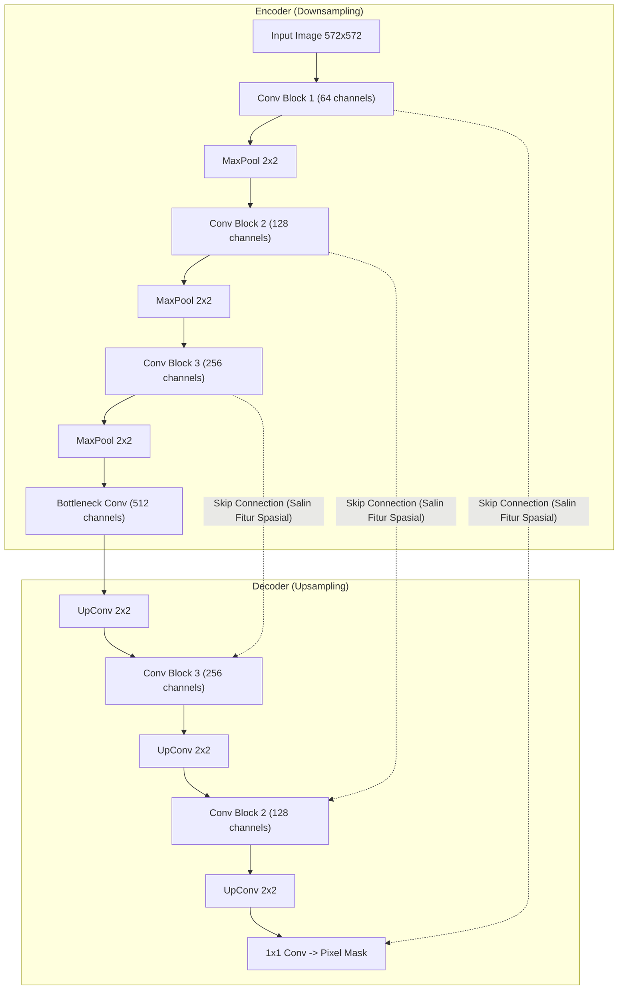

# Modul 191: Arsitektur Penglihatan Komputer / Vision (Konvolusi 2D, ResNet, Deteksi Objek YOLO, Segmentasi U-Net/SAM, ViT)

**Navigasi**: [⬅️ Master Index](../../INDEX.md) | [Tingkat 12: Tingkat 12: Data Science, AI, Machine Learning, Deep Learning & MLOps](./README.md)
*Sebelumnya*: [190. fondasi-pembelajaran-mendalam-autodiferensiasi](./190-fondasi-pembelajaran-mendalam-autodiferensiasi.md) | *Berikutnya*: [192. arsitektur-pemodelan-sekuensial-model-generatif](./192-arsitektur-pemodelan-sekuensial-model-generatif.md)

---

## 1. Intuisi Dasar Tanpa Jargon ("Seperti Bayi Baru Lahir")
Bagaimana komputer "melihat" dan mengenali wajah, kucing, atau rambu lalu lintas dari jutaan pixel angka? Jika Anda menganalisis gambar menggunakan jaringan saraf biasa, Anda akan memperlakukan setiap pixel secara terpisah dan kehilangan hubungan spasial: pixel hidung tidak akan tahu di mana posisi pixel mata atau mulut.

**Convolutional Neural Networks (CNN)** bekerja seperti kaca pembesar kecil (kernel/filter) yang digeser ke seluruh permukaan gambar ([LeCun et al. - Gradient-Based Learning Applied to Document Recognition](http://vision.stanford.edu/cs598_spring07/papers/Lecun98.pdf)). Kaca pembesar pertama mendeteksi garis lurus dan tepian tajam (*edges*). Lapisan berikutnya menggabungkan garis-garis tersebut menjadi pola bentuk (lingkaran, sudut). Lapisan yang lebih dalam menggabungkannya menjadi objek utuh (mata, roda mobil).

Sementara itu, **Vision Transformers (ViT)** memotong gambar menjadi kotak-kotak puzzle kecil (patch) dan memperlakukan setiap potongan puzzle seperti kata-kata dalam sebuah kalimat, memperhatikan hubungan antar bagian gambar di mana pun posisinya menggunakan mekanisme atensi global ([Dosovitskiy et al. - An Image is Worth 16x16 Words](https://arxiv.org/abs/2010.11929)).

## 2. Fondasi Teoretis & Aksiomatik / Matematis
Formulasi Matematis Penglihatan Komputer:

1. **Operasi Konvolusi Diskrit 2D**:
Untuk input citra $I \in \mathbb{R}^{H \times W}$ dan kernel filter $K \in \mathbb{R}^{k_h \times k_w}$:
$$(I * K)(i, j) = \sum_{m=0}^{k_h-1} \sum_{n=0}^{k_w-1} I(i + m, j + n) K(m, n)$$
Dimensi output dengan padding $P$, stride $S$, dan kernel $K$:
$$O = \left\lfloor \frac{W - K + 2P}{S} \right\rfloor + 1$$

2. **Residual Connections (ResNet)**:
Mengatasi fenomena degradasi optimasi pada jaringan yang sangat dalam ([He et al. - Deep Residual Learning for Image Recognition](https://arxiv.org/abs/1512.03385)):
$$\mathcal{H}(x) = \mathcal{F}(x, \{W_i\}) + x$$
Gradien propagasi mundur mempertahankan jalur langsung (*identity gradient highway*):
$$\frac{\partial \mathcal{L}}{\partial x} = \frac{\partial \mathcal{L}}{\partial \mathcal{H}} \left( \frac{\partial \mathcal{F}}{\partial x} + 1 \right)$$
Bahkan jika $\frac{\partial \mathcal{F}}{\partial x}$ lenyap mendekati 0, gradien $\frac{\partial \mathcal{L}}{\partial \mathcal{H}}$ tetap mengalir tanpa hambatan.

3. **Arsitektur Segmentasi U-Net & Skip Connections**:
Menggabungkan representasi fitur semantik level tinggi dari jalur kontraksi (encoder) dengan resolusi spasial tinggi dari jalur ekspansi (decoder) melalui konkatenasi fitur langsung:
$$X_{\text{dec}}^{(l)} = \text{Conv}\left( [\text{UpSample}(X_{\text{dec}}^{(l+1)}), X_{\text{enc}}^{(l)}] \right)$$

4. **Vision Transformer (ViT) Patch Linear Projection**:
Citra $x \in \mathbb{R}^{H \times W \times C}$ dipotong menjadi $N = \frac{HW}{P^2}$ patch datar $x_p \in \mathbb{R}^{N \times (P^2 C)}$, lalu diproyeksikan secara linier ditambah embedding posisi:
$$z_0 = [x_{\text{class}}; x_p^1 E; x_p^2 E; \dots; x_p^N E] + E_{\text{pos}}, \quad E \in \mathbb{R}^{(P^2 C) \times D}$$

## 3. Anatomi Teknis & Cara Kerja Internal
Arsitektur U-Net dengan koneksi lewati (*skip connections*) untuk segmentasi citra medis berpresisi pixel:



Skip connection memulihkan detail tepi spasial yang hilang akibat operasi downsampling pooling, memungkinkan segmentasi semantik hingga ke batas tepi sel terkecil ([Ronneberger et al. - U-Net](https://arxiv.org/abs/1505.04597)).

## 4. Implementasi Praktis & Kode / Simulasi Riil
```python
import torch
import torch.nn as nn

# 1. Blok Residual Klasik (ResNet Basic Block)
class ResidualBlock(nn.Module):
    def __init__(self, channels):
        super().__init__()
        self.conv1 = nn.Conv2d(channels, channels, kernel_size=3, padding=1, bias=False)
        self.bn1 = nn.BatchNorm2d(channels)
        self.relu = nn.ReLU(inplace=True)
        self.conv2 = nn.Conv2d(channels, channels, kernel_size=3, padding=1, bias=False)
        self.bn2 = nn.BatchNorm2d(channels)
        
    def forward(self, x):
        residual = x # Simpan jalan pintas identitas
        out = self.relu(self.bn1(self.conv1(x)))
        out = self.bn2(self.conv2(out))
        out += residual # Tambahkan input langsung (Identity Highway)
        out = self.relu(out)
        return out

# 2. Patch Embedding Vision Transformer (ViT)
class PatchEmbedding(nn.Module):
    def __init__(self, img_size=224, patch_size=16, in_channels=3, embed_dim=768):
        super().__init__()
        self.n_patches = (img_size // patch_size) ** 2
        # Implementasi proyeksi patch ekuivalen menggunakan Conv2d ber-stride patch_size
        self.proj = nn.Conv2d(in_channels, embed_dim, kernel_size=patch_size, stride=patch_size)
        
    def forward(self, x):
        # x: (B, C, H, W) -> (B, embed_dim, H/P, W/P) -> (B, n_patches, embed_dim)
        x = self.proj(x)
        x = x.flatten(2).transpose(1, 2)
        return x

# Uji Coba Komponen Arsitektur
dummy_img = torch.randn(2, 64, 32, 32)
res_block = ResidualBlock(channels=64)
out_res = res_block(dummy_img)
print(f"Output ResBlock Shape: {out_res.shape} (Dimensi spasial & channel dipertahankan)")

dummy_rgb = torch.randn(4, 3, 224, 224)
vit_embed = PatchEmbedding(img_size=224, patch_size=16, in_channels=3, embed_dim=768)
tokens = vit_embed(dummy_rgb)
print(f"Output ViT Patch Tokens: {tokens.shape} (196 token visual berdimensi 768)")
```

## 5. Miskonsepsi & Jebakan Industri
*Kerusakan Resolusi Spasial pada Deteksi Objek*: Melakukan pooling berlebihan hingga ukuran feature map menjadi sangat kecil ($7 \times 7$) menyebabkan model kehilangan kemampuan mendeteksi objek-objek kecil (*small objects*). Solusi standar industri: gunakan *Feature Pyramid Networks (FPN)* yang menggabungkan feature map dari berbagai skala resolusi secara multiskala ([Lin et al. - Feature Pyramid Networks for Object Detection](https://arxiv.org/abs/1612.03144)).

## 6. Proyek Latihan & Rubrik Penilaian Mandiri
### Level 1 (Pemula)
Bangun CNN 3-layer sederhana di PyTorch (Conv2d, MaxPool2d, Linear) untuk mengklasifikasikan dataset Fashion-MNIST, evaluasi akurasi pengujian dan visualisasikan matriks kernel konvolusi lapisan pertama.
*Rubrik*: Mencapai akurasi validasi $> 88\%$ dalam 5 epoch.

### Level 2 (Menengah)
Bangun arsitektur deteksi objek satu tahap bergaya mini-YOLO: rancang head model yang memprediksi bounding box kustom $(x, y, w, h, \text{conf})$ untuk setiap sel grid $S \times S$, dan implementasikan fungsi loss kombinasi MSE koordinat + BCE klasifikasi.
*Rubrik*: Model mampu memprediksi bounding box tunggal dengan koordinat ternormalisasi $[0, 1]$.

### Level 3 (Mahir)
Implementasikan Vision Transformer (ViT) lengkap dari awal: rancang modul Patch Embedding, tambahkan Token [CLS] yang dapat dipelajari, Positional Embedding 1D, tumpukan Transformer Encoder dengan Multi-Head Self-Attention, dan klasifikasi Linear Head.
*Rubrik*: Berhasil menjalankan inferensi klasifikasi citra tanpa pustaka pretrained transformer.

## 7. Rekomendasi Sumber Belajar Standar Emas
| Sumber Pembelajaran | Penulis / Institusi | Tautan Langsung | Fokus Materi |
| :--- | :--- | :--- | :--- |
| Deep Residual Learning for Image Recognition | Kaiming He, Xiangyu Zhang, Shaoqing Ren, Jian Sun | [arXiv ResNet Paper](https://arxiv.org/abs/1512.03385) | Arsitektur ResNet, Formulasi Skip Connections |
| An Image is Worth 16x16 Words: Transformers for Image Recognition at Scale | Alexey Dosovitskiy et al. (Google Research) | [arXiv ViT Paper](https://arxiv.org/abs/2010.11929) | Vision Transformer (ViT), Patch Projection, Self-Attention Citra |
| U-Net: Convolutional Networks for Biomedical Image Segmentation | Olaf Ronneberger, Philipp Fischer, Thomas Brox | [arXiv U-Net Paper](https://arxiv.org/abs/1505.04597) | Segmentasi Semantik Citra Medis, Up-Convolution |
| You Only Look Once: Unified, Real-Time Object Detection | Joseph Redmon, Santosh Divvala, Ross Girshick, Ali Farhadi | [arXiv YOLO Paper](https://arxiv.org/abs/1506.02640) | Deteksi Objek Real-Time Bounding Box Regression |

---
*Navigasi Cepat*: [Ke Tingkat 12](./README.md) | [Ke Master Index](../../INDEX.md) | *Sebelumnya*: [190. fondasi-pembelajaran-mendalam-autodiferensiasi](./190-fondasi-pembelajaran-mendalam-autodiferensiasi.md) | *Berikutnya*: [192. arsitektur-pemodelan-sekuensial-model-generatif](./192-arsitektur-pemodelan-sekuensial-model-generatif.md)
