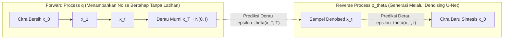

# Modul 192: Arsitektur Pemodelan Sekuensial & Model Generatif (LSTM, State Space Models Mamba, GNN, VAE ELBO, Denoising Diffusion)

**Navigasi**: [⬅️ Master Index](../../INDEX.md) | [Tingkat 12: Tingkat 12: Data Science, AI, Machine Learning, Deep Learning & MLOps](./README.md)
*Sebelumnya*: [191. arsitektur-penglihatan-komputer-vision](./191-arsitektur-penglihatan-komputer-vision.md) | *Berikutnya*: [193. pembelajaran-penguatan-reinforcement-learning](./193-pembelajaran-penguatan-reinforcement-learning.md)

---

## 1. Intuisi Dasar Tanpa Jargon ("Seperti Bayi Baru Lahir")
### 1.1 Konsep Inti & Analogi Tanpa Jargon
Bayangkan Anda mendengarkan rekaman musik atau membaca sebuah novel misteri. Kata di halaman 300 baru masuk akal jika Anda mengingat petunjuk kecil di halaman 15. Jaringan saraf biasa memiliki amnesia: ia memproses setiap kata seolah-olah kata itu berdiri sendiri tanpa masa lalu.

### 1.2 Urgensi Rekayasa & Signifikansi Sistemik
**Model Sekuensial (seperti LSTM dan Mamba)** memiliki buku catatan memori ([Hochreiter & Schmidhuber - Long Short-Term Memory](https://www.bioinf.jku.at/publications/photocopy/pdf/lstm.pdf)). Sambil membaca kalimat kata demi kata, model memiliki "gerbang" (*gates*) yang memutuskan: informasi apa yang boleh dilupakan, informasi baru apa yang harus dicatat, dan informasi apa yang harus dikeluarkan sekarang.

Sementara itu, bagaimana AI bisa menghasilkan gambar fotorealistik dari ketiadaan? **Model Difusi (Denoising Diffusion)** bekerja seperti memulihkan patung kuno yang terkubur pasir ([Ho et al. - Denoising Diffusion Probabilistic Models](https://arxiv.org/abs/2006.11239)). Selama pelatihan, AI melihat gambar bersih yang secara bertahap dirusak oleh derau pasir acak (*Gaussian noise*) hingga menjadi abu-abu total. AI kemudian dilatih untuk membalik proses ini: menebak dan meniup butiran pasir derau tersebut selangkah demi selangkah hingga patung kristal yang sempurna muncul kembali!

## 2. Fondasi Teoretis & Aksiomatik / Matematis
### 2.1 Kerangka Teori Aksiomatik & Formulasi Matematis
Formulasi Matematis Arsitektur Sekuensial & Generatif:

### 2.2 Penurunan Matematis Langkah-demi-Langkah
1. **Long Short-Term Memory (LSTM) Internal Gates**:
Status sel $C_t$ dan status tersembunyi $h_t$ diatur oleh 3 gerbang sigmoid:
$$\begin{aligned}
f_t &= \sigma(W_f x_t + U_f h_{t-1} + b_f) \quad &&\text{(Forget Gate)} \\
i_t &= \sigma(W_i x_t + U_i h_{t-1} + b_i) \quad &&\text{(Input Gate)} \\
\tilde{C}_t &= \tanh(W_c x_t + U_c h_{t-1} + b_c) \quad &&\text{(Candidate Cell State)} \\
C_t &= f_t \odot C_{t-1} + i_t \odot \tilde{C}_t \quad &&\text{(Updated Cell State)} \\
o_t &= \sigma(W_o x_t + U_o h_{t-1} + b_o) \quad &&\text{(Output Gate)} \\
h_t &= o_t \odot \tanh(C_t)
\end{aligned}$$

2. **State Space Models (SSM) & Mamba Selective Scan**:
Sistem dinamik kontinu dipetakan ke waktu diskret via zero-order hold (ZOH) ([Gu & Dao - Mamba: Linear-Time Sequence Modeling with Selective State Spaces](https://arxiv.org/abs/2312.00752)):
$$h'_t = \bar{A} h_{t-1} + \bar{B} x_t, \quad y_t = C h_t, \quad \bar{A} = \exp(\Delta A), \quad \bar{B} = (\Delta A)^{-1}(\exp(\Delta A) - I) \cdot \Delta B$$
Parameter $\Delta, B, C$ dijadikan fungsi input-dependent dinamis, memungkinkan kompleksitas waktu komputasi linier $\mathcal{O}(L)$ terhadap panjang sekuens $L$.

3. **Variational Autoencoder (VAE) & Evidence Lower Bound (ELBO)**:
Memaksimalkan batas bawah log-likelihood marginal:
$$\ln p_\theta(x) \ge \mathbb{E}_{q_\phi(z \mid x)} \left[ \ln p_\theta(x \mid z) \right] - D_{KL}\left( q_\phi(z \mid x) \parallel p(z) \right)$$
Reparameterization Trick memungkinkan propagasi gradien menembus variabel acak kontinu:
$$z = \mu(x) + \sigma(x) \odot \epsilon, \quad \epsilon \sim \mathcal{N}(0, I)$$

4. **Denoising Diffusion Probabilistic Models (DDPM)**:
Proses maju (*forward diffusion*) menambahkan derau terstruktur:
$$q(x_t \mid x_0) = \mathcal{N}\left(x_t; \sqrt{\bar{\alpha}_t} x_0, (1 - \bar{\alpha}_t) I \right), \quad \alpha_t = 1 - \beta_t, \quad \bar{\alpha}_t = \prod_{s=1}^t \alpha_s$$
Fungsi loss melatih neural network $\epsilon_\theta$ untuk memprediksi derau yang ditambahkan:
$$\mathcal{L}_{\text{simple}}(\theta) = \mathbb{E}_{t, x_0, \epsilon} \left[ \| \epsilon - \epsilon_\theta(x_t, t) \|^2 \right]$$

## 3. Anatomi Teknis & Cara Kerja Internal
Arsitektur Denoising Diffusion Probabilistic Model (DDPM) bolak-balik:



Proses reverse diffusion secara rekursif mengurangi komponen noise yang diprediksi oleh U-Net bersyarat waktu (*time-conditioned U-Net*), mengubah distribusi Gaussian putih acak menjadi sampel data realistis bernilai tinggi ([Song et al. - Score-Based Generative Modeling](https://arxiv.org/abs/2011.13456)).

#### Tabel Penelusuran Siklus Pelatihan RNN BPTT & Kolaps Ragam Generatif (Mode Collapse)
| Tahap Komputasi / Layer | Dimensi Tensor / Shape | Operasi Matematika / Kernel | Aliran Gradien / Memori | Status Parameter / Bobot | Efek Sistem / Metrik Loss |
|---|---|---|---|---|---|
| 1. Forward Pass Langkah Waktu $t$ | `(B=64, Hidden=512)` | Cell LSTM / GRU $h_t = \tanh(W x_t + U h_{t-1})$ | Memory tape merekam 500 langkah waktu | Bobot berulang $U$ aktif | Model memproses sekuens teks panjang |
| 2. Backpropagation Through Time | 500 Langkah Waktu Mundur | Gradien mengalir mundur melewati ratusan cell | Perkalian berulang matriks bobot: $\prod_{k=1}^T U^T$ | Nilai singular terbesar $\|U\| > 1.0$ | Magnitudo gradien melipatgandakan diri eksponensial |
| 3. Ledakan Gradien BPTT | Ruang Gradien Recurrent | Gradien melonjak: $\|\nabla \mathcal{L}\| > 10^5$ | Buffer gradien VRAM meluap | Bobot melonjak ke nilai ekstrem | Keruntuhan representasi laten sekuensial |
| 4. Generasi Teks Halusinasi | Pelatihan Model Bahasa Generatif | Sampling autoregresif kata demi kata | Distribusi probabilitas runtuh ke entropi nol | Model terjebak dalam loop: "the the the the" | Fenomena *Degenerate Repetition* / Kolaps Generasi |
| 5. Mitigasi Truncated BPTT + Clip | Potongan Sekuens Maksimum 64 | Truncated BPTT + `clip_grad_norm_(1.0)` | Gradien dipangkas jika melampaui batas norma | Bobot stabil, memori kontekstual terjaga | Model menghasilkan teks koheren dan kaya keragaman |

## 4. Implementasi Praktis & Kode / Simulasi Riil
```python
import torch
import torch.nn as nn

# 1. Reparameterization Trick pada Variational Autoencoder (VAE)
class VAEEncoder(nn.Module):
    def __init__(self, in_features=784, latent_dim=20):
        super().__init__()
        self.fc = nn.Linear(in_features, 256)
        self.fc_mu = nn.Linear(256, latent_dim)
        self.fc_logvar = nn.Linear(256, latent_dim)
        
    def forward(self, x):
        h = torch.relu(self.fc(x))
        mu = self.fc_mu(h)
        logvar = self.fc_logvar(h)
        # Reparameterization: z = mu + std * eps
        std = torch.exp(0.5 * logvar)
        eps = torch.randn_like(std)
        z = mu + std * eps
        return z, mu, logvar

# 2. Formula Forward Diffusion Noise Schedule (DDPM)
def q_sample(x_start, t, noise=None):
    if noise is None:
        noise = torch.randn_like(x_start)
    # Jadwal Linier Beta sederhana untuk simulasi
    betas = torch.linspace(0.0001, 0.02, 1000)
    alphas = 1.0 - betas
    alphas_cumprod = torch.cumprod(alphas, dim=0)
    
    sqrt_alphas_cumprod = torch.sqrt(alphas_cumprod[t])
    sqrt_one_minus_alphas_cumprod = torch.sqrt(1.0 - alphas_cumprod[t])
    
    # x_t = sqrt(alpha_bar_t) * x_0 + sqrt(1 - alpha_bar_t) * eps
    return sqrt_alphas_cumprod * x_start + sqrt_one_minus_alphas_cumprod * noise

# Uji Coba VAE dan Noise Schedule
encoder = VAEEncoder(in_features=64, latent_dim=8)
dummy_x = torch.randn(4, 64)
z, mu, logvar = encoder(dummy_x)
print(f"VAE Latent Vector Shape: {z.shape}")

clean_signal = torch.ones(1, 10) # Sinyal murni
noisy_step_500 = q_sample(clean_signal, t=500)
print(f"Sinyal Ter-difusi pada Step 500 (Separuh Hancur):\n{noisy_step_500.numpy()}")
```

## 5. Miskonsepsi & Jebakan Industri
*Posterior Collapse pada VAE*: Jika decoder terlalu kuat (misalnya menggunakan autoregressive decoder), model cenderung mengabaikan variabel laten $z$ sama sekali, menyebabkan $q(z \mid x) \approx p(z)$ (KL-Divergence kolaps menjadi 0) dan variabel laten tidak memuat informasi fitur input apa pun. Mitigasi: terapkan teknik *KL Annealing* (meningkatkan bobot penalti KL secara bertahap dari 0 ke 1 selama training) atau *Free Bits* ([Bowman et al. - Generating Sentences from a Continuous Space](https://arxiv.org/abs/1511.06349)).

### Studi Kasus Kegagalan Nyata: Fenomena Posterior Collapse VAE & Ledakan Gradien BPTT pada Pemodelan Sekuensial Awal (2020)
- **Kronologi & Konteks Sejarah**: Sebelum standardisasi arsitektur Transformer modern, pengembangan model pemodelan sekuensial dan generatif (seperti Recurrent Neural Networks, LSTM, dan Variational Autoencoders / VAE) sering kali mengalami kegagalan struktural kronis di industri, di mana model generatif teks atau percakapan tiba-tiba berhenti belajar dan hanya mampu menghasilkan respons seragam yang berulang-ulang tanpa variasi (*Mode Collapse & Posterior Collapse*).
- **Akar Masalah Rekayasa Pemodelan Generatif & Dinamika Laten**: Pada model sekuensial berbasis RNN/LSTM, propagasi balik melintasi ratusan langkah waktu (*Backpropagation Through Time / BPTT*) melibatkan perkalian berantai matriks bobot tersembunyi yang identik ($U^T$). Jika nilai eigen terbesar dari matriks tersebut bernilai $> 1$, gradien meledak secara eksponensial; jika $< 1$, gradien lenyap (*vanishing gradient*), membuat model melupakan konteks jangka panjang. Pada model generatif VAE, masalah serupa muncul dalam bentuk **Posterior Collapse**: ketika suku regularisasi Kullback-Leibler (KL Divergence) mendominasi suku rekonstruksi pada fungsi objektif ELBO ($\mathcal{L} = \mathbb{E}[\log p(x|z)] - \beta D_{KL}(q(z|x) \parallel p(z))$), decoder mengabaikan variabel laten $z$ sepenuhnya dan hanya memprediksi frekuensi kata marjinal, menghasilkan teks repetitif yang monoton.

- **Potongan Kode / Arsitektur Cacat (Vulnerable Implementation)**:
```python
# Analisis Posterior Collapse pada VAE & Penjadwalan KL Annealing
import torch
import torch.nn as nn

# FUNGSI LOSS CACAT: Regularisasi KL penuh diterapkan sejak awal pelatihan
def naive_vae_loss(recon_x, x, mu, logvar):
    recon_loss = nn.functional.binary_cross_entropy(recon_x, x, reduction='sum')
    # KL Divergence murni tanpa bobot penyesuaian:
    # Memicu POSTERIOR COLLAPSE: Latent code z diabaikan total oleh decoder!
    kl_loss = -0.5 * torch.sum(1 + logvar - mu.pow(2) - logvar.exp())
    return recon_loss + kl_loss

# MITIGASI AMAN: KL Annealing (Pemanasan Bertahap Suku KL Divergence)
def annealed_vae_loss(recon_x, x, mu, logvar, current_epoch, warmup_epochs=20):
    recon_loss = nn.functional.binary_cross_entropy(recon_x, x, reduction='sum')
    kl_loss = -0.5 * torch.sum(1 + logvar - mu.pow(2) - logvar.exp())
    
    # Annealing factor beta bertumbuh linear dari 0.0 ke 1.0
    beta = min(1.0, float(current_epoch) / float(warmup_epochs))
    
    # Mengizinkan decoder mempelajari representasi rekonstruksi terlebih dahulu
    # sebelum memaksa distribusi laten mendekati Gaussian standar
    total_loss = recon_loss + beta * kl_loss
    return total_loss
```

- **Analisis Forensik & Rekayasa Modern**: Penyelidikan terhadap instabilitas pemodelan generatif melahirkan prinsip rekayasa mutakhir: (1) Penerapan **KL Annealing** dan batas minimum suku informasi (*Free Bits / InfoVAE*) untuk mencegah hilangnya daya representasi variabel laten; (2) Penerapan **Truncated Backpropagation Through Time (TBPTT)** yang membatasi kedalaman aliran gradien maksimal 64 hingga 128 langkah waktu; (3) Migrasi industri dari pemodelan rekuren ke arsitektur atensi penuh (Transformer Decoder-Only) yang mengeliminasi masalah ledakan komputasi rekursif secara struktural.

## 6. Proyek Latihan & Rubrik Penilaian Mandiri
### Level 1 (Pemula)
Implementasikan sel RNN sederhana dari nol di PyTorch menggunakan formula $h_t = \tanh(W x_t + U h_{t-1} + b)$, dan latih untuk memprediksi karakter berikutnya pada string teks pendek ("hello").
*Rubrik*: Model mampu memprediksi karakter berikutnya dengan benar.

### Level 2 (Menengah)
Bangun Variational Autoencoder (VAE) lengkap untuk dataset MNIST: implementasikan kalkulasi loss kombinasi Binary Cross-Entropy (reconstruction loss) dan KL Divergence analitik terhadap Gaussian standar:
$$D_{KL} = -\frac{1}{2} \sum \left( 1 + \log(\sigma^2) - \mu^2 - \sigma^2 \right)$$
*Rubrik*: Menghasilkan visualisasi rekonstruksi angka dan interpolasi ruang laten 2D.

### Level 3 (Mahir)
Bangun modul pemrosesan derau terbalik (*Reverse Sampling Loop*) DDPM mini untuk data 1D atau citra resolusi kecil: latih MLP sederhana untuk memprediksi vektor noise $\epsilon_\theta(x_t, t)$ pada 100 timesteps, lalu lakukan proses sampling iteratif dari noise Gaussian murni $x_{100} \sim \mathcal{N}(0, I)$ hingga menghasilkan distribusi target.
*Rubrik*: Loop sampling menghasilkan distribusi yang sesuai dengan data target asli.

### Tingkat 1: Dasar
- **Tugas**: Implementasikan sel rekuren sederhana (Vanilla RNN Cell) dari nol dalam Python menggunakan NumPy: Hitung transisi state $h_t = \tanh(W_{xh} x_t + W_{hh} h_{t-1} + b_h)$ dan $y_t = W_{hy} h_t + b_y$ untuk sekuens sepanjang 10 langkah waktu, lalu hitung turunan analitis BPTT secara manual.
- **Petunjuk Perancangan Arsitektur**:
  - Inisialisasi matriks bobot dengan skala normal terdistribusi.
  - Simpan riwayat $h_t$ pada setiap langkah forward untuk digunakan pada loop backward.
  - Pada loop backward, akumulasikan gradien $\frac{\partial \mathcal{L}}{\partial W_{hh}}$ dari $t=10$ mundur ke $t=1$.
- **Test Vector & Kasus Uji**:
  - Berikan input sekuens sintetis.
  - Uji gradien numerik (*Gradient Checking via Finite Differences*): periksa kesesuaian antara turunan analitis manual dengan turunan numerik $(\mathcal{L}(\theta+\epsilon) - \mathcal{L}(\theta-\epsilon))/(2\epsilon)$ dengan toleransi galat relatif $< 10^{-4}$.
- **Rubrik Penilaian Objektif**:
  - Skor 100%: Turunan analitis BPTT presisi, gradient check lulus, loop sekuensial bersih.
  - Skor 50%: Forward pass benar namun backward pass salah mengakumulasikan gradien antar langkah waktu.
  - Skor 0%: Mengabaikan aturan rantai rekursif pada perkalian matriks $W_{hh}$.

### Tingkat 2: Menengah
- **Tugas**: Bangun implementasi lengkap Variational Autoencoder (VAE) dalam PyTorch untuk dataset citra MNIST: Terapkan reparameterization trick $z = \mu + \sigma \odot \epsilon$ (dengan $\epsilon \sim \mathcal{N}(0, I)$), hitung loss ELBO, dan implementasikan mekanisme KL Annealing siklis (*Cyclical KL Annealing*).
- **Petunjuk Perancangan Arsitektur**:
  - Encoder memetakan citra $28 \times 28$ ke vektor rata-rata $\mu$ dan log-varians $\log \sigma^2$ berdimensi 16.
  - Reparameterization trick memastikan operasi sampling dapat dilewati oleh aliran gradien autograd.
  - Plot nilai KL divergence per epoch: buktikan bahwa KL Annealing mencegah keruntuhan posterior ke nol.
- **Test Vector & Kasus Uji**:
  - Generate citra baru dengan mengambil sampel acak $z \sim \mathcal{N}(0, I)$ dan meneruskannya ke Decoder.
  - Citra hasil generasi harus merepresentasikan angka digit tulisan tangan yang tajam dan bervariasi (0 s/d 9).
- **Rubrik Penilaian Objektif**:
  - Skor 100%: Reparameterization trick presisi, KL annealing bekerja mulus, sampel generasi tajam dan beragam.
  - Skor 50%: VAE berjalan namun posterior collapse terjadi karena mengabaikan penjadwalan annealing bobot KL.
  - Skor 0%: Melakukan sampling langsung tanpa reparameterization trick (memutus aliran gradien).

### Tingkat 3: Mahir
- **Tugas**: Rancang model Diffusion Model tanpa pembimbing (*Denoising Diffusion Probabilistic Model / DDPM*) mini dalam PyTorch untuk generasi data 2D: Implementasikan proses difusi maju (*Forward Noising Process*) dengan linear variance schedule $\beta_1 \dots \beta_T$ dan latih jaringan neural residual untuk memprediksi derau Gaussian yang diinjeksikan $\epsilon_\theta(x_t, t)$.
- **Petunjuk Perancangan Arsitektur**:
  - Hitung koefisien analitis: $\alpha_t = 1 - \beta_t$ dan $\bar{\alpha}_t = \prod_{s=1}^t \alpha_s$.
  - Sampling langsung pada langkah sembarang $t$: $x_t = \sqrt{\bar{\alpha}_t} x_0 + \sqrt{1 - \bar{\alpha}_t} \epsilon$.
  - Fungsi objektif: Mean Squared Error sederhana antara derau asli $\epsilon$ dan prediksi $\epsilon_\theta(x_t, t)$.
- **Test Vector & Kasus Uji**:
  - Latih pada distribusi data "Two Moons" atau "Swiss Roll" 2D.
  - Jalankan algoritma sampling difusi terbalik (*Reverse Sampling*) dari derau murni $x_T \sim \mathcal{N}(0, I)$ selama 100 langkah: titik-titik sampel yang dihasilkan harus merekonstruksi bentuk distribusi 2D asli dengan keselarasan tinggi.
- **Rubrik Penilaian Objektif**:
  - Skor 100%: Formulasi matematika DDPM presisi, sampling difusi terbalik stabil, visualisasi rekonstruksi distribusi akurat.
  - Skor 50%: Forward process benar namun salah mengimplementasikan rumus pengurangan derau pada reverse sampling.
  - Skor 0%: Melatih model tanpa menyertakan embedding langkah waktu $t$ pada jaringan prediktor.

## 7. Rekomendasi Sumber Belajar Standar Emas
| Sumber Pembelajaran | Penulis / Institusi | Tautan Langsung | Fokus Materi |
| :--- | :--- | :--- | :--- |
| Denoising Diffusion Probabilistic Models (DDPM) | Jonathan Ho, Ajay Jain, Pieter Abbeel (UC Berkeley) | [arXiv DDPM Paper](https://arxiv.org/abs/2006.11239) | Formulasi Forward & Reverse Process, Simplified Loss |
| Mamba: Linear-Time Sequence Modeling with Selective State Spaces | Albert Gu & Tri Dao (CMU / Princeton) | [arXiv Mamba Paper](https://arxiv.org/abs/2312.00752) | State Space Models, Selective Scan, Alternatif Transformer |
| Auto-Encoding Variational Bayes (VAE) | Diederik P. Kingma & Max Welling | [arXiv VAE Paper](https://arxiv.org/abs/1312.6114) | Teori ELBO, Reparameterization Trick, Variational Inference |
| Long Short-Term Memory | Sepp Hochreiter & Jürgen Schmidhuber | [Neural Computation 1997](https://www.bioinf.jku.at/publications/photocopy/pdf/lstm.pdf) | Solusi Masalah Vanishing Gradient pada Model Sekuensial |

---
*Navigasi Cepat*: [Ke Tingkat 12](./README.md) | [Ke Master Index](../../INDEX.md) | *Sebelumnya*: [191. arsitektur-penglihatan-komputer-vision](./191-arsitektur-penglihatan-komputer-vision.md) | *Berikutnya*: [193. pembelajaran-penguatan-reinforcement-learning](./193-pembelajaran-penguatan-reinforcement-learning.md)
