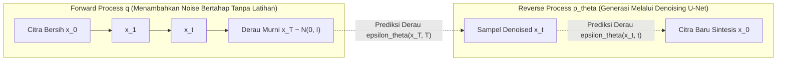

# Modul 192: Arsitektur Pemodelan Sekuensial & Model Generatif (LSTM, State Space Models Mamba, GNN, VAE ELBO, Denoising Diffusion)

**Navigasi**: [⬅️ Master Index](../../INDEX.md) | [Tingkat 12: Tingkat 12: Data Science, AI, Machine Learning, Deep Learning & MLOps](./README.md)
*Sebelumnya*: [191. arsitektur-penglihatan-komputer-vision](./191-arsitektur-penglihatan-komputer-vision.md) | *Berikutnya*: [193. pembelajaran-penguatan-reinforcement-learning](./193-pembelajaran-penguatan-reinforcement-learning.md)

---

## 1. Intuisi Dasar Tanpa Jargon ("Seperti Bayi Baru Lahir")
Bayangkan Anda mendengarkan rekaman musik atau membaca sebuah novel misteri. Kata di halaman 300 baru masuk akal jika Anda mengingat petunjuk kecil di halaman 15. Jaringan saraf biasa memiliki amnesia: ia memproses setiap kata seolah-olah kata itu berdiri sendiri tanpa masa lalu.

**Model Sekuensial (seperti LSTM dan Mamba)** memiliki buku catatan memori ([Hochreiter & Schmidhuber - Long Short-Term Memory](https://www.bioinf.jku.at/publications/photocopy/pdf/lstm.pdf)). Sambil membaca kalimat kata demi kata, model memiliki "gerbang" (*gates*) yang memutuskan: informasi apa yang boleh dilupakan, informasi baru apa yang harus dicatat, dan informasi apa yang harus dikeluarkan sekarang.

Sementara itu, bagaimana AI bisa menghasilkan gambar fotorealistik dari ketiadaan? **Model Difusi (Denoising Diffusion)** bekerja seperti memulihkan patung kuno yang terkubur pasir ([Ho et al. - Denoising Diffusion Probabilistic Models](https://arxiv.org/abs/2006.11239)). Selama pelatihan, AI melihat gambar bersih yang secara bertahap dirusak oleh derau pasir acak (*Gaussian noise*) hingga menjadi abu-abu total. AI kemudian dilatih untuk membalik proses ini: menebak dan meniup butiran pasir derau tersebut selangkah demi selangkah hingga patung kristal yang sempurna muncul kembali!

## 2. Fondasi Teoretis & Aksiomatik / Matematis
Formulasi Matematis Arsitektur Sekuensial & Generatif:

1. **Long Short-Term Memory (LSTM) Internal Gates**:
Status sel $C_t$ dan status tersembunyi $h_t$ diatur oleh 3 gerbang sigmoid:
$$\begin{aligned}
f_t &= \sigma(W_f x_t + U_f h_{t-1} + b_f) \quad &&\text{(Forget Gate)} \\
i_t &= \sigma(W_i x_t + U_i h_{t-1} + b_i) \quad &&\text{(Input Gate)} \\
\tilde{C}_t &= \tanh(W_c x_t + U_c h_{t-1} + b_c) \quad &&\text{(Candidate Cell State)} \\
C_t &= f_t \odot C_{t-1} + i_t \odot \tilde{C}_t \quad &&\text{(Updated Cell State)} \\
o_t &= \sigma(W_o x_t + U_o h_{t-1} + b_o) \quad &&\text{(Output Gate)} \\
h_t &= o_t \odot \tanh(C_t)
\end{aligned}$$

2. **State Space Models (SSM) & Mamba Selective Scan**:
Sistem dinamik kontinu dipetakan ke waktu diskret via zero-order hold (ZOH) ([Gu & Dao - Mamba: Linear-Time Sequence Modeling with Selective State Spaces](https://arxiv.org/abs/2312.00752)):
$$h'_t = \bar{A} h_{t-1} + \bar{B} x_t, \quad y_t = C h_t, \quad \bar{A} = \exp(\Delta A), \quad \bar{B} = (\Delta A)^{-1}(\exp(\Delta A) - I) \cdot \Delta B$$
Parameter $\Delta, B, C$ dijadikan fungsi input-dependent dinamis, memungkinkan kompleksitas waktu komputasi linier $\mathcal{O}(L)$ terhadap panjang sekuens $L$.

3. **Variational Autoencoder (VAE) & Evidence Lower Bound (ELBO)**:
Memaksimalkan batas bawah log-likelihood marginal:
$$\ln p_\theta(x) \ge \mathbb{E}_{q_\phi(z \mid x)} \left[ \ln p_\theta(x \mid z) \right] - D_{KL}\left( q_\phi(z \mid x) \parallel p(z) \right)$$
Reparameterization Trick memungkinkan propagasi gradien menembus variabel acak kontinu:
$$z = \mu(x) + \sigma(x) \odot \epsilon, \quad \epsilon \sim \mathcal{N}(0, I)$$

4. **Denoising Diffusion Probabilistic Models (DDPM)**:
Proses maju (*forward diffusion*) menambahkan derau terstruktur:
$$q(x_t \mid x_0) = \mathcal{N}\left(x_t; \sqrt{\bar{\alpha}_t} x_0, (1 - \bar{\alpha}_t) I \right), \quad \alpha_t = 1 - \beta_t, \quad \bar{\alpha}_t = \prod_{s=1}^t \alpha_s$$
Fungsi loss melatih neural network $\epsilon_\theta$ untuk memprediksi derau yang ditambahkan:
$$\mathcal{L}_{\text{simple}}(\theta) = \mathbb{E}_{t, x_0, \epsilon} \left[ \| \epsilon - \epsilon_\theta(x_t, t) \|^2 \right]$$

## 3. Anatomi Teknis & Cara Kerja Internal
Arsitektur Denoising Diffusion Probabilistic Model (DDPM) bolak-balik:



Proses reverse diffusion secara rekursif mengurangi komponen noise yang diprediksi oleh U-Net bersyarat waktu (*time-conditioned U-Net*), mengubah distribusi Gaussian putih acak menjadi sampel data realistis bernilai tinggi ([Song et al. - Score-Based Generative Modeling](https://arxiv.org/abs/2011.13456)).

## 4. Implementasi Praktis & Kode / Simulasi Riil
```python
import torch
import torch.nn as nn

# 1. Reparameterization Trick pada Variational Autoencoder (VAE)
class VAEEncoder(nn.Module):
    def __init__(self, in_features=784, latent_dim=20):
        super().__init__()
        self.fc = nn.Linear(in_features, 256)
        self.fc_mu = nn.Linear(256, latent_dim)
        self.fc_logvar = nn.Linear(256, latent_dim)
        
    def forward(self, x):
        h = torch.relu(self.fc(x))
        mu = self.fc_mu(h)
        logvar = self.fc_logvar(h)
        # Reparameterization: z = mu + std * eps
        std = torch.exp(0.5 * logvar)
        eps = torch.randn_like(std)
        z = mu + std * eps
        return z, mu, logvar

# 2. Formula Forward Diffusion Noise Schedule (DDPM)
def q_sample(x_start, t, noise=None):
    if noise is None:
        noise = torch.randn_like(x_start)
    # Jadwal Linier Beta sederhana untuk simulasi
    betas = torch.linspace(0.0001, 0.02, 1000)
    alphas = 1.0 - betas
    alphas_cumprod = torch.cumprod(alphas, dim=0)
    
    sqrt_alphas_cumprod = torch.sqrt(alphas_cumprod[t])
    sqrt_one_minus_alphas_cumprod = torch.sqrt(1.0 - alphas_cumprod[t])
    
    # x_t = sqrt(alpha_bar_t) * x_0 + sqrt(1 - alpha_bar_t) * eps
    return sqrt_alphas_cumprod * x_start + sqrt_one_minus_alphas_cumprod * noise

# Uji Coba VAE dan Noise Schedule
encoder = VAEEncoder(in_features=64, latent_dim=8)
dummy_x = torch.randn(4, 64)
z, mu, logvar = encoder(dummy_x)
print(f"VAE Latent Vector Shape: {z.shape}")

clean_signal = torch.ones(1, 10) # Sinyal murni
noisy_step_500 = q_sample(clean_signal, t=500)
print(f"Sinyal Ter-difusi pada Step 500 (Separuh Hancur):\n{noisy_step_500.numpy()}")
```

## 5. Miskonsepsi & Jebakan Industri
*Posterior Collapse pada VAE*: Jika decoder terlalu kuat (misalnya menggunakan autoregressive decoder), model cenderung mengabaikan variabel laten $z$ sama sekali, menyebabkan $q(z \mid x) \approx p(z)$ (KL-Divergence kolaps menjadi 0) dan variabel laten tidak memuat informasi fitur input apa pun. Mitigasi: terapkan teknik *KL Annealing* (meningkatkan bobot penalti KL secara bertahap dari 0 ke 1 selama training) atau *Free Bits* ([Bowman et al. - Generating Sentences from a Continuous Space](https://arxiv.org/abs/1511.06349)).

## 6. Proyek Latihan & Rubrik Penilaian Mandiri
### Level 1 (Pemula)
Implementasikan sel RNN sederhana dari nol di PyTorch menggunakan formula $h_t = \tanh(W x_t + U h_{t-1} + b)$, dan latih untuk memprediksi karakter berikutnya pada string teks pendek ("hello").
*Rubrik*: Model mampu memprediksi karakter berikutnya dengan benar.

### Level 2 (Menengah)
Bangun Variational Autoencoder (VAE) lengkap untuk dataset MNIST: implementasikan kalkulasi loss kombinasi Binary Cross-Entropy (reconstruction loss) dan KL Divergence analitik terhadap Gaussian standar:
$$D_{KL} = -\frac{1}{2} \sum \left( 1 + \log(\sigma^2) - \mu^2 - \sigma^2 \right)$$
*Rubrik*: Menghasilkan visualisasi rekonstruksi angka dan interpolasi ruang laten 2D.

### Level 3 (Mahir)
Bangun modul pemrosesan derau terbalik (*Reverse Sampling Loop*) DDPM mini untuk data 1D atau citra resolusi kecil: latih MLP sederhana untuk memprediksi vektor noise $\epsilon_\theta(x_t, t)$ pada 100 timesteps, lalu lakukan proses sampling iteratif dari noise Gaussian murni $x_{100} \sim \mathcal{N}(0, I)$ hingga menghasilkan distribusi target.
*Rubrik*: Loop sampling menghasilkan distribusi yang sesuai dengan data target asli.

## 7. Rekomendasi Sumber Belajar Standar Emas
| Sumber Pembelajaran | Penulis / Institusi | Tautan Langsung | Fokus Materi |
| :--- | :--- | :--- | :--- |
| Denoising Diffusion Probabilistic Models (DDPM) | Jonathan Ho, Ajay Jain, Pieter Abbeel (UC Berkeley) | [arXiv DDPM Paper](https://arxiv.org/abs/2006.11239) | Formulasi Forward & Reverse Process, Simplified Loss |
| Mamba: Linear-Time Sequence Modeling with Selective State Spaces | Albert Gu & Tri Dao (CMU / Princeton) | [arXiv Mamba Paper](https://arxiv.org/abs/2312.00752) | State Space Models, Selective Scan, Alternatif Transformer |
| Auto-Encoding Variational Bayes (VAE) | Diederik P. Kingma & Max Welling | [arXiv VAE Paper](https://arxiv.org/abs/1312.6114) | Teori ELBO, Reparameterization Trick, Variational Inference |
| Long Short-Term Memory | Sepp Hochreiter & Jürgen Schmidhuber | [Neural Computation 1997](https://www.bioinf.jku.at/publications/photocopy/pdf/lstm.pdf) | Solusi Masalah Vanishing Gradient pada Model Sekuensial |

---
*Navigasi Cepat*: [Ke Tingkat 12](./README.md) | [Ke Master Index](../../INDEX.md) | *Sebelumnya*: [191. arsitektur-penglihatan-komputer-vision](./191-arsitektur-penglihatan-komputer-vision.md) | *Berikutnya*: [193. pembelajaran-penguatan-reinforcement-learning](./193-pembelajaran-penguatan-reinforcement-learning.md)
