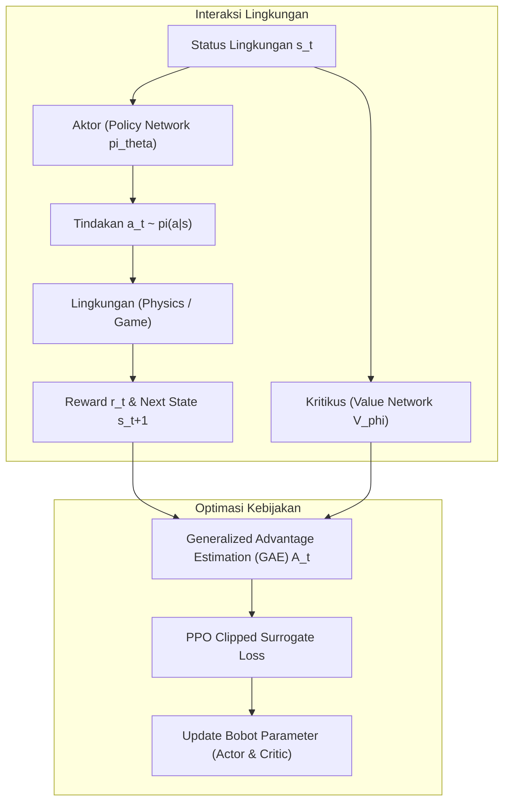

# Modul 193: Pembelajaran Penguatan / Reinforcement Learning (Markov Decision Process, Persamaan Bellman, DQN, PPO, Actor-Critic)

**Navigasi**: [⬅️ Master Index](../../INDEX.md) | [Tingkat 12: Tingkat 12: Data Science, AI, Machine Learning, Deep Learning & MLOps](./README.md)
*Sebelumnya*: [192. arsitektur-pemodelan-sekuensial-model-generatif](./192-arsitektur-pemodelan-sekuensial-model-generatif.md) | *Berikutnya*: [194. rekayasa-sistem-ai-skala-produksi](./194-rekayasa-sistem-ai-skala-produksi.md)

---

## 1. Intuisi Dasar Tanpa Jargon ("Seperti Bayi Baru Lahir")
Bagaimana seorang anak kecil belajar mengendarai sepeda? Tidak ada orang tua yang bisa menurunkan persamaan kalkulus fisika tentang sudut kemiringan dan gaya sentrifugal ke otak anak tersebut. Anak itu belajar melalui **Trial and Error (Mencoba dan Merasakan Akibatnya)**.

Jika ia mengayuh dengan seimbang ke depan, ia merasakan kegembiraan meluncur (**Hadiah Positif / Reward**). Jika ia memiringkan setang terlalu tajam dan terjatuh menabrak pohon, lututnya lecet (**Hukuman / Negative Reward**).

**Pembelajaran Penguatan (Reinforcement Learning)** adalah cabang AI di mana sebuah agen (*agent*) ditempatkan di dalam sebuah lingkungan asing (*environment*). Agen mengambil tindakan (*action*), mengamati perubahan situasi (*state*), dan menerima skor (*reward*). Tujuan agen adalah mencari strategi tindakan terbaik (**Kebijakan / Policy**) yang memaksimalkan total akumulasi hadiah sepanjang hidupnya ([Sutton & Barto - Reinforcement Learning: An Introduction](http://incompleteideas.net/book/the-book-2nd.html)).

## 2. Fondasi Teoretis & Aksiomatik / Matematis
Formulasi Matematis Reinforcement Learning:

1. **Markov Decision Process (MDP)**:
Didefinisikan sebagai tuple formal $\langle \mathcal{S}, \mathcal{A}, \mathcal{P}, \mathcal{R}, \gamma \rangle$:
* Sifat Markov: Status saat ini merangkum seluruh riwayat masa lalu: $P(S_{t+1} \mid S_t, A_t, \dots, S_0, A_0) = P(S_{t+1} \mid S_t, A_t)$.
* Total Pengembalian Terdiskon (Discounted Return):
$$G_t = \sum_{k=0}^\infty \gamma^k R_{t+k+1}, \quad \gamma \in [0, 1)$$

2. **Persamaan Ekspektasi & Optimalitas Bellman**:
Fungsi Nilai Status $V^\pi(s)$ dan Nilai Tindakan $Q^\pi(s, a)$:
$$V^\pi(s) = \sum_{a \in \mathcal{A}} \pi(a \mid s) \left[ \mathcal{R}(s, a) + \gamma \sum_{s' \in \mathcal{S}} \mathcal{P}(s' \mid s, a) V^\pi(s') \right]$$
$$Q^*(s, a) = \mathcal{R}(s, a) + \gamma \sum_{s' \in \mathcal{S}} \mathcal{P}(s' \mid s, a) \max_{a'} Q^*(s', a')$$

3. **Deep Q-Networks (DQN)**:
Mengaproksimasi fungsi $Q(s, a; \theta)$ dengan deep neural network ([Mnih et al. - Human-level Control Through Deep Reinforcement Learning](https://www.nature.com/articles/nature14236)). Dua inovasi penstabil:
* *Experience Replay Buffer* $\mathcal{D}$: Menghilangkan korelasi temporal antar transisi sampel $(s_t, a_t, r_t, s_{t+1})$.
* *Target Network* $\theta^-$ yang diperbarui secara lambat untuk menghindari pergeseran target bergerak:
$$\mathcal{L}(\theta) = \mathbb{E}_{(s, a, r, s') \sim \mathcal{D}} \left[ \left( r + \gamma \max_{a'} Q(s', a'; \theta^-) - Q(s, a; \theta) \right)^2 \right]$$

4. **Proximal Policy Optimization (PPO)**:
Metode Actor-Critic dengan pemotongan rasio probabilitas kebijakan (*clipped surrogate objective*) untuk mencegah pembaruan kebijakan yang terlalu destruktif ([Schulman et al. - Proximal Policy Optimization Algorithms](https://arxiv.org/abs/1707.06347)):
$$\mathcal{L}^{\text{CLIP}}(\theta) = \hat{\mathbb{E}}_t \left[ \min\left( r_t(\theta) \hat{A}_t, \, \text{clip}(r_t(\theta), 1-\epsilon, 1+\epsilon) \hat{A}_t \right) \right], \quad r_t(\theta) = \frac{\pi_\theta(a_t \mid s_t)}{\pi_{\theta_{\text{old}}}(a_t \mid s_t)}$$

## 3. Anatomi Teknis & Cara Kerja Internal
Arsitektur interaksi Actor-Critic pada algoritma Proximal Policy Optimization (PPO):



Critic bertindak sebagai penilai objektif yang mengestimasi apakah tindakan yang diambil aktor bernilai lebih baik atau lebih buruk daripada ekspektasi rata-rata (*Advantage function* $A(s, a) = Q(s, a) - V(s)$), menekan varians gradien secara masif ([Mnih et al. - Asynchronous Methods for Deep RL](https://arxiv.org/abs/1602.01783)).

## 4. Implementasi Praktis & Kode / Simulasi Riil
```python
import numpy as np

# 1. Implementasi Q-Learning Tabular Klasik pada Lingkungan Grid 1D
class CliffGrid1D:
    def __init__(self, size=6):
        self.size = size
        self.state = 0
        self.goal = size - 1
        
    def reset(self):
        self.state = 0
        return self.state
        
    def step(self, action):
        # 0 = Mundur (Kiri), 1 = Maju (Kanan)
        if action == 1:
            self.state = min(self.state + 1, self.size - 1)
        else:
            self.state = max(self.state - 1, 0)
            
        done = (self.state == self.goal)
        reward = 10.0 if done else -1.0 # Penalti waktu -1 setiap langkah
        return self.state, reward, done

# Pelatihan Tabel Q (Q-Table)
env = CliffGrid1D(size=5)
Q_table = np.zeros((5, 2)) # 5 status, 2 aksi
alpha = 0.1   # Learning rate
gamma = 0.9   # Discount factor
epsilon = 0.2 # Eksplorasi

for episode in range(100):
    s = env.reset()
    done = False
    while not done:
        # Epsilon-Greedy Action Selection
        if np.random.rand() < epsilon:
            a = np.random.choice([0, 1])
        else:
            a = np.argmax(Q_table[s])
            
        next_s, r, done = env.step(a)
        
        # Persamaan Pembaruan Bellman Q-Learning
        best_future_q = np.max(Q_table[next_s])
        Q_table[s, a] = Q_table[s, a] + alpha * (r + gamma * best_future_q - Q_table[s, a])
        s = next_s

print("Tabel Q Terlatih (Status x Aksi [Kiri, Kanan]):")
print(np.round(Q_table, 2))
print("Kebijakan Optimal:", ["Maju" if np.argmax(Q_table[i]) == 1 else "Mundur" for i in range(4)])
```

## 5. Miskonsepsi & Jebakan Industri
*Deadly Triad pada Reinforcement Learning*: Didefinisikan oleh Richard Sutton: Kombinasi antara (1) Aproksimasi fungsi non-linier (neural network), (2) Pembelajaran bootstrap (menggunakan estimasi nilai berikutnya seperti Q-learning alih-alih return Monte Carlo aktual), dan (3) Pelatihan Off-Policy (belajar dari data replay buffer). Jika ketiga faktor ini hadir tanpa teknik penstabil (seperti Target Network dan Normalisasi Reward), estimasi nilai Q rawan meledak tak hingga (*divergensi matematis*) ([Sutton & Barto RL Book Chapter 11](http://incompleteideas.net/book/the-book-2nd.html)).

## 6. Proyek Latihan & Rubrik Penilaian Mandiri
### Level 1 (Pemula)
Terapkan algoritma Tabular Q-Learning pada lingkungan `FrozenLake-v1` Gymnasium (OpenAI Gym), plot kurva akumulasi reward per 500 episode, dan buktikan agen mencapai tingkat keberhasilan $> 70\%$.
*Rubrik*: Grafik reward menunjukkan konvergensi ke kebijakan optimal.

### Level 2 (Menengah)
Bangun implementasi Deep Q-Network (DQN) mini di PyTorch untuk memecahkan `CartPole-v1`: rancang Replay Buffer berukuran 10.000 sampel, gunakan target network yang disinkronisasi setiap 100 langkah, dan capai skor sempurna 500 poin.
*Rubrik*: Model mampu menyeimbangkan tiang tegak selama 500 langkah berturut-turut.

### Level 3 (Mahir)
Implementasikan fungsi loss PPO Clipped Surrogate dan Generalized Advantage Estimation (GAE-$\lambda$) dari awal:
$$\hat{A}_t^{\text{GAE}} = \sum_{l=0}^\infty (\gamma \lambda)^l \delta_{t+l}^V, \quad \delta_t^V = r_t + \gamma V(s_{t+1}) - V(s_t)$$
Hitung rasio probabilitas kebijakan $r_t(\theta)$, terapkan clipping bound $[1-\epsilon, 1+\epsilon]$, dan uji ketahanan gradient update terhadap pergeseran distribusi.
*Rubrik*: Kode loss bebas autograd bug, gradien dibatasi sesuai clipping boundary.

## 7. Rekomendasi Sumber Belajar Standar Emas
| Sumber Pembelajaran | Penulis / Institusi | Tautan Langsung | Fokus Materi |
| :--- | :--- | :--- | :--- |
| Reinforcement Learning: An Introduction (2nd Ed.) | Richard S. Sutton & Andrew G. Barto | [Complete Sutton Book PDF](http://incompleteideas.net/book/the-book-2nd.html) | Alkitab RL: MDP, Dynamic Programming, Q-Learning, Policy Gradient |
| Human-level Control Through Deep Reinforcement Learning | Volodymyr Mnih et al. (Google DeepMind) | [Nature 2015 DQN Paper](https://www.nature.com/articles/nature14236) | Inovasi Deep Q-Networks, Target Network, Replay Buffer |
| Proximal Policy Optimization Algorithms (PPO) | John Schulman et al. (OpenAI) | [arXiv PPO Paper](https://arxiv.org/abs/1707.06347) | Clipped Surrogate Objective, Actor-Critic, Standar RL Modern |
| Spinning Up in Deep Reinforcement Learning | OpenAI Educational Team | [OpenAI Spinning Up Portal](https://spinningup.openai.com/) | Panduan Praktis, Matematika Algoritma VPG, TRPO, SAC |

---
*Navigasi Cepat*: [Ke Tingkat 12](./README.md) | [Ke Master Index](../../INDEX.md) | *Sebelumnya*: [192. arsitektur-pemodelan-sekuensial-model-generatif](./192-arsitektur-pemodelan-sekuensial-model-generatif.md) | *Berikutnya*: [194. rekayasa-sistem-ai-skala-produksi](./194-rekayasa-sistem-ai-skala-produksi.md)
