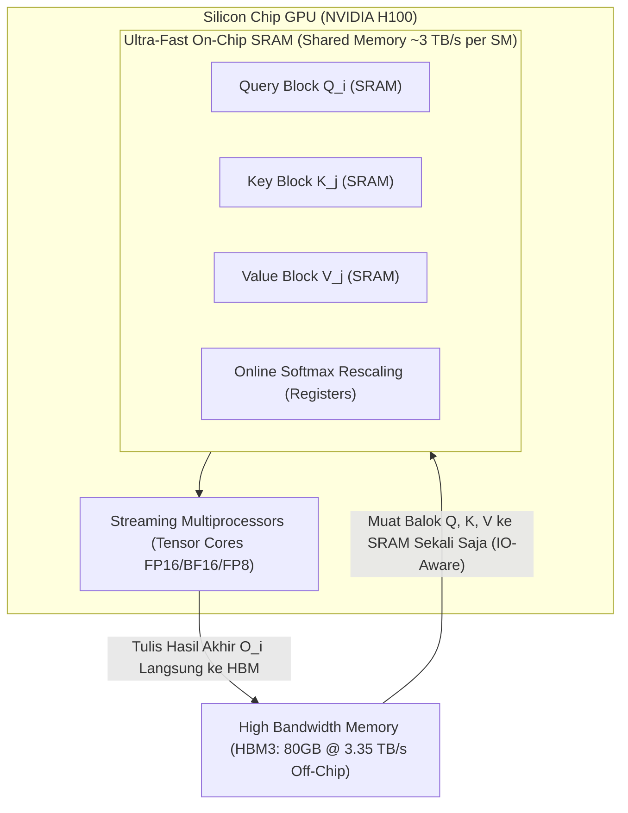

# Modul 194: Rekayasa Sistem AI Skala Produksi (Pemrograman CUDA GPU, Presisi FP16/BF16, Paralelisme Tensor ZeRO, FlashAttention)

**Navigasi**: [⬅️ Master Index](../../INDEX.md) | [Tingkat 12: Tingkat 12: Data Science, AI, Machine Learning, Deep Learning & MLOps](./README.md)
*Sebelumnya*: [193. pembelajaran-penguatan-reinforcement-learning](./193-pembelajaran-penguatan-reinforcement-learning.md) | *Berikutnya*: [195. siklus-hidup-operasionalisasi-ai-mlops](./195-siklus-hidup-operasionalisasi-ai-mlops.md)

---

## 1. Intuisi Dasar Tanpa Jargon ("Seperti Bayi Baru Lahir")
Melatih model kecerdasan buatan modern (seperti LLaMA, GPT, atau Claude) dengan ratusan miliar parameter seperti memindahkan sebuah gunung menggunakan armada truk raksasa. Satu kartu grafis GPU tercanggih sekalipun (seperti NVIDIA H100 80GB VRAM) tidak akan pernah cukup untuk menampung satu model utuh sendirian.

Dalam memori GPU, setiap parameter tidak hanya membutuhkan tempat untuk bobotnya sendiri: ia membutuhkan tempat untuk gradiennya, serta status optimizer (pada AdamW, dibutuhkan 16 hingga 20 byte memori per parameter!) ([Rajbhandari et al. - ZeRO Memory Analysis](https://arxiv.org/abs/1910.02054)).

**Rekayasa Sistem AI Skala Produksi** adalah seni arsitektur perangkat keras dan perangkat lunak paralel tingkat rendah: memotong-motong model raksasa ke ribuan GPU yang terhubung via kabel serat optik berkecepatan tinggi (InfiniBand/NVLink), menulis kernel komputasi GPU murni (CUDA/Triton) agar register chip tidak pernah menganggur, dan memanfaatkan presisi angka pecahan mini (FP16/BF16/FP8) untuk melipatgandakan kecepatan komputasi tanpa merusak kecerdasan model ([FlashAttention: Fast and Memory-Efficient Exact Attention](https://arxiv.org/abs/2205.14135)).

## 2. Fondasi Teoretis & Aksiomatik / Matematis
Formulasi Matematis & Rekayasa Memori AI Skala Besar:

1. **Analisis Konsumsi Memori Pelatihan LLM (AdamW 16-bit)**:
Untuk model dengan $\Phi$ parameter yang dilatih dalam mixed-precision:
* Bobot Parameter Model (FP16/BF16): $2\Phi$ bytes
* Gradien (FP16/BF16): $2\Phi$ bytes
* Status Optimizer AdamW (Salinan Bobot Master FP32 + Momen ke-1 FP32 + Momen ke-2 FP32): $(4 + 4 + 4)\Phi = 12\Phi$ bytes
* **Total Memori Statis Minimum**: $2\Phi + 2\Phi + 12\Phi = 16\Phi$ bytes!
Untuk model 70B parameter: $16 \times 70 \times 10^9 \approx 1.120\text{ GB}$ (Membutuhkan minimal 14 kartu GPU 80GB hanya untuk menampung bobot dan optimizer, belum termasuk buffer aktivasi dan KV-Cache!).

2. **Taksonomi Paralelisme ZeRO (Zero Redundancy Optimizer)**:
* **ZeRO-Stage 1**: Mempartisi status optimizer di seluruh $N_d$ GPU paralel: Konsumsi memori turun menjadi $4\Phi + \frac{12\Phi}{N_d}$ bytes.
* **ZeRO-Stage 2**: Mempartisi status optimizer dan gradien: Konsumsi memori turun menjadi $2\Phi + \frac{14\Phi}{N_d}$ bytes.
* **ZeRO-Stage 3**: Mempartisi seluruh bobot parameter, gradien, dan optimizer: Konsumsi memori menjadi $\frac{16\Phi}{N_d}$ bytes (Paralelisme Linier Sempurna).

3. **Komputasi FlashAttention (IO-Aware Exact Attention)**:
Mengatasi *Memory Bandwidth Bottleneck* pada High Bandwidth Memory (HBM) GPU dengan menghitung Softmax secara bertahap melalui teknik *tiling* di SRAM lokal chip:
$$m(x) = \max(m(x^{(1)}), m(x^{(2)})), \quad l(x) = e^{m(x^{(1)}) - m(x)} l(x^{(1)}) + e^{m(x^{(2)}) - m(x)} l(x^{(2)})$$
Meremajakan komputasi atensi dari $\mathcal{O}(N^2)$ akses HBM menjadi $\mathcal{O}(N)$ akses HBM, mempercepat eksekusi 2x s/d 4x tanpa ada aproksimasi numerik ([Dao et al. - FlashAttention](https://arxiv.org/abs/2205.14135)).

## 3. Anatomi Teknis & Cara Kerja Internal
Hierarki memori perangkat keras GPU NVIDIA Hopper/Blackwell dan arsitektur tiling FlashAttention:



Dengan menjaga kalkulasi matriks atensi tetap berada di dalam memori SRAM lokal chip dan tidak pernah menulis matriks perantara $S = QK^T \in \mathbb{R}^{N \times N}$ ke HBM eksternal, FlashAttention menghilangkan hambatan transfer bus memori secara radikal ([Tri Dao - FlashAttention-2](https://arxiv.org/abs/2307.08691)).

## 4. Implementasi Praktis & Kode / Simulasi Riil
```python
import torch
import torch.nn as nn

# 1. mixed Precision Training Loop dengan Automatic Mixed Precision (AMP)
class HeavyModel(nn.Module):
    def __init__(self):
        super().__init__()
        self.net = nn.Sequential(
            nn.Linear(2048, 4096),
            nn.GELU(),
            nn.Linear(4096, 2048)
        )
    def forward(self, x):
        return self.net(x)

device = "cuda" if torch.cuda.is_available() else "cpu"
model = HeavyModel().to(device)
optimizer = torch.optim.AdamW(model.parameters(), lr=1e-3)
scaler = torch.amp.GradScaler('cuda', enabled=(device == 'cuda'))

# Simulasi Input Data
x = torch.randn(64, 2048, device=device)
target = torch.randn(64, 2048, device=device)

# Pelatihan Mixed Precision (Forward di FP16/BF16, Gradien di FP32)
optimizer.zero_grad()

with torch.amp.autocast(device_type=('cuda' if device == 'cuda' else 'cpu'), dtype=torch.bfloat16):
    output = model(x)
    loss = nn.functional.mse_loss(output, target)

# Backward pass dengan scaling gradien untuk mencegah underflow numerik
scaler.scale(loss).backward()
scaler.step(optimizer)
scaler.update()

print(f"Perangkat Aktif   : {device}")
print(f"Mixed-Precision   : BFloat16/FP16 Berhasil Dieksekusi")
print(f"Loss Iterasi ke-1 : {loss.item():.6f}")
```

## 5. Miskonsepsi & Jebakan Industri
*Underflow Numerik pada Gradien FP16*: Format angka 16-bit float standar (IEEE FP16) hanya memiliki rentang eksponen 5-bit, sehingga angka yang lebih kecil dari $2^{-14} \approx 6.1 \times 10^{-5}$ akan dibulatkan menjadi 0 (*underflow*). Karena gradien backpropagation pada model dalam sering kali bernilai sangat kecil ($10^{-6}$), training FP16 tanpa `GradScaler` akan menyebabkan gradien lenyap total. Gunakan format **BFloat16** (8-bit eksponen sama dengan FP32) yang kebal terhadap masalah underflow ini ([Micikevicius et al. - Mixed Precision Training](https://arxiv.org/abs/1710.03740)).

## 6. Proyek Latihan & Rubrik Penilaian Mandiri
### Level 1 (Pemula)
Tulis skrip PyTorch yang membandingkan konsumsi alokasi memori VRAM GPU (`torch.cuda.memory_allocated()`) antara tensor berpresisi FP32 (float), FP16 (half), dan BFloat16, serta verifikasi penghematan memori sebesar 50%.
*Rubrik*: Output mencetak perbandingan memori teralokasi secara akurat.

### Level 2 (Menengah)
Implementasikan fungsi komputasi Scaled Dot-Product Attention menggunakan algoritma *Online Softmax Tiling* sederhana dalam Python/PyTorch murni: hitung nilai maksimum baris berjalan $m_i$ dan faktor normalisasi $l_i$ per blok tanpa pernah mengalokasikan matriks atensi penuh $N \times N$ sekaligus.
*Rubrik*: Hasil numerik output identik dengan `F.scaled_dot_product_attention` standar dengan toleransi $10^{-5}$.

### Level 3 (Mahir)
Tulis kernel GPU kustom menggunakan **OpenAI Triton** untuk operasi penambahan vektor atau perkalian matriks GEMM: tentukan alokasi blok program (`tl.program_id`), konfigurasi pemuatan blok SRAM via pointer arithmetics, dan ukur throughput komputasi (TFLOPS) terhadap implementasi PyTorch standar.
*Rubrik*: Kernel Triton terkompilasi dan dieksekusi di GPU dengan throughput $\ge 80\%$ performa PyTorch.

## 7. Rekomendasi Sumber Belajar Standar Emas
| Sumber Pembelajaran | Penulis / Institusi | Tautan Langsung | Fokus Materi |
| :--- | :--- | :--- | :--- |
| FlashAttention: Fast and Memory-Efficient Exact Attention | Tri Dao, Daniel Y. Fu, Stefano Ermon, Atri Rudra, Christopher Ré | [arXiv FlashAttention Paper](https://arxiv.org/abs/2205.14135) | Arsitektur IO-Aware, Online Softmax Tiling, Kernel GPU |
| ZeRO: Memory Optimizations Toward Training Trillion Parameter Models | Samyam Rajbhandari et al. (Microsoft DeepSpeed) | [arXiv DeepSpeed Paper](https://arxiv.org/abs/1910.02054) | Partisi State Optimizer, Gradien, Model Sharding |
| Mixed Precision Training | Paulius Micikevicius et al. (NVIDIA / Baidu) | [arXiv ICLR 2018 Paper](https://arxiv.org/abs/1710.03740) | Loss Scaling, Presisi FP16/BF16, Arsitektur Tensor Core |
| OpenAI Triton Documentation & Language Guide | OpenAI Systems Team | [Triton Official Documentation](https://triton-lang.org/main/index.html) | Pemrograman GPU Berperforma Tinggi untuk Python Developer |

---
*Navigasi Cepat*: [Ke Tingkat 12](./README.md) | [Ke Master Index](../../INDEX.md) | *Sebelumnya*: [193. pembelajaran-penguatan-reinforcement-learning](./193-pembelajaran-penguatan-reinforcement-learning.md) | *Berikutnya*: [195. siklus-hidup-operasionalisasi-ai-mlops](./195-siklus-hidup-operasionalisasi-ai-mlops.md)
