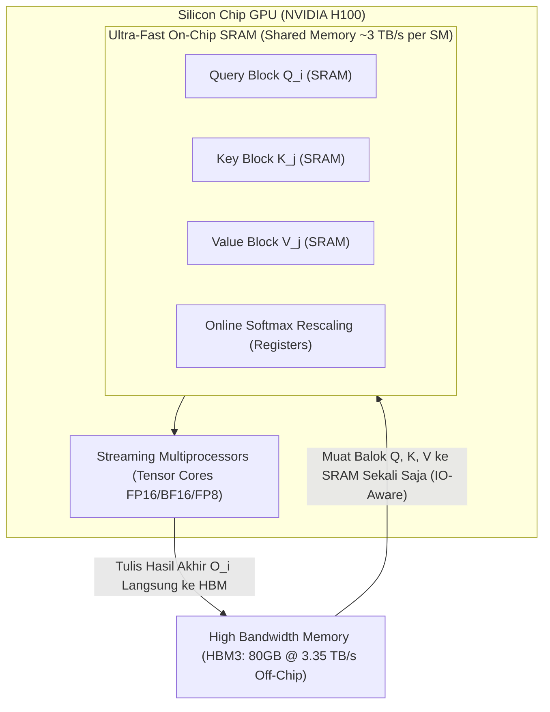

# Modul 194: Rekayasa Sistem AI Skala Produksi (Pemrograman CUDA GPU, Presisi FP16/BF16, Paralelisme Tensor ZeRO, FlashAttention)

**Navigasi**: [⬅️ Master Index](../../INDEX.md) | [Tingkat 12: Tingkat 12: Data Science, AI, Machine Learning, Deep Learning & MLOps](./README.md)
*Sebelumnya*: [193. pembelajaran-penguatan-reinforcement-learning](./193-pembelajaran-penguatan-reinforcement-learning.md) | *Berikutnya*: [195. siklus-hidup-operasionalisasi-ai-mlops](./195-siklus-hidup-operasionalisasi-ai-mlops.md)

---

## 1. Intuisi Dasar Tanpa Jargon ("Seperti Bayi Baru Lahir")
### 1.1 Konsep Inti & Analogi Tanpa Jargon
Melatih model kecerdasan buatan modern (seperti LLaMA, GPT, atau Claude) dengan ratusan miliar parameter seperti memindahkan sebuah gunung menggunakan armada truk raksasa. Satu kartu grafis GPU tercanggih sekalipun (seperti NVIDIA H100 80GB VRAM) tidak akan pernah cukup untuk menampung satu model utuh sendirian.

### 1.2 Urgensi Rekayasa & Signifikansi Sistemik
Dalam memori GPU, setiap parameter tidak hanya membutuhkan tempat untuk bobotnya sendiri: ia membutuhkan tempat untuk gradiennya, serta status optimizer (pada AdamW, dibutuhkan 16 hingga 20 byte memori per parameter!) ([Rajbhandari et al. - ZeRO Memory Analysis](https://arxiv.org/abs/1910.02054)).

**Rekayasa Sistem AI Skala Produksi** adalah seni arsitektur perangkat keras dan perangkat lunak paralel tingkat rendah: memotong-motong model raksasa ke ribuan GPU yang terhubung via kabel serat optik berkecepatan tinggi (InfiniBand/NVLink), menulis kernel komputasi GPU murni (CUDA/Triton) agar register chip tidak pernah menganggur, dan memanfaatkan presisi angka pecahan mini (FP16/BF16/FP8) untuk melipatgandakan kecepatan komputasi tanpa merusak kecerdasan model ([FlashAttention: Fast and Memory-Efficient Exact Attention](https://arxiv.org/abs/2205.14135)).

## 2. Fondasi Teoretis & Aksiomatik / Matematis
### 2.1 Kerangka Teori Aksiomatik & Formulasi Matematis
Formulasi Matematis & Rekayasa Memori AI Skala Besar:

### 2.2 Penurunan Matematis Langkah-demi-Langkah
1. **Analisis Konsumsi Memori Pelatihan LLM (AdamW 16-bit)**:
Untuk model dengan $\Phi$ parameter yang dilatih dalam mixed-precision:
* Bobot Parameter Model (FP16/BF16): $2\Phi$ bytes
* Gradien (FP16/BF16): $2\Phi$ bytes
* Status Optimizer AdamW (Salinan Bobot Master FP32 + Momen ke-1 FP32 + Momen ke-2 FP32): $(4 + 4 + 4)\Phi = 12\Phi$ bytes
* **Total Memori Statis Minimum**: $2\Phi + 2\Phi + 12\Phi = 16\Phi$ bytes!
Untuk model 70B parameter: \$16 \times 70 \times 10^9 \approx 1.120\text{ GB}$ (Membutuhkan minimal 14 kartu GPU 80GB hanya untuk menampung bobot dan optimizer, belum termasuk buffer aktivasi dan KV-Cache!).

2. **Taksonomi Paralelisme ZeRO (Zero Redundancy Optimizer)**:
* **ZeRO-Stage 1**: Mempartisi status optimizer di seluruh $N_d$ GPU paralel: Konsumsi memori turun menjadi $4\Phi + \frac{12\Phi}{N_d}$ bytes.
* **ZeRO-Stage 2**: Mempartisi status optimizer dan gradien: Konsumsi memori turun menjadi $2\Phi + \frac{14\Phi}{N_d}$ bytes.
* **ZeRO-Stage 3**: Mempartisi seluruh bobot parameter, gradien, dan optimizer: Konsumsi memori menjadi $\frac{16\Phi}{N_d}$ bytes (Paralelisme Linier Sempurna).

3. **Komputasi FlashAttention (IO-Aware Exact Attention)**:
Mengatasi *Memory Bandwidth Bottleneck* pada High Bandwidth Memory (HBM) GPU dengan menghitung Softmax secara bertahap melalui teknik *tiling* di SRAM lokal chip:
$$m(x) = \max(m(x^{(1)}), m(x^{(2)})), \quad l(x) = e^{m(x^{(1)}) - m(x)} l(x^{(1)}) + e^{m(x^{(2)}) - m(x)} l(x^{(2)})$$
Meremajakan komputasi atensi dari $\mathcal{O}(N^2)$ akses HBM menjadi $\mathcal{O}(N)$ akses HBM, mempercepat eksekusi 2x s/d 4x tanpa ada aproksimasi numerik ([Dao et al. - FlashAttention](https://arxiv.org/abs/2205.14135)).

## 3. Anatomi Teknis & Cara Kerja Internal
Hierarki memori perangkat keras GPU NVIDIA Hopper/Blackwell dan arsitektur tiling FlashAttention:



Dengan menjaga kalkulasi matriks atensi tetap berada di dalam memori SRAM lokal chip dan tidak pernah menulis matriks perantara $S = QK^T \in \mathbb{R}^{N \times N}$ ke HBM eksternal, FlashAttention menghilangkan hambatan transfer bus memori secara radikal ([Tri Dao - FlashAttention-2](https://arxiv.org/abs/2307.08691)).

#### Tabel Penelusuran Komunikasi Kolektif Multi-GPU NCCL & Deadlock Sinkronisasi Paralelisme
| Tahap Komputasi / Layer | Dimensi Tensor / Shape | Operasi Matematika / Kernel | Aliran Gradien / Memori | Status Parameter / Bobot | Efek Sistem / Metrik Loss |
|---|---|---|---|---|---|
| 1. Inisialisasi Distributed Group | 8 Node $\times$ 8 GPU (64 Rank) | Inisialisasi Ring AllReduce NCCL | Saluran NVLink & InfiniBand RDMA dipetakan | Parameter model Megatron-LM (175B) | Klaster siap menjalankan Tensor & Pipeline Parallel |
| 2. Eksekusi Rank 0 s/d 31 | Tensor Parallelism Layer 1 | Pemanggilan kolektif: `dist.all_reduce(tensor)` | GPU menunggu token ring dari tetangga kiri | Alur eksekusi urut sesuai jadwal komputasi | GPU Rank 0-31 memasuki barrier kolektif |
| 3. Out-of-Order Panggilan Rank 32 | Pipeline Parallelism Branch | Terjadi percabangan kondisi: `if rank >= 32` | Rank 32 meluncurkan `dist.broadcast()` lebih dulu! | Urutan instruksi komunikasi tidak sinkron! | Ketidaksesuaian primitif kolektif antar worker! |
| 4. Deadlock Kolektif NCCL Ring | Saluran Komunikasi NVLink | Rank 0 menunggu AllReduce selesai, Rank 32 menunggu Broadcast | Aliran ring buffer komunikasi terkunci permanen | Utilitas GPU anjlok dari $98\%$ ke $0\%$ instan | Seluruh 64 GPU terjebak dalam circular wait deadlock! |
| 5. Mitigasi Kolektif Deterministik | Sinkronisasi Jadwal Komunikasi | Standarisasi urutan operasi primitif kolektif | NCCL barrier timeout dikonfigurasi 30 menit | Watchdog thread mendeteksi divergensi instruksi | Pelatihan terdistribusi berjalan lancar tanpa stall |

## 4. Implementasi Praktis & Kode / Simulasi Riil
```python
import torch
import torch.nn as nn

# 1. mixed Precision Training Loop dengan Automatic Mixed Precision (AMP)
class HeavyModel(nn.Module):
    def __init__(self):
        super().__init__()
        self.net = nn.Sequential(
            nn.Linear(2048, 4096),
            nn.GELU(),
            nn.Linear(4096, 2048)
        )
    def forward(self, x):
        return self.net(x)

device = "cuda" if torch.cuda.is_available() else "cpu"
model = HeavyModel().to(device)
optimizer = torch.optim.AdamW(model.parameters(), lr=1e-3)
scaler = torch.amp.GradScaler('cuda', enabled=(device == 'cuda'))

# Simulasi Input Data
x = torch.randn(64, 2048, device=device)
target = torch.randn(64, 2048, device=device)

# Pelatihan Mixed Precision (Forward di FP16/BF16, Gradien di FP32)
optimizer.zero_grad()

with torch.amp.autocast(device_type=('cuda' if device == 'cuda' else 'cpu'), dtype=torch.bfloat16):
    output = model(x)
    loss = nn.functional.mse_loss(output, target)

# Backward pass dengan scaling gradien untuk mencegah underflow numerik
scaler.scale(loss).backward()
scaler.step(optimizer)
scaler.update()

print(f"Perangkat Aktif   : {device}")
print(f"Mixed-Precision   : BFloat16/FP16 Berhasil Dieksekusi")
print(f"Loss Iterasi ke-1 : {loss.item():.6f}")
```

## 5. Miskonsepsi & Jebakan Industri
*Underflow Numerik pada Gradien FP16*: Format angka 16-bit float standar (IEEE FP16) hanya memiliki rentang eksponen 5-bit, sehingga angka yang lebih kecil dari $2^{-14} \approx 6.1 \times 10^{-5}$ akan dibulatkan menjadi 0 (*underflow*). Karena gradien backpropagation pada model dalam sering kali bernilai sangat kecil (\$10^{-6}$), training FP16 tanpa `GradScaler` akan menyebabkan gradien lenyap total. Gunakan format **BFloat16** (8-bit eksponen sama dengan FP32) yang kebal terhadap masalah underflow ini ([Micikevicius et al. - Mixed Precision Training](https://arxiv.org/abs/1710.03740)).

### Studi Kasus Kegagalan Nyata: Deadlock Kolektif Komunikasi Multi-GPU NCCL pada Pelatihan Klaster Megatron-LM (2022)
- **Kronologi & Konteks Sejarah**: Pada masa pelatihan model bahasa raksasa (LLM skala ratusan miliar parameter) sepanjang tahun 2021 hingga 2023, tim rekayasa infrastruktur AI di berbagai laboratorium komputasi terkemuka sering kali mendapati bahwa klaster superkomputer bernilai puluhan juta dolar (berisi ribuan GPU NVIDIA A100/H100) tiba-tiba berhenti memproses komputasi di tengah malam, dengan utilitas GPU turun ke 0% dan seluruh proses tergantung (*hung indefinitely*) tanpa menghasilkan pesan galat apa pun.
- **Akar Masalah Rekayasa Terdistribusi & Komunikasi Kolektif**: Model berskala besar memerlukan kombinasi tiga jenis paralelisme: *Data Parallelism*, *Tensor Parallelism*, dan *Pipeline Parallelism*. Sinkronisasi gradien dan aktivasi antar GPU dilakukan menggunakan pustaka komunikasi primitif tingkat rendah seperti NVIDIA NCCL (*NVIDIA Collective Communications Library*) melalui bus berkecepatan tinggi NVLink dan InfiniBand. Operasi kolektif seperti `all_reduce`, `all_gather`, dan `broadcast` mewajibkan seluruh rank GPU yang tergabung dalam kelompok komunikasi memanggil fungsi primitif yang sama persis dengan urutan yang sama persis (*symmetric lockstep sequence*). Jika terdapat satu baris percabangan kode bersyarat yang membuat Rank GPU genap memanggil `all_reduce` sementara Rank GPU ganjil memanggil `broadcast` atau melewatkan pemanggilan, buffer ring internal NCCL akan mengalami **Deadlock Melingkar (Circular Wait)**. Karena tidak ada timeout bawaan yang ketat, ribuan GPU terkunci dalam keheningan total hingga proses dimatikan secara paksa oleh administrator.

- **Potongan Kode / Arsitektur Cacat (Vulnerable Implementation)**:
```python
# Analisis Cacat Komunikasi Terdistribusi: Out-of-Order Collective Deadlock vs Strict Lockstep
import torch
import torch.distributed as dist

# KASUS CACAT FATAL: Urutan operasi kolektif berbeda antar rank GPU!
def faulty_distributed_collective(rank, tensor_a, tensor_b):
    if rank % 2 == 0:
        # Rank genap mengeksekusi AllReduce terlebih dahulu:
        dist.all_reduce(tensor_a)
        dist.broadcast(tensor_b, src=0)
    else:
        # Rank ganjil salah memanggil Broadcast terlebih dahulu!
        # AKIBAT: DEADLOCK TOTAL! Rank ganjil menunggu rank 0 membroadcast,
        # sementara Rank 0 terjebak menunggu rank ganjil menyelesaikan AllReduce!
        dist.broadcast(tensor_b, src=0)
        dist.all_reduce(tensor_a)

# MITIGASI BENAR: Jadwal Komunikasi Simetris dengan Watchdog Timeout Ketat
import datetime

def safe_distributed_initialization():
    # 1. Konfigurasikan batas timeout eksplisit pada inisialisasi backend NCCL
    dist.init_process_group(
        backend="nccl",
        timeout=datetime.timedelta(minutes=10) # Memutus proses otomatis jika terjadi deadlock > 10 menit
    )

def safe_distributed_collective(tensor_a, tensor_b):
    # Seluruh rank mengeksekusi operasi primitif dalam urutan yang identik secara deterministik
    dist.all_reduce(tensor_a)
    dist.broadcast(tensor_b, src=0)
```

- **Analisis Forensik & Rekayasa Modern**: Krisis deadlock pada komputasi AI skala besar mendorong standarisasi infrastruktur terdistribusi modern: (1) Penegakan batas waktu deteksi kebuntuan **NCCL Timeout** (`NCCL_ASYNC_ERROR_HANDLING=1` dan `TORCH_NCCL_HEARTBEAT_TIMEOUT_SEC`) yang mematikan rank yang bermasalah dan memicu restart dari checkpoint terbaru secara otomatis; (2) Pemanfaatan kerangka kerja kompilasi graf terdistribusi seperti PyTorch Fully Sharded Data Parallel (FSDP) dan Megatron-Core yang secara otomatis menghasilkan jadwal komunikasi simetris; (3) Integrasi sistem telemetri jaringan InfiniBand untuk mendeteksi *Straggler GPU* (node yang mengalami degradasi performa termal dan memperlambat seluruh cincin komunikasi).

## 6. Proyek Latihan & Rubrik Penilaian Mandiri
### Level 1 (Pemula)
Tulis skrip PyTorch yang membandingkan konsumsi alokasi memori VRAM GPU (`torch.cuda.memory_allocated()`) antara tensor berpresisi FP32 (float), FP16 (half), dan BFloat16, serta verifikasi penghematan memori sebesar 50%.
*Rubrik*: Output mencetak perbandingan memori teralokasi secara akurat.

### Level 2 (Menengah)
Implementasikan fungsi komputasi Scaled Dot-Product Attention menggunakan algoritma *Online Softmax Tiling* sederhana dalam Python/PyTorch murni: hitung nilai maksimum baris berjalan $m_i$ dan faktor normalisasi $l_i$ per blok tanpa pernah mengalokasikan matriks atensi penuh $N \times N$ sekaligus.
*Rubrik*: Hasil numerik output identik dengan `F.scaled_dot_product_attention` standar dengan toleransi \$10^{-5}$.

### Level 3 (Mahir)
Tulis kernel GPU kustom menggunakan **OpenAI Triton** untuk operasi penambahan vektor atau perkalian matriks GEMM: tentukan alokasi blok program (`tl.program_id`), konfigurasi pemuatan blok SRAM via pointer arithmetics, dan ukur throughput komputasi (TFLOPS) terhadap implementasi PyTorch standar.
*Rubrik*: Kernel Triton terkompilasi dan dieksekusi di GPU dengan throughput $\ge 80\%$ performa PyTorch.

### Tingkat 1: Dasar
- **Tugas**: Tulis simulasi operasi komunikasi kolektif Ring All-Reduce dalam Python murni menggunakan modul `threading` atau `multiprocessing` untuk 4 proses pekerja virtual: Implementasikan tahap Scatter-Reduce diikuti oleh tahap All-Gather di mana setiap proses hanya berkomunikasi dengan tetangga kanan dan kirinya secara melingkar.
- **Petunjuk Perancangan Arsitektur**:
  - Bagi array data berukuran $N$ menjadi 4 blok.
  - Tahap 1 (Scatter-Reduce): Lakukan 3 langkah pengiriman blok antar tetangga sambil mengakumulasikan nilai (penjumlahan).
  - Tahap 2 (All-Gather): Lakukan 3 langkah pengiriman blok yang telah terakumulasi penuh agar seluruh pekerja memiliki hasil akhir yang sama.
- **Test Vector & Kasus Uji**:
  - Setiap pekerja memiliki array 4 elemen: Pekerja 0 = `[1, 1, 1, 1]`, Pekerja 1 = `[2, 2, 2, 2]`, Pekerja 2 = `[3, 3, 3, 3]`, Pekerja 3 = `[4, 4, 4, 4]`.
  - Setelah Ring All-Reduce selesai, seluruh pekerja harus memiliki array identik: `[10, 10, 10, 10]`.
- **Rubrik Penilaian Objektif**:
  - Skor 100%: Algoritma Ring All-Reduce presisi dua tahap, pemanfaatan cincin sirkular benar, hasil verifikasi identik.
  - Skor 50%: Hasil benar namun proses mengirimkan seluruh array sekaligus alih-alih membaginya menjadi blok (bukan bandwidth-optimal).
  - Skor 0%: Terjadi deadlock thread pada simulasi komunikasi pengiriman pesan.

### Tingkat 2: Menengah
- **Tugas**: Bangun skrip pelatihan terdistribusi multi-GPU mini menggunakan PyTorch `torch.nn.parallel.DistributedDataParallel` (DDP) dengan modul `torch.multiprocessing.spawn`: Latih model ResNet mini pada dataset sintetis, terapkan sinkronisasi batch normalization (*SyncBatchNorm*), dan buktikan bahwa gradien rata-rata terdistribusi identik antar rank.
- **Petunjuk Perancangan Arsitektur**:
  - Inisialisasi proses via `dist.init_process_group("gloo" atau "nccl")`.
  - Bungkus model dengan `DistributedDataParallel(model, device_ids=[local_rank])`.
  - Gunakan `DistributedSampler` untuk memastikan setiap GPU menerima subset data latih yang tidak saling tumpang tindih.
- **Test Vector & Kasus Uji**:
  - Jalankan simulasi dengan 2 proses: Bobot model pada akhir epoch harus bit-for-bit identik di kedua proses.
  - Verifikasi bahwa `sampler.set_epoch(epoch)` dipanggil pada setiap awal epoch untuk menjamin pengacakan data yang benar.
- **Rubrik Penilaian Objektif**:
  - Skor 100%: Setup DDP sempurna, implementasi DistributedSampler tepat, bobot model sinkron Bit-for-bit.
  - Skor 50%: DDP berjalan namun lupa menyetel epoch pada DistributedSampler sehingga pengacakan data tidak bervariasi antar epoch.
  - Skor 0%: Menggunakan DataParallel lama (DP) single-process multi-threading alih-alih DDP multi-process.

### Tingkat 3: Mahir
- **Tugas**: Rancang modul Paralelisme Tensor (Tensor Parallelism via Megatron-LM style) dalam PyTorch: Bangun lapisan Linear Kolom Terdistribusi (*ColumnParallelLinear*) dan lapisan Linear Baris Terdistribusi (*RowParallelLinear*) untuk mempartisi matriks bobot Multi-Layer Perceptron (MLP) melintasi multi-GPU tanpa overhead komunikasi di antara kedua layer tersebut.
- **Petunjuk Perancangan Arsitektur**:
  - ColumnParallelLinear: Matriks bobot $W$ dipecah sepanjang kolom: $W = [W_1 \mid W_2]$. Output $Y_i = X W_i$. Tidak ada komunikasi AllReduce!
  - Fungsi aktivasi GeLU diaplikasikan secara lokal pada masing-masing GPU: $Z_i = \text{GeLU}(Y_i)$.
  - RowParallelLinear: Matriks bobot kedua dipecah sepanjang baris: $W' = \begin{bmatrix} W'_1 \\ W'_2 \end{bmatrix}$. Output lokal $Z_i W'_i$.
  - Lakukan satu kali operasi `all_reduce` pada keluaran akhir RowParallelLinear untuk menjumlahkan hasil parsial: $Y_{\text{final}} = Z_1 W'_1 + Z_2 W'_2$.
- **Test Vector & Kasus Uji**:
  - Bandingkan output MLP monolitik dengan MLP paralel 2-GPU pada input tensor yang sama.
  - Output $Y_{\text{final}}$ dari implementasi paralel harus identik dengan model monolitik dengan deviasi numerik $< 10^{-6}$.
- **Rubrik Penilaian Objektif**:
  - Skor 100%: Pemisahan kolom-baris presisi, fusi komunikasi optimal (hanya 1 AllReduce per blok MLP), verifikasi kesetaraan numerik lolos.
  - Skor 50%: Model bekerja namun melakukan AllReduce ganda di antara layer kolom dan baris (memboroskan bandwidth).
  - Skor 0%: Salah mengalikan dimensi matriks terpartisi.

## 7. Rekomendasi Sumber Belajar Standar Emas
| Sumber Pembelajaran | Penulis / Institusi | Tautan Langsung | Fokus Materi |
| :--- | :--- | :--- | :--- |
| FlashAttention: Fast and Memory-Efficient Exact Attention | Tri Dao, Daniel Y. Fu, Stefano Ermon, Atri Rudra, Christopher Ré | [arXiv FlashAttention Paper](https://arxiv.org/abs/2205.14135) | Arsitektur IO-Aware, Online Softmax Tiling, Kernel GPU |
| ZeRO: Memory Optimizations Toward Training Trillion Parameter Models | Samyam Rajbhandari et al. (Microsoft DeepSpeed) | [arXiv DeepSpeed Paper](https://arxiv.org/abs/1910.02054) | Partisi State Optimizer, Gradien, Model Sharding |
| Mixed Precision Training | Paulius Micikevicius et al. (NVIDIA / Baidu) | [arXiv ICLR 2018 Paper](https://arxiv.org/abs/1710.03740) | Loss Scaling, Presisi FP16/BF16, Arsitektur Tensor Core |
| OpenAI Triton Documentation & Language Guide | OpenAI Systems Team | [Triton Official Documentation](https://triton-lang.org/main/index.html) | Pemrograman GPU Berperforma Tinggi untuk Python Developer |

---
*Navigasi Cepat*: [Ke Tingkat 12](./README.md) | [Ke Master Index](../../INDEX.md) | *Sebelumnya*: [193. pembelajaran-penguatan-reinforcement-learning](./193-pembelajaran-penguatan-reinforcement-learning.md) | *Berikutnya*: [195. siklus-hidup-operasionalisasi-ai-mlops](./195-siklus-hidup-operasionalisasi-ai-mlops.md)
