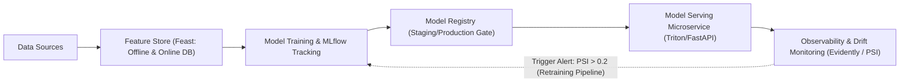

# Modul 195: Siklus Hidup Operasionalisasi AI / MLOps (Pelacakan Eksperimen MLflow, Feature Store Feast, Monitoring Data Drift)

**Navigasi**: [⬅️ Master Index](../../INDEX.md) | [Tingkat 12: Tingkat 12: Data Science, AI, Machine Learning, Deep Learning & MLOps](./README.md)
*Sebelumnya*: [194. rekayasa-sistem-ai-skala-produksi](./194-rekayasa-sistem-ai-skala-produksi.md) | *Berikutnya*: [196. fondasi-sains-kognitif-filsafat-pikiran](../13-sains-kognitif-nlp/196-fondasi-sains-kognitif-filsafat-pikiran.md)

---

## 1. Intuisi Dasar Tanpa Jargon ("Seperti Bayi Baru Lahir")
### 1.1 Konsep Inti & Analogi Tanpa Jargon
Membangun model machine learning di dalam Jupyter Notebook seperti memasak sup yang sangat lezat di dapur rumah Anda sendiri untuk porsi satu orang. Namun, **MLOps (Machine Learning Operations)** adalah membangun pabrik sup kalengan multinasional yang harus memproduksi 100.000 kaleng sup setiap hari dengan rasa yang 100% konsisten, higienis, teruji laboratorium, dan tidak basi saat dikirim ke supermarket di seluruh dunia ([Sculley et al. - Hidden Technical Debt in Machine Learning Systems](https://research.google/pubs/pub43146/)).

### 1.2 Urgensi Rekayasa & Signifikansi Sistemik
Di dunia nyata, kode pemodelan AI hanyalah kotak kecil di tengah ekosistem raksasa: Anda butuh melacak eksperimen mana yang menghasilkan akurasi terbaik (**MLflow**), menyimpan fitur siap saji agar tim training dan tim web server tidak menghitung ulang hal yang sama (**Feast Feature Store**), serta sistem deteksi dini jika data perilaku konsumen tiba-tiba berubah drastis karena krisis ekonomi atau pandemi (**Data Drift & Concept Drift**) ([Guyenet - Designing Machine Learning Systems](https://www.oreilly.com/library/view/designing-machine-learning/9781098107956/)).

## 2. Fondasi Teoretis & Aksiomatik / Matematis
### 2.1 Kerangka Teori Aksiomatik & Formulasi Matematis
Landasan Formal MLOps & Deteksi Pergeseran Distribusi Data:

### 2.2 Penurunan Matematis Langkah-demi-Langkah
1. **Taksonomi Pergeseran Distribusi (Data & Concept Drift)**:
Berdasarkan aturan probabilitas bersama $P(X, Y) = P(Y \mid X) P(X)$:
* **Covariate Drift (Data Drift)**: Distribusi fitur input berubah, tetapi pemetaan kondisional label tetap:
$$P_t(X) \neq P_{t+1}(X), \quad P_t(Y \mid X) = P_{t+1}(Y \mid X)$$
* **Concept Drift**: Distribusi fitur input tetap sama, tetapi hubungan pemetaan label berubah (misal: definisi penipuan transaksi berubah):
$$P_t(X) = P_{t+1}(X), \quad P_t(Y \mid X) \neq P_{t+1}(Y \mid X)$$
* **Prior Probability Shift**: Rasio distribusi label berubah: $P_t(Y) \neq P_{t+1}(Y)$.

2. **Metrik Statistik Deteksi Drift**:
* **Population Stability Index (PSI)**: Mengukur pergeseran distribusi populasi antar interval waktu:
$$\text{PSI} = \sum_{b=1}^B \left( \%Actual_b - \%Expected_b \right) \times \ln\left( \frac{\%Actual_b}{\%Expected_b} \right)$$
Ambang batas industri: $\text{PSI} < 0.1$ (Stabil/Tidak Ada Drift), $0.1 \le \text{PSI} \le 0.2$ (Drift Sedang), $\text{PSI} > 0.2$ (Drift Parah: Latih Ulang Model!).
* **Uji Dua-Sampel Kolmogorov-Smirnov (KS-Test)**:
$$D = \sup_x |F_{\text{baseline}}(x) - F_{\text{production}}(x)|$$
Jika $p\text{-value} < \alpha$ (misal 0.05), tolak hipotesis nol: terjadi pergeseran distribusi yang signifikan secara statistik ([Massey - The Kolmogorov-Smirnov Test for Goodness of Fit](https://www.jstor.org/stable/2280095)).

## 3. Anatomi Teknis & Cara Kerja Internal
Arsitektur siklus hidup MLOps skala produksi dengan feedback loop otomatis:



Feature Store menjamin konsistensi data antara *offline training* (batch terdistribusi) dan *online inference* (key-value Redis latensi milidetik), mengeliminasi *Training-Serving Skew* yang kerap menghancurkan performa model di sistem produksi ([Hermann & Del Balso - Meet Michelangelo: Uber's ML Platform](https://www.uber.com/en-ID/blog/michelangelo-machine-learning-platform/)).

#### Tabel Penelusuran Pipeline Ekstraksi Fitur & Kebocoran Silent Schema Drift
| Tahap Komputasi / Layer | Dimensi Tensor / Shape | Operasi Matematika / Kernel | Aliran Gradien / Memori | Status Parameter / Bobot | Efek Sistem / Metrik Loss |
|---|---|---|---|---|---|
| 1. Perubahan Pipeline Upstream | Layanan Data Engine Unity | Format fitur diubah: Integer ID $\to$ Float Normalisasi | Tipe data kolom berubah tanpa notifikasi tim ML | Tidak ada kontrak skema (Pydantic / Great Exp) | Perubahan format dirilis diam-diam ke produksi |
| 2. Pemuatan Fitur ke Model | `(B=1000, D=80)` Vektor Fitur | Model Inferensi Penargetan Iklan Real-Time | Fitur integer lama mengharapkan rentang $[0, 1000]$ | Model menerima angka pecahan $[0.0, 1.0]$ | Tipe data float kompatibel sehingga tidak ada exception! |
| 3. Inferensi Tanpa Pesan Galat | Logit Probabilitas Klik Iklan | Model Deep Neural Network Mengevaluasi Input | Aktivasi neuron layer pertama mendekati nol | Model berjalan normal tanpa melempar runtime error! | Silent Failure / Kegagalan Senyap Sistemik! |
| 4. Kerusakan Keputusan Bisnis | Prediksi CTR Iklan Anjlok | Nilai prediksi probabilitas menjadi acak | Alokasi anggaran iklan terdistribusi ke target yang salah | Bidding mesin iklan salah mengestimasi nilai konversi | Nilai monetisasi tayangan iklan hancur berantakan |
| 5. Dampak Finansial & Pemulihan | Laporan Keuangan Unity Q1 2022 | Pendapatan Divisi Monetisasi Tergerus \$110 Juta | Tim teknis butuh 3 bulan untuk mendeteksi akar masalah | Nilai kapitalisasi pasar Unity anjlok $-37\%$ dalam 1 hari! | Audit pipeline skema data otomatis diadopsi permanen |

## 4. Implementasi Praktis & Kode / Simulasi Riil
```python
import numpy as np
from scipy import stats

# 1. Perhitungan Statistik Population Stability Index (PSI)
def calculate_psi(expected, actual, num_buckets=10):
    # Buat bin berdasarkan kuantil data baseline (expected)
    percentiles = np.linspace(0, 100, num_buckets + 1)
    bins = np.percentile(expected, percentiles)
    bins[0] = -np.inf
    bins[-1] = np.inf
    
    # Hitung proporsi frekuensi di setiap bucket
    expected_counts, _ = np.histogram(expected, bins=bins)
    actual_counts, _ = np.histogram(actual, bins=bins)
    
    expected_pct = expected_counts / len(expected)
    actual_pct = actual_counts / len(actual)
    
    # Hindari pembagian nol dengan epsilon smoothing
    eps = 1e-6
    expected_pct = np.clip(expected_pct, eps, 1.0)
    actual_pct = np.clip(actual_pct, eps, 1.0)
    
    # Rumus PSI
    psi_value = np.sum((actual_pct - expected_pct) * np.log(actual_pct / expected_pct))
    return psi_value

# Simulasi Baseline (Data Latihan) vs Production Data (Mengalami Data Drift)
np.random.seed(42)
baseline_data = np.random.normal(loc=50.0, scale=10.0, size=5000)
prod_data_stable = np.random.normal(loc=50.1, scale=10.2, size=5000) # Tanpa drift
prod_data_drifted = np.random.normal(loc=56.0, scale=12.0, size=5000) # Terjadi Data Drift!

psi_stable = calculate_psi(baseline_data, prod_data_stable)
psi_drifted = calculate_psi(baseline_data, prod_data_drifted)

# Uji Dua Sampel Kolmogorov-Smirnov (KS-Test)
ks_stat, ks_pvalue = stats.ks_2samp(baseline_data, prod_data_drifted)

print(f"PSI Data Stabil  : {psi_stable:.4f} (Status: AMAN, PSI < 0.1)")
print(f"PSI Data Bergeser: {psi_drifted:.4f} (Status: WASPADA DRIFT, PSI > 0.2!)")
print(f"KS-Test P-Value  : {ks_pvalue:.2e} (Tolak H0: Terjadi pergeseran distribusi nyata)")
```

## 5. Miskonsepsi & Jebakan Industri
*Training-Serving Skew*: Ketidaksesuaian implementasi fitur antara saat pelatihan model (misal ditulis dengan skrip SQL/Pandas batch) dan saat inferensi aplikasi langsung (misal ditulis ulang oleh tim backend dengan kode Java/Go/C++). Perbedaan pembulatan matematika mikro atau penanganan timezone dapat membuat distribusi data berbeda secara permanen, menyebabkan akurasi model ambruk seketika di level produksi. Mitigasi: gunakan *Feature Store* terpadu (seperti Feast) atau serialisasi pipeline komputasi fitur ([Google Rules of ML - Rule #29](https://developers.google.com/machine-learning/guides/rules-of-ml)).

### Studi Kasus Kegagalan Nyata: Kerugian Pendapatan $110 Juta Unity Technologies Akibat Silent Schema Drift pada Fitur AI (2022)
- **Kronologi & Konteks Sejarah**: Pada Mei 2022, perusahaan platform mesin game terkemuka Unity Technologies mengumumkan bahwa kesalahan data pada sistem penargetan iklan kecerdasan buatan (*Audience Pinpointer*) telah menghancurkan efektivitas algoritma monetisasi mereka, mengakibatkan penurunan estimasi pendapatan perusahaan sebesar $110 Juta dan memicu kejatuhan harga saham Unity hingga lebih dari 37% dalam satu hari perdagangan bursa.
- **Akar Masalah Rekayasa MLOps & Kerapuhan Skema Data**: Sistem machine learning Unity mengandalkan aliran data besar dari jutaan perangkat seluler untuk memprediksi pengguna mana yang memiliki probabilitas tinggi mengunduh atau melakukan pembelian dalam game. Kerusakan masif terjadi bukan karena arsitektur neural network yang rusak, melainkan karena fenomena **Silent Schema Drift**: sistem rekayasa data di sisi upstream memodifikasi format pengkodean fitur dan mengasimilasi data yang tercemar tanpa adanya validasi skema independen. Karena fitur baru tersebut tetap bertipe data numerik float, pipeline inferensi Python/C++ tidak melempar kesalahan sistem (*runtime exception*); model tetap mengeksekusi inferensi namun menghasilkan prediksi yang sepenuhnya acak. Ketiadaan pemantauan distribusi data berkelanjutan (*Data Drift Monitoring*) membuat bencana ini tidak terdeteksi selama berbulan-bulan di lingkungan produksi.

- **Potongan Kode / Arsitektur Cacat (Vulnerable Implementation)**:
```python
# Analisis Cacat MLOps: Ketiadaan Validasi Skema Data vs Kontrak Skema Pydantic
from pydantic import BaseModel, Field, field_validator
from typing import List

# KASUS CACAT FATAL: Fungsi inferensi menerima dictionary mentah tanpa validasi skema
def naive_inference_service(model, raw_feature_dict):
    # Jika upstream mengubah format dari ID integer [1..500] menjadi float ter-normalisasi [0.0..1.0],
    # kode ini TIDAK melempar error! Model memproses data sampah tanpa peringatan!
    feature_vector = [raw_feature_dict['user_category_id'], raw_feature_dict['app_frequency']]
    return model.predict([feature_vector]) # SILENT DEGRADATION!

# MITIGASI MODERN: Penegakan Kontrak Skema Data Ketat (Data Quality Gate)
class UserAdFeatures(BaseModel):
    user_category_id: int = Field(ge=1, le=1000, description="Kategori ID wajib integer 1-1000")
    app_frequency: float = Field(ge=0.0, le=100.0, description="Frekuensi sesi harian")
    
    @field_validator('user_category_id')
    def validate_integer_id(cls, v):
        if not isinstance(v, int):
            # Memblokir data yang melanggar kontrak skema sebelum mencapai model AI!
            raise ValueError(f"DATA_CORRUPTION_ALERT: user_category_id must be integer, got {type(v)}")
        return v

def safe_inference_service(model, raw_feature_dict):
    # Validasi skema secara ketat pada gerbang API inferensi
    validated_data = UserAdFeatures(**raw_feature_dict)
    feature_vector = [validated_data.user_category_id, validated_data.app_frequency]
    return model.predict([feature_vector])
```

- **Analisis Forensik & Rekayasa Modern**: Skandal keuangan Unity menjadi studi kasus wajib dalam disiplin MLOps modern: (1) Penerapan **Data Contracts** yang memperlakukan skema data seperti API publik yang tidak boleh diubah tanpa proses deprecation resmi; (2) Penerapan gerbang validasi otomatis menggunakan perkakas seperti **Great Expectations** atau **Pydantic** pada setiap titik transfer data antar microservice; (3) Implementasi sistem pemantauan performa model berkelanjutan (*Continuous Model Observability via Evidently AI / Arize*) yang membunyikan alarm otomatis jika distribusi prediksi atau metrik bisnis (seperti conversion rate) berdeviasi melampaui 3-sigma.

## 6. Proyek Latihan & Rubrik Penilaian Mandiri
### Level 1 (Pemula)
Gunakan pustaka MLflow untuk membuat sesi pelacakan eksperimen: catat parameter hyperparameter (learning rate, depth), metrik evaluasi (accuracy, f1-score), dan simpan artefak model Scikit-Learn yang telah dilatih menggunakan `mlflow.sklearn.log_model`.
*Rubrik*: Eksperimen tercatat lengkap dan dapat diinspeksi melalui MLflow UI lokal.

### Level 2 (Menengah)
Bangun sistem deteksi drift otomatis menggunakan pustaka `evidently` atau Scipy murni: buat fungsi yang menerima dua dataframe (referensi vs produksi), menghitung uji Kolmogorov-Smirnov pada seluruh kolom numerik, dan memicu alarm webhook / exception jika lebih dari 20% fitur mengalami $p < 0.01$.
*Rubrik*: Skrip mendeteksi pergeseran fitur secara otomatis pada dataset iris termodifikasi.

### Level 3 (Mahir)
Rancang arsitektur pipeline CI/CD/CT (Continuous Training) otomatis menggunakan GitHub Actions / GitLab CI: buat alur kerja yang secara otomatis memvalidasi kualitas data baru, mengeksekusi training ulang model jika terdeteksi drift, menguji performa model baru terhadap model juara (*challenger vs champion test*), dan mempromosikan model ke tahap Registry Production secara aman (*Canary Deployment*).
*Rubrik*: File konfigurasi YAML pipeline lengkap, mencakup unit testing model dan logic gate evaluasi.

### Tingkat 1: Dasar
- **Tugas**: Tulis suite pengujian kualitas data (*Data Quality Test Suite*) dalam Python menggunakan modul `pydantic` atau asersi manual yang memvalidasi integritas dataframe masukan: (1) Kolom non-nullable; (2) Batasan rentang nilai numerik ($ge, le$); (3) Keunikan kunci primer; (4) Nilai string sesuai dengan daftar enum kategori yang diizinkan.
- **Petunjuk Perancangan Arsitektur**:
  - Bangun kelas model skema data.
  - Iterasi setiap baris dataframe masukan dan tangkap seluruh pelanggaran validasi ke dalam laporan kesalahan terstruktur.
- **Test Vector & Kasus Uji**:
  - Berikan dataset uji berisi 100 baris dengan 3 baris cacat (nilai negatif pada kolom umur, nilai null pada ID, dan kategori tidak dikenal).
  - Validator harus menangkap tepat ketiga baris yang bermasalah dan menghasilkan ringkasan galat JSON terperinci.
- **Rubrik Penilaian Objektif**:
  - Skor 100%: Validasi skema komprehensif, pelaporan galat terstruktur, kinerja validasi cepat.
  - Skor 50%: Validasi bekerja namun hanya berhenti pada kesalahan pertama tanpa memeriksa baris-baris berikutnya.
  - Skor 0%: Hanya mengecek tipe data tanpa memvalidasi batasan nilai logika bisnis.

### Tingkat 2: Menengah
- **Tugas**: Bangun modul pelacak eksperimen machine learning mini (*Mini-MLflow Experiment Tracker*) dalam Python yang merekam: parameter hyperparameter, metrik evaluasi per epoch, artefak model biner yang disimpan, hash git commit saat eksekusi, serta lingkungan dependensi paket (`pip freeze`), lalu menyimpannya dalam struktur direktori metadata JSON terorganisir.
- **Petunjuk Perancangan Arsitektur**:
  - Buat context manager: `with ExperimentTracker(run_name="resnet_run_1") as tracker:`.
  - Metode: `tracker.log_param(key, val)`, `tracker.log_metric(key, val, step)`, `tracker.log_artifact(filepath)`.
  - Simpan metadata dalam format JSON terenkapsulasi yang menjamin reproduksibilitas eksperimen $100\%$.
- **Test Vector & Kasus Uji**:
  - Jalankan skrip pelatihan dengan 10 epoch pencatatan loss.
  - Verifikasi bahwa direktori `experiments/<run_id>/` memuat berkas `params.json`, `metrics.json`, `metadata.json`, dan file bobot model biner yang valid.
- **Rubrik Penilaian Objektif**:
  - Skor 100%: Perekaman eksperimen rapi berbasis context manager, pelacakan dependensi dan git hash otomatis, penanganan file aman.
  - Skor 50%: Berhasil mencatat metrik namun tidak menyimpan metadata lingkungan eksekusi (git commit/dependencies).
  - Skor 0%: Nilai metrik lama tertimpa pada setiap iterasi.

### Tingkat 3: Mahir
- **Tugas**: Rancang pipeline Feature Store mikro berbasis Point-in-Time Correctness (*Time-Travel Feature Retrieval*) dalam Python/SQL: Bangun mesin penggabungan fitur (*Feature Merger*) yang menggabungkan fitur agregasi dinamis (misal jumlah transaksi pengguna dalam 7 hari terakhir) dengan label peristiwa transaksi pada waktu $T_{\text{event}}$ tanpa membocorkan data masa depan ($T > T_{\text{event}}$).
- **Petunjuk Perancangan Arsitektur**:
  - Skema data: `user_id`, `event_timestamp`, `feature_value`.
  - Implementasikan logika ASOF JOIN: Untuk setiap observasi $(user, T_{\text{label}})$, ambil nilai fitur terbaru yang memiliki timestamp $T_{\text{feature}} \le T_{\text{label}}$.
  - Tulis tes asersi invarian: pastikan tidak ada satupun fitur dalam dataset pelatihan yang memiliki timestamp lebih baru daripada labelnya (*Zero Future Information Leakage*).
- **Test Vector & Kasus Uji**:
  - Masukkan log transaksi pengguna dengan update fitur berkelanjutan.
  - Lakukan kueri pengambilan fitur pada 3 titik waktu berbeda dalam riwayat pengguna: Data fitur yang dikembalikan harus mencerminkan kondisi historis akun pada detik tersebut persis.
- **Rubrik Penilaian Objektif**:
  - Skor 100%: Logika ASOF join presisi, jaminan matematis point-in-time correctness terbukti, kebal target leakage temporal.
  - Skor 50%: Pengambilan fitur bekerja namun menggunakan join biasa yang menyertakan data masa depan pada jendela hari yang sama.
  - Skor 0%: Mengambil fitur agregasi statis terkini untuk seluruh peristiwa historis.

## 7. Rekomendasi Sumber Belajar Standar Emas
| Sumber Pembelajaran | Penulis / Institusi | Tautan Langsung | Fokus Materi |
| :--- | :--- | :--- | :--- |
| Hidden Technical Debt in Machine Learning Systems | D. Sculley et al. (Google Research) | [NeurIPS 2015 Classic Paper](https://research.google/pubs/pub43146/) | Analisis Biaya Arsitektur ML, Training-Serving Skew, Boundary Erosion |
| Designing Machine Learning Systems | Chip Huyen | [O'Reilly Media Book](https://www.oreilly.com/library/view/designing-machine-learning/9781098107956/) | Desain MLOps End-to-End, Feature Engineering, Monitoring |
| MLflow: A Platform for Managing the Machine Learning Lifecycle | Matei Zaharia et al. (Databricks) | [MLflow Official Documentation](https://mlflow.org/docs/latest/index.html) | Tracking, Model Registry, Projects, Recipes |
| Feast: Feature Store for Machine Learning | Feast Open Source Community | [Feast Dev Documentation](https://docs.feast.dev/) | Arsitektur Point-in-Time Join, Online/Offline Synchronization |

---
*Navigasi Cepat*: [Ke Tingkat 12](./README.md) | [Ke Master Index](../../INDEX.md) | *Sebelumnya*: [194. rekayasa-sistem-ai-skala-produksi](./194-rekayasa-sistem-ai-skala-produksi.md) | *Berikutnya*: [196. fondasi-sains-kognitif-filsafat-pikiran](../13-sains-kognitif-nlp/196-fondasi-sains-kognitif-filsafat-pikiran.md)
