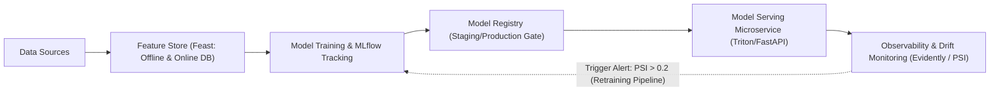

# Modul 195: Siklus Hidup Operasionalisasi AI / MLOps (Pelacakan Eksperimen MLflow, Feature Store Feast, Monitoring Data Drift)

**Navigasi**: [⬅️ Master Index](../../INDEX.md) | [Tingkat 12: Tingkat 12: Data Science, AI, Machine Learning, Deep Learning & MLOps](./README.md)
*Sebelumnya*: [194. rekayasa-sistem-ai-skala-produksi](./194-rekayasa-sistem-ai-skala-produksi.md) | *Berikutnya*: [196. fondasi-sains-kognitif-filsafat-pikiran](../13-sains-kognitif-nlp/196-fondasi-sains-kognitif-filsafat-pikiran.md)

---

## 1. Intuisi Dasar Tanpa Jargon ("Seperti Bayi Baru Lahir")
Membangun model machine learning di dalam Jupyter Notebook seperti memasak sup yang sangat lezat di dapur rumah Anda sendiri untuk porsi satu orang. Namun, **MLOps (Machine Learning Operations)** adalah membangun pabrik sup kalengan multinasional yang harus memproduksi 100.000 kaleng sup setiap hari dengan rasa yang 100% konsisten, higienis, teruji laboratorium, dan tidak basi saat dikirim ke supermarket di seluruh dunia ([Sculley et al. - Hidden Technical Debt in Machine Learning Systems](https://research.google/pubs/pub43146/)).

Di dunia nyata, kode pemodelan AI hanyalah kotak kecil di tengah ekosistem raksasa: Anda butuh melacak eksperimen mana yang menghasilkan akurasi terbaik (**MLflow**), menyimpan fitur siap saji agar tim training dan tim web server tidak menghitung ulang hal yang sama (**Feast Feature Store**), serta sistem deteksi dini jika data perilaku konsumen tiba-tiba berubah drastis karena krisis ekonomi atau pandemi (**Data Drift & Concept Drift**) ([Guyenet - Designing Machine Learning Systems](https://www.oreilly.com/library/view/designing-machine-learning/9781098107956/)).

## 2. Fondasi Teoretis & Aksiomatik / Matematis
Landasan Formal MLOps & Deteksi Pergeseran Distribusi Data:

1. **Taksonomi Pergeseran Distribusi (Data & Concept Drift)**:
Berdasarkan aturan probabilitas bersama $P(X, Y) = P(Y \mid X) P(X)$:
* **Covariate Drift (Data Drift)**: Distribusi fitur input berubah, tetapi pemetaan kondisional label tetap:
$$P_t(X) \neq P_{t+1}(X), \quad P_t(Y \mid X) = P_{t+1}(Y \mid X)$$
* **Concept Drift**: Distribusi fitur input tetap sama, tetapi hubungan pemetaan label berubah (misal: definisi penipuan transaksi berubah):
$$P_t(X) = P_{t+1}(X), \quad P_t(Y \mid X) \neq P_{t+1}(Y \mid X)$$
* **Prior Probability Shift**: Rasio distribusi label berubah: $P_t(Y) \neq P_{t+1}(Y)$.

2. **Metrik Statistik Deteksi Drift**:
* **Population Stability Index (PSI)**: Mengukur pergeseran distribusi populasi antar interval waktu:
$$\text{PSI} = \sum_{b=1}^B \left( \%Actual_b - \%Expected_b \right) \times \ln\left( \frac{\%Actual_b}{\%Expected_b} \right)$$
Ambang batas industri: $\text{PSI} < 0.1$ (Stabil/Tidak Ada Drift), $0.1 \le \text{PSI} \le 0.2$ (Drift Sedang), $\text{PSI} > 0.2$ (Drift Parah: Latih Ulang Model!).
* **Uji Dua-Sampel Kolmogorov-Smirnov (KS-Test)**:
$$D = \sup_x |F_{\text{baseline}}(x) - F_{\text{production}}(x)|$$
Jika $p\text{-value} < \alpha$ (misal 0.05), tolak hipotesis nol: terjadi pergeseran distribusi yang signifikan secara statistik ([Massey - The Kolmogorov-Smirnov Test for Goodness of Fit](https://www.jstor.org/stable/2280095)).

## 3. Anatomi Teknis & Cara Kerja Internal
Arsitektur siklus hidup MLOps skala produksi dengan feedback loop otomatis:



Feature Store menjamin konsistensi data antara *offline training* (batch terdistribusi) dan *online inference* (key-value Redis latensi milidetik), mengeliminasi *Training-Serving Skew* yang kerap menghancurkan performa model di sistem produksi ([Hermann & Del Balso - Meet Michelangelo: Uber's ML Platform](https://www.uber.com/en-ID/blog/michelangelo-machine-learning-platform/)).

## 4. Implementasi Praktis & Kode / Simulasi Riil
```python
import numpy as np
from scipy import stats

# 1. Perhitungan Statistik Population Stability Index (PSI)
def calculate_psi(expected, actual, num_buckets=10):
    # Buat bin berdasarkan kuantil data baseline (expected)
    percentiles = np.linspace(0, 100, num_buckets + 1)
    bins = np.percentile(expected, percentiles)
    bins[0] = -np.inf
    bins[-1] = np.inf
    
    # Hitung proporsi frekuensi di setiap bucket
    expected_counts, _ = np.histogram(expected, bins=bins)
    actual_counts, _ = np.histogram(actual, bins=bins)
    
    expected_pct = expected_counts / len(expected)
    actual_pct = actual_counts / len(actual)
    
    # Hindari pembagian nol dengan epsilon smoothing
    eps = 1e-6
    expected_pct = np.clip(expected_pct, eps, 1.0)
    actual_pct = np.clip(actual_pct, eps, 1.0)
    
    # Rumus PSI
    psi_value = np.sum((actual_pct - expected_pct) * np.log(actual_pct / expected_pct))
    return psi_value

# Simulasi Baseline (Data Latihan) vs Production Data (Mengalami Data Drift)
np.random.seed(42)
baseline_data = np.random.normal(loc=50.0, scale=10.0, size=5000)
prod_data_stable = np.random.normal(loc=50.1, scale=10.2, size=5000) # Tanpa drift
prod_data_drifted = np.random.normal(loc=56.0, scale=12.0, size=5000) # Terjadi Data Drift!

psi_stable = calculate_psi(baseline_data, prod_data_stable)
psi_drifted = calculate_psi(baseline_data, prod_data_drifted)

# Uji Dua Sampel Kolmogorov-Smirnov (KS-Test)
ks_stat, ks_pvalue = stats.ks_2samp(baseline_data, prod_data_drifted)

print(f"PSI Data Stabil  : {psi_stable:.4f} (Status: AMAN, PSI < 0.1)")
print(f"PSI Data Bergeser: {psi_drifted:.4f} (Status: WASPADA DRIFT, PSI > 0.2!)")
print(f"KS-Test P-Value  : {ks_pvalue:.2e} (Tolak H0: Terjadi pergeseran distribusi nyata)")
```

## 5. Miskonsepsi & Jebakan Industri
*Training-Serving Skew*: Ketidaksesuaian implementasi fitur antara saat pelatihan model (misal ditulis dengan skrip SQL/Pandas batch) dan saat inferensi aplikasi langsung (misal ditulis ulang oleh tim backend dengan kode Java/Go/C++). Perbedaan pembulatan matematika mikro atau penanganan timezone dapat membuat distribusi data berbeda secara permanen, menyebabkan akurasi model ambruk seketika di level produksi. Mitigasi: gunakan *Feature Store* terpadu (seperti Feast) atau serialisasi pipeline komputasi fitur ([Google Rules of ML - Rule #29](https://developers.google.com/machine-learning/guides/rules-of-ml)).

## 6. Proyek Latihan & Rubrik Penilaian Mandiri
### Level 1 (Pemula)
Gunakan pustaka MLflow untuk membuat sesi pelacakan eksperimen: catat parameter hyperparameter (learning rate, depth), metrik evaluasi (accuracy, f1-score), dan simpan artefak model Scikit-Learn yang telah dilatih menggunakan `mlflow.sklearn.log_model`.
*Rubrik*: Eksperimen tercatat lengkap dan dapat diinspeksi melalui MLflow UI lokal.

### Level 2 (Menengah)
Bangun sistem deteksi drift otomatis menggunakan pustaka `evidently` atau Scipy murni: buat fungsi yang menerima dua dataframe (referensi vs produksi), menghitung uji Kolmogorov-Smirnov pada seluruh kolom numerik, dan memicu alarm webhook / exception jika lebih dari 20% fitur mengalami $p < 0.01$.
*Rubrik*: Skrip mendeteksi pergeseran fitur secara otomatis pada dataset iris termodifikasi.

### Level 3 (Mahir)
Rancang arsitektur pipeline CI/CD/CT (Continuous Training) otomatis menggunakan GitHub Actions / GitLab CI: buat alur kerja yang secara otomatis memvalidasi kualitas data baru, mengeksekusi training ulang model jika terdeteksi drift, menguji performa model baru terhadap model juara (*challenger vs champion test*), dan mempromosikan model ke tahap Registry Production secara aman (*Canary Deployment*).
*Rubrik*: File konfigurasi YAML pipeline lengkap, mencakup unit testing model dan logic gate evaluasi.

## 7. Rekomendasi Sumber Belajar Standar Emas
| Sumber Pembelajaran | Penulis / Institusi | Tautan Langsung | Fokus Materi |
| :--- | :--- | :--- | :--- |
| Hidden Technical Debt in Machine Learning Systems | D. Sculley et al. (Google Research) | [NeurIPS 2015 Classic Paper](https://research.google/pubs/pub43146/) | Analisis Biaya Arsitektur ML, Training-Serving Skew, Boundary Erosion |
| Designing Machine Learning Systems | Chip Huyen | [O'Reilly Media Book](https://www.oreilly.com/library/view/designing-machine-learning/9781098107956/) | Desain MLOps End-to-End, Feature Engineering, Monitoring |
| MLflow: A Platform for Managing the Machine Learning Lifecycle | Matei Zaharia et al. (Databricks) | [MLflow Official Documentation](https://mlflow.org/docs/latest/index.html) | Tracking, Model Registry, Projects, Recipes |
| Feast: Feature Store for Machine Learning | Feast Open Source Community | [Feast Dev Documentation](https://docs.feast.dev/) | Arsitektur Point-in-Time Join, Online/Offline Synchronization |

---
*Navigasi Cepat*: [Ke Tingkat 12](./README.md) | [Ke Master Index](../../INDEX.md) | *Sebelumnya*: [194. rekayasa-sistem-ai-skala-produksi](./194-rekayasa-sistem-ai-skala-produksi.md) | *Berikutnya*: [196. fondasi-sains-kognitif-filsafat-pikiran](../13-sains-kognitif-nlp/196-fondasi-sains-kognitif-filsafat-pikiran.md)
