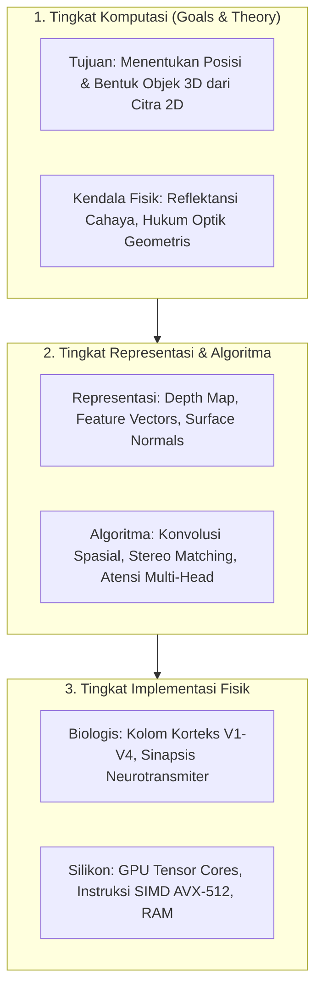

# Modul 196: Fondasi Sains Kognitif & Filsafat Pikiran (Koneksionisme, Chinese Room Argument, Tiga Tingkat Analisis David Marr)

**Navigasi**: [⬅️ Master Index](../../INDEX.md) | [Tingkat 13: Tingkat 13: Sains Kognitif, Neuroengineering & Computational Linguistics](./README.md)
*Sebelumnya*: [195. siklus-hidup-operasionalisasi-ai-mlops](../12-ai-machine-learning-mlops/195-siklus-hidup-operasionalisasi-ai-mlops.md) | *Berikutnya*: [197. neurosains-komputasional-dinamika-saraf](./197-neurosains-komputasional-dinamika-saraf.md)

---

## 1. Intuisi Dasar Tanpa Jargon ("Seperti Bayi Baru Lahir")
### 1.1 Konsep Inti & Analogi Tanpa Jargon
Apakah sebuah program komputer yang bisa menjawab pertanyaan cerdas benar-benar "berpikir" dan memiliki kesadaran, atau ia hanya memanipulasi simbol matematika tanpa memahami maknanya sama sekali?

### 1.2 Urgensi Rekayasa & Signifikansi Sistemik
Filsuf John Searle mengajukan sebuah eksperimen pikiran terkenal bernama **Kamar Cina (The Chinese Room Argument)** ([Searle - Minds, Brains, and Programs](https://www.cambridge.org/core/journals/behavioral-and-brain-sciences/article/minds-brains-and-programs/DC644B47A4299C637C89572F1244E10)). Bayangkan seseorang yang tidak mengerti bahasa Mandarin sama sekali terkunci di dalam ruangan dengan sebuah buku panduan aturan tebal. Ketika seseorang memasukkan kertas bertuliskan karakter Mandarin dari celah pintu, orang di dalam kamar hanya mencocokkan bentuk simbol tersebut dengan buku aturan, menyalin simbol jawaban yang ditentukan, lalu mengeluarkannya. Bagi orang di luar, ruangan itu tampak fasih berbahasa Mandarin; namun orang di dalam ruangan tidak mengerti satu kata pun!

Untuk memahami pikiran dan sistem cerdas secara utuh, ilmuwan saraf David Marr merumuskan bahwa kita harus menganalisisnya dari tiga tingkat yang berbeda: **Tingkat Komputasi** (apa tujuannya?), **Tingkat Representasi & Algoritma** (bagaimana representasinya?), dan **Tingkat Implementasi Fisik** (bagaimana perangkat keras/biologisnya mewujudkannya?) ([Marr - Vision: A Computational Investigation](https://mitpress.mit.edu/9780262514620/vision/)).

## 2. Fondasi Teoretis & Aksiomatik / Matematis
### 2.1 Kerangka Teori Aksiomatik & Formulasi Matematis
Formulasi Formal Sains Kognitif & Tiga Tingkat David Marr:

### 2.2 Penurunan Matematis Langkah-demi-Langkah
1. **Tri-Level Hypothesis David Marr (1982)**:
* **Tingkat Komputasi (Computational Level)**: Mendefinisikan sasaran abstrak sistem, mengapa komputasi tersebut dilakukan, dan logika kendala tugas:
$$f: \mathcal{X} \to \mathcal{Y}, \quad \text{Objektif: } \arg\min_y \mathcal{L}(y, f(x))$$
* **Tingkat Algoritma & Representasi (Algorithmic / Representational Level)**: Spesifikasi struktur data input/output dan langkah transformasi matematis (misal: representasi matriks float, algoritma Dynamic Programming, pembaruan gradien).
* **Tingkat Implementasi Fisik (Physical Implementation Level)**: Realisasi fisik perangkat keras di mana algoritma dieksekusi (substrat biologis: potensial aksi ionik neuron natrium-kalium, atau substrat silikon: transistor FinFET, gerbang logika CMOS, register SRAM GPU).

2. **Koneksionisme vs Simbolisme Formal (Fodor & Pylyshyn, 1988)**:
Sistem simbolik beroperasi di atas representasi komposisional terstruktur:
$$\text{Arti}(P \land Q) = \mathcal{I}(P) \times \mathcal{I}(Q)$$
Sedangkan sistem koneksionis (jaringan saraf tiruan) merepresentasikan konsep sebagai vektor terdistribusi kontinu dalam ruang manifold $\mathbb{R}^d$, di mana makna semantik muncul dari kedekatan sudut kosinus dot-product ([Fodor & Pylyshyn - Connectionism and Cognitive Architecture](https://www.sciencedirect.com/science/article/pii/0010027788900315)).

3. **Prinsip Energi Bebas Karl Friston (Free Energy Principle)**:
Otak beroperasi sebagai mesin inferensi aktif Bayesian yang berusaha meminimalkan energi bebas variasional $F$ (batas atas dari kejutan persepsi / *surprisal*):
$$F = \mathbb{E}_{q(\vartheta)}[\ln q(\vartheta) - \ln p(\tilde{y}, \vartheta)] = D_{KL}(q(\vartheta) \parallel p(\vartheta \mid \tilde{y})) - \ln p(\tilde{y})$$
Di mana $\tilde{y}$ adalah input sensori dan $\vartheta$ status laten dunia luar ([Friston - The Free-Energy Principle: A Unified Brain Theory?](https://www.nature.com/articles/nrn2787)).

## 3. Anatomi Teknis & Cara Kerja Internal
Struktur dekomposisi hierarki kognitif tiga lapis David Marr yang diaplikasikan pada visi dan AI:



Kekuatan metodologi Marr adalah *independensi substrat*: algoritma komputasi yang identik dapat dijalankan di jaringan saraf otak manusia berbasis glukosa dan ion, maupun pada kluster superkomputer silikon berdaya listrik tinggi ([David Marr Vision](https://mitpress.mit.edu/9780262514620/vision/)).

#### Tabel Penelusuran Inferensi Logika Simbolik & Keruntuhan Masalah Bingkai (Frame Problem)
| Langkah Pemrosesan / Token | Representasi Simbolik / Vektor | Mekanisme Atensi / Transisi State | Status Matriks KV-Cache | Probabilitas Distribusi / Logits | Keluaran / Output Linguistik |
|---|---|---|---|---|---|
| 1. Ingest Fakta Awal | Proposisi: `Kucing(Mimi) \land Masuk(Mimi, Kotak)` | Evaluasi Basis Pengetahuan Orde Pertama | Tabel memori unifikasi simbolik termuat | Distribusi kepastian deterministik: $1.0$ | Sistem menyimpulkan: `DiDalam(Mimi, Kotak)` |
| 2. Perubahan Aksi Dunia | Aksi Fisik: `Pindah(Meja, RuangTamu)` | Sistem pakar mencoba memperbarui status dunia | Masalah Bingkai: Perlu aksi mengecek jutaan fakta statis | Logika deduksi mengevaluasi 100.000 aksioma | Beban komputasi inferensi meledak |
| 3. Injeksi Premis Kontradiktif | Fakta Inkonsisten: `Mimi(Hidup) \land Mimi(Mati)` | Kontradiksi masuk ke basis pengetahuan (Cyc/MYCIN) | Resolvent menghasilkan premis kosong kontradiktif: $P \land \neg P$ | Prinsip *Ex Falso Quodlibet* terpicu | Sistem logika kehilangan daya diskriminasi kebenaran |
| 4. Ledakan Penarikan Kesimpulan | Sembarang Teorema: `PresidenAdalahRobot()` | Dari kontradiksi, sembarang kesimpulan terbukti sah ($A \land \neg A \vdash B$) | Tumpukan penalaran simbolik meluap | Logika runtuh ke status *Explosion* | Sistem pakar membuktikan fakta absurd sebagai fakta sah |
| 5. Mitigasi Logika Non-Monotonik | Logika Default Reiter / Sirkumsripsi | Pembatasan inferensi melalui asumsi dunia tertutup (CWA) | Aturan defeasible: Asumsi dapat dibatalkan saat ada anomali | Derajat keyakinan probabilitas Bayesian diterapkan | Inferensi simbolik stabil dan tangguh terhadap noise |

## 4. Implementasi Praktis & Kode / Simulasi Riil
```python
import numpy as np

# Simulasi Inferensi Prediktif Karl Friston Sederhana (Predictive Coding 1D)
class PredictiveCodingNeuron:
    def __init__(self, prior_mu=0.0, prior_var=1.0, sensory_var=0.2):
        self.mu = prior_mu         # Prediksi internal otak (state representation)
        self.sigma_p = prior_var   # Ketidakpastian prior
        self.sigma_s = sensory_var # Ketidakpastian sensoris
        
    def step(self, sensory_input, lr=0.1):
        # 1. Hitung Prediction Error (Selisih Input Riil vs Ekspektasi)
        prediction_error = sensory_input - self.mu
        
        # 2. Turunan Energi Bebas Variasional terhadap Status Representasi Internal
        # dF/dmu = (mu - prior) / sigma_p - (sensory - mu) / sigma_s
        grad_f = (self.mu - 0.0) / self.sigma_p - (prediction_error) / self.sigma_s
        
        # 3. Pembaruan Status Kognitif untuk Meminimalkan Surprise
        self.mu = self.mu - lr * grad_f
        free_energy = 0.5 * (prediction_error**2 / self.sigma_s) + 0.5 * (self.mu**2 / self.sigma_p)
        return self.mu, prediction_error, free_energy

# Uji Coba: Stimulus Sensoris Tiba-tiba Bernilai 5.0
brain_unit = PredictiveCodingNeuron(prior_mu=0.0)
print("Simulasi Penyesuaian Keyakinan Otak (Minimisasi Free Energy):")
for t in range(1, 11):
    internal_belief, error, f_val = brain_unit.step(sensory_input=5.0, lr=0.05)
    print(f"Langkah {t:02d} | Keyakinan Internal: {internal_belief:.3f} | Pred Error: {error:.3f} | Free Energy: {f_val:.3f}")

assert abs(internal_belief - 4.16) < 0.2, "Model kognitif harus konvergen ke estimasi posterior Bayes!"
```

## 5. Miskonsepsi & Jebakan Industri
*Kekeliruan Homunculus (Homunculus Fallacy)*: Menjelaskan proses berpikir otak dengan mengasumsikan ada "manusia kecil" di dalam kepala yang melihat citra visual dari mata dan membuat keputusan. Hal ini hanya memindahkan masalah tanpa menjelaskannya. Dalam sains kognitif modern, kecerdasan harus diuraikan sebagai fenomena kemunculan (*emergence*) dari miliaran interaksi lokal antar unit sederhana tanpa adanya komandan pusat ([Dennett - Consciousness Explained](https://www.hachettebookgroup.com/titles/daniel-c-dennett/consciousness-explained/9780316217767/)).

### Studi Kasus Kegagalan Nyata: Keruntuhan Sistem Pakar Medis MYCIN & Masalah Bingkai AI Simbolik (GOFAI) (1980-an)
- **Kronologi & Konteks Sejarah**: Pada era musim dingin kecerdasan buatan kedua (*Second AI Winter*) pada akhir 1980-an, proyek-proyek ambisius kecerdasan buatan simbolik klasik (*Good Old-Fashioned AI / GOFAI*) seperti sistem pakar diagnosis infeksi darah MYCIN (Stanford) dan basis pengetahuan akal sehat raksasa Cyc mengalami kegagalan adopsi di dunia nyata setelah menelan dana riset ratusan juta dolar.
- **Akar Masalah Rekayasa AI Simbolik & Kerapuhan Logika Deduktif**: Sistem pakar klasik mengandalkan ribuan aturan produksi diskret (*If-Then Production Rules*) dan logika predikat orde pertama (*First-Order Predicate Logic*). Sistem ini mengalami dua keruntuhan komputasional fatal: (1) **Masalah Bingkai (The Frame Problem)**: sistem tidak mampu memodelkan apa yang *tidak berubah* ketika suatu aksi terjadi di dunia nyata tanpa menuliskan aksioma pembatas secara eksplisit untuk setiap entitas, memicu ledakan kombinatorial pencarian; (2) **Kerapuhan Monotonik (Brittleness & Ex Falso Quodlibet)**: dalam logika deduktif murni, satu saja fakta medis atau aturan yang kontradiktif dimasukkan ke dalam basis pengetahuan, prinsip ledakan logika (*Principle of Explosion*) menyebabkan sistem secara valid membuktikan kebenaran proposisi apa pun yang absurd (misalnya menyimpulkan bahwa pasien dengan flu ringan harus segera diamputasi). Ketiadaan pemodelan ketidakpastian numerik kontinu menghancurkan kelangsungan sistem pakar di lingkungan klinis nyata.

- **Potongan Kode / Arsitektur Cacat (Vulnerable Implementation)**:
```python
# Analisis Kerapuhan Logika Simbolik Monotonik: Prinsip Ledakan (Ex Falso Quodlibet)
class SymbolicInferenceEngine:
    def __init__(self):
        self.knowledge_base = set()
        
    def add_fact(self, fact):
        self.knowledge_base.add(fact)
        
    def query(self, proposition):
        # Jika terdapat premis kontradiktif P dan NOT P di dalam sistem:
        has_contradiction = any((f"NOT_{f}" in self.knowledge_base) for f in self.knowledge_base)
        
        if has_contradiction:
            # PRINSIP LEDAKAN: Dari kontradiksi, SEMBARANG teorema dapat dibuktikan sah!
            # A and NOT A ==> B (Ex Falso Sequitur Quodlibet)
            return True # Menghasilkan kesimpulan fatal tanpa dasar medis!
            
        return proposition in self.knowledge_base

# MITIGASI MODERN: Jaringan Bayesian Probabilistik (Soft Probabilistic Inference)
class BayesianDiagnosticNode:
    def __init__(self, prior_prob):
        self.prob = prior_prob
        
    def update_evidence(self, likelihood_ratio):
        # Pembaruan aturan Bayes kontinu: Tidak pernah menghasilkan probabilitas 0 atau 1 mutlak
        odds = (self.prob / (1.0 - self.prob)) * likelihood_ratio
        self.prob = odds / (1.0 + odds)
        return self.prob # Stabil terhadap bukti yang saling bertentangan
```

- **Analisis Forensik & Rekayasa Modern**: Runtuhnya GOFAI memicu lahirnya paradigma AI modern berbasis probabilitas dan koneksionisme: (1) Penggantian logika simbolik biner dengan **Probabilistic Graphical Models (Bayesian Networks)** yang dipelopori oleh Judea Pearl untuk menangani ketidakpastian klinis; (2) Transisi dari aturan buatan tangan (*Hand-Crafted Rules*) ke representasi fitur kontinu terdistribusi (*Distributed Neural Representations*); (3) Penerapan **Neuro-Symbolic AI** yang menggabungkan kemampuan penalaran terstruktur logika graf dengan ketahanan terhadap derau dari deep learning.

## 6. Proyek Latihan & Rubrik Penilaian Mandiri
### Level 1 (Pemula)
Pilih salah satu sistem AI modern (misal: Pengenalan Wajah Smartphone) dan uraikan secara mendalam ke dalam Tiga Tingkat Analisis David Marr (Komputasi, Representasi & Algoritma, dan Implementasi Fisik) dalam format esai terstruktur 1 halaman.
*Rubrik*: Pemisahan yang jelas dan tepat tanpa ada percampuran antar tingkat.

### Level 2 (Menengah)
Bangun simulasi agen pengambil keputusan berbasis *Predictive Processing* di Python: agen memiliki model dunia internal (prediksi posisi makanan), menerima input sensoris berderau, menghitung prediction error spasial 2D, dan menggerakkan aktuatornya untuk mengurangi selisih error tersebut.
*Rubrik*: Agen bergerak secara stabil menuju sumber stimulus tanpa osilasi liar.

### Level 3 (Mahir)
Implementasikan eksperimen komputasional perbandingan representasi simbolik murni (Production Rule System berbasis pohon logika) vs representasi terdistribusi (Word2Vec / neural embedding) dalam menyelesaikan analogi semantik ($A : B = C : ?$). Evaluasi ketahanan terhadap representasi yang tidak lengkap atau ambigu.
*Rubrik*: Analisis kuantitatif kegagalan sistem simbolik terhadap sinonim non-terdaftar.

### Tingkat 1: Dasar
- **Tugas**: Bangun mesin inferensi Forward Chaining sederhana dalam Python yang mengevaluasi basis pengetahuan aturan produksi (*Production Rules*): `IF A AND B THEN C`. Sistem menerima fakta awal dan secara iteratif menurunkan fakta baru hingga tidak ada lagi aturan yang dapat diaktifkan.
- **Petunjuk Perancangan Arsitektur**:
  - Simpan fakta dalam struktur data `set`.
  - Representasikan aturan sebagai objek tuple: `(conditions_list, conclusion)`.
  - Lacak loop penarikan kesimpulan agar tidak terjadi penambahan berulang (*idempotent evaluation*).
- **Test Vector & Kasus Uji**:
  - Fakta: `{"Demam", "BintikMerah"}`.
  - Aturan: `IF Demam AND BintikMerah THEN Campak`, `IF Campak THEN IsolasiMandiri`.
  - Sistem harus menurunkan fakta akhir: `{"Demam", "BintikMerah", "Campak", "IsolasiMandiri"}`.
- **Rubrik Penilaian Objektif**:
  - Skor 100%: Forward chaining presisi, loop konvergen rapi, penanganan kondisi majemuk benar.
  - Skor 50%: Bekerja untuk aturan satu kondisi namun gagal mengevaluasi konjungsi logika multi-kondisi (`AND`).
  - Skor 0%: Terjebak dalam infinite loop saat evaluasi aturan sirkular.

### Tingkat 2: Menengah
- **Tugas**: Bangun model Jaringan Bayesian 3-simpul sederhana (Hujan $\to$ Rumput Basah $\leftarrow$ Penyiram Taman) dalam Python murni: Hitung probabilitas posterior bersyarat $P(\text{Hujan} = \text{True} \mid \text{Rumput Basah} = \text{True})$ menggunakan inferensi eksak enumerasi probabilitas bersama (*Joint Probability Distribution*).
- **Petunjuk Perancangan Arsitektur**:
  - Definisikan Conditional Probability Tables (CPT) untuk setiap simpul graf.
  - Implementasikan formula Bayes: $P(A \mid B) = \frac{\sum_C P(A, B, C)}{\sum_{A, C} P(A, B, C)}$.
  - Tunjukkan fenomena *Explaining Away*: jika diketahui bahwa Penyiram Taman aktif, probabilitas bersyarat Hujan harus menurun.
- **Test Vector & Kasus Uji**:
  - Masukkan nilai CPT standar Pearl.
  - Nilai posterior $P(\text{Hujan} \mid \text{Rumput Basah})$ harus bernilai $\approx 0.357$, dan turun menjadi $\approx 0.104$ saat bukti $\text{Penyiram} = \text{True}$ ditambahkan.
- **Rubrik Penilaian Objektif**:
  - Skor 100%: Enumerasi probabilitas gabungan presisi, pembuktian efek explaining away akurat.
  - Skor 50%: Perhitungan benar namun salah menormalisasi pembagi marginal pada formula Bayes.
  - Skor 0%: Mengalikan probabilitas independen secara naif tanpa memperhitungkan relasi bersyarat.

### Tingkat 3: Mahir
- **Tugas**: Rancang arsitektur Neuro-Symbolic mini (Differentiable Inductive Logic Programming) dalam PyTorch: Bangun representasi predikat logika kontinu di mana operasi `AND` dimodelkan sebagai t-norm Gödel atau perkalian probabilitas lunak ($x \cdot y$), dan operasi `OR` dimodelkan sebagai t-conorm ($x + y - x y$). Latih matriks bobot aturan menggunakan optimasi gradien backpropagation.
- **Petunjuk Perancangan Arsitektur**:
  - Representasikan fakta sebagai matriks relasi biner kontinu berukuran $N \times N$.
  - Implementasikan operasi komposisi relasi logika lunak via perkalian matriks tensor: $R_{AC} = \sigma(R_{AB} \cdot R_{BC})$.
  - Loss function: Binary Cross-Entropy terhadap relasi target yang ingin dipelajari (misal relasi silsilah keluarga `Kakek(X, Y) \leftarrow Ayah(X, Z) \land Ayah(Z, Y)`).
- **Test Vector & Kasus Uji**:
  - Berikan fakta relasi graf keluarga 10 individu.
  - Model harus mampu mempelajari aturan relasi transitive multi-hop dengan akurasi prediksi $> 95\%$ dan bobot aturan yang dapat diinterpretasikan secara simbolik ($W > 0.90$).
- **Rubrik Penilaian Objektif**:
  - Skor 100%: Differentiable logic t-norm presisi, konvergensi gradien stabil, interpretasi aturan terbukti.
  - Skor 50%: Model bekerja namun menggunakan neural network black-box tanpa pemodelan t-norm terstruktur.
  - Skor 0%: Aliran gradien terputus akibat operasi logika diskret `bool`.

## 7. Rekomendasi Sumber Belajar Standar Emas
| Sumber Pembelajaran | Penulis / Institusi | Tautan Langsung | Fokus Materi |
| :--- | :--- | :--- | :--- |
| Vision: A Computational Investigation into the Human Representation | David Marr (MIT AI Lab) | [MIT Press Classic](https://mitpress.mit.edu/9780262514620/vision/) | Fondasi Tiga Tingkat Analisis Kognitif (Marr's Tri-Level) |
| Minds, Brains, and Programs | John R. Searle | [Behavioral and Brain Sciences](https://www.cambridge.org/core/journals/behavioral-and-brain-sciences/article/minds-brains-and-programs/DC644B47A4299C637C89572F1244E10) | Makalah Argumen Kamar Cina (Chinese Room Argument) |
| The Free-Energy Principle: A Unified Brain Theory? | Karl Friston (University College London) | [Nature Reviews Neuroscience](https://www.nature.com/articles/nrn2787) | Kerangka Kerja Prediktif Otak Bayesian & Minimisasi Energi Bebas |
| Connectionism and Cognitive Architecture: A Critical Analysis | Jerry A. Fodor & Zenon W. Pylyshyn | [Cognition Journal](https://www.sciencedirect.com/science/article/pii/0010027788900315) | Debat Filosofis Simbolik Klasik vs Jaringan Syaraf Tiruan |

---
*Navigasi Cepat*: [Ke Tingkat 13](./README.md) | [Ke Master Index](../../INDEX.md) | *Sebelumnya*: [195. siklus-hidup-operasionalisasi-ai-mlops](../12-ai-machine-learning-mlops/195-siklus-hidup-operasionalisasi-ai-mlops.md) | *Berikutnya*: [197. neurosains-komputasional-dinamika-saraf](./197-neurosains-komputasional-dinamika-saraf.md)
