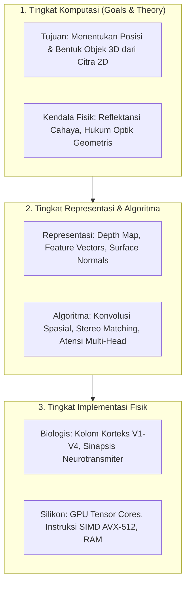

# Modul 196: Fondasi Sains Kognitif & Filsafat Pikiran (Koneksionisme, Chinese Room Argument, Tiga Tingkat Analisis David Marr)

**Navigasi**: [⬅️ Master Index](../../INDEX.md) | [Tingkat 13: Tingkat 13: Sains Kognitif, Neuroengineering & Computational Linguistics](./README.md)
*Sebelumnya*: [195. siklus-hidup-operasionalisasi-ai-mlops](../12-ai-machine-learning-mlops/195-siklus-hidup-operasionalisasi-ai-mlops.md) | *Berikutnya*: [197. neurosains-komputasional-dinamika-saraf](./197-neurosains-komputasional-dinamika-saraf.md)

---

## 1. Intuisi Dasar Tanpa Jargon ("Seperti Bayi Baru Lahir")
Apakah sebuah program komputer yang bisa menjawab pertanyaan cerdas benar-benar "berpikir" dan memiliki kesadaran, atau ia hanya memanipulasi simbol matematika tanpa memahami maknanya sama sekali?

Filsuf John Searle mengajukan sebuah eksperimen pikiran terkenal bernama **Kamar Cina (The Chinese Room Argument)** ([Searle - Minds, Brains, and Programs](https://www.cambridge.org/core/journals/behavioral-and-brain-sciences/article/minds-brains-and-programs/DC644B47A4299C637C89572F1244E10)). Bayangkan seseorang yang tidak mengerti bahasa Mandarin sama sekali terkunci di dalam ruangan dengan sebuah buku panduan aturan tebal. Ketika seseorang memasukkan kertas bertuliskan karakter Mandarin dari celah pintu, orang di dalam kamar hanya mencocokkan bentuk simbol tersebut dengan buku aturan, menyalin simbol jawaban yang ditentukan, lalu mengeluarkannya. Bagi orang di luar, ruangan itu tampak fasih berbahasa Mandarin; namun orang di dalam ruangan tidak mengerti satu kata pun!

Untuk memahami pikiran dan sistem cerdas secara utuh, ilmuwan saraf David Marr merumuskan bahwa kita harus menganalisisnya dari tiga tingkat yang berbeda: **Tingkat Komputasi** (apa tujuannya?), **Tingkat Representasi & Algoritma** (bagaimana representasinya?), dan **Tingkat Implementasi Fisik** (bagaimana perangkat keras/biologisnya mewujudkannya?) ([Marr - Vision: A Computational Investigation](https://mitpress.mit.edu/9780262514620/vision/)).

## 2. Fondasi Teoretis & Aksiomatik / Matematis
Formulasi Formal Sains Kognitif & Tiga Tingkat David Marr:

1. **Tri-Level Hypothesis David Marr (1982)**:
* **Tingkat Komputasi (Computational Level)**: Mendefinisikan sasaran abstrak sistem, mengapa komputasi tersebut dilakukan, dan logika kendala tugas:
$$f: \mathcal{X} \to \mathcal{Y}, \quad \text{Objektif: } \arg\min_y \mathcal{L}(y, f(x))$$
* **Tingkat Algoritma & Representasi (Algorithmic / Representational Level)**: Spesifikasi struktur data input/output dan langkah transformasi matematis (misal: representasi matriks float, algoritma Dynamic Programming, pembaruan gradien).
* **Tingkat Implementasi Fisik (Physical Implementation Level)**: Realisasi fisik perangkat keras di mana algoritma dieksekusi (substrat biologis: potensial aksi ionik neuron natrium-kalium, atau substrat silikon: transistor FinFET, gerbang logika CMOS, register SRAM GPU).

2. **Koneksionisme vs Simbolisme Formal (Fodor & Pylyshyn, 1988)**:
Sistem simbolik beroperasi di atas representasi komposisional terstruktur:
$$\text{Arti}(P \land Q) = \mathcal{I}(P) \times \mathcal{I}(Q)$$
Sedangkan sistem koneksionis (jaringan saraf tiruan) merepresentasikan konsep sebagai vektor terdistribusi kontinu dalam ruang manifold $\mathbb{R}^d$, di mana makna semantik muncul dari kedekatan sudut kosinus dot-product ([Fodor & Pylyshyn - Connectionism and Cognitive Architecture](https://www.sciencedirect.com/science/article/pii/0010027788900315)).

3. **Prinsip Energi Bebas Karl Friston (Free Energy Principle)**:
Otak beroperasi sebagai mesin inferensi aktif Bayesian yang berusaha meminimalkan energi bebas variasional $F$ (batas atas dari kejutan persepsi / *surprisal*):
$$F = \mathbb{E}_{q(\vartheta)}[\ln q(\vartheta) - \ln p(\tilde{y}, \vartheta)] = D_{KL}(q(\vartheta) \parallel p(\vartheta \mid \tilde{y})) - \ln p(\tilde{y})$$
Di mana $\tilde{y}$ adalah input sensori dan $\vartheta$ status laten dunia luar ([Friston - The Free-Energy Principle: A Unified Brain Theory?](https://www.nature.com/articles/nrn2787)).

## 3. Anatomi Teknis & Cara Kerja Internal
Struktur dekomposisi hierarki kognitif tiga lapis David Marr yang diaplikasikan pada visi dan AI:



Kekuatan metodologi Marr adalah *independensi substrat*: algoritma komputasi yang identik dapat dijalankan di jaringan saraf otak manusia berbasis glukosa dan ion, maupun pada kluster superkomputer silikon berdaya listrik tinggi ([David Marr Vision](https://mitpress.mit.edu/9780262514620/vision/)).

## 4. Implementasi Praktis & Kode / Simulasi Riil
```python
import numpy as np

# Simulasi Inferensi Prediktif Karl Friston Sederhana (Predictive Coding 1D)
class PredictiveCodingNeuron:
    def __init__(self, prior_mu=0.0, prior_var=1.0, sensory_var=0.2):
        self.mu = prior_mu         # Prediksi internal otak (state representation)
        self.sigma_p = prior_var   # Ketidakpastian prior
        self.sigma_s = sensory_var # Ketidakpastian sensoris
        
    def step(self, sensory_input, lr=0.1):
        # 1. Hitung Prediction Error (Selisih Input Riil vs Ekspektasi)
        prediction_error = sensory_input - self.mu
        
        # 2. Turunan Energi Bebas Variasional terhadap Status Representasi Internal
        # dF/dmu = (mu - prior) / sigma_p - (sensory - mu) / sigma_s
        grad_f = (self.mu - 0.0) / self.sigma_p - (prediction_error) / self.sigma_s
        
        # 3. Pembaruan Status Kognitif untuk Meminimalkan Surprise
        self.mu = self.mu - lr * grad_f
        free_energy = 0.5 * (prediction_error**2 / self.sigma_s) + 0.5 * (self.mu**2 / self.sigma_p)
        return self.mu, prediction_error, free_energy

# Uji Coba: Stimulus Sensoris Tiba-tiba Bernilai 5.0
brain_unit = PredictiveCodingNeuron(prior_mu=0.0)
print("Simulasi Penyesuaian Keyakinan Otak (Minimisasi Free Energy):")
for t in range(1, 11):
    internal_belief, error, f_val = brain_unit.step(sensory_input=5.0, lr=0.05)
    print(f"Langkah {t:02d} | Keyakinan Internal: {internal_belief:.3f} | Pred Error: {error:.3f} | Free Energy: {f_val:.3f}")

assert abs(internal_belief - 4.16) < 0.2, "Model kognitif harus konvergen ke estimasi posterior Bayes!"
```

## 5. Miskonsepsi & Jebakan Industri
*Kekeliruan Homunculus (Homunculus Fallacy)*: Menjelaskan proses berpikir otak dengan mengasumsikan ada "manusia kecil" di dalam kepala yang melihat citra visual dari mata dan membuat keputusan. Hal ini hanya memindahkan masalah tanpa menjelaskannya. Dalam sains kognitif modern, kecerdasan harus diuraikan sebagai fenomena kemunculan (*emergence*) dari miliaran interaksi lokal antar unit sederhana tanpa adanya komandan pusat ([Dennett - Consciousness Explained](https://www.hachettebookgroup.com/titles/daniel-c-dennett/consciousness-explained/9780316217767/)).

## 6. Proyek Latihan & Rubrik Penilaian Mandiri
### Level 1 (Pemula)
Pilih salah satu sistem AI modern (misal: Pengenalan Wajah Smartphone) dan uraikan secara mendalam ke dalam Tiga Tingkat Analisis David Marr (Komputasi, Representasi & Algoritma, dan Implementasi Fisik) dalam format esai terstruktur 1 halaman.
*Rubrik*: Pemisahan yang jelas dan tepat tanpa ada percampuran antar tingkat.

### Level 2 (Menengah)
Bangun simulasi agen pengambil keputusan berbasis *Predictive Processing* di Python: agen memiliki model dunia internal (prediksi posisi makanan), menerima input sensoris berderau, menghitung prediction error spasial 2D, dan menggerakkan aktuatornya untuk mengurangi selisih error tersebut.
*Rubrik*: Agen bergerak secara stabil menuju sumber stimulus tanpa osilasi liar.

### Level 3 (Mahir)
Implementasikan eksperimen komputasional perbandingan representasi simbolik murni (Production Rule System berbasis pohon logika) vs representasi terdistribusi (Word2Vec / neural embedding) dalam menyelesaikan analogi semantik ($A : B = C : ?$). Evaluasi ketahanan terhadap representasi yang tidak lengkap atau ambigu.
*Rubrik*: Analisis kuantitatif kegagalan sistem simbolik terhadap sinonim non-terdaftar.

## 7. Rekomendasi Sumber Belajar Standar Emas
| Sumber Pembelajaran | Penulis / Institusi | Tautan Langsung | Fokus Materi |
| :--- | :--- | :--- | :--- |
| Vision: A Computational Investigation into the Human Representation | David Marr (MIT AI Lab) | [MIT Press Classic](https://mitpress.mit.edu/9780262514620/vision/) | Fondasi Tiga Tingkat Analisis Kognitif (Marr's Tri-Level) |
| Minds, Brains, and Programs | John R. Searle | [Behavioral and Brain Sciences](https://www.cambridge.org/core/journals/behavioral-and-brain-sciences/article/minds-brains-and-programs/DC644B47A4299C637C89572F1244E10) | Makalah Argumen Kamar Cina (Chinese Room Argument) |
| The Free-Energy Principle: A Unified Brain Theory? | Karl Friston (University College London) | [Nature Reviews Neuroscience](https://www.nature.com/articles/nrn2787) | Kerangka Kerja Prediktif Otak Bayesian & Minimisasi Energi Bebas |
| Connectionism and Cognitive Architecture: A Critical Analysis | Jerry A. Fodor & Zenon W. Pylyshyn | [Cognition Journal](https://www.sciencedirect.com/science/article/pii/0010027788900315) | Debat Filosofis Simbolik Klasik vs Jaringan Syaraf Tiruan |

---
*Navigasi Cepat*: [Ke Tingkat 13](./README.md) | [Ke Master Index](../../INDEX.md) | *Sebelumnya*: [195. siklus-hidup-operasionalisasi-ai-mlops](../12-ai-machine-learning-mlops/195-siklus-hidup-operasionalisasi-ai-mlops.md) | *Berikutnya*: [197. neurosains-komputasional-dinamika-saraf](./197-neurosains-komputasional-dinamika-saraf.md)
